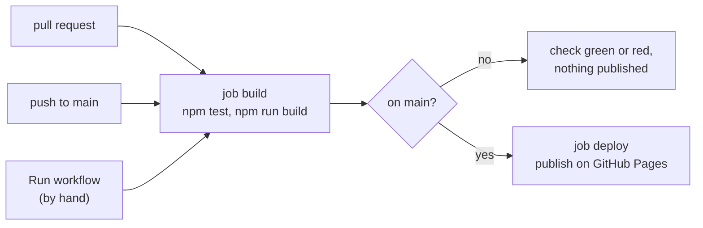

# The reading site

`tools/site` turns the notes under `topics/` into a website for reading: <https://thomaswening.github.io/doubting-thomas/>. The Markdown stays the source. GitHub keeps rendering it as before, and nothing in a note has to change for the site.

The site adds what GitHub's layout cannot give:

- a text column of comfortable width;
- definitions, propositions and theorems in boxes;
- maths rendered by [KaTeX](https://katex.org);
- display settings that each browser remembers: theme, contrast, font, text size, line spacing, text width, space around equations, and whether long equations shrink or scroll;
- a contents panel, and a full-screen button where the browser allows it.

## When it runs and what a failure blocks

The workflow [site.yml](../../.github/workflows/site.yml) runs on every pull request, on every push to `main`, and by hand (*Actions → site → Run workflow*).



- **On a pull request**, the job `build` runs the tests and builds the site. A failure turns the pull request's check red. Nothing is published.
- **On `main`**, the job `deploy` then publishes the build. If `build` fails, the site keeps showing the last good version.

## Rules

### Rule 1: every formula renders in KaTeX

**Every formula in a note must be one that KaTeX can render.** GitHub renders maths with MathJax, the site with KaTeX. The two accept almost the same LaTeX, but not quite. A formula that only one of them can render shows up red on the other.

The build renders every formula and collects the ones KaTeX rejects. For each, it prints a line, and the build fails:

```text
error: topics/qft/example.md: KaTeX cannot render "\\frac{a": KaTeX parse error: Unexpected end of input in a macro argument, expected '}' at end of input: \frac{a
```

| Case | Reported | Accepted |
|---|---|---|
| Unbalanced braces | `` $`\frac{a`$ `` | `` $`\frac{a}{b}`$ `` |
| A macro KaTeX does not know | `` $`\slashed{p}`$ `` | `` $`\not{p}`$ `` |
| A Unicode symbol in maths | Not reported. KaTeX draws it from the body font, so check that it looks right. | `` $`\qquad ∎`$ `` |

### Rule 2: the tests pass

**`npm test` passes.** The tests in [test/](test/) pin down how the site reads a note: which Markdown becomes maths, a box or a folded proof, and how links and heading anchors are rewritten. A failure means a change to [src/](src/) broke one of these. Each test is named after the behaviour it checks.

## How the site reads a note

The site follows the conventions of [AGENTS.md](../../AGENTS.md). A note written by those rules looks right on both GitHub and the site.

| In the note | On the site |
|---|---|
| `` $`…`$ ``, `$…$` or `$$…$$` in a sentence | inline maths |
| a ` ```math ` block, or a paragraph that holds only `` $`\displaystyle …`$ `` | a displayed equation, which shrinks or scrolls when it is too wide |
| a paragraph that starts with `**Definition`, `**Proposition`, `**Theorem`, `**Lemma` or `**Corollary` | a box, with the label on a line of its own. Displayed equations right after the paragraph belong to the box. |
| a paragraph that starts with `*Proof idea.*` | set off by a line on the left |
| `<details><summary>Proof</summary>` or `Solution` | a folded block with an arrow |
| the list under `## Key claims` | claims with C1, C2, … in the margin |
| a ` ```mermaid ` block | a diagram, redrawn when the theme changes |
| a link to another note, `x.md#c3` | a link to its page, `x.html#c3` |
| a link out of `topics/`, such as `../../AGENTS.md` | a link to the file on GitHub |
| headings | the same anchors as on GitHub, so `#key-claims` works on both |

Only `topics/` is published. `results/`, `backlog.md`, the templates and the rules stay on GitHub.

## When it fails

Open the failed run (*Details* next to the check) and the step that is red.

- **Step "Build"**: each `error:` line names the note and the formula. Fix the formula in the note. Check that GitHub still renders it, because the note must work on both.
- **Step "Test"**: the failing test's name says which behaviour broke. Undo or fix the change in `src/`.
- **Step "npm ci"**: `package-lock.json` does not match `package.json`. Run `npm install` locally and commit both files.
- **Job "deploy"**: GitHub Pages is not set up, or not available for the repository. See "Setting up GitHub Pages" below.

There are no exemptions. A formula that GitHub and KaTeX both cannot render is wrong either way.

## Running it locally

From `tools/site`, with Node 22:

```bash
npm ci
npm test
npm run build
```

The site lands in `tools/site/_site`, which Git ignores. To read it, serve the folder, for example with `python -m http.server 8123 -d _site`, and open <http://localhost:8123>.

## Setting up GitHub Pages

This is needed once, by the repository's owner: *Settings → Pages → Build and deployment → Source: GitHub Actions*. On a free GitHub plan, Pages needs a public repository. With GitHub Pro, a private repository can publish too, and the site is still public.

## Files

| File | What it is |
|---|---|
| [src/build.mjs](src/build.mjs) | the entry point: reads every note, writes its page, copies the assets |
| [src/markdown.mjs](src/markdown.mjs) | Markdown to HTML: maths, boxes, folded blocks, heading anchors |
| [src/links.mjs](src/links.mjs) | how links between notes are rewritten |
| [template.html](template.html) | the page around each note: the bar, the panels, the column |
| [assets/reader.css](assets/reader.css) | the look: themes, type, boxes |
| [assets/reader.js](assets/reader.js) | the settings, the panels, full screen, fitting long equations, the diagrams |
| [package.json](package.json) | the pinned dependencies: markdown-it, KaTeX, Mermaid and three fonts, all served from the site itself |
