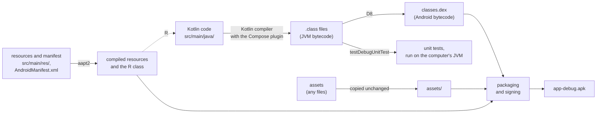

# From sources to an APK

## TL;DR

- **Gradle** runs the build. The **Android Gradle Plugin** (AGP) adds the Android steps, as the .NET SDK adds its targets to MSBuild.
- The **Kotlin compiler** turns Kotlin into `.class` files of JVM bytecode, as Roslyn turns C# into IL. **D8** then converts them into **dex**, the only bytecode Android runs. On the phone, the Android runtime compiles dex to machine code.
- **aapt2** compiles the resources and the manifest. It generates the class `R`, whose fields are integer IDs of the resources, like a generated `Resources.Designer.cs`.
- **Assets** are copied into the APK unchanged. **Packaging** zips everything into the APK and signs it: a debug build with the computer's debug key, a release with the release key.
- **Unit tests** run on the computer's own JVM against the `.class` files. They need no dex and no phone.

## Key claims

- <a id="c1"></a>**C1.** Gradle itself knows nothing about Android. The Android Gradle Plugin adds the tasks that build an APK, such as `assembleDebug`, as the .NET SDK's targets give MSBuild a `Build` target.
- <a id="c2"></a>**C2.** The Kotlin compiler produces `.class` files containing bytecode for the Java virtual machine (JVM). This is the counterpart of Roslyn producing IL in an assembly. The Compose compiler plugin runs inside the Kotlin compiler and rewrites the functions marked `@Composable`, which draw the screens.
- <a id="c3"></a>**C3.** Android does not run JVM bytecode. D8 converts the `.class` files into dex files (`classes.dex`), Android's own bytecode, which is what the APK contains.
- <a id="c4"></a>**C4.** On the phone, the Android runtime (ART) compiles dex to machine code, partly while the app runs and partly ahead of time in the background. The .NET runtime does the same with IL.
- <a id="c5"></a>**C5.** aapt2 compiles the resources (`res/`) and the manifest (`AndroidManifest.xml`) into a binary form. It generates the class `R`, with one integer constant per resource, such as `R.string.app_name`. Code names a resource through `R`, as C# code names a `.resx` entry through its generated `Resources.Designer.cs`.
- <a id="c6"></a>**C6.** Files in `assets/` are copied into the APK unchanged. They get no `R` entry: code opens them by their path, as with a content file copied by `CopyToOutputDirectory`.
- <a id="c7"></a>**C7.** Packaging zips the dex files, the compiled resources, the manifest and the assets into the APK and signs it. A debug build is signed with a debug key that the Android SDK creates on each computer. A release build is signed with the release key named in the build file's signing configuration.
- <a id="c8"></a>**C8.** Android installs an update only if it is signed with the same key as the installed app. A debug build therefore cannot replace a release, or the other way round, while both use the same application ID.
- <a id="c9"></a>**C9.** Local unit tests (`src/test/`, task `testDebugUnitTest`) run on the computer's JVM against the `.class` files. They need no dex, no phone and no emulator. Tests that must run on Android are instrumented tests in `src/androidTest/`.

## Explanation

### Gradle and its plugin

Gradle is a general build tool, like MSBuild. It runs tasks and knows which task needs which. On its own it can't build an Android app ([C1](#c1)). A plugin, declared in the build file, adds the Android tasks. The Android Gradle Plugin is to Gradle what the .NET SDK's targets are to MSBuild: a `.csproj` with `Sdk="Microsoft.NET.Sdk"` gets `Build`, `Publish` and `Test` from the SDK, not from MSBuild. In the same way, `./gradlew assembleDebug` runs a task that the plugin added.

How Gradle's own files map to a .NET solution (the wrapper, the version catalog, modules) is the subject of the note on Gradle versus MSBuild.

### Five tools, one APK

`assembleDebug` runs a chain of tools. Each arrow below is one tool, each box a set of files. The diagram follows [Skip the Fluff](https://github.com/thomaswening/skip-the-fluff)'s development notes, with one arrow added: the `R` class is generated before the Kotlin code is compiled, because the code refers to it.



| Step | Tool | .NET counterpart |
|---|---|---|
| Run the build | Gradle with the Android Gradle Plugin | MSBuild with the .NET SDK's targets |
| Compile code | Kotlin compiler, plus the Compose plugin | Roslyn, plus source generators |
| Convert bytecode | D8: `.class` to dex | none: IL runs as it is |
| Compile resources | aapt2, which generates `R` | `.resx` compilation and `Resources.Designer.cs` |
| Copy assets | the plugin, unchanged | `CopyToOutputDirectory` |
| Package and sign | the plugin, with the debug or release key | `dotnet publish` and code signing |
| Unit tests | JUnit on the computer's JVM | `dotnet test` |

### Two bytecodes

Kotlin was made for the JVM, so its compiler writes JVM bytecode: `.class` files, one per class, as Roslyn writes IL ([C2](#c2)). A JVM is to Java bytecode what the .NET runtime is to IL. But Android has no JVM. Its runtime, ART, reads dex, a different bytecode designed for phones. So D8 converts every `.class` file, including those of every library, into dex ([C3](#c3)). .NET has no such step: the IL that Roslyn writes is the IL that runs.

On the phone, ART compiles dex to machine code ([C4](#c4)). Like the .NET JIT, it compiles while the app runs. It also compiles the most used code ahead of time while the phone is idle, somewhat like ReadyToRun.

The Compose compiler plugin is a part of the Kotlin compiler, not a separate step ([C2](#c2)). It rewrites every `@Composable` function so that Compose can call it again when its data changes. A C# source generator only adds code. The Compose plugin changes the functions themselves.

### Resources and the R class

Resources are texts, images, layouts and similar files in `res/`, sorted into folders by kind (`values/`, `drawable/`). The manifest tells Android what it must know before the app starts: its ID, its screens, its permissions. aapt2 compiles both into a binary form that Android reads quickly ([C5](#c5)).

aapt2 also gives every resource an integer ID and generates the class `R` with one constant per resource. `R.string.app_name` is such an ID. Code passes it to Android, which looks up the text in the right language for the phone ([C5](#c5)). This is why the Kotlin compiler runs after aapt2: the code refers to `R`.

Assets are the opposite: files that Android doesn't interpret. They are copied as they are into the APK's `assets/` folder, get no ID, and are opened by their path ([C6](#c6)). Skip the Fluff ships its JavaScript and JSON files this way.

### Packaging and signing

An APK is a zip file: `classes.dex`, the compiled resources, the binary manifest and the assets. Packaging builds the zip and signs it ([C7](#c7)). A debug build is signed automatically with a debug key that the Android SDK creates on first use on each computer. A release is signed with the release key, which the build file names in a signing configuration. Without one, a release build is left unsigned and can't be installed.

The key matters because Android accepts an update only from the same key ([C8](#c8)). A debug build and a release with the same application ID block each other: one can be installed only after uninstalling the other, which deletes the app's data. Projects therefore often give the debug build its own ID, for example by appending `.debug`, so that both install side by side.

### Unit tests skip the phone

Local unit tests in `src/test/` are compiled to `.class` files like the app and run on the computer's own JVM ([C9](#c9)). D8 never sees them. That is why they run in seconds and need no phone, like `dotnet test`. Their limit: Android's own classes are only stubs there. Code that needs a real Android goes into instrumented tests in `src/androidTest/`, which are dexed, installed and run on a phone or an emulator.

## Examples

The tasks that `./gradlew assembleDebug --console=plain` prints as it runs are the steps above. The list is abridged. Gradle may run independent tasks in another order. Compiling always waits for `R`. Packaging always comes last.

```text
> Task :app:mergeDebugResources        aapt2 compiles each resource
> Task :app:processDebugResources      aapt2 links them, writes the manifest and R
> Task :app:compileDebugKotlin         Kotlin compiler, with the Compose plugin
> Task :app:dexBuilderDebug            D8 converts .class files to dex
> Task :app:mergeDexDebug              D8 merges the dex files
> Task :app:mergeDebugAssets           assets are collected unchanged
> Task :app:packageDebug               the APK is zipped and signed with the debug key
> Task :app:assembleDebug
```

Task names contain the build variant (`Debug`). The release build runs `compileReleaseKotlin`, `packageRelease` and so on. The exact list changes between plugin versions.

## Pitfalls

- **`R.string.app_name` is not the text.** It is an `Int`, the resource's ID. The text comes from passing it to Android, as `stringResource(R.string.app_name)` in Compose. `Resources.Designer.cs`, in contrast, returns the string itself ([C5](#c5)).
- **"Kotlin runs on the JVM" is not true on the phone.** It is true during the build and for unit tests. On the phone, the code runs as dex on ART ([C3](#c3), [C9](#c9)).
- **A release build without a signing configuration** produces an unsigned APK, which no phone installs ([C7](#c7)).
- **Installing a debug build over a release** (or the other way round) fails with the same application ID, since the keys differ ([C8](#c8)).

## Sources

- Skip the Fluff, [`docs/development.md`, "How the sources become an APK"](https://github.com/thomaswening/skip-the-fluff/blob/main/docs/development.md#how-the-sources-become-an-apk), and the parts table below it. Set up in [PR 14](https://github.com/thomaswening/skip-the-fluff/pull/14), merged 9 November 2026.
- Android Developers: [Configure your build](https://developer.android.com/build), [d8](https://developer.android.com/tools/d8), [AAPT2](https://developer.android.com/tools/aapt2), [App resources overview](https://developer.android.com/guide/topics/resources/providing-resources), [Sign your app](https://developer.android.com/studio/publish/app-signing), [Build local unit tests](https://developer.android.com/training/testing/local-tests).
- Android Open Source Project: [ART and Dalvik](https://source.android.com/docs/core/runtime).
