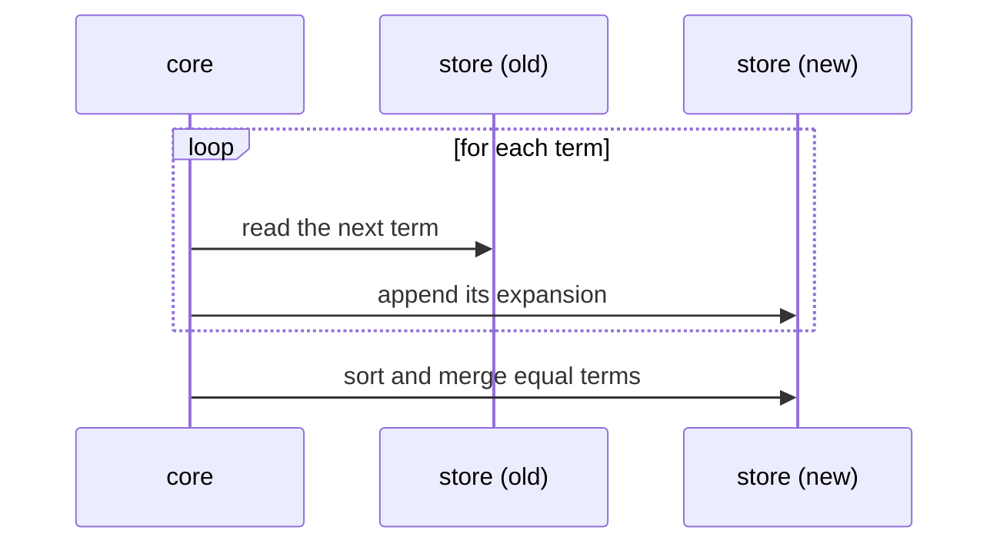

# Static and runtime views of an architecture

## TL;DR

- One diagram cannot show everything about a system. Architecture documents use several **views**, each answering one question.
- The **static view** (arc42: building-block view) shows which parts exist and which may use which. It is true at every moment.
- The **runtime view** shows what the parts do, in order, during one concrete scenario. It is usually a sequence diagram.
- A static arrow means "may use". A runtime arrow means "calls, at this point in time".
- Some properties are visible only at run time, for example that no step ever holds the whole data set in memory.

## Key claims

- **C1.** A static view shows the parts of a system and their allowed dependencies. It contains no time and no order of events.
- **C2.** A runtime view shows how the parts interact, in order, during one concrete scenario, such as running one script or handling one request.
- **C3.** In a sequence diagram each participant is a vertical lifeline, each arrow is a message or call from one participant to another, and time runs from top to bottom.
- **C4.** An arrow in a static dependency diagram means "may use" and is a rule. An arrow in a sequence diagram means "calls at this moment" and is an event.
- **C5.** A runtime view covers only the scenario it draws. It illustrates the design, and it does not prove a property holds in every case.
- **C6.** arc42 has a building-block view (section 5) and a runtime view (section 6) as separate sections. Kruchten's 4+1 model (1995) similarly separates a logical, a development, a process and a physical view, tied together by scenarios.

## Explanation

### Why more than one picture

Think of a .NET solution. Its project references form a graph: the web project references the services, which reference the data layer, and nothing references back. That graph is the static view ([C1](#c1)). It says what *may* happen. It does not say what *does* happen when a request arrives.

To see that, you step through one request in the debugger: the controller calls the service, which opens a transaction, which calls the repository twice, which commits. Drawing that walk is the runtime view ([C2](#c2)).

Both are needed. A reviewer who sees only the project references cannot tell that a request makes two database round trips. A reviewer who sees only the walk cannot tell whether the controller is allowed to call the repository directly.

### Reading a sequence diagram

A sequence diagram is the usual form of a runtime view ([C3](#c3)). Read it like a debugger's call log turned into a picture:

- each column (lifeline) is one participant: an object, component or process;
- each horizontal arrow is one call or message, labelled with what is passed;
- earlier events are higher up;
- a `loop` box repeats its contents, and a note marks something left open or explained.

The arrows mean something different from the arrows in a dependency graph ([C4](#c4)). "A → B" in the static view is a permission that holds forever. "A → B" in a sequence diagram happened once, at that height.

### What only the runtime view shows

In Tante, the static view shows `tante_core` and the expression store as two boxes with an arrow between them. The runtime view of `expand E` shows the core reading one term from the old store, appending its expansion to a new store, and repeating. It never holds the whole expression. That is the property that lets the store move to disk later ([streaming interfaces](streaming-interfaces.md)). The static view cannot show it, because it has no notion of "one at a time".

The runtime view only shows the scenario it draws ([C5](#c5)). That a script with one statement streams does not prove that all statements do. The rule that makes it true for all of them is a static one: the store's interface has no "give me everything" operation.

### Views in the standard outlines

arc42 makes these two separate sections, 5 and 6 ([C6](#c6)), and adds a deployment view (section 7) for where the parts run. Kruchten's "4+1" view model, from 1995, is the older ancestor of this idea. Its four views are logical, development, process and physical, plus scenarios that tie them together.

## Examples

A runtime view in Mermaid, which GitHub renders:

The matching static view is a single arrow `core --> store`, meaning "the core may use the store".

## Pitfalls

- **Reading a static arrow as a call.** "The API may use the parser" does not mean every API call parses something ([C4](#c4)).
- **Drawing every scenario.** A runtime view is for the one or two scenarios that explain the design, not a test suite in pictures.
- **Generalising from one scenario** ([C5](#c5)).
- **Mixing both in one diagram.** Numbered arrows on a component diagram try to be both views and end up as neither.

## Sources

- [Tante, `docs/architecture.md` §5 and §6](https://github.com/thomaswening/Tante/blob/main/docs/architecture.md#6-runtime-view), [pull request #10](https://github.com/thomaswening/Tante/pull/10); Claude session on Tante, 2026-10-25.
- [arc42, section 5: Building block view](https://docs.arc42.org/section-5/) and [section 6: Runtime view](https://docs.arc42.org/section-6/).
- P. Kruchten, "The 4+1 View Model of Architecture", *IEEE Software* 12(6), 1995.
- [Mermaid sequence diagrams](https://mermaid.js.org/syntax/sequenceDiagram.html).
