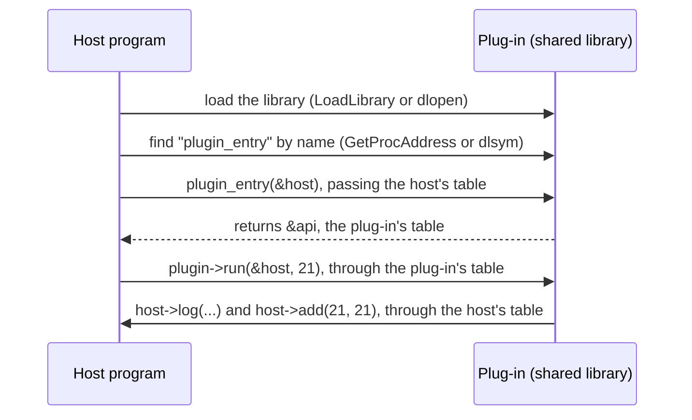

# Tables of function pointers

## TL;DR

- A **table of function pointers** is a struct whose fields are function pointers. It is C's version of an interface: whoever fills the table decides which functions run.
- It is needed when one piece of code must call another it **isn't linked against**, the usual case being a plug-in loaded at run time.
- A plug-in exports one entry function, found by name. Everything else travels through tables: the host passes in a table of its services, and the plug-in returns a table of what it provides.
- Tables are extended only by **appending** fields, and they carry their size or version, so that old plug-ins keep working with new hosts and the other way round.
- C++ virtual functions and COM interfaces are built from the same idea.

## Key claims

- <a id="c1"></a>**C1.** A struct whose fields are function pointers lets code call functions chosen at run time by whoever filled the struct; the caller needs neither the functions' names nor a link to the code behind them, much as code calling a C# interface needs no knowledge of the implementing class.

- <a id="c2"></a>**C2.** A plug-in loaded at run time typically exports a single entry function, which the host finds by name (`GetProcAddress` on Windows, `dlsym` elsewhere); the host passes it a table of the host's services, and it returns a table, or a description containing one, of what the plug-in provides.

- <a id="c3"></a>**C3.** Functions in such a table usually take a handle or context pointer as a parameter, to say which object they act on; the handle plays the role of `this`.

- <a id="c4"></a>**C4.** To extend a table without breaking plug-ins already compiled against it, new fields are added only at the end, never inserted or reordered, and the table records its size or version so that code compiled against a newer header can check whether a field exists before calling it.

- <a id="c5"></a>**C5.** Calling a null function pointer is undefined behaviour, so a table with optional entries must document which may be null, and callers must check those entries before calling them.

- <a id="c6"></a>**C6.** C++ compilers commonly implement virtual functions with a table of function pointers per class (the vtable) and a hidden pointer to it in each object; the C++ standard does not specify this layout, which is one reason C++ classes do not form a stable boundary between compilers, while a C struct of function pointers does.

- <a id="c7"></a>**C7.** A COM interface pointer points to an object whose first field points to a table of function pointers with a fixed layout, beginning with `QueryInterface`, `AddRef` and `Release`; because that layout is defined at the binary level, COM objects can be used across compilers and languages, .NET included.

- <a id="c8"></a>**C8.** A function that other code reaches only through a table of function pointers can be declared `static` (internal linkage), because the caller gets its address from the table, not by name; only the plug-in's entry function must be visible by name.

## Explanation

### Why a table

Ordinarily a program calls a library's function by name, and the linker connects the call to the code ([opaque handles](opaque-handles.md) works like that). That needs the library at link time. A plug-in is built separately and loaded while the program runs, so neither side can name the other's functions in advance. What they can share is a struct layout, declared in a common header: a list of function pointers in a fixed order ([C1](#c1)). One side fills the struct with its own functions, the other calls through it.

This is the C counterpart of programming against an interface. A C# class that receives an `ILogger` neither knows nor cares which class implements it; a C plug-in that receives a `host_api*` neither knows nor cares which functions are behind `host->log`.

### The handshake

Something must be found by name, or nothing could start. That is the plug-in's single **entry function** ([C2](#c2)). The host loads the shared library, looks the entry function up with `GetProcAddress` or `dlsym`, and calls it with a pointer to its own table of services. The plug-in answers with a table describing what it provides: its name, its version, its functions. From then on all calls in both directions go through the two tables.

The [example](#examples) below does exactly this, with a host that offers `log` and `add` and a plug-in called `doubler`. Solid arrows are calls, the dashed arrow is a return value:



Only the first two steps use a name. Every later call goes through a field of a table, so the functions behind the fields need no visible name at all: they can be `static` in their own source file ([C8](#c8)). `static` on a function at file scope gives it **internal linkage**: the name is known only inside that source file, much like a C# type declared with the `file` modifier. Other source files, and the linker, cannot refer to it by name.

Functions in the tables usually take a handle, so that they know which object they're working on ([C3](#c3)): [Tante](https://github.com/thomaswening/Tante)'s `host->rational_add(a, b)` takes two `tante_rational*` handles, and a plug-in's `run` function might take the host's session handle. This is the [object-as-handle](opaque-handles.md#c9) pattern again, with the method found through a table instead of by name.

### Growing a table safely

A plug-in compiled last year knows the table as it was then: field 0 is `log`, field 1 is `add`, at fixed offsets. If the host inserted a new field at the front, every old plug-in would call the wrong function. So tables only grow at the end ([C4](#c4)). An old plug-in then simply never looks at the new fields. The reverse case, a new plug-in on an old host, is handled by a size or version field at the start: before calling a newer function, the plug-in checks that the table it was given is long enough to contain it. Windows API structs with a `cbSize` first field, and SQLite's table for loadable extensions, follow this rule.

Optional functions may be left null, which the documentation must say, because calling a null function pointer is undefined behaviour in C, not an exception ([C5](#c5)).

### The same idea in C++ and COM

When a C++ class has virtual functions, compilers usually give the class a hidden table of function pointers, the **vtable**, and each object a hidden pointer to it; a virtual call looks the function up in the table ([C6](#c6)). It is the pattern above, generated automatically. But the standard leaves the details to the compiler, which is one reason C++ classes don't make a stable boundary between compilers and an explicit C table does ([ABI note](../cpp/abi-and-shared-libraries.md)).

COM fixes such a table at the binary level ([C7](#c7)). A COM interface pointer points to an object whose first field points to a table; the table always starts with `QueryInterface`, `AddRef` and `Release`, followed by the interface's own methods. Since every compiler can produce that layout, a COM object written in C++ can be used from C, from Visual Basic, or from C# through COM interop.

## Examples

A host and a plug-in in one file, so that it runs as it stands. In real use the code comes from three places, marked in the comments:

- **The shared header** declares the two struct types and nothing else. Both the host and the plug-in include it, so both agree on the layout of the tables. It is the only code they share.
- **The plug-in's source** is compiled into the shared library. It defines `double_it` and `plugin_entry`.
- **The host's source** is compiled into the program that loads the library. It defines `host_log`, `host_add` and `main`, which fills a `host_api` with the host's functions. Instead of calling `plugin_entry` directly, the real host finds it with `dlsym` or `GetProcAddress`.

```c
#include <stdio.h>

/* ==== shared header: included by both the host and the plug-in ==== */

/* What the host offers to plug-ins. */
typedef struct host_api {
    unsigned size;                       /* sizeof(host_api) as the host knew it */
    void (*log)(const char* message);
    int  (*add)(int a, int b);
} host_api;

/* What a plug-in offers to the host. */
typedef struct plugin_api {
    const char* name;
    int (*run)(const host_api* host, int input);
} plugin_api;

/* ==== plug-in source: compiled into the shared library ==== */

/* static: internal linkage, the name is private to this source file.
   The host reaches double_it only through api.run. */
static int double_it(const host_api* host, int input)
{
    host->log("plugin: doubling");
    return host->add(input, input);      /* calls the host through its table */
}

const plugin_api* plugin_entry(const host_api* host)   /* the one function found by name, so not static */
{
    /* static inside a function means something else: api lives as long as
       the program, so returning its address is safe. */
    static const plugin_api api = { "doubler", double_it };
    host->log("plugin: loaded");
    return &api;
}

/* ==== host source: compiled into the program that loads the library ==== */

/* static: internal linkage again. The plug-in reaches these only through the host_api table. */
static void host_log(const char* message) { printf("[log] %s\n", message); }
static int  host_add(int a, int b) { return a + b; }

int main(void)
{
    host_api host = { sizeof(host_api), host_log, host_add };
    const plugin_api* plugin = plugin_entry(&host);
    printf("%s: %d\n", plugin->name, plugin->run(&host, 21));
    return 0;
}
```

Expected output:

```
[log] plugin: loaded
[log] plugin: doubling
doubler: 42
```

Version 2 of the shared header gives the host a new service, `multiply`, which multiplies two integers. Its function pointer is appended as the last field ([C4](#c4)). A plug-in built against version 2 may still be loaded by a host built against version 1, whose table ends after `add`. So before calling `multiply`, the plug-in checks that the host's table is long enough to contain it:

```c
#include <stddef.h>                      /* offsetof and NULL */

typedef struct host_api {
    unsigned size;
    void (*log)(const char* message);
    int  (*add)(int a, int b);
    int  (*multiply)(int a, int b);      /* new in version 2: appended, never inserted */
} host_api;

int square(const host_api* host, int x)
{
    /* offsetof(host_api, multiply): how many bytes from the start of the struct the field begins.
       sizeof(host->multiply): the size of the field itself, one function pointer.
       A version 1 host set size to sizeof of its shorter struct, which ends where multiply would begin. */
    size_t needed = offsetof(host_api, multiply) + sizeof(host->multiply);
    if (host->size >= needed && host->multiply != NULL)
        return host->multiply(x, x);     /* the host is new enough */
    int result = 0;                      /* older host: fall back on add */
    for (int i = 0; i < x; ++i) result = host->add(result, x);
    return result;
}
```

With a version 2 host, `square(&host, 5)` calls `multiply(5, 5)`. With a version 1 host it adds 5 five times. Both return 25. `offsetof` is the C counterpart of .NET's `Marshal.OffsetOf`.

## Pitfalls

- Inserting or reordering fields in a published table: every plug-in compiled against the old layout calls the wrong functions ([C4](#c4)).
- Calling an optional entry without checking it for null ([C5](#c5)).
- Assuming the plug-in can call host functions by name: it isn't linked against the host, so only the entry function is found by name and everything else must come through a table ([C2](#c2)).
- Reading the two `static`s in the example as one thing: on a function at file scope, `static` means internal linkage ([C8](#c8)); on a variable inside a function, it means the variable lives as long as the program instead of being destroyed when the function returns ([stack and heap](stack-and-heap.md#c1)).
- Confusing the table with the handles passed through it: the table holds functions, the handles stand for objects ([opaque handles](opaque-handles.md#c11)).

## Sources

- Claude session on [Tante](https://github.com/thomaswening/Tante), 2026-10-20, from Thomas's review of the [opaque handles note](https://github.com/thomaswening/doubting-thomas/pull/2), on the engine function table `tante_host` of [Tante ADR-0004](https://github.com/thomaswening/Tante/pull/1).
- SQLite: [run-time loadable extensions](https://www.sqlite.org/loadext.html), whose extensions call SQLite through a table of function pointers.
- Microsoft Learn: [COM interface pointers and interfaces](https://learn.microsoft.com/en-us/windows/win32/com/interface-pointers-and-interfaces), [GetProcAddress](https://learn.microsoft.com/en-us/windows/win32/api/libloaderapi/nf-libloaderapi-getprocaddress).
- cppreference: [offsetof](https://en.cppreference.com/w/c/types/offsetof).
