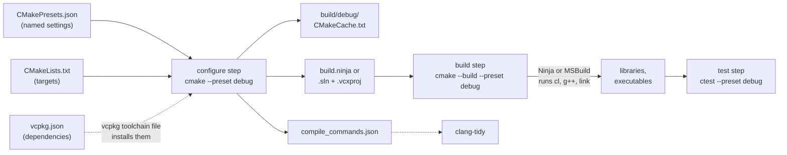

# The CMake build pipeline, from Make to vcpkg and CTest

## TL;DR

- A **build system** such as Make or Ninja runs the compiler and linker commands of [Compiling and linking C++ by hand](../cpp/compiling-and-linking.md) in the right order. It reruns only what a change affects.
- **CMake** is not a build system but a generator of build systems. Its **configure** step reads `CMakeLists.txt` and writes build files for Ninja, Visual Studio or Make. Its **build** step runs that tool. MSBuild does both jobs in .NET.
- A CMake project is a set of **targets** (libraries, executables). `PUBLIC`, `PRIVATE` and `INTERFACE` decide which settings, such as include directories, pass on to the targets that link a target. This is like a transitive `PackageReference`.
- **vcpkg** in manifest mode is CMake's NuGet: `vcpkg.json` lists the packages, its **baseline** fixes their versions, the **toolchain file** hooks it into CMake's configure step and the **triplet** chooses platform and linkage.
- **CTest** runs the tests a project registers and counts exit code 0 as passed. A test framework such as **Catch2** writes the tests. **Presets** name the configurations, so CI can run a matrix of them.

## Key claims

- <a id="c1"></a>**C1.** Make rebuilds a target when one of its listed prerequisites is newer than it (file modification time). It knows only the dependencies it is told, so a header missing from the list leaves objects stale. GCC and Clang can write the list with `-MMD`.
- <a id="c2"></a>**C2.** CMake works in two steps. The configure step (`cmake -S <source> -B <build>`) reads `CMakeLists.txt` and writes, into the build directory, the build files for a generator (Ninja, Visual Studio, Unix Makefiles) and the cache `CMakeCache.txt`. The build step (`cmake --build <build>`) runs the generator's tool, which calls the compiler and the linker.
- <a id="c3"></a>**C3.** Ninja and Unix Makefiles are single-configuration generators: the build type (Debug, Release) is fixed at configure time by `CMAKE_BUILD_TYPE`. Visual Studio and Ninja Multi-Config are multi-configuration generators: the build type is chosen at build time with `--config`, and `CMAKE_BUILD_TYPE` is ignored.
- <a id="c4"></a>**C4.** A property set on a target with `PRIVATE` applies only to building that target. `INTERFACE` applies only to targets that link it. `PUBLIC` applies to both. `target_link_libraries` passes `PUBLIC` and `INTERFACE` properties on to the linking target, and further along chains of `PUBLIC` links.
- <a id="c5"></a>**C5.** `find_package(fmt CONFIG REQUIRED)` loads the CMake file that an installed package provides (`fmt-config.cmake`). That file defines imported targets such as `fmt::fmt`. Linking one brings its include directories and library files, as with a target of the project's own.
- <a id="c6"></a>**C6.** `CMakePresets.json` names configure, build and test settings (generator, build directory, cache variables, toolchain file), so `cmake --preset <name>` replaces a long command line. It is committed. Personal presets go into `CMakeUserPresets.json`, which is not.
- <a id="c7"></a>**C7.** With `CMAKE_EXPORT_COMPILE_COMMANDS=ON`, the configure step writes `compile_commands.json`, the exact compiler command for each source file. Only the Ninja and Makefile generators write it. clang-tidy and the clangd language server read it to parse each file as the compiler does.
- <a id="c8"></a>**C8.** In vcpkg's manifest mode, `vcpkg.json` lists a project's dependencies. Its `builtin-baseline`, a commit of the vcpkg repository, fixes the version of every package. Passing vcpkg's `scripts/buildsystems/vcpkg.cmake` as CMake's toolchain file makes the configure step install the packages into the build directory, where `find_package` finds them. The toolchain file must be set before the first `project()` call, so changing it needs a fresh build directory.
- <a id="c9"></a>**C9.** A vcpkg triplet names the target architecture, operating system and linkage, such as `x64-windows` (DLLs), `x64-windows-static` (static libraries, static runtime) or `x64-linux` (static libraries). vcpkg caches each built package under a hash of its inputs (version, triplet, compiler, dependencies) and restores it instead of building again.
- <a id="c10"></a>**C10.** CTest runs the commands registered with `add_test` and counts a test as passed when it exits with code 0, unless properties such as `WILL_FAIL` or `PASS_REGULAR_EXPRESSION` say otherwise. Catch2's `catch_discover_tests` registers each `TEST_CASE` of a test executable as its own CTest test.

## Explanation

### Terms used

| Term | Meaning | Closest .NET idea |
|---|---|---|
| Build system | A tool that runs build commands in dependency order and skips what is up to date: Make, Ninja, MSBuild. | MSBuild |
| Generator | CMake's back end that writes the files for one build system. | none |
| Target | A library or executable that CMake builds, with its sources and settings. | a project (`.csproj`) |
| Usage requirement | A setting (include directory, macro, linked library) that a target passes on to the targets that link it. | what a `PackageReference` passes on transitively |
| Toolchain file | A CMake script read before anything else, which sets the compiler or, for vcpkg, hooks in the package manager. | none |
| Port | A vcpkg package recipe: where the source is and how to build it. | a NuGet package, but built from source |
| Triplet | vcpkg's name for one target platform and linkage, e.g. `x64-windows`. | a runtime identifier (`win-x64`) |
| Preset | A named set of CMake settings in `CMakePresets.json`. | a build configuration plus its MSBuild properties |

### Why a build system

The commands in the note on compiling and linking are fine for two files. A real project has hundreds. After a change, only the affected files should be recompiled, then everything relinked. Working out which files those are is the build system's job.

Make is the oldest one still in use. A `Makefile` lists rules: a target, its prerequisites and the command that makes it.

```make
app: main.o greet.o
	$(CXX) main.o greet.o -o app

main.o: main.cpp greet.h
	$(CXX) $(CXXFLAGS) -c main.cpp
```

Make compares file times ([C1](#c1)). If `greet.h` is newer than `main.o`, it recompiles `main.o`, then relinks `app`. If nothing changed, it says `'app' is up to date.` ([Example 1](#example-1-make)).

Nobody writes Makefiles by hand for portable C++ any more. There are four reasons:

- **Header dependencies.** Each object depends on every header it includes, transitively. Keeping that list by hand fails sooner or later. Compilers can write it (`-MMD`), but the Makefile must then read the files back in.
- **Compilers differ.** `g++ -c -Wall -o main.o` is `cl /c /W4 /Fomain.obj` on Windows. Static libraries are `.a` or `.lib`. A Makefile would need two versions of every rule.
- **Platforms differ.** Windows has no Make by default. Visual Studio wants a solution. Xcode wants a project.
- **Libraries.** Finding an installed library, its headers and its link flags on each system is work no one wants to repeat.

### CMake writes the build system

CMake solves this with one more level. A project describes *what* to build, in `CMakeLists.txt`, independent of the compiler. CMake translates that into the files of a real build system ([C2](#c2)):



Solid arrows are the three steps a developer runs. Dotted arrows are what tools hook in: vcpkg during configure, clang-tidy reading the compile commands.

- **Configure** runs CMake's own language. It detects the compiler, runs `find_package`, evaluates every `if()` and writes the build files. Its results are cached in `CMakeCache.txt`, so the next run is fast. Errors here are CMake errors: a missing package, a typo in a target name.
- **Build** runs Ninja, MSBuild or Make on those files. Errors here are compiler and linker errors. When `CMakeLists.txt` changes, the build step reruns the configure step on its own.

.NET has no separate configure step. MSBuild reads the `.csproj` and builds in one go. The closest analogy is that CMake plays the SDK's role (`Microsoft.NET.Sdk` turning a short project file into build logic) while Ninja plays MSBuild's (running the tasks).

Everything CMake writes goes into the build directory, apart from the sources. This is called an *out-of-source build*. Deleting the build directory is always safe and is the cure for a confused cache. One source tree can have several build directories: one per compiler, one per build type.

A **generator** is the build system CMake writes for ([C3](#c3)):

| Generator | Writes | Build type chosen | Default on |
|---|---|---|---|
| Ninja | `build.ninja` | at configure, `CMAKE_BUILD_TYPE` | none (must be named) |
| Unix Makefiles | `Makefile` | at configure, `CMAKE_BUILD_TYPE` | Linux, macOS |
| Visual Studio 18 2026 | `.sln` and `.vcxproj` files for MSBuild | at build, `--config Release` | Windows with Visual Studio |
| Ninja Multi-Config | `build-<Config>.ninja` | at build, `--config Release` | none |

Ninja is the usual choice where it is available. It is fast and small. Visual Studio itself opens CMake projects directly (*Open Folder*) and uses Ninja behind the scenes.

### Targets and usage requirements

Modern CMake is written in targets. `add_library` and `add_executable` create them. Every setting is attached to a target with a `target_…` command ([Example 2](#example-2-a-cmake-project-with-a-test)):

```cmake
add_library(greet src/greet.cpp)                  # a library target
target_include_directories(greet PUBLIC src)      # greet's headers live in src/
target_compile_features(greet PUBLIC cxx_std_20)  # C++20 for greet and its users

add_executable(app src/main.cpp)
target_link_libraries(app PRIVATE greet)          # app uses greet
```

The keyword decides who gets the setting ([C4](#c4)):

| Keyword | Used to build the target itself | Passed to targets that link it | Typical use |
|---|---|---|---|
| `PRIVATE` | yes | no | a macro only the `.cpp` files need; a library used only inside the implementation |
| `INTERFACE` | no | yes | a header-only library, which has nothing to build |
| `PUBLIC` | yes | yes | the directory of the library's public headers; a library whose types appear in the public headers |

`target_link_libraries(app PRIVATE greet)` does more than add `greet.lib` to the link. It gives `app` every `PUBLIC` and `INTERFACE` setting of `greet`: here the include directory `src` and C++20. CMake calls these settings *usage requirements*. They flow on through `PUBLIC` links: if `greet` linked `fmt` with `PUBLIC`, `app` would get `fmt`'s include directory too. With `PRIVATE`, the chain stops at `greet`.

The .NET counterpart is a `PackageReference`. It is transitive by default, like `PUBLIC`. `PrivateAssets="all"` stops it from flowing on, like `PRIVATE`. The difference: in C++ the choice is per setting, and it matters at compile time, because headers are pasted in as text. If `greet.h` includes a header of `fmt`, every user of `greet` needs `fmt`'s include directory, so `fmt` must be `PUBLIC`.

The older style, still common in tutorials, sets flags for everything at once: `include_directories(...)`, `add_definitions(...)`, `CMAKE_CXX_FLAGS`. It works but leaks settings into targets that do not need them.

### Finding packages

A library installed somewhere comes into a project through `find_package` ([C5](#c5)). In *config mode* the package ships a file `<name>-config.cmake` (or `<Name>Config.cmake`) which defines imported targets, named `namespace::name` by convention:

```cmake
find_package(fmt CONFIG REQUIRED)
target_link_libraries(demo PRIVATE fmt::fmt)
```

Linking `fmt::fmt` is all it takes: the target carries its include directories, its library files for Debug and Release, and its own usage requirements. A `::` in a name means an imported target. CMake then fails at configure time if the target doesn't exist, instead of passing `-lfmt::fmt` to the linker.

Where do packages come from? They can be installed by the system (`apt install libfmt-dev`), built by hand, fetched as source during configure (`FetchContent`), or come from a package manager.

### Presets and compile commands

A configure command for a real project is long: generator, build directory, build type, toolchain file, warnings as errors, sanitizers. `CMakePresets.json` gives such a combination a name ([C6](#c6)):

```json
{
  "version": 6,
  "configurePresets": [
    {
      "name": "debug",
      "generator": "Ninja",
      "binaryDir": "${sourceDir}/build/debug",
      "cacheVariables": {
        "CMAKE_BUILD_TYPE": "Debug",
        "CMAKE_EXPORT_COMPILE_COMMANDS": "ON"
      }
    }
  ],
  "buildPresets": [{ "name": "debug", "configurePreset": "debug" }],
  "testPresets": [{ "name": "debug", "configurePreset": "debug" }]
}
```

Then `cmake --preset debug`, `cmake --build --preset debug` and `ctest --preset debug` configure, build and test. Presets can inherit from hidden base presets, so a matrix of compilers and build types stays short. Visual Studio, VS Code and CLion list the presets in their toolbar. `CMakeUserPresets.json` holds a developer's own presets and is listed in `.gitignore`.

`compile_commands.json` lists the full compiler command for every source file ([C7](#c7)). Tools that must understand the code exactly as the compiler does read it: clang-tidy, the clangd language server, some IDEs. Without it they would not know the include directories, macros or language standard, and every `#include` would look broken. It is written by the Ninja and Makefile generators only. A project on Windows that wants it uses Ninja.

### Dependencies with vcpkg

C++ had no standard package manager for most of its life. Today two are common: **vcpkg** (Microsoft, builds from source, integrated with CMake and Visual Studio) and **Conan** (JFrog, with its own Python-based recipes and binary repositories). Both solve the same problem. This note covers vcpkg.

vcpkg is a git repository of *ports*, recipes that download a library's source and build it with your compiler. Building from source avoids the ABI and runtime problems of [Compiling and linking](../cpp/compiling-and-linking.md#c7): every library is compiled with the same compiler and settings as the project.

In **manifest mode**, the project declares its dependencies in `vcpkg.json` next to `CMakeLists.txt` ([C8](#c8)):

```json
{
  "dependencies": [ "fmt" ],
  "builtin-baseline": "c52f7bd748185ef0e0daf033d9f2ddfc8a3449ea"
}
```

| vcpkg | .NET |
|---|---|
| `vcpkg.json`, `"dependencies"` | `<PackageReference>` items in the `.csproj` |
| `builtin-baseline` | one commit of the vcpkg repository that fixes the version of every package. Same baseline, same versions on every machine: close to `packages.lock.json`. |
| `"overrides"` | pinning one package to an exact version |
| `vcpkg.cmake` as the toolchain file | the NuGet restore that `dotnet build` runs first |
| triplet | runtime identifier (`win-x64`, `linux-x64`) |
| binary cache | the global packages folder `~/.nuget/packages` |

The **toolchain file** connects vcpkg with CMake. It is passed as `CMAKE_TOOLCHAIN_FILE`, on the command line or in a preset, and CMake reads it before the first `project()`. In manifest mode it then runs `vcpkg install` during the configure step. The packages land in `<build>/vcpkg_installed/<triplet>/`, where `find_package` looks. The first configure on a new machine therefore takes long, since every library is compiled. Later ones take seconds.

A **triplet** names what to build for ([C9](#c9)). `x64-windows` builds DLLs against the dynamic runtime. `x64-windows-static` builds static libraries against the static runtime (`/MT`). `x64-windows-static-md` builds static libraries against the dynamic runtime (`/MD`), a common middle way. `x64-linux` and `arm64-osx` build static libraries by default.

**Binary caching** makes rebuilds cheap ([C9](#c9)). vcpkg hashes everything that goes into a package build (the port's version, the triplet, the compiler, the hashes of its dependencies) and stores the result as a zip under that hash. On Windows the default cache is `%LOCALAPPDATA%\vcpkg\archives`. A CI pipeline points `VCPKG_BINARY_SOURCES` at a folder that it keeps between runs, or at a NuGet feed, so it builds each library once.

### Tests and tooling on top

**CTest** is CMake's test runner ([C10](#c10)). `enable_testing()` (or `include(CTest)`) switches it on. `add_test(NAME greet_test COMMAND greet_test)` registers a command. `ctest` runs all registered commands and reports which exited with 0. A test is any program. This is the role of `dotnet test` as a runner.

A **test framework** writes the tests themselves: assertions, test cases, a `main` that runs them. Catch2 is a common choice, like xUnit:

```cpp
#include <catch2/catch_test_macros.hpp>
#include "greet.h"

TEST_CASE("greet puts the name between Hello and !", "[greet]")
{
    REQUIRE(greet("test") == "Hello, test!");
}
```

(This snippet was not compiled for the note. Tante's tests have the same shape.) Linking `Catch2::Catch2WithMain` supplies `main`. `catch_discover_tests(<target>)` asks the test executable for its test cases and registers each one with CTest ([C10](#c10)). `ctest -R greet` then runs single cases. Tags such as `[greet]` can become CTest labels, so `ctest -L greet` selects by tag.

Two clang tools complete the picture:

- **clang-format** reformats code by the rules in a committed `.clang-format` file. In CI it runs with `--dry-run --Werror` and fails on any difference. The .NET counterpart is `dotnet format` with `.editorconfig`.
- **clang-tidy** is a linter with checks for bugs, modern style and the C++ Core Guidelines, configured in `.clang-tidy`. It needs `compile_commands.json` ([C7](#c7)). The .NET counterpart is the Roslyn analysers. Details: [Static analysis for C++](../cpp/static-analysis.md).

**Continuous integration** runs presets. A GitHub Actions *matrix* starts one job per operating system. Each job runs `cmake --preset`, `cmake --build --preset` and `ctest --preset` for its presets: release, then a sanitizer build ([Sanitizers](../cpp/sanitizers.md)). Separate jobs run clang-tidy and clang-format.

### A real project: Tante

[Tante](https://github.com/thomaswening/Tante)'s build skeleton ([PR 19](https://github.com/thomaswening/Tante/pull/19)) uses every layer of this note. A tour, file by file:

- **`CMakeLists.txt`** sets `CMAKE_CXX_STANDARD 20` with `CMAKE_CXX_EXTENSIONS OFF` for the whole project, so the compiler gets `-std=c++20` rather than GCC's dialect `-std=gnu++20`. It adds `cmake/` to the module path and calls `add_subdirectory` for each target's folder. `include(CTest)` turns on testing.
- **`src/api/CMakeLists.txt`** creates `tante_api` as a `STATIC` library. Its include directory `include/` is `PUBLIC`, so `tante` (the command-line tool) can include `tante/version.hpp`. The macro with the version string is `PRIVATE`: only `version.cpp` sees it ([C4](#c4)).
- **`cmake/TanteCompilerOptions.cmake`** defines `tante_apply_guardrails(<target>)`. It adds `/W4 /permissive- /utf-8` for MSVC or `-Wall -Wextra -Wpedantic -Wconversion -Wsign-conversion -Wshadow` for GCC and Clang, all `PRIVATE`, so Tante's warnings never leak into code that uses it. With the option `TANTE_SANITIZE` it adds ASan and UBSan flags to compiling and linking.
- **`CMakePresets.json`** has hidden base presets (`base` with the vcpkg toolchain file, `CMAKE_COMPILE_WARNING_AS_ERROR` and the compile commands) and visible ones that combine a system with a build type, such as `linux-gcc-asan` ([C6](#c6)). The Windows presets name no generator, so CMake takes Visual Studio, a multi-configuration generator. That is why their build and test presets set `"configuration": "Debug"` ([C3](#c3)). The vcpkg triplet there is `x64-windows-static-md`.
- **`vcpkg.json`** lists one dependency, `catch2`, with a `builtin-baseline` ([C8](#c8)).
- **`tests/CMakeLists.txt`** finds Catch2, builds `tante_tests` and registers its cases with `catch_discover_tests(... ADD_TAGS_AS_LABELS)`. It also registers two tests of the tool itself: `tante --version` must print the version (`PASS_REGULAR_EXPRESSION`), and an unknown option must fail (`WILL_FAIL`) ([C10](#c10)).
- **`.github/workflows/ci.yml`** runs a matrix of Windows, Linux and macOS, each with a release and a sanitizer preset. Its composite action `setup-vcpkg` clones vcpkg at the baseline commit and keeps the binary cache between runs ([C9](#c9)). Separate jobs run clang-tidy on the `linux-clang-tidy` preset's compile commands, and clang-format.

### What to know and what to look up

Covering both this note and [Compiling and linking C++ by hand](../cpp/compiling-and-linking.md):

| Layer | Must know (to read and review build changes) | Can look up or leave to tools |
|---|---|---|
| Preprocessor | `#include` pastes text; quotes against angle brackets; include directories | macro tricks; the exact search order |
| Compiler | one translation unit at a time; declaration against definition | most flags; code generation |
| Linker | resolves symbols; the two link errors and their usual causes | linker scripts; symbol visibility details |
| Libraries | static against shared; DLL exports and import libraries; why C++ types across a DLL are fragile | rpath details; `.def` files |
| MSVC runtimes | `/MD` against `/MDd`; what `LNK2038` means | `/MT` against `/MD` trade-offs beyond "match them" |
| Flags | standard, warnings, `-Werror`, optimisation, debug info, `NDEBUG`, sanitizers | everything else |
| Make | rules, prerequisites, file times | Make's own language; nobody writes it by hand for C++ |
| CMake | configure against build; targets; `PRIVATE`, `PUBLIC`, `INTERFACE`; `find_package`; presets | generator expressions (`$<…>`); policies; install and export rules |
| vcpkg | manifest, baseline, toolchain file, triplet | writing ports; overlay triplets; registries |
| Tests and tools | CTest counts exit codes; Catch2 test cases; what clang-tidy and clang-format check | Catch2's matchers and generators; clang-tidy check options |
| CI | a matrix of presets; why each system runs | the YAML of a particular workflow |

## Examples

Examples 1 and 2 ran on 11 November 2026: Make 4.3 and CMake 3.28.3 with GCC 13.3 on WSL (Ubuntu 24.04), and the CMake 4.3 that ships with Visual Studio 2026, with Ninja and MSVC 19.51. Example 3 was not run (see its text).

### Example 1: Make

The files `greet.h`, `greet.cpp` and `main.cpp` are those of [Compiling and linking, Example 2](../cpp/compiling-and-linking.md#example-2-two-files-and-the-linker).

```make
# Makefile. Recipe lines start with a tab, not spaces.
CXX      = g++
CXXFLAGS = -std=c++20 -Wall -Wextra

app: main.o greet.o
	$(CXX) main.o greet.o -o app

main.o: main.cpp greet.h
	$(CXX) $(CXXFLAGS) -c main.cpp

greet.o: greet.cpp greet.h
	$(CXX) $(CXXFLAGS) -c greet.cpp
```

```text
$ make
g++ -std=c++20 -Wall -Wextra -c main.cpp
g++ -std=c++20 -Wall -Wextra -c greet.cpp
g++ main.o greet.o -o app
$ make
make: 'app' is up to date.
$ touch greet.h && make
g++ -std=c++20 -Wall -Wextra -c main.cpp
g++ -std=c++20 -Wall -Wextra -c greet.cpp
g++ main.o greet.o -o app
$ touch greet.cpp && make
g++ -std=c++20 -Wall -Wextra -c greet.cpp
g++ main.o greet.o -o app
```

A change to the header recompiles both files. A change to `greet.cpp` recompiles only that file ([C1](#c1)). `g++ -MMD -c main.cpp` writes `main.d` with the line `main.o: main.cpp greet.h`: the dependency list the compiler found itself.

### Example 2: a CMake project with a test

```text
CMakeLists.txt
CMakePresets.json        (the preset shown under "Presets and compile commands")
src/greet.h
src/greet.cpp
src/main.cpp
tests/greet_test.cpp
```

```cmake
cmake_minimum_required(VERSION 3.28)
project(Greeter LANGUAGES CXX)

add_library(greet src/greet.cpp)
target_include_directories(greet PUBLIC src)
target_compile_features(greet PUBLIC cxx_std_20)

add_executable(app src/main.cpp)
target_link_libraries(app PRIVATE greet)

enable_testing()
add_executable(greet_test tests/greet_test.cpp)
target_link_libraries(greet_test PRIVATE greet)
add_test(NAME greet_test COMMAND greet_test)
```

```cpp
// tests/greet_test.cpp: a test without a framework
#include "greet.h"

int main()
{
    return greet("test") == "Hello, test!" ? 0 : 1; // exit code 0 means passed
}
```

On Windows, in a Developer PowerShell (Visual Studio ships CMake and Ninja):

```text
cmake --preset debug
cmake --build --preset debug
ctest --preset debug
```

On Linux without Ninja, the same project with the Makefile generator:

```bash
cmake -S . -B build/linux -G "Unix Makefiles" -DCMAKE_BUILD_TYPE=Debug -DCMAKE_EXPORT_COMPILE_COMMANDS=ON
cmake --build build/linux
ctest --test-dir build/linux
```

Expected end of the output, on both (the time varies):

```text
    Start 1: greet_test
1/1 Test #1: greet_test .......................   Passed    0.00 sec

100% tests passed, 0 tests failed out of 1
```

The test file lives in `tests/`, away from `greet.h`. It finds the header only because `greet` publishes `src` as a `PUBLIC` include directory and `greet_test` links `greet` ([C4](#c4)). Change `PUBLIC` to `PRIVATE` in `target_include_directories`, and the build of `greet_test` fails:

```text
tests/greet_test.cpp:1:10: fatal error: greet.h: No such file or directory
```

(`app` still builds: `main.cpp` sits next to `greet.h`, and a quoted `#include` looks in the including file's directory first.)

The first entry of `build/linux/compile_commands.json` ([C7](#c7)):

```json
{
  "directory": "/tmp/bp/cmk/build/linux",
  "command": "/usr/bin/c++  -I/tmp/bp/cmk/src -g -std=gnu++20 -o CMakeFiles/greet.dir/src/greet.cpp.o -c /tmp/bp/cmk/src/greet.cpp",
  "file": "/tmp/bp/cmk/src/greet.cpp",
  "output": "CMakeFiles/greet.dir/src/greet.cpp.o"
}
```

Two things show here. The build type Debug became `-g`. `cxx_std_20` became `-std=gnu++20`, GCC's dialect with extensions, because the project did not set `CMAKE_CXX_EXTENSIONS OFF`.

With Ninja and C++20, the build log starts with lines such as `Scanning greet.cpp for CXX dependencies`. CMake 3.28 and later look for C++20 modules in every source file. A project without modules can ignore them.

### Example 3: a vcpkg dependency

```json
{
  "dependencies": [ "fmt" ],
  "builtin-baseline": "c52f7bd748185ef0e0daf033d9f2ddfc8a3449ea"
}
```

```cmake
cmake_minimum_required(VERSION 3.28)
project(FmtDemo LANGUAGES CXX)

find_package(fmt CONFIG REQUIRED)

add_executable(demo main.cpp)
target_compile_features(demo PRIVATE cxx_std_20)
target_link_libraries(demo PRIVATE fmt::fmt)
```

```cpp
#include <fmt/core.h>

int main()
{
    fmt::print("{} + {} = {}\n", 1, 2, 1 + 2);
}
```

```bash
cmake -S . -B build -G Ninja -DCMAKE_TOOLCHAIN_FILE="$VCPKG_ROOT/scripts/buildsystems/vcpkg.cmake"
cmake --build build
./build/demo        # 1 + 2 = 3
```

This example was **not run**: on the machine where the note was written, vcpkg could not clone its own registry. Tante's CI runs the same mechanism with Catch2 on every pull request.

## Good habits

- Attach every setting to a target with `target_…` and the narrowest keyword that works, `PRIVATE` by default ([C4](#c4); [Effective Modern CMake](https://gist.github.com/mbinna/c61dbb39bca0e4fb7d1f73b0d66a4fd1)).
- Link imported targets (`fmt::fmt`) rather than library files or variables ([C5](#c5)).
- Build out of source and treat the build directory as disposable ([C2](#c2)).
- Commit `CMakePresets.json` and a `builtin-baseline`, so every machine and CI build the same way with the same library versions ([C6](#c6), [C8](#c8)).

## Pitfalls

- **Setting `CMAKE_BUILD_TYPE` with the Visual Studio generator.** It is ignored. The build type comes from `--config` or the build preset's `configuration`, otherwise Debug ([C3](#c3)).
- **Forgetting the configuration in CTest with a multi-config generator.** Without `-C Release` (or a test preset with `configuration`), `ctest` cannot tell which build's executables to run and reports the tests as not available ([C3](#c3)).
- **A `PRIVATE` include directory for public headers.** The library builds. Every user of it fails with `No such file or directory` ([C4](#c4), [Example 2](#example-2-a-cmake-project-with-a-test)).
- **Adding the toolchain file to an existing build directory.** It has no effect. Delete the build directory and configure again ([C8](#c8)).
- **Expecting `compile_commands.json` from the Visual Studio generator.** It isn't written. Use Ninja ([C7](#c7)).
- **Mistaking CTest for the test framework.** CTest only runs programs and reads exit codes. Assertions come from Catch2 or similar ([C10](#c10)).

## Exercises

1. **Explain.** A colleague says: "CMake compiled my code with warnings." Which step of CMake ran the compiler, and which tool actually started it?

   <details><summary>Solution</summary>

   The build step. CMake's configure step only wrote the build files. `cmake --build` ran Ninja, MSBuild or Make, which started the compiler ([C2](#c2)).

   </details>

2. **Apply.** Library `parser` includes `<fmt/format.h>` in its public header `parser.h`, and uses `spdlog` only in `parser.cpp`. Which keyword does each get in `target_link_libraries(parser ...)`?

   <details><summary>Solution</summary>

   `PUBLIC fmt::fmt`, because every user of `parser.h` compiles `fmt`'s header too and needs its include directory. `PRIVATE spdlog::spdlog`, because users never see it ([C4](#c4)).

   </details>

3. **Predict.** You configure with `cmake -S . -B build -G "Visual Studio 18 2026" -DCMAKE_BUILD_TYPE=Release` and then run `cmake --build build`. Which configuration is built?

   <details><summary>Solution</summary>

   Debug. The Visual Studio generator is multi-configuration, so it ignores `CMAKE_BUILD_TYPE`. Without `--config Release`, it builds its default, Debug ([C3](#c3)).

   </details>

## Sources

- Claude session on [Tante](https://github.com/thomaswening/Tante), 2026-11-11, after the build skeleton of [Tante PR 19](https://github.com/thomaswening/Tante/pull/19) (`CMakeLists.txt`, `cmake/TanteCompilerOptions.cmake`, `CMakePresets.json`, `vcpkg.json`, `.github/workflows/ci.yml`).
- [CMake tutorial](https://cmake.org/cmake/help/latest/guide/tutorial/index.html) and [cmake-buildsystem(7)](https://cmake.org/cmake/help/latest/manual/cmake-buildsystem.7.html), on targets and usage requirements.
- [cmake-presets(7)](https://cmake.org/cmake/help/latest/manual/cmake-presets.7.html) and [CMAKE_EXPORT_COMPILE_COMMANDS](https://cmake.org/cmake/help/latest/variable/CMAKE_EXPORT_COMPILE_COMMANDS.html).
- [vcpkg in CMake projects](https://learn.microsoft.com/en-us/vcpkg/users/buildsystems/cmake-integration), [versioning and baselines](https://learn.microsoft.com/en-us/vcpkg/users/versioning), [triplets](https://learn.microsoft.com/en-us/vcpkg/concepts/triplets) and [binary caching](https://learn.microsoft.com/en-us/vcpkg/users/binarycaching), Microsoft Learn.
- [Catch2: CMake integration](https://github.com/catchorg/Catch2/blob/devel/docs/cmake-integration.md) and [ctest(1)](https://cmake.org/cmake/help/latest/manual/ctest.1.html).
- [GNU Make manual](https://www.gnu.org/software/make/manual/make.html), chapter 2, "An Introduction to Makefiles".
