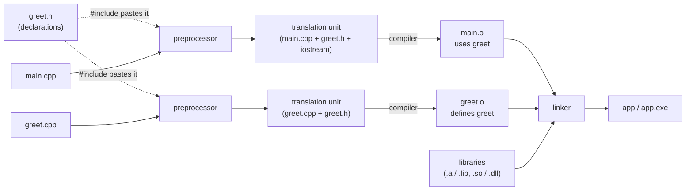

# Compiling and linking C++ by hand

## TL;DR

- A C++ build has three stages. The **preprocessor** pastes text (`#include`, macros). The **compiler** turns each `.cpp` file, on its own, into an **object file**. The **linker** joins the object files and libraries into an executable.
- The compiler needs only a **declaration** to compile a call. The **definition** is needed once, at link time. Headers exist to carry the declarations, the job that assembly metadata does for C#.
- A missing definition (`undefined reference`, `LNK2019`) or a duplicate one (`multiple definition`, `LNK2005`) is a **link error**, not a compile error. It names a symbol, not a source line.
- A **static library** is a bundle of object files copied into the program. A **shared library** (`.so`, `.dll`) is loaded at run time. Windows and Linux differ in what a shared library exports and where the program looks for it.
- On MSVC, debug and release builds use different **runtime libraries**. Objects built against different ones cannot be linked together.
- A handful of compiler flags matter: the language standard, warnings, warnings as errors, optimisation, debug information and sanitizers. Everything else can be looked up when needed.

## Key claims

- <a id="c1"></a>**C1.** The preprocessor runs before the compiler and works on text. `#include` replaces itself with the contents of the named file. Macros are replaced by their text. The flag `-I dir` (GCC, Clang) or `/I dir` (MSVC) adds a directory in which `#include` looks for files.
- <a id="c2"></a>**C2.** The compiler compiles each translation unit (a `.cpp` file after preprocessing) separately into an object file (`.o` with GCC and Clang, `.obj` with MSVC). The object file holds machine code plus a symbol table: the symbols it defines and the symbols it uses without defining. A declaration is enough to compile a call to a function. Its definition is needed only when linking.
- <a id="c3"></a>**C3.** The linker resolves every symbol that an object file uses to exactly one definition. No definition gives `undefined reference to …` (GNU ld) or `LNK2019: unresolved external symbol` (MSVC). Two definitions give `multiple definition of …` (GNU ld) or `LNK2005: … already defined` (MSVC).
- <a id="c4"></a>**C4.** `-L dir` adds a directory in which the linker looks for libraries. `-l name` links `libname.so` or `libname.a` from there. GNU ld searches a static library only for symbols still unresolved at the point where it appears on the command line, so libraries must come after the object files that use them.
- <a id="c5"></a>**C5.** A DLL built by MSVC exports only the functions marked `__declspec(dllexport)` (or listed in a `.def` file). A program links against it through an import library, a small `.lib` file with the same extension as a static library. A shared library on Linux exports all its non-hidden symbols by default.
- <a id="c6"></a>**C6.** When a program starts, Windows looks for its DLLs first in the directory of the executable. Linux does not search the executable's directory. It searches the paths recorded in the executable (rpath or runpath), `LD_LIBRARY_PATH` and the system directories, otherwise the program fails with `cannot open shared object file`.
- <a id="c7"></a>**C7.** MSVC has four C++ runtime libraries, chosen by `/MD`, `/MDd`, `/MT` and `/MTd` (dynamic or static, release or debug). The debug runtimes change the layout of standard containers. The linker refuses to combine objects built against different runtimes with `LNK2038: mismatch detected`. With GCC and Clang on Linux, a debug build only changes optimisation and debug information, so debug and release objects can be linked together.
- <a id="c8"></a>**C8.** GCC and Clang warn about very little unless asked with `-Wall -Wextra`. MSVC's default warning level is `/W1`; projects use `/W4`. `-Werror` (GCC, Clang) and `/WX` (MSVC) turn every warning into an error.
- <a id="c9"></a>**C9.** Optimisation (`-O2`, `/O2`) and debug information (`-g`, `/Zi`) are independent flags. A release build usually also defines the macro `NDEBUG`, which removes every `assert` from the program.

## Explanation

### Terms used

| Term | Meaning | Closest .NET idea |
|---|---|---|
| Translation unit | A `.cpp` file after the preprocessor has pasted in its headers. The unit the compiler compiles. | None. `csc` compiles all files of a project at once. |
| Object file | The compiler's output for one translation unit: machine code with a symbol table. | A piece of an assembly, before the pieces are joined. |
| Symbol | The name under which a function or global variable appears in an object file. C++ names are *mangled*: the parameter types are encoded in the name. | A method's token in assembly metadata. |
| Declaration | A statement that something exists, with its type: `std::string greet(const std::string&);` | An interface member's signature. |
| Definition | The thing itself: the body of a function, the storage of a variable. | The method body. |
| Linker | The tool that joins object files and libraries into an executable or a shared library: `ld` on Linux, `link.exe` on Windows. | No counterpart. The .NET runtime binds assemblies when it loads them. |
| Static library | An archive of object files: `libname.a`, `name.lib`. | Merging another assembly into yours, as ILMerge did. |
| Shared library | A library loaded at run time: `libname.so` on Linux, `name.dll` on Windows. | A referenced assembly `.dll`. |
| Runtime library | The compiled C and C++ standard library a program links against: on MSVC, `msvcp140.dll` and its siblings. | The .NET runtime and base class library. |

### Three stages

C# hides a fact that C++ shows: building a program is more than one step. `csc` reads all source files of a project together and writes one assembly. A C++ compiler reads one `.cpp` file at a time. The pieces are joined later by a separate program, the linker.



Solid arrows are data flowing through a tool. Dotted arrows are the text that `#include` pastes in. Each `.cpp` file goes through the preprocessor and the compiler on its own. Only the linker sees all of them.

### The preprocessor pastes text

`#include "greet.h"` is not an import. It is a copy and paste, done before the compiler sees the code ([C1](#c1)). After preprocessing, `main.cpp` with its single `#include <iostream>` is about 43,000 lines long ([Example 2](#example-2-two-files-and-the-linker)). Macros (`#define`) are replaced by their text in the same pass. C# has only the conditional part of this (`#if DEBUG`). Its `using` directive refers to types the compiler reads from referenced assemblies.

The preprocessor looks for a header in the include directories. `-I src` (GCC, Clang) or `/I src` (MSVC) adds one ([C1](#c1)). With quotes, `#include "greet.h"`, GCC, Clang and MSVC look first in the directory of the file that contains the `#include`. With angle brackets, `#include <iostream>`, they look only in the include directories.

### The compiler sees one file at a time

Each translation unit is compiled alone into an object file ([C2](#c2)). When `main.cpp` calls `greet`, the compiler does not know where `greet` is. It only needs the declaration from `greet.h` to check the call and emit it. In the object file, `main.o` lists `greet` as *used but not defined*. `greet.o` lists it as *defined* ([Example 2](#example-2-two-files-and-the-linker) shows both with `nm`).

This is why C++ has headers. A C# compiler learns the signatures of another project from that project's assembly metadata. A C++ compiler has no such metadata. The header gives it the declarations instead.

Separate compilation is also why builds can be incremental. A change to `greet.cpp` recompiles only `greet.o` and relinks. A change to `greet.h` recompiles every file that includes it. The note on [the CMake build pipeline](../cmake/build-pipeline.md) shows how build tools exploit this.

### The linker joins the pieces

The linker reads all object files and libraries. For every symbol that one of them uses, it finds the one definition ([C3](#c3)). Two errors follow from this:

- **No definition.** A `.cpp` file was not compiled or not passed to the linker, a library is missing, or the declaration does not match the definition (a different parameter type is a different mangled name). GNU ld says `undefined reference`. MSVC says `LNK2019`.
- **Two definitions.** Typically a function defined in a header without `inline`, included by two `.cpp` files. GNU ld says `multiple definition`. MSVC says `LNK2005`. Why `inline` fixes this is in [Header-only libraries, C3](header-only-libraries.md#c3).

A link error names a symbol, not a line of source. GNU ld prints the C++ signature in readable form. MSVC prints it twice, readable and mangled (`?greet@@YA…`). `std::string` shows up in its full form, `std::__cxx11::basic_string<char, …>`. Read past that to the function name.

The rule that every used function has exactly one definition in the program is part of the *one-definition rule*. The note on [linkage](linkage-and-storage-duration.md#c2) covers which names are shared between translation units and which are private to one.

### Static and shared libraries

A static library is an archive of object files ([Static libraries, shared libraries and the C++ ABI, C1](abi-and-shared-libraries.md#c1)). `ar rcs libgreet.a greet.o` makes one on Linux. `lib greet.obj /OUT:greet.lib` makes one with MSVC. The linker copies what the program needs from it into the executable.

To link a library, give the linker a directory with `-L` and a name with `-l`. `-L. -lgreet` finds `./libgreet.so` or `./libgreet.a` ([C4](#c4)). Order matters with GNU ld: it reads the command line from left to right and takes from a static library only what is still missing at that point. `g++ -L. -lgreet main.o` fails. `g++ main.o -L. -lgreet` works ([Example 4](#example-4-static-and-shared-libraries)). MSVC's linker has no such rule. You pass the `.lib` file by name.

A shared library is loaded when the program starts ([ABI note, C2](abi-and-shared-libraries.md#c2)). The platforms differ in two ways:

- **What it exports** ([C5](#c5)). A DLL exports nothing unless told to, with `__declspec(dllexport)` in the code or a `.def` file. The program links against a small *import library*, also called `greet.lib`, which tells the linker that `greet` lives in `greet.dll`. If nothing is exported, `link.exe` writes no import library at all. A `.so` on Linux exports everything by default. Compiling it needs `-fPIC` (position-independent code).
- **Where the program finds it** ([C6](#c6)). Windows looks next to the `.exe` first. Linux does not. A program linked against `./libgreet.so` fails at start-up with `cannot open shared object file` until the library is installed, `LD_LIBRARY_PATH` names its directory, or the executable records the path (*rpath*). CMake writes the rpath for programs in its build directory, so they run there.

Passing C++ types such as `std::string` across a shared-library boundary needs both sides built with compatible compilers and settings. That is the ABI problem, explained in [Static libraries, shared libraries and the C++ ABI](abi-and-shared-libraries.md#c4).

### Debug and release runtimes on MSVC

A .NET library built in Debug can be referenced from a Release application. On MSVC that is not true for C++ ([C7](#c7)). The flag `/MDd` links the debug runtime. It adds checks to the standard containers, which changes their size and layout (the macro `_ITERATOR_DEBUG_LEVEL` is 2 instead of 0). An object built with `/MDd` and one built with `/MD` would disagree about what a `std::vector` is. The linker stops it with `LNK2038: mismatch detected for 'RuntimeLibrary'` ([Example 5](#example-5-mixing-msvc-runtimes)).

So on Windows every library must come in the flavour that matches the program: debug libraries for a debug build, release for release, and the same `/MD` or `/MT`. Package managers such as vcpkg build both flavours for this reason. On Linux, GCC's and Clang's debug builds use the same standard library, so the question does not arise.

### Compiler flags that matter

Each compiler has hundreds of flags. These are the ones a C++ developer is expected to recognise:

| Purpose | GCC and Clang | MSVC | .NET counterpart |
|---|---|---|---|
| Language standard | `-std=c++20` | `/std:c++20` | `<LangVersion>` |
| Common warnings | `-Wall -Wextra` | `/W4` | `<WarningLevel>`, `<AnalysisLevel>` |
| Warnings as errors | `-Werror` | `/WX` | `<TreatWarningsAsErrors>` |
| Optimisation | `-O0` (none) to `-O3` | `/Od` (none), `/O2` | `<Optimize>` |
| Debug information | `-g` | `/Zi` (to a `.pdb`) | `<DebugType>` |
| Disable `assert` | `-DNDEBUG` | `/DNDEBUG` | Release leaving out the `DEBUG` constant |
| Sanitizers | `-fsanitize=address,undefined` | `/fsanitize=address` | none |
| Exceptions | on by default | `/EHsc` | always on |
| Include directory | `-I dir` | `/I dir` | `<ProjectReference>`, roughly |
| Define a macro | `-DNAME=value` | `/DNAME=value` | `<DefineConstants>` |

Warnings deserve a word. With no flags, GCC compiles `int unused = 42;` silently. With `-Wall` it warns ([C8](#c8), [Example 6](#example-6-warnings-and-warnings-as-errors)). Projects therefore switch on a set of warnings and turn them into errors in CI, so that no warning is ever ignored ([Static analysis for C++, C2](static-analysis.md#c2)).

Optimisation and debug information are separate switches ([C9](#c9)). A "Debug" build is `-O0 -g`; a "Release" build is `-O3 -DNDEBUG` with GCC (`/O2 /DNDEBUG` with MSVC). Build tools bundle them under those names. `NDEBUG` is the one with a trap: `assert(x > 0)` disappears completely from a release build, together with any side effect inside it.

Sanitizers insert run-time checks for memory errors and undefined behaviour. They are flags to the compiler and to the linker. The note on [sanitizers](sanitizers.md) covers them.

## Examples

All examples were compiled on 11 November 2026 with GCC 13.3 and Clang 18.1 (WSL, Ubuntu 24.04) and with MSVC 19.51 (Visual Studio 2026). The MSVC commands run in a *Developer PowerShell for VS*, which puts `cl.exe` and `link.exe` on the `PATH`.

### Example 1: one file

```cpp
// hello.cpp
#include <iostream>

int main()
{
    std::cout << "Hello from one file\n";
}
```

```bash
g++ -std=c++20 -Wall -Wextra hello.cpp -o hello   # or clang++ with the same flags
./hello
```

```text
cl /std:c++20 /EHsc /W4 hello.cpp
.\hello.exe
```

Expected output, from both:

```text
Hello from one file
```

One command did all three stages. The compiler driver (`g++`, `cl`) runs the preprocessor, the compiler and the linker in turn.

### Example 2: two files and the linker

```cpp
// greet.h
#pragma once
#include <string>

std::string greet(const std::string& name); // declaration: "this exists somewhere"
```

```cpp
// greet.cpp
#include "greet.h"

std::string greet(const std::string& name) // definition: the actual code
{
    return "Hello, " + name + "!";
}
```

```cpp
// main.cpp
#include <iostream>
#include "greet.h"

int main()
{
    std::cout << greet("linker") << '\n';
}
```

`#pragma once` stops a header from being pasted twice into one translation unit. Look at what the preprocessor produces, then compile each file without linking (`-c`, `/c`) and link the objects:

```bash
g++ -std=c++20 -E main.cpp | wc -l      # preprocess only: about 43,000 lines
g++ -std=c++20 -Wall -Wextra -c greet.cpp   # writes greet.o
g++ -std=c++20 -Wall -Wextra -c main.cpp    # writes main.o
g++ main.o greet.o -o app                    # link
./app
```

```text
cl /std:c++20 /EHsc /W4 /c greet.cpp main.cpp
link main.obj greet.obj /OUT:app.exe
.\app.exe
```

Expected output:

```text
Hello, linker!
```

`nm -C` lists the symbols of an object file. `U` means used but undefined, `T` means defined in the code section ([C2](#c2)):

```text
$ nm -C main.o | grep greet
                 U greet(std::__cxx11::basic_string<char, std::char_traits<char>, std::allocator<char> > const&)
$ nm -C greet.o | grep greet
0000000000000000 T greet(std::__cxx11::basic_string<char, std::char_traits<char>, std::allocator<char> > const&)
```

Leave `greet.o` out of the link, and the definition is missing ([C3](#c3)):

```text
$ g++ main.o -o app
/usr/bin/ld: main.o: in function `main':
main.cpp:(.text+0x4f): undefined reference to `greet(std::__cxx11::basic_string<char, std::char_traits<char>, std::allocator<char> > const&)'
collect2: error: ld returned 1 exit status
```

```text
> link main.obj /OUT:app.exe
main.obj : error LNK2019: unresolved external symbol "class std::basic_string<char,struct std::char_traits<char>,class std::allocator<char> > __cdecl greet(class std::basic_string<char,struct std::char_traits<char>,class std::allocator<char> > const &)" (?greet@@YA?AV?$basic_string@DU?$char_traits@D@std@@V?$allocator@D@2@@std@@AEBV12@@Z) referenced in function main
app.exe : fatal error LNK1120: 1 unresolved externals
```

### Example 3: a definition in a header

```cpp
// answer.h
#pragma once

int answer() { return 42; } // a definition in a header, without inline
```

```cpp
// a.cpp
#include "answer.h"

int twice() { return 2 * answer(); }
```

```cpp
// main.cpp
#include <iostream>
#include "answer.h"

int twice();

int main() { std::cout << answer() + twice() << '\n'; }
```

`#pragma once` does not help: it works within one translation unit. Both translation units contain the definition ([C3](#c3)).

```text
$ g++ -std=c++20 -Wall -Wextra a.cpp main.cpp -o odr
/usr/bin/ld: /tmp/ccYXQgns.o: in function `answer()':
main.cpp:(.text+0x0): multiple definition of `answer()'; /tmp/ccTWt7Aj.o:a.cpp:(.text+0x0): first defined here
collect2: error: ld returned 1 exit status
```

```text
> cl /std:c++20 /EHsc /W4 a.cpp main.cpp
main.obj : error LNK2005: "int __cdecl answer(void)" (?answer@@YAHXZ) already defined in a.obj
a.exe : fatal error LNK1169: one or more multiply defined symbols found
```

Writing `inline int answer()` makes it link and print `126`.

### Example 4: static and shared libraries

With the files of Example 2, on Linux:

```bash
ar rcs libgreet.a greet.o              # static library: an archive of greet.o
g++ main.o -L. -lgreet -o app_static   # objects first, then libraries
./app_static                           # Hello, linker!

g++ -L. -lgreet main.o -o bad_order    # library first: undefined reference to `greet(...)'
```

```bash
g++ -std=c++20 -fPIC -shared greet.cpp -o libgreet.so   # shared library
g++ main.o -L. -lgreet -o app_shared                     # -lgreet now finds the .so first
./app_shared
# ./app_shared: error while loading shared libraries: libgreet.so:
#   cannot open shared object file: No such file or directory
LD_LIBRARY_PATH=. ./app_shared                           # Hello, linker!
```

The executable sits next to `libgreet.so` and still cannot find it ([C6](#c6)). With MSVC:

```text
lib greet.obj /OUT:greet.lib                 # static library
link main.obj greet.lib /OUT:app_static.exe  # Hello, linker!
cl /std:c++20 /EHsc /LD greet.cpp /Fe:greetdll.dll
```

The last command builds `greetdll.dll` but no `greetdll.lib`. Nothing in `greet.cpp` is marked `__declspec(dllexport)`, so the DLL exports nothing and there is nothing to link against ([C5](#c5)).

### Example 5: mixing MSVC runtimes

```text
> cl /std:c++20 /EHsc /MDd /c greet.cpp
> cl /std:c++20 /EHsc /MD /c main.cpp
> link main.obj greet.obj /OUT:mixed.exe
greet.obj : error LNK2038: mismatch detected for '_ITERATOR_DEBUG_LEVEL': value '2' doesn't match value '0' in main.obj
greet.obj : error LNK2038: mismatch detected for 'RuntimeLibrary': value 'MDd_DynamicDebug' doesn't match value 'MD_DynamicRelease' in main.obj
```

The two objects disagree about the layout of `std::string` ([C7](#c7)). The linker catches it because MSVC records both settings in every object file.

### Example 6: warnings and warnings as errors

```cpp
// warn.cpp
#include <iostream>

int main()
{
    int unused = 42; // initialised, never read
    std::cout << "built anyway\n";
}
```

| Command | Result |
|---|---|
| `g++ -std=c++20 warn.cpp` | builds, no message |
| `g++ -std=c++20 -Wall -Wextra warn.cpp` | builds, `warning: unused variable ‘unused’ [-Wunused-variable]` |
| `g++ -std=c++20 -Wall -Wextra -Werror warn.cpp` | fails, `error: unused variable ‘unused’ [-Werror=unused-variable]` |
| `cl /std:c++20 /EHsc /W4 warn.cpp` | builds, `warning C4189: 'unused': local variable is initialized but not referenced` |
| `cl /std:c++20 /EHsc /W4 /WX warn.cpp` | fails, `error C2220: the following warning is treated as an error` |

Clang behaves like GCC here, with slightly different wording (`[-Werror,-Wunused-variable]`) ([C8](#c8)).

## Good habits

- Compile with `-Wall -Wextra` or `/W4` from the first line of code, and make warnings errors in CI ([C8](#c8); [Static analysis for C++, C2](static-analysis.md#c2)).
- Put declarations in headers and definitions in `.cpp` files. A function defined in a header is `inline` ([C3](#c3); [Header-only libraries, C3](header-only-libraries.md#c3)).
- Never put code with side effects inside `assert` ([C9](#c9)).

## Pitfalls

- **Reading a link error as a compile error.** It has no line number because the problem is not in one file. Look for a missing `.cpp` file, a missing library or a declaration whose parameter types differ from the definition's ([C3](#c3)).
- **`#pragma once` against multiple definitions.** It stops the same header from being pasted twice into *one* translation unit. Two translation units still each get their own copy of every definition in it ([Example 3](#example-3-a-definition-in-a-header)).
- **`-lgreet` before the object files.** GNU ld then finds nothing to take from a static library ([C4](#c4)). MSVC and macOS's linker don't care, so the mistake shows up only on Linux.
- **Two kinds of `.lib`.** On Windows, `greet.lib` can be a static library or the import library of `greet.dll`. The name doesn't tell ([C5](#c5)).
- **"It runs on my machine, from the build directory."** On Linux, a program linked against a shared library outside the system directories runs only where its rpath or `LD_LIBRARY_PATH` points ([C6](#c6)).
- **A release library in a debug build on Windows.** `LNK2038` means the runtimes differ. Get or build the library in the matching configuration ([C7](#c7)).

## Exercises

1. **Predict.** A project has `parser.h`, `parser.cpp` and `main.cpp`. You build with `g++ main.cpp -o app`. Which stage fails, and with what kind of message?

   <details><summary>Solution</summary>

   Preprocessing and compiling `main.cpp` succeed: the header gives the declarations ([C2](#c2)). The link fails with `undefined reference to` each function from `parser.cpp`, because `parser.cpp` was never compiled ([C3](#c3)).

   </details>

2. **Explain.** Why does C++ need header files while C# does not?

   <details><summary>Solution</summary>

   The C++ compiler compiles each translation unit alone and has no metadata about the others. It needs the declarations pasted in as text ([C1](#c1), [C2](#c2)). The C# compiler reads signatures from the metadata of referenced assemblies.

   </details>

3. **Diagnose.** A Windows debug build of your program fails with `LNK2038: mismatch detected for 'RuntimeLibrary': value 'MD_DynamicRelease' doesn't match value 'MDd_DynamicDebug'`. What happened?

   <details><summary>Solution</summary>

   A library was built in release mode with `/MD`. Your program is built in debug mode with `/MDd`. Link the debug build of the library ([C7](#c7)).

   </details>

## Sources

- Claude session on [Tante](https://github.com/thomaswening/Tante), 2026-11-11, after the build skeleton of [Tante PR 19](https://github.com/thomaswening/Tante/pull/19). Examples compiled with GCC 13.3, Clang 18.1 and MSVC 19.51.
- [Translation phases](https://en.cppreference.com/w/cpp/language/translation_phases) and [the one-definition rule](https://en.cppreference.com/w/cpp/language/definition#One_Definition_Rule), cppreference.
- [GCC: options for linking](https://gcc.gnu.org/onlinedocs/gcc/Link-Options.html), on `-l` and the order of libraries.
- [/MD, /MT, /LD (Use run-time library)](https://learn.microsoft.com/en-us/cpp/build/reference/md-mt-ld-use-run-time-library), Microsoft Learn.
- [Dynamic-link library search order](https://learn.microsoft.com/en-us/windows/win32/dlls/dynamic-link-library-search-order), Microsoft Learn, and [ld.so(8)](https://man7.org/linux/man-pages/man8/ld.so.8.html) for Linux.
- [Exporting from a DLL using __declspec(dllexport)](https://learn.microsoft.com/en-us/cpp/build/exporting-from-a-dll-using-declspec-dllexport), Microsoft Learn.
