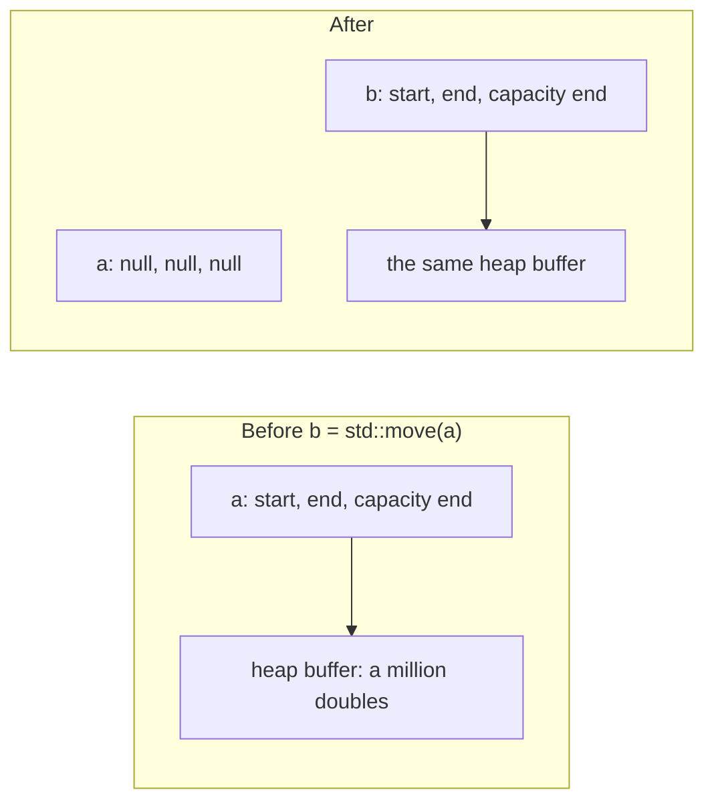

# Copy and move

## TL;DR

- C++ objects are **values**: `T b = a;` makes a second, independent object, like assigning a C# `struct`, not like assigning a C# class reference.
- Copying calls the **copy constructor** (`T(const T&)`, for a new object) or the **copy assignment** (`operator=(const T&)`, for an existing one). The compiler writes both for you, copying every member.
- **Moving** (`T(T&&)`, `operator=(T&&)`) lets a new object take over the resources of one that is about to be discarded, instead of duplicating them.
- `std::move(x)` doesn't move anything; it only marks `x` as something that may be moved from.
- Rule of zero: build classes from members that manage themselves, and write none of these functions. Rule of five: if you write one, think about all five.

## Key claims

- <a id="c1"></a>**C1.** In C++, `T b = a;` and passing `a` by value create a new object by calling `T`'s copy constructor `T(const T&)`, and `b = a;` between two existing objects calls the copy assignment operator `operator=(const T&)`; in C#, assigning a variable of class type copies only the reference.
- <a id="c2"></a>**C2.** The copy operations the compiler generates copy each member in turn; for a raw pointer member this copies only the address, so both objects then point to the same resource (a shallow copy).
- <a id="c3"></a>**C3.** `T&&` is an rvalue reference: it binds to temporaries and to expressions cast with `std::move`, and a move constructor `T(T&&)` or move assignment `operator=(T&&)` uses it to take over the source's resources instead of copying them.
- <a id="c4"></a>**C4.** `std::move(x)` performs no move; it is a cast that lets `x` bind to an rvalue reference. After an object of a standard library type has been moved from, it is in a valid but unspecified state and should only be assigned to or destroyed.
- <a id="c5"></a>**C5.** If a class declares a copy constructor, copy assignment operator, move assignment operator or destructor, the compiler does not generate a move constructor for it, and a move of that class falls back to a copy where a copy is possible.
- <a id="c6"></a>**C6.** Rule of zero: a class whose members all manage their own resources (`std::string`, `std::vector`, `std::unique_ptr`) needs no user-written destructor, copy or move operations. Rule of five: a class that writes any of the destructor, copy constructor, copy assignment, move constructor or move assignment usually has to consider all five.
- <a id="c7"></a>**C7.** `std::vector` moves its elements when it reallocates only if their move constructor is `noexcept` (or they cannot be copied); otherwise it copies them, to keep its guarantee that a failed reallocation leaves the vector unchanged.
- <a id="c8"></a>**C8.** `std::unique_ptr` is move-only: its copy operations are deleted, and moving it transfers ownership of the pointed-to object, leaving the source empty.
- <a id="c9"></a>**C9.** The compiler does not check that a `noexcept` function really doesn't throw; if an exception leaves a `noexcept` function at run time, `std::terminate` is called and the program ends.

## Explanation

### Values by default

In C#, a class variable holds a reference; `var b = a;` gives two names for one object. Only `struct`s are copied. What decides this is the type, not where the object lives: a `struct` stored in a field of a class object sits on the heap and is still copied on assignment. In C++ every class behaves like a C# struct in this respect, on the stack and on the heap alike ([C1](#c1)): `Widget b = a;` builds a second `Widget`, and changes to `b` don't affect `a`. A C++ pointer or `std::shared_ptr` is the closest thing to a C# reference.

The copy is made by a special constructor, the **copy constructor**, which takes the original by `const` reference. Assignment between two objects that already exist calls the **copy assignment operator** instead. If you don't write them, the compiler does, copying each member ([C2](#c2)). That is right for members that copy themselves properly (`std::string` copies its characters), and wrong for a raw pointer that owns something: two objects end up owning one resource, and both destructors release it. That is why the [handle wrapper](../c/opaque-handles.md) deletes its copy operations.

### Moving instead of copying

Copying a large object is expensive, and often wasteful: the original is about to disappear anyway, as with a temporary returned from a function. C++11 added **moving** for this case ([C3](#c3)).

To tell expiring objects apart, C++ sorts expressions into two kinds. An **lvalue** has a name and lives on after the current statement: a variable `a`, an element `v[0]`. An **rvalue** is a temporary without a name that ends with the statement: the result of `make_values()`, of `a + b`, of `std::string("x")`. A non-`const` reference `T&` binds only to lvalues. An **rvalue reference** `T&&` binds only to rvalues:

```cpp
void keep(std::string&& s);

std::string name = "x";
keep(std::string("y"));   // fine: a temporary is an rvalue
keep(name);               // compile error: name is an lvalue
keep(std::move(name));    // fine: std::move turns name into an rvalue
```

A move constructor `T(T&&)` takes its argument by rvalue reference, so it runs only for expiring objects. It **steals** their resources: it copies the source's pointer to the resource into the new object and sets the source's pointer to null. The source's destructor then has nothing left to release.

`std::vector` shows why this pays. Its elements live in a buffer on the heap. The vector object itself, in the common standard libraries (GCC's, Clang's, MSVC's), holds only three pointers: to the start of that buffer, to the end of the elements in use and to the end of the buffer. Copying a vector allocates a new buffer and copies every element. Moving it copies the three pointers and sets the source's to null. The buffer itself stays where it is and only changes owner, so moving a vector of a million elements costs the same as moving an empty one:



You can ask to move from a named object, an lvalue, with `std::move(x)`. Despite the name, it moves nothing ([C4](#c4)). It is a cast of `x` to an rvalue reference, saying "treat `x` as expiring", and generates no code of its own. The move itself happens in the move constructor or move assignment that receives the result: for a vector, the copying of three pointers and nulling of the source's described above. A class without a move constructor gets no move: the rvalue binds to the copy constructor's `const T&` instead. A copy is made. Afterwards `x` still exists and will still be destroyed, but its contents are unspecified, so don't read it.

### Which functions exist

The compiler generates the copy and move operations only when it is safe to assume member-by-member behaviour is wanted. Writing a destructor or a copy operation signals that the class manages something by hand, so the compiler stops generating the move constructor, and moves silently become copies ([C5](#c5)). Hence the two rules ([C6](#c6)):

- **Rule of zero**: prefer classes whose members manage themselves. Then you write none of the five, and all of them are correct.
- **Rule of five**: if a class must manage a resource directly (as a wrapper for a C handle does), decide about all five: destructor, copy constructor, copy assignment, move constructor, move assignment. Deleting the copies with `= delete` is a decision too.

So a class that gets a destructor, even one only for logging, should declare all five, writing `= default` for those where the member-by-member version is right (`= default` is explained under [Examples](#examples)). Better still, leave the destructor out and follow the rule of zero. A linter finds the mistake: clang-tidy's check `cppcoreguidelines-special-member-functions` reports a class that declares some of the five but not all ([static analysis](static-analysis.md)).

### `noexcept` matters

When a `std::vector` grows, it moves its elements to new memory. If a move threw halfway, some elements would already have left the old memory, and the vector couldn't be restored. So it moves only when the move constructor promises not to throw by being `noexcept`, and copies otherwise ([C7](#c7)). A move constructor that doesn't throw should say so. clang-tidy's check `performance-noexcept-move-constructor` reports one that doesn't.

`noexcept` is a promise the compiler does not check. If an exception leaves a `noexcept` function anyway, the program calls `std::terminate` and ends at once ([C9](#c9)). So the vector is never left half-moved: the program stops instead. A crash of another kind, such as dereferencing a null pointer, is not an exception at all. It is undefined behaviour with or without `noexcept`.

### Move-only types

Some objects shouldn't be copied at all: a file, a lock, unique ownership of memory. `std::unique_ptr` is the standard example ([C8](#c8)): its copies are deleted, its moves transfer ownership. It can still be returned from functions and stored in containers, since those only need moves.

## Examples

Which function runs when:

```cpp
#include <iostream>
#include <utility>

struct Tracer {
    Tracer() = default;
    Tracer(const Tracer&) { std::cout << "copy\n"; }
    Tracer(Tracer&&) noexcept { std::cout << "move\n"; }
    Tracer& operator=(const Tracer&) { std::cout << "copy-assign\n"; return *this; }
    Tracer& operator=(Tracer&&) noexcept { std::cout << "move-assign\n"; return *this; }
};

int main()
{
    Tracer a;
    Tracer b = a;              // new object from a named one: copy
    Tracer c = std::move(a);   // new object from an object marked expiring: move
    b = c;                     // existing object from a named one: copy assignment
    b = Tracer();              // existing object from a temporary: move assignment
}
```

Expected output:

```
copy
move
copy-assign
move-assign
```

`Tracer() = default;` asks the compiler to generate the default constructor exactly as it would have on its own. It has to be asked: declaring any other constructor, here the copy and move constructors, stops the compiler from generating the default one, which `Tracer a;` needs. `= default` works the same way for the destructor and the copy and move operations.

Rule of zero in practice: this class needs none of the five, because its members copy and move themselves correctly.

```cpp
#include <memory>
#include <string>
#include <vector>

struct Record {
    std::string name;
    std::vector<double> values;
    std::unique_ptr<int> extra;   // makes Record move-only, automatically
};
```

A move-only wrapper for a C handle, completing the minimal one in [opaque handles](../c/opaque-handles.md):

```cpp
#include <utility>

extern "C" {
    typedef struct db db;
    db*  db_open(const char* path);
    void db_close(db* d);
}

class Database {
    db* handle_;
public:
    explicit Database(const char* path) : handle_(db_open(path)) {}
    ~Database() { if (handle_) db_close(handle_); }

    Database(const Database&) = delete;                // no copies (rule of five: decided)
    Database& operator=(const Database&) = delete;

    Database(Database&& other) noexcept                // move constructor: take over the handle
        : handle_(std::exchange(other.handle_, nullptr)) {}
    Database& operator=(Database&& other) noexcept {   // move assignment
        if (this != &other) {
            if (handle_) db_close(handle_);            // release what we held
            handle_ = std::exchange(other.handle_, nullptr);
        }
        return *this;
    }
};

Database open_default() { return Database("data.db"); }   // fine: returning moves (or elides)
```

Reading it:

- `explicit` stops the one-parameter constructor from acting as an implicit conversion: without it, a function taking a `Database` could be called with `"data.db"` and would silently open a database. It is the opposite of C#'s `implicit operator`.
- `: handle_(db_open(path))` is a member initialiser list: it sets the field before the constructor body runs, like `_handle = DbOpen(path);` at the start of a C# constructor.
- `std::exchange(other.handle_, nullptr)` returns `other`'s handle and sets it to null in one step, so the moved-from object holds nothing ([C3](#c3)).
- `if (handle_)` is false for a null pointer, so a moved-from object's destructor does nothing.
- `noexcept` is good practice for every move. For this class it doesn't change what `std::vector` does, since copying is deleted and the vector has to move anyway; it decides between moving and copying only for types that can do both ([C7](#c7)). Without any move constructor, a `std::vector<Database>` couldn't grow at all.

## Pitfalls

- Expecting `T b = a;` to share one object, as in C#: it makes an independent copy ([C1](#c1)).
- Relying on the generated copy for a class with an owning raw pointer: a double release ([C2](#c2)).
- Reading a variable after `std::move` from it ([C4](#c4)).
- Adding a destructor "for logging" and silently losing the generated move constructor ([C5](#c5)). Declare all five or leave the destructor out; clang-tidy's `cppcoreguidelines-special-member-functions` reports the mistake.
- Forgetting `noexcept` on a move constructor and getting copies in `std::vector` ([C7](#c7)); clang-tidy's `performance-noexcept-move-constructor` reports it.
- Marking a move constructor `noexcept` when it can throw: the program ends with `std::terminate` instead of reporting the exception ([C9](#c9)).

## Sources

- Claude session on [Tante](https://github.com/thomaswening/Tante), 2026-10-20, from Thomas's review of the [opaque handles note](https://github.com/thomaswening/doubting-thomas/pull/2), on the C++ wrapper of [Tante ADR-0004](https://github.com/thomaswening/Tante/pull/1).
- cppreference: [copy constructors](https://en.cppreference.com/w/cpp/language/copy_constructor), [move constructors](https://en.cppreference.com/w/cpp/language/move_constructor), [std::move](https://en.cppreference.com/w/cpp/utility/move), [rule of three/five/zero](https://en.cppreference.com/w/cpp/language/rule_of_three), [std::move_if_noexcept](https://en.cppreference.com/w/cpp/utility/move_if_noexcept), [value categories](https://en.cppreference.com/w/cpp/language/value_category), [noexcept specifier](https://en.cppreference.com/w/cpp/language/noexcept_spec).
- clang-tidy checks [cppcoreguidelines-special-member-functions](https://clang.llvm.org/extra/clang-tidy/checks/cppcoreguidelines/special-member-functions.html) and [performance-noexcept-move-constructor](https://clang.llvm.org/extra/clang-tidy/checks/performance/noexcept-move-constructor.html).
