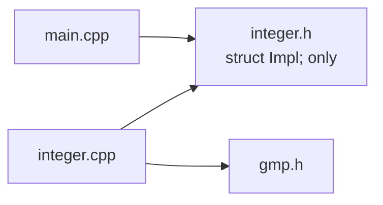

# Pimpl (pointer to implementation)

## TL;DR

- `#include` pastes a header's text into every file that includes it. A class whose header includes a C library's header (`gmp.h`) hands that library to everyone who uses the class.
- **Pimpl** ("pointer to implementation") moves the class's data into a struct `Impl` that the header only declares. The class holds a `std::unique_ptr<Impl>`. `Impl` is defined in the `.cpp`, the only file that includes the library.
- Everything that may delete an `Impl` (the destructor, the constructors and the move assignment) is declared in the header and defined in the `.cpp`, where `Impl` is complete. `= default` there is enough.
- `unique_ptr` can't be copied, so a value type like Tante's `Integer` writes its own copy constructor and copy assignment that copy the `Impl`. All five special members get declared: the rule of five in practice.
- A moved-from object has `impl_ == nullptr`. It may still be destroyed and assigned to. Anything else on it dereferences null.
- The price is one heap allocation per object and one extra pointer hop per access.

## Key claims

- <a id="c1"></a>**C1.** `#include` inserts the header's text into the including file, so every translation unit that includes a header also compiles every header it includes: a class header that includes `gmp.h` makes every user of the class depend on `gmp.h` and need it on its include path.
- <a id="c2"></a>**C2.** A data member held by value must have a complete type where the class is defined, because the compiler needs its size to lay out the class; a pointer or `std::unique_ptr` member may point to an incomplete type, which needs only a declaration such as `struct Impl;`.
- <a id="c3"></a>**C3.** `private` controls who may use a member, not who can see it: private members are still written in the header, still count towards the class's size and still need their types' headers to be included.
- <a id="c4"></a>**C4.** In the pimpl idiom, the class declares a nested `struct Impl;` and holds `std::unique_ptr<Impl> impl_;`. `Impl` is defined in the `.cpp` file, which is the only file that includes the library's header.
- <a id="c5"></a>**C5.** `std::unique_ptr<Impl>` can delete its object only where `Impl` is complete. So the class declares its destructor, its constructors and its move assignment in the header and defines them in the `.cpp` after `Impl`'s definition (`Integer::~Integer() = default;`). Defined in the header, explicitly or by the compiler, they fail to compile with "incomplete type" (GCC 13, Clang 18 and MSVC 19.51 alike).
- <a id="c6"></a>**C6.** A class with a `std::unique_ptr` member has deleted copy operations by default. A pimpl class meant to behave as a value writes a copy constructor and a copy assignment that create a new `Impl` from the source's (a deep copy). Together with the destructor and the two moves, it declares all five special members.
- <a id="c7"></a>**C7.** Moving a pimpl object leaves the source with `impl_ == nullptr`. The class must still allow destroying it and assigning to it: the copy assignment creates a new `Impl` when `impl_` is null. Every other member function dereferences `impl_` and is undefined behaviour on a moved-from object unless it checks.
- <a id="c8"></a>**C8.** Pimpl costs one heap allocation each time an object is created or copied, plus one pointer indirection on each access to its data. A move costs only a pointer copy and cannot throw.
- <a id="c9"></a>**C9.** Because the header holds only a pointer, `sizeof` of the class stays the same when `Impl` changes: changing `Impl` recompiles only the `.cpp` and does not change the class's binary layout.
- <a id="c10"></a>**C10.** The alternative without a heap allocation reserves fixed, aligned storage of a chosen size inside the class and checks in the `.cpp` with `static_assert(sizeof(mpz_t) <= size)` that the hidden type fits. It saves the allocation but hard-codes a size in the header that a new library version can outgrow.

## Explanation

### The problem: a header leaks what it includes

[Tante](https://github.com/thomaswening/Tante)'s `Integer` keeps its digits in GMP's `mpz_t`. The obvious class holds one as a member:

```cpp
// integer.h, the obvious version
#include <gmp.h>                 // every user of Integer now compiles gmp.h

class Integer {
    mpz_t value_;                // private, yet visible to every includer
};
```

`#include` is text pasting ([C1](#c1)). The [translation unit](linkage-and-storage-duration.md#c1) of every `.cpp` that includes `integer.h` therefore contains all of `gmp.h`: its declarations and its macros. Each such file needs GMP's headers on its include path. It recompiles when GMP's header changes. Tante's ADR-0003 wants GMP to stay a private detail of `src/arith/`, so this version breaks the rule for every caller.

`private` doesn't help ([C3](#c3)). In C#, an `internal` class in another assembly is invisible to you: the compiler reads the assembly's metadata, not its source. C++ has no metadata. The compiler learns a class's layout only from its definition in the header, private members included. It needs that layout to reserve space for an `Integer` on the stack or inside another object. So `mpz_t` must be complete wherever `Integer` is defined ([C2](#c2)).

A pointer escapes this. All object pointers have the same size, whatever they point to. So a class may hold a pointer to a type the compiler has only heard the name of: an **incomplete type**, as in [opaque handles](../c/opaque-handles.md#c1).

### The idiom

Move every data member into a struct `Impl`. Declare it in the header without a body and hold it through a `std::unique_ptr` ([C4](#c4)):

```cpp
// integer.h
#include <memory>

class Integer {
public:
    explicit Integer(long value);
    ~Integer();
    // copy and move operations: see below
private:
    struct Impl;                     // incomplete here
    std::unique_ptr<Impl> impl_;     // owns the Impl
};
```

```cpp
// integer.cpp
#include "integer.h"
#include <gmp.h>                     // the only file that sees GMP

struct Integer::Impl {
    mpz_t value;
};
```



Only `integer.cpp` reaches `gmp.h`. Every other file sees a class that holds one pointer. That pointer is the [opaque handle](../c/opaque-handles.md) of C, owned by a `unique_ptr` instead of a hand-written wrapper ([RAII](raii-and-ownership.md#c6)).

The .NET counterparts are a public facade class that forwards to an `internal` implementation class, and `SafeHandle`, which wraps a native handle and releases it ([opaque handles C6](../c/opaque-handles.md#c6)). Pimpl combines both. The facade is the public class, the implementation is `Impl`. The `unique_ptr` releases it like `SafeHandle` does, but deterministically at the end of scope.

### Where the special members must be defined

`std::unique_ptr<Impl>` may run `delete` on its `Impl` in three kinds of place:

- the class's destructor, which destroys `impl_`;
- the move assignment, which deletes the `Impl` it overwrites;
- every constructor, the move constructor included. If a constructor throws after `impl_` is built, the language destroys `impl_` again. So each constructor must be able to call `unique_ptr`'s destructor, even when nothing in it can throw.

`delete` needs the complete type, to call `Impl`'s destructor. The standard library checks this with a `static_assert`. MSVC reports it as "can't delete an incomplete type".

If the class leaves its destructor to the compiler, the compiler defines it inline in the class, so in every file that includes the header. There `Impl` is incomplete, and the build fails. The same happens to a constructor written in the header. The fix is to declare these members in the header and define them in the `.cpp` after `Impl` ([C5](#c5)). The constructors that do real work live in the `.cpp` anyway. The other three are one line each:

```cpp
// integer.cpp, after struct Integer::Impl { … };
Integer::~Integer() = default;
Integer::Integer(Integer&& other) noexcept = default;
Integer& Integer::operator=(Integer&& other) noexcept = default;
```

`= default` asks for the compiler's version ([constructors C7](constructors.md#c7)), now generated where `Impl` is complete. The moves have to be declared anyway. A user-declared destructor stops the compiler from generating them ([copy and move C5](copy-and-move.md#c5)).

### Copying: the rule of five in practice

`unique_ptr` is [move-only](copy-and-move.md#c8), so the class's copy operations are deleted ([C6](#c6)). For a handle to a database that would be right. For a number it is wrong: `Integer b = a;` must give an independent second number, as `int` does. So the class writes both copies itself. Each makes a new `Impl` from the source's `Impl`. That means asking the library to copy its value (`mpz_init_set` for GMP), since copying the `mpz_t` struct would copy only its pointer to the digits.

That is all five special members: destructor, copy constructor, copy assignment, move constructor, move assignment. It is the [rule of five](copy-and-move.md#c6). Three are one line of `= default` in the `.cpp`. Two are real code.

### The moved-from state

A move takes over the source's pointer and leaves the source's `impl_` null ([C7](#c7)). The moved-from object still exists and will still be destroyed, so the class must allow two things:

- **Destruction.** A null `unique_ptr` deletes nothing, so this is free.
- **Assignment to it.** `a = b;` after `std::move(a)` must work. A copy assignment that wrote into `*impl_` would dereference null. It must create a new `Impl` when `impl_` is null.

Every other operation, such as `to_decimal()` or `<`, reads `impl_->value` and is undefined behaviour on a moved-from object. Tante's `Integer` documents this: "A moved-from Integer may only be assigned to or destroyed." That is the same promise the standard library makes for its own types ([copy and move C4](copy-and-move.md#c4)).

### The cost, and the alternative

Each object costs one heap allocation, on construction and on every copy ([C8](#c8)). Each access to the data follows one more pointer. For `mpz_t` this adds to an allocation GMP makes anyway for the digits. A move gets cheaper: it copies one pointer and can't throw.

In return, the header is stable ([C9](#c9)). `sizeof(Integer)` is the size of one pointer, whatever `Impl` contains. Changing `Impl` recompiles one `.cpp`. Code compiled against the old header still has the right layout, which matters across a [shared-library boundary](abi-and-shared-libraries.md).

Where the allocation matters, the class can reserve raw storage inside itself instead ([C10](#c10)), sometimes called "fast pimpl":

```cpp
// in the header: room for the hidden type, without naming it
alignas(8) std::byte storage_[16];   // alignas(8): an address divisible by 8

// in the .cpp, where mpz_t is known
static_assert(sizeof(mpz_t) <= sizeof(storage_));
```

`static_assert` checks a condition at compile time and fails the build if it is false. The `.cpp` then constructs the `mpz_t` inside `storage_` and destroys it by hand, which needs tools this note doesn't cover. The price is a size written into the header. If a new GMP needed more bytes, the `static_assert` would stop the build, and every user would recompile after the fix. Plain pimpl is the default. Fast pimpl is an optimisation for a measured hot spot.

## Examples

A complete pimpl class over a stand-in for a C library, so that it builds without GMP. `num.h` has the shape of `gmp.h`: a struct type whose fields are in the header, plus functions to initialise, copy, release and compare it.

```c
/* num.h: stand-in for gmp.h */
#pragma once
#include <stdlib.h>

typedef struct { long* digits; } num_t;

static inline void num_init_si(num_t* x, long v) { x->digits = (long*)malloc(sizeof(long)); *x->digits = v; }
static inline void num_init_set(num_t* x, const num_t* src) { num_init_si(x, *src->digits); }
static inline void num_clear(num_t* x) { free(x->digits); }
static inline long num_get_si(const num_t* x) { return *x->digits; }
```

```cpp
// integer.h: what every user of Integer includes. No num.h here.
#pragma once
#include <memory>

class Integer {
public:
    explicit Integer(long value);
    ~Integer();                                     // declared here, defined in integer.cpp
    Integer(const Integer& other);                  // deep copy
    Integer& operator=(const Integer& other);
    Integer(Integer&& other) noexcept;              // steal the pointer
    Integer& operator=(Integer&& other) noexcept;

    long to_long() const;

private:
    struct Impl;                                    // declared, not defined: incomplete here
    std::unique_ptr<Impl> impl_;
};
```

```cpp
// integer.cpp: the only file that includes the C library.
#include "integer.h"
#include "num.h"

struct Integer::Impl {
    num_t value;
    explicit Impl(long v) { num_init_si(&value, v); }
    Impl(const Impl& other) { num_init_set(&value, &other.value); }   // the library copies
    Impl& operator=(const Impl&) = delete;                             // unused: Integer replaces the whole Impl
    ~Impl() { num_clear(&value); }
};

Integer::Integer(long value) : impl_(std::make_unique<Impl>(value)) {}

// Impl is complete from here on, so unique_ptr can delete it.
Integer::~Integer() = default;
Integer::Integer(Integer&& other) noexcept = default;
Integer& Integer::operator=(Integer&& other) noexcept = default;

Integer::Integer(const Integer& other) : impl_(std::make_unique<Impl>(*other.impl_)) {}

Integer& Integer::operator=(const Integer& other)
{
    if (this != &other)
        impl_ = std::make_unique<Impl>(*other.impl_);   // also works if impl_ is null
    return *this;
}

long Integer::to_long() const { return num_get_si(&impl_->value); }
```

```cpp
// main.cpp
#include <iostream>
#include <utility>
#include "integer.h"

int main()
{
    Integer a(42);
    Integer b = a;               // copy constructor: a second, independent number
    Integer c = std::move(a);    // move constructor: c takes a's Impl, a's impl_ is null
    a = b;                       // copy assignment gives a a new Impl
    std::cout << a.to_long() << ' ' << b.to_long() << ' ' << c.to_long() << '\n';
    std::cout << sizeof(Integer) << '\n';
}
```

Expected output on a 64-bit platform:

```
42 42 42
8
```

`sizeof(Integer)` is 8: one pointer ([C9](#c9)). `std::make_unique<Impl>(*other.impl_)` creates a new `Impl` with `Impl`'s copy constructor, which asks the library for a copy of the value ([C6](#c6)). Assigning the new `unique_ptr` to `impl_` deletes the old `Impl`, or nothing if `impl_` was null ([C7](#c7)).

Leave out the destructor declaration from `integer.h`, and `main.cpp` no longer compiles ([C5](#c5)):

```cpp
class Integer {
public:
    explicit Integer(long value);
    // no ~Integer(): the compiler defines one here, where Impl is incomplete
private:
    struct Impl;
    std::unique_ptr<Impl> impl_;
};
// error (GCC): invalid application of 'sizeof' to incomplete type 'Integer::Impl'
// error (MSVC): static assertion failed: 'can't delete an incomplete type'
```

Writing `Integer(Integer&&) noexcept = default;` inside the class gives the same error. So do a defaulted move assignment and a constructor with a body, such as `Integer() {}`, written there.

## Good habits

- Declare the destructor, the constructors and both moves in the header and define them in the `.cpp`, even when they are `= default` ([C5](#c5); Herb Sutter, GotW #100).
- Decide on copying explicitly: write deep copies for a value type, or leave them deleted for a handle-like type ([C6](#c6); C++ Core Guidelines C.21).
- Document what a moved-from object allows, and make assignment to it work ([C7](#c7)).
- Reach for fast pimpl only after measuring that the allocation matters ([C8](#c8), [C10](#c10)).

## Pitfalls

- Expecting `private` to hide a member's type from includers: the header still needs it ([C3](#c3)).
- Relying on the compiler-generated destructor: "incomplete type" errors in every file that destroys the class ([C5](#c5)).
- Defining `~Integer() = default;` inside the class in the header. That is still the header, where `Impl` is incomplete ([C5](#c5)).
- Copying the C struct itself (`impl_->value = other.impl_->value`) instead of asking the library to copy: both objects then share the library's internal buffer ([C6](#c6), [copy and move C2](copy-and-move.md#c2)).
- A copy assignment that writes into `*impl_`: it crashes when assigning to a moved-from object ([C7](#c7)).
- Reading a moved-from object, such as printing it after `std::move`: a null dereference ([C7](#c7)).

## Exercises

1. **Predict.** A class `Matrix` with `struct Impl; std::unique_ptr<Impl> impl_;` declares no special members. In which files does the build fail, and why?

   <details><summary>Solution</summary>

   In every file that creates or destroys a `Matrix`. The compiler defines the destructor in the header, where `Impl` is incomplete, and `unique_ptr` can't delete an incomplete type ([C5](#c5)). Declaring `~Matrix();` in the header and defining it in the `.cpp` fixes it. The moves then need the same treatment.

   </details>

2. **Explain.** Why can the header of `Integer` not just forward-declare `mpz_t` and hold one by value?

   <details><summary>Solution</summary>

   A member held by value must be complete, because the compiler needs its size to lay out `Integer` ([C2](#c2)). Only a pointer to an incomplete type is allowed.

   </details>

3. **Spot the bug.** `Integer& Integer::operator=(const Integer& other) { *impl_ = *other.impl_; return *this; }`, with an `Impl` that has a deep-copying copy assignment. Which call sequence crashes?

   <details><summary>Solution</summary>

   `Integer b = std::move(a); a = b;`. After the move, `a.impl_` is null, and `*impl_` dereferences null ([C7](#c7)).

   </details>

## Sources

- Claude session on [Tante](https://github.com/thomaswening/Tante), 2026-11-12: the primer before the review of slice 2, `Integer` and `Rational` over GMP in `src/arith/`, with GMP hidden as Tante ADR-0003 §2 decides.
- Herb Sutter, [GotW #100: Compilation Firewalls](https://herbsutter.com/gotw/_100/) and [GotW #101](https://herbsutter.com/gotw/_101/).
- cppreference: [PImpl](https://en.cppreference.com/w/cpp/language/pimpl), [std::unique_ptr](https://en.cppreference.com/w/cpp/memory/unique_ptr) (the note on incomplete types), [static_assert](https://en.cppreference.com/w/cpp/language/static_assert).
- C++ Core Guidelines: [I.27, for stable library ABI, consider the Pimpl idiom](https://isocpp.github.io/CppCoreGuidelines/CppCoreGuidelines#ri-pimpl), [C.21](https://isocpp.github.io/CppCoreGuidelines/CppCoreGuidelines#c21-if-you-define-or-delete-any-copy-move-or-destructor-function-define-or-delete-them-all).
