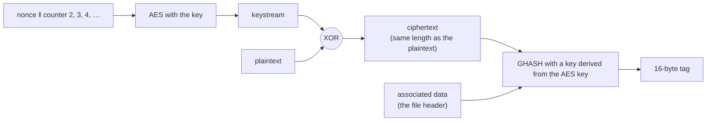

# AES-GCM and authenticated encryption

## TL;DR

- **AES** encrypts one 16-byte block with a key. To encrypt data of any length you need a **mode**. **GCM** (Galois/Counter Mode) is the mode to use by default: it encrypts *and* computes a 16-byte **authentication tag** that detects any change to the ciphertext.

- That makes it **authenticated encryption**: decryption either returns exactly the original bytes or throws. A wrong key, a flipped bit or a cut-off file all end in `AuthenticationTagMismatchException`, never in garbage.

- Each encryption needs a 12-byte **nonce** (number used once). It is not secret and is stored with the ciphertext, but it must **never repeat under the same key**. A repeated nonce lets an attacker combine the two ciphertexts and recover plaintext without the key.

- **Associated data** is authenticated but not encrypted. A file header (version, KDF parameters, salt) goes in there: readable by anyone, changeable by no one.

- In .NET: `new AesGcm(key, tagSizeInBytes: 16)`, then `Encrypt(nonce, plaintext, ciphertext, tag, associatedData)` and `Decrypt(nonce, ciphertext, tag, plaintext, associatedData)`.

## Key claims

- <a id="c1"></a>**C1.** AES is a block cipher: with a 128-, 192- or 256-bit key it encrypts exactly one 16-byte block. A **mode of operation** defines how to encrypt longer data with it. GCM is a mode that turns AES into a stream: the ciphertext is as long as the plaintext.

- <a id="c2"></a>**C2.** GCM is an **authenticated encryption with associated data** (AEAD) mode. Encryption outputs the ciphertext and an authentication tag computed over the ciphertext and the associated data. Decryption recomputes the tag and fails if it differs, so any change to ciphertext, tag, nonce or associated data, and any wrong key, is detected.

- <a id="c3"></a>**C3.** In .NET, `AesGcm.Decrypt` throws `AuthenticationTagMismatchException` (a `CryptographicException`, since .NET 8) when the tag doesn't verify, and clears the plaintext buffer. The caller never receives unverified plaintext.

- <a id="c4"></a>**C4.** GCM needs a nonce for every encryption. .NET's `AesGcm` supports only 12-byte nonces. The nonce doesn't need to be secret and is stored next to the ciphertext. It must never be used twice with the same key.

- <a id="c5"></a>**C5.** If two messages are encrypted with the same key and nonce, the XOR of their ciphertexts equals the XOR of their plaintexts. Knowing one plaintext then reveals the other, without the key. Nonce reuse also lets an attacker forge valid tags.

- <a id="c6"></a>**C6.** Random 12-byte nonces are safe as long as one key encrypts no more than about $2^{32}$ messages. Beyond that, the chance of a repeated nonce grows too large.

- <a id="c7"></a>**C7.** **Associated data** is passed to both `Encrypt` and `Decrypt`, is covered by the tag, but is not encrypted and not stored by GCM. A file format puts its header there, so the header stays readable but can't be changed undetected.

- <a id="c8"></a>**C8.** Unauthenticated modes such as CBC detect no tampering. An attacker who can submit modified ciphertexts and observe whether decryption fails can, in many designs, recover the plaintext (a **padding oracle** attack). That is why authenticated encryption is the default.

## Explanation

### From a block cipher to a mode

AES is a function: 32 key bytes and 16 input bytes in, 16 scrambled bytes out ([C1](#c1)). That's all. A password store is longer than 16 bytes, so something must decide how to apply AES to many blocks. That is the **mode**.

The naive mode, encrypting each block on its own (ECB), leaks patterns: equal plaintext blocks give equal ciphertext blocks. Real modes mix in a value that changes from block to block. GCM uses **counter mode**, which rests on one bitwise operation, XOR.

### XOR

**XOR** (exclusive or) compares two bits. The result is 1 when they differ and 0 when they are equal:

| a | b | a XOR b |
|---|---|---------|
| 0 | 0 | 0 |
| 0 | 1 | 1 |
| 1 | 0 | 1 |
| 1 | 1 | 0 |

On bytes, XOR works bit by bit, each bit with the bit at the same position. In C#, the operator is `^`, and `a ^= b` means `a = a ^ b`, like `+=`. In formulas, XOR is written $\oplus$. Here is one byte, the letter `h` (`0x68`), XORed with an arbitrary byte `0xB3`:

```text
  0110 1000   0x68  'h'
^ 1011 0011   0xB3
= 1101 1011   0xDB
```

Three rules follow from the table:

- XOR with 0 changes nothing: $x \oplus 0 = x$.
- XOR with itself gives 0: $x \oplus x = 0$.
- The order doesn't matter: $a \oplus b \oplus c$ gives the same result however you group and reorder it, like `+`.

Together they give the one property encryption needs: XOR the same value on twice, and it is gone again. $(x \oplus k) \oplus k = x \oplus (k \oplus k) = x \oplus 0 = x$. In the byte above, `0xDB ^ 0xB3` gives `0x68` again, the `h`.

### Counter mode

Counter mode turns AES into a generator of random-looking bytes, the **keystream**, and XORs them onto the plaintext:

1. **Build counter blocks.** Each block is 16 bytes: the 12-byte nonce, followed by a 4-byte counter. Written *nonce ‖ 2*, where ‖ means "followed by" (concatenation, like `nonce.Concat(counter)` in LINQ). The plaintext uses the counters 2, 3, 4, … GCM reserves counter 1 for the tag.
2. **Encrypt the counter blocks with AES.** Each gives 16 keystream bytes. Enough blocks are encrypted to cover the plaintext.
3. **XOR the keystream onto the plaintext**, byte by byte: ciphertext byte $i$ = plaintext byte $i$ $\oplus$ keystream byte $i$. The last keystream bytes are dropped, so the ciphertext is exactly as long as the plaintext.

Decryption builds the same keystream from the same key and nonce and XORs it on again. By the rule above, that removes it and leaves the plaintext. The **nonce** (number used once) is what makes the keystream differ from one encryption to the next under the same key.



### The tag: encryption you can trust

Counter mode alone hides the data but protects nothing else. Each plaintext bit is its ciphertext bit XOR one keystream bit. So if an attacker flips a ciphertext bit, decryption flips exactly the same plaintext bit, and reports no error.

That lets an attacker who knows the layout of the data change it on purpose, without the key. Say a settings file ends in `admin=0`. The character `0` is `0x30` (`0011 0000`), and `1` is `0x31` (`0011 0001`). They differ only in the lowest bit. The attacker flips the lowest bit of the last ciphertext byte, and the file decrypts to `admin=1`. The attacker never saw the keystream and never decrypted anything.

GCM adds an **authentication tag** ([C2](#c2)). After encrypting, it computes a keyed checksum (GHASH) over the ciphertext and the associated data, and stores the 16-byte result. A .NET comparison: like a hash you'd store to detect a corrupt download, except that it is **keyed**: a secret key is one of its inputs.

The difference matters against an attacker. A download page that lists a SHA-256 hash detects accidents: anyone can recompute `SHA256.HashData(file)`. But that is exactly the problem. An attacker who swaps the file simply recomputes the hash and swaps that too. A keyed checksum needs the key as well as the data. Without the key, an attacker who changes the data can't compute the tag that would match it. The tag is checked by the one party that does have the key: whoever decrypts. In .NET, the classic keyed checksum is `HMACSHA256.HashData(key, data)`, next to the unkeyed `SHA256.HashData(data)`. GCM's GHASH plays the same role, with a key that GCM derives from the AES key.

At decryption, `AesGcm` recomputes the tag. If it differs, it throws `AuthenticationTagMismatchException` and clears the output buffer ([C3](#c3)). This gives a password store two things at once:

- **Tampering is detected.** A flipped bit anywhere fails.
- **A wrong password is detected.** A wrong password gives a wrong key, which gives a wrong tag. No separate "password check" value needs storing.

The example below encrypts a short text with a random key, decrypts it, and then tries twice more: once with one ciphertext bit flipped, once with a different key. The output was printed with .NET 10:

```csharp
byte[] key = RandomNumberGenerator.GetBytes(32);
byte[] nonce = RandomNumberGenerator.GetBytes(12);
byte[] plaintext = "github: hunter2"u8.ToArray();
byte[] ciphertext = new byte[plaintext.Length];
byte[] tag = new byte[16];

using var gcm = new AesGcm(key, tagSizeInBytes: 16);
gcm.Encrypt(nonce, plaintext, ciphertext, tag);
Console.WriteLine($"plaintext {plaintext.Length} bytes, ciphertext {ciphertext.Length} bytes, tag {tag.Length} bytes");

byte[] decrypted = new byte[ciphertext.Length];
gcm.Decrypt(nonce, ciphertext, tag, decrypted);
Console.WriteLine(Encoding.UTF8.GetString(decrypted));

ciphertext[0] ^= 1;                              // flip one bit
try { gcm.Decrypt(nonce, ciphertext, tag, decrypted); }
catch (AuthenticationTagMismatchException) { Console.WriteLine("flipped bit: AuthenticationTagMismatchException"); }
ciphertext[0] ^= 1;                              // flip it back

using var wrong = new AesGcm(RandomNumberGenerator.GetBytes(32), tagSizeInBytes: 16);
try { wrong.Decrypt(nonce, ciphertext, tag, decrypted); }
catch (AuthenticationTagMismatchException) { Console.WriteLine("wrong key: AuthenticationTagMismatchException"); }
Console.WriteLine($"output cleared: {decrypted.AsSpan().IndexOfAnyExcept((byte)0) < 0}");
```

```text
plaintext 15 bytes, ciphertext 15 bytes, tag 16 bytes
github: hunter2
flipped bit: AuthenticationTagMismatchException
wrong key: AuthenticationTagMismatchException
output cleared: True
```

Reading it:

- `new AesGcm(key, tagSizeInBytes: 16)` sets up AES-GCM with a 32-byte key. The caller provides every buffer: `Encrypt` writes into `ciphertext` and `tag`, `Decrypt` into `decrypted`.
- The ciphertext is exactly as long as the plaintext, 15 bytes. The 16-byte tag comes on top ([C1](#c1)).
- `ciphertext[0] ^= 1` XORs the first ciphertext byte with `0000 0001`, which flips its lowest bit. The same line again flips it back.
- One flipped bit, and decryption refuses. A wrong key, and it refuses too ([C2](#c2)).
- After the failed decryption, the output buffer holds only zeros, not half-decrypted text ([C3](#c3)).

### The nonce: once, really once

Counter mode's keystream depends only on the key and the nonce. Use the same pair twice, and you get the same keystream twice ([C4](#c4)).

Name the pieces. Two messages are encrypted with the same key and the same nonce:

- $`P_1`$ and $`P_2`$ are the two plaintexts, as byte arrays.
- $K$ is the keystream. It is the same for both, because key and nonce are the same.
- $`C_1`$ and $`C_2`$ are the two ciphertexts. By counter mode, $`C_1 = P_1 \oplus K`$ and $`C_2 = P_2 \oplus K`$.
- $\oplus$ is XOR, byte by byte at each position, `^` in C#.

The attacker has $`C_1`$ and $`C_2`$, from two saved versions of a file, say. They XOR the two ciphertexts and apply the rules from the XOR section:

```math
\begin{aligned}
C_1 \oplus C_2 &= (P_1 \oplus K) \oplus (P_2 \oplus K) && \text{insert what } C_1 \text{ and } C_2 \text{ are} \\
               &= P_1 \oplus P_2 \oplus (K \oplus K) && \text{reorder} \\
               &= P_1 \oplus P_2 \oplus 0           && x \oplus x = 0 \\
               &= P_1 \oplus P_2                    && x \oplus 0 = x
\end{aligned}
```

The keystream is gone: it was XORed on twice. What's left mixes only the two plaintexts. If the attacker knows $`P_2`$ (an entry they added themselves, or a standard header), they XOR it on once more, and it is gone too:

```math
C_1 \oplus C_2 \oplus P_2 = P_1 \oplus P_2 \oplus P_2 = P_1
```

That is the first message, recovered without the key ([C5](#c5)). Here it is for one byte, with a made-up keystream byte `0xB3`. Message 1 has the character `4` at this position, message 2 has `0`:

| | value | bits |
|---|---|---|
| $`P_1`$, the character `4` | `0x34` | `0011 0100` |
| $`P_2`$, the character `0` | `0x30` | `0011 0000` |
| $K$, made up | `0xB3` | `1011 0011` |
| $`C_1 = P_1 \oplus K`$ | `0x87` | `1000 0111` |
| $`C_2 = P_2 \oplus K`$ | `0x83` | `1000 0011` |
| $`C_1 \oplus C_2`$ | `0x04` | `0000 0100` |
| $`C_1 \oplus C_2 \oplus P_2`$ | `0x34` | `0011 0100`, the `4` again |

Nonce reuse also breaks the tag: from two messages under one nonce, an attacker can work out GHASH's key and then forge tags for messages of their choice. The example below doesn't show that part.

The example below makes the mistake on purpose. It encrypts two 16-byte messages with the same key and the same nonce. Then it plays the attacker, who has both ciphertexts and knows the second message, but not the key:

```csharp
byte[] key = RandomNumberGenerator.GetBytes(32);
byte[] nonce = RandomNumberGenerator.GetBytes(12);
byte[] p1 = "pin=4711 user=al"u8.ToArray();
byte[] p2 = "pin=0000 user=bo"u8.ToArray();
byte[] c1 = new byte[16], c2 = new byte[16], t = new byte[16];
using (var gcm = new AesGcm(key, 16))
{
    gcm.Encrypt(nonce, p1, c1, t);
    gcm.Encrypt(nonce, p2, c2, t);   // the mistake: the same nonce again
}

byte[] x = new byte[16];
for (int i = 0; i < 16; i++) x[i] = (byte)(c1[i] ^ c2[i] ^ p2[i]);
Console.WriteLine($"recovered without the key: {Encoding.UTF8.GetString(x)}");
```

```text
recovered without the key: pin=4711 user=al
```

Reading it:

- The loop runs over the 16 byte positions. At each position `i`, it XORs the two ciphertext bytes and the known plaintext byte: `c1[i] ^ c2[i] ^ p2[i]`. That is the second formula above, one byte at a time, as in the table.
- The cast `(byte)` is needed because C# computes `byte ^ byte` as `int`, as it does for `byte + byte`.
- The result is the first message, recovered without the key.
- The tags were ignored. Nothing in the attack needs them.

How to get unique nonces:

- **Random:** 12 bytes from `RandomNumberGenerator` at every encryption. Two random 96-bit values collide only rarely, as long as one key doesn't encrypt more than about $2^{32}$ messages ([C6](#c6)). A password store saved a few times a day is billions of saves away from that.
- **New key per encryption:** if each save also draws a new salt, the KDF gives a new key, and the nonce only has to be unique under that one key.

The nonce isn't secret. It's stored in the file, like the salt.

### Associated data: the header

A store file starts with a header: a format marker, the KDF's iteration count, the salt, the nonce. The reader needs these *before* it can decrypt, so they can't be encrypted. But they must not be changeable either: an attacker who lowers the iteration count in the header would make the next save weaker.

That is what **associated data** is for ([C7](#c7)). You pass the header bytes to `Encrypt` and `Decrypt` as `associatedData`. GCM doesn't encrypt or store them, but includes them in the tag. Change one header byte, and decryption fails.

The example below encrypts with a 4-byte header as associated data, changes one byte of the header, and tries to decrypt:

```csharp
byte[] key = RandomNumberGenerator.GetBytes(32);
byte[] nonce = RandomNumberGenerator.GetBytes(12);
byte[] header = "PWS1"u8.ToArray();
byte[] plaintext = "github: hunter2"u8.ToArray();
byte[] ciphertext = new byte[plaintext.Length], tag = new byte[16], decrypted = new byte[plaintext.Length];

using var gcm = new AesGcm(key, tagSizeInBytes: 16);
gcm.Encrypt(nonce, plaintext, ciphertext, tag, associatedData: header);

header[3] = (byte)'2';                           // "PWS1" becomes "PWS2"
try { gcm.Decrypt(nonce, ciphertext, tag, decrypted, associatedData: header); }
catch (AuthenticationTagMismatchException) { Console.WriteLine("changed header: AuthenticationTagMismatchException"); }
```

```text
changed header: AuthenticationTagMismatchException
```

Reading it:

- The header itself isn't encrypted or stored by `Encrypt`. The program keeps it, here in its own array, in a file at the start.
- Key, nonce, ciphertext and tag are all intact. Only the header changed, and the tag no longer matches.

### The file layout

```text
offset  length  field                    encrypted?   in the tag?
------  ------  -----------------------  -----------  -----------
     0       4  format marker "PWS1"     no           yes (associated data)
     4       4  PBKDF2 iterations        no           yes (associated data)
     8      16  salt                     no           yes (associated data)
    24      12  nonce                    no           yes (associated data)
    36      16  tag                      no           (it is the tag)
    52       n  ciphertext               yes          yes
```

Overhead: 52 bytes, whatever the length of the data.

The method below writes a store in this layout. It combines the [key derivation note](password-key-derivation.md) with the sections above:

```csharp
static byte[] Seal(ReadOnlySpan<byte> password, ReadOnlySpan<byte> plaintext)
{
    const int HeaderLength = 4 + 4 + 16 + 12, Iterations = 600_000;
    byte[] file = new byte[HeaderLength + 16 + plaintext.Length];
    Span<byte> header = file.AsSpan(0, HeaderLength);
    "PWS1"u8.CopyTo(header);
    BinaryPrimitives.WriteInt32LittleEndian(header[4..], Iterations);
    RandomNumberGenerator.Fill(header.Slice(8, 16));    // new salt at every save
    RandomNumberGenerator.Fill(header.Slice(24, 12));   // new nonce at every save

    byte[] key = Rfc2898DeriveBytes.Pbkdf2(password, header.Slice(8, 16), Iterations, HashAlgorithmName.SHA256, 32);
    try
    {
        using var gcm = new AesGcm(key, tagSizeInBytes: 16);
        gcm.Encrypt(header.Slice(24, 12), plaintext,
                    file.AsSpan(HeaderLength + 16), file.AsSpan(HeaderLength, 16),
                    associatedData: header);
    }
    finally { CryptographicOperations.ZeroMemory(key); }
    return file;
}
```

Reading it:

- `file` is allocated once at its final size. Every part of the layout is a `Span` slice of it, so `Encrypt` writes the tag and the ciphertext straight into their places.
- The header comes first: marker, iteration count, then a new random salt and a new random nonce. So every save gets a new key as well as a new nonce ([C4](#c4)).
- The whole header goes in as associated data, so none of it can change undetected ([C7](#c7)).
- The key is wiped right after use, in `finally`.
- Sealing 15 bytes gave a 67-byte file: 52 bytes of overhead plus 15.

Opening a store is the same in reverse. Read the marker and the iteration count from the header, derive the key from the password and the stored salt, and call `Decrypt` with the stored nonce, the tag and the same header as associated data. A wrong password, a changed header byte and a flipped ciphertext bit all end in the same `AuthenticationTagMismatchException`, as the earlier examples showed.

### Why not AES-CBC?

Older code often uses `Aes.Create()` with its default mode, CBC, which encrypts but doesn't authenticate ([C8](#c8)). Decrypting tampered CBC data either yields garbage or fails on the padding at the end. If an attacker can tell those two outcomes apart, by an error message or by timing, they can decrypt the data byte by byte through repeated tries. Fixing CBC means adding an HMAC over the ciphertext, and checking it before decrypting. AES-GCM does both jobs in one primitive, which is why it is the default choice in new code.

## Good habits

- Use an authenticated mode, AES-GCM, for new code; not CBC without a MAC, never ECB ([C2](#c2), [C8](#c8); NIST SP 800-38D; OWASP *Cryptographic Storage Cheat Sheet*).

- Generate a fresh 12-byte nonce with `RandomNumberGenerator` for every encryption, and store it with the ciphertext ([C4](#c4), [C6](#c6); NIST SP 800-38D, section 8).

- Pass the file header as associated data ([C7](#c7); NIST SP 800-38D).

- Construct `AesGcm` with an explicit `tagSizeInBytes: 16` ([C3](#c3); .NET diagnostic SYSLIB0053).

- Treat `AuthenticationTagMismatchException` as "wrong password or damaged file", and never use partial output ([C3](#c3); Microsoft Learn, `AesGcm.Decrypt`).

## Pitfalls

- **A constant or counter-from-zero nonce with a long-lived key.** The second save under the same key repeats it ([C5](#c5)).

- **Thinking the nonce must be secret.** It mustn't repeat. It may be public ([C4](#c4)).

- **Leaving the header out of the associated data.** An attacker can then change it unnoticed, for example to lower the KDF cost ([C7](#c7)).

- **Using `Aes.Create()` and its default mode for files.** That is CBC without authentication ([C8](#c8)).

- **Telling the user "wrong password" and "file damaged" apart.** GCM can't tell them apart, and it shouldn't try: both are a tag mismatch ([C2](#c2)).

## Exercises

1. **Predict.** In the store above, an attacker flips one bit in the salt. What happens when you open the file with the right password?

   <details><summary>Solution</summary>

   `AuthenticationTagMismatchException`. The salt is part of the associated data, so the tag no longer matches ([C7](#c7)). The changed salt also gives a different key, which fails the tag as well.

   </details>

2. **Explain.** Why does a password store with AES-GCM need no separate value to check whether the master password is right?

   <details><summary>Solution</summary>

   A wrong password gives a wrong key, and a wrong key gives a tag that doesn't match. Decryption fails before returning anything ([C2](#c2), [C3](#c3)).

   </details>

3. **Find the bug.** A colleague's store derives its key once at installation (fixed salt), and uses `new byte[12]` (all zeros) as the nonce at every save. What can an attacker who collects two saved versions of the file do?

   <details><summary>Solution</summary>

   Both versions use the same key and the same nonce, so the XOR of the ciphertexts is the XOR of the two plaintexts ([C5](#c5)). Knowing parts of one version (an entry the attacker added, or a common URL) reveals the same positions of the other. The attacker can also forge tags. Fix: a random nonce at every save ([C4](#c4)), ideally with a new salt too.

   </details>

## Sources

- M. Dworkin, [NIST SP 800-38D: Recommendation for Block Cipher Modes of Operation: Galois/Counter Mode (GCM) and GMAC](https://csrc.nist.gov/pubs/sp/800/38/d/final), 2007: the mode, 96-bit IVs, the uniqueness requirement (section 8) and the limit for random IVs (section 8.3).
- A. Joux, [Authentication Failures in NIST version of GCM](https://csrc.nist.gov/csrc/media/projects/block-cipher-techniques/documents/bcm/joux_comments.pdf), comment to NIST, 2006: forging tags after a nonce is repeated.
- Microsoft Learn, [`AesGcm` class](https://learn.microsoft.com/en-us/dotnet/api/system.security.cryptography.aesgcm): nonce and tag sizes, the constructor with `tagSizeInBytes`, `AuthenticationTagMismatchException`, clearing the plaintext on failure.
- OWASP, [Cryptographic Storage Cheat Sheet](https://cheatsheetseries.owasp.org/cheatsheets/Cryptographic_Storage_Cheat_Sheet.html): authenticated modes as the default.
- Claude session, 2026-11-18: every snippet was run there with .NET 10.
