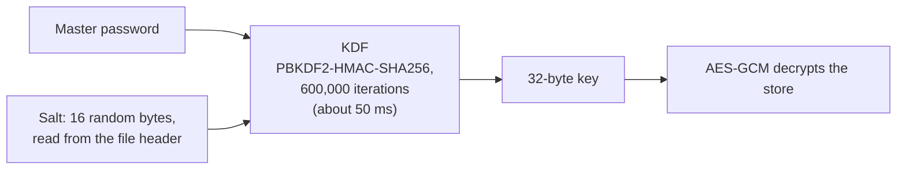

# Deriving a key from a password

## TL;DR

- A cipher such as AES needs a key of exactly 32 random-looking bytes. A password is neither: it has the wrong length, and it is guessable. A **key derivation function** (KDF) turns a password into a key.

- A password KDF is **slow on purpose**. An attacker who has the encrypted file guesses passwords offline, and each guess costs one KDF run. At about 50 ms per run, that is 20 guesses per second per CPU core instead of millions.

- A **salt** is a random value stored next to the ciphertext, not secret, that goes into the KDF with the password. The same password then gives a different key in every file, so an attacker can't precompute keys for common passwords.

- **PBKDF2** (in .NET: `Rfc2898DeriveBytes.Pbkdf2`) repeats a keyed hash a chosen number of times: 600,000 for HMAC-SHA256 is the current OWASP recommendation. **Argon2id** also uses a lot of memory, which slows down graphics cards and custom hardware more. OWASP prefers it, but .NET has no built-in Argon2.

- Store the algorithm, the iteration count and the salt in the file's header, so the next version can raise the cost and still open old files.

## Key claims

- <a id="c1"></a>**C1.** A key derivation function maps a password, a salt and cost parameters to a key of a chosen length. The same inputs always give the same key, so the key never has to be stored: it is derived again at every unlock.

- <a id="c2"></a>**C2.** A password KDF is deliberately slow, so each guess in an offline attack costs as much as one legitimate unlock. A fast hash such as plain SHA-256 is unsuitable, because an attacker can compute millions of guesses per second.

- <a id="c3"></a>**C3.** A salt is a random value, typically 16 bytes, generated once per file (or per password) and stored in clear next to the ciphertext. It makes the same password yield different keys in different files, which defeats tables of keys precomputed for common passwords. The salt is not secret.

- <a id="c4"></a>**C4.** PBKDF2 (RFC 8018) applies a pseudorandom function, usually HMAC-SHA256, for a chosen number of iterations. Its cost grows linearly with the iteration count. OWASP recommends 600,000 iterations for PBKDF2-HMAC-SHA256.

- <a id="c5"></a>**C5.** Argon2id (RFC 9106) is **memory-hard**: each run needs a chosen amount of memory as well as time. That reduces the advantage of graphics cards and custom chips, which have many cores but little memory per core. OWASP recommends Argon2id first, with at least 19 MiB, two iterations and one lane.

- <a id="c6"></a>**C6.** In .NET, `Rfc2898DeriveBytes.Pbkdf2(password, salt, iterations, hashAlgorithm, outputLength)` derives a key in one static call. Since .NET 10 the constructors of `Rfc2898DeriveBytes` are obsolete (`SYSLIB0060`). .NET has no built-in Argon2; it needs a third-party library.

- <a id="c7"></a>**C7.** The KDF's parameters (algorithm, iteration count or memory, salt) are stored in the encrypted file's header. That lets a program open older files after it raises the cost for new ones.

## Explanation

### Why a password isn't a key

`AesGcm` wants a 32-byte key. You could take the password's UTF-8 bytes, pad them, and use that. But a cipher's security assumes the key is one of $2^{256}$ equally likely values. A password chosen by a person comes from a far smaller set: dictionary words, names, years, the same patterns everyone uses.

Hashing it to 32 bytes fixes the length, not the guessability. If an attacker has your encrypted file, they can try passwords offline: for each guess, compute the key, try to decrypt, check whether it worked. With a plain SHA-256, one CPU core computes millions of guesses per second (the next section measures it). A graphics card does far more. A password that would survive a few thousand guesses survives seconds.

### Slow on purpose

A KDF turns this around ([C2](#c2)). It makes computing the key expensive, for the attacker and for you alike. You pay once per unlock, and 50 ms is not noticeable. The attacker pays once per *guess*, and needs millions of guesses ([C1](#c1)).



The example below compares the two costs on one laptop core: a million plain SHA-256 hashes, then one key from PBKDF2 with 600,000 iterations. The output was printed with .NET 10:

```csharp
byte[] salt = RandomNumberGenerator.GetBytes(16);

var sw = Stopwatch.StartNew();
for (int i = 0; i < 1_000_000; i++) SHA256.HashData("correct horse"u8);
Console.WriteLine($"one million SHA-256 hashes: {sw.ElapsedMilliseconds} ms");

sw.Restart();
byte[] key = Rfc2898DeriveBytes.Pbkdf2("correct horse"u8, salt, 600_000, HashAlgorithmName.SHA256, 32);
Console.WriteLine($"one PBKDF2 key, 600000 iterations: {sw.ElapsedMilliseconds} ms");
```

```text
one million SHA-256 hashes: 164 ms
one PBKDF2 key, 600000 iterations: 46 ms
```

Reading it:

- A plain hash costs well under a microsecond: about six million guesses per second on one core.
- One PBKDF2 key costs 46 ms, as long as about 280,000 plain hashes. That factor is what an offline attacker pays per guess ([C2](#c2)). For you, 46 ms at unlock goes unnoticed.
- `Rfc2898DeriveBytes.Pbkdf2` takes the password, the salt, the iteration count, the hash function and the key length in bytes, and returns the key ([C6](#c6)).
- The `"correct horse"u8` literal keeps the example short. A real program gets the password from the user as bytes or characters, never as a `string`. The [note on keeping secrets in .NET memory](../dotnet/secrets-in-memory.md) explains why.

The cost is a dial. More iterations make each guess more expensive, and each unlock slower. RFC 8018 says the count should be "as large as possible" while the delay stays acceptable. OWASP's current figure for PBKDF2-HMAC-SHA256 is 600,000 iterations ([C4](#c4)). Computers get faster, so the figure goes up over the years. That is why the count belongs in the file ([C7](#c7)).

### The salt

Without a salt, the password `hunter2` gives the same key in every file in the world. An attacker could compute the keys for the ten million most common passwords once, store them, and then test every stolen file against that table in no time.

A **salt** is 16 random bytes, generated when the file is created and stored in its header ([C3](#c3)). It goes into the KDF together with the password. The same password now gives a different key in every file, so a precomputed table is useless. Every file has to be attacked on its own, at full KDF cost per guess.

The example below derives three keys from the same password: two with the same salt, one with a new salt:

```csharp
byte[] salt = RandomNumberGenerator.GetBytes(16);
byte[] k1 = Rfc2898DeriveBytes.Pbkdf2("correct horse"u8, salt, 600_000, HashAlgorithmName.SHA256, 32);
byte[] k2 = Rfc2898DeriveBytes.Pbkdf2("correct horse"u8, salt, 600_000, HashAlgorithmName.SHA256, 32);
byte[] k3 = Rfc2898DeriveBytes.Pbkdf2("correct horse"u8, RandomNumberGenerator.GetBytes(16), 600_000, HashAlgorithmName.SHA256, 32);

Console.WriteLine($"same salt: same key = {k1.AsSpan().SequenceEqual(k2)}");
Console.WriteLine($"other salt: same key = {k1.AsSpan().SequenceEqual(k3)}");
```

```text
same salt: same key = True
other salt: same key = False
```

Reading it:

- Same password, same salt: the same key every time. So the key never has to be stored. The program keeps the salt and derives the key again at each unlock ([C1](#c1)).
- Same password, new salt: a different key. Two files protected with the same password don't share a key ([C3](#c3)).

The salt is not secret. It sits in clear next to the ciphertext, like the IV of a cipher. Its only job is to be different. In .NET terms: the salt is to the KDF what a per-instance seed is to a hash table that resists collision attacks.

### PBKDF2 and Argon2

**PBKDF2** (password-based key derivation function 2) is the old standard ([C4](#c4)). It feeds the password and salt into HMAC-SHA256, feeds the result back in, and repeats, 600,000 times, then combines the results. Each iteration is cheap, so the cost is pure CPU time. That is its weakness: a graphics card has thousands of small cores, each able to run its own guess.

**Argon2** won the Password Hashing Competition in 2015 and is standardised in RFC 9106. Besides time, it needs a block of memory per run, for example 19 MiB or 64 MiB, fills it, and reads it back in an order that is hard to shortcut ([C5](#c5)). Thousands of parallel guesses would need thousands of such blocks. Memory, not cores, becomes the bottleneck, and the attacker's hardware advantage shrinks. The variant to use is **Argon2id**.

OWASP recommends Argon2id first and PBKDF2 where a FIPS-certified algorithm is required. For a .NET program the trade is:

| | PBKDF2 | Argon2id |
|---|---|---|
| In .NET | built in: `Rfc2898DeriveBytes.Pbkdf2` | needs a third-party library |
| Resistance to graphics cards | lower: cost is CPU time only | higher: cost is time and memory |
| Parameters | hash, iterations | memory, iterations, lanes |
| OWASP minimum | 600,000 iterations (HMAC-SHA256) | 19 MiB, 2 iterations, 1 lane |

### What the KDF doesn't fix

A KDF makes guessing expensive, not impossible. A password from the top thousand is found in a thousand guesses, however slow each one is. It protects a reasonable password, not a weak one.

And it only matters once someone has the file and tries offline. It does nothing against malware that logs the password as you type it.

### Caching the derived key

Typing a long master password at every use is tiring. A common design derives the key once, then keeps it for a while, protected by the operating system: on Windows with DPAPI's `CurrentUser` scope ([DPAPI](../windows/dpapi.md)). The next unlock reads the cached key instead of asking. If the cache is lost (a password reset, a new PC), the program asks for the master password again and nothing else is lost. The cache holds the *derived key*, not the password, so the password itself is never stored.

## Good habits

- Derive keys from passwords with a slow password KDF, never with a plain hash ([C2](#c2); OWASP, *Password Storage Cheat Sheet*).

- Generate a new random 16-byte salt for every file, with `RandomNumberGenerator` ([C3](#c3); RFC 9106, section 3.1; RFC 8018, section 4.1).

- Use at least OWASP's current cost: 600,000 iterations for PBKDF2-HMAC-SHA256, or Argon2id with at least 19 MiB ([C4](#c4), [C5](#c5); OWASP).

- Use the static `Rfc2898DeriveBytes.Pbkdf2`, not the obsolete constructors ([C6](#c6); .NET diagnostic SYSLIB0060).

- Store the algorithm, cost and salt in the file header ([C7](#c7); RFC 8018, section 4).

## Pitfalls

- **Using `SHA256.HashData(password)` as the key.** Fast enough for an attacker to try millions of passwords per second ([C2](#c2)).

- **A fixed salt in the code.** Every file then shares it, and one precomputed table attacks them all ([C3](#c3)).

- **Treating the salt as a secret.** It is stored in clear and that is fine ([C3](#c3)). What protects the file is the password plus the KDF's cost.

- **Copying an old example with 1,000 or 10,000 iterations.** RFC 8018 quotes a minimum of 1,000 from 2010. Today's recommendation is hundreds of times higher ([C4](#c4)).

- **`new Rfc2898DeriveBytes(password, salt)`.** That old constructor defaults to SHA-1 and 1,000 iterations. It is obsolete since .NET 10 ([C6](#c6)).

- **Hard-coding the iteration count in the reader.** A file written with another count then can't be opened ([C7](#c7)).

## Exercises

1. **Explain.** An attacker has your encrypted store. Why does a 50 ms KDF hurt them more than it hurts you?

   <details><summary>Solution</summary>

   You run the KDF once per unlock. The attacker runs it once per guess and needs millions of guesses, so the same 50 ms multiplies into days or years for them ([C2](#c2)).

   </details>

2. **Predict.** Two users both choose `Sommer2026!` as master password. Do their stores have the same key? What if the program had used a fixed salt?

   <details><summary>Solution</summary>

   No: each store has its own random salt, so the keys differ ([C3](#c3)). With a fixed salt the keys would be equal, and a key precomputed for `Sommer2026!` would open both.

   </details>

3. **Decide.** Version 1.0 of a password tool used 600,000 PBKDF2 iterations. Version 2.0 wants 1,000,000. How does 2.0 open the stores 1.0 wrote, and when do they get the higher cost?

   <details><summary>Solution</summary>

   It reads the iteration count from each file's header and uses that to derive the key ([C7](#c7)). At the next save it writes the new count, with a new salt, so each store moves to the higher cost the first time it is saved again.

   </details>

## Sources

- K. Moriarty, B. Kaliski, A. Rusch, [RFC 8018: PKCS #5: Password-Based Cryptography Specification Version 2.1](https://www.rfc-editor.org/rfc/rfc8018.html), 2017: sections 4.1 (salt), 4.2 (iteration count) and 5.2 (PBKDF2).
- A. Biryukov, D. Dinu, D. Khovratovich, S. Josefsson, [RFC 9106: Argon2 Memory-Hard Function for Password Hashing and Proof-of-Work Applications](https://www.rfc-editor.org/rfc/rfc9106.html), 2021: Argon2id, recommended parameters, 16-byte salts.
- OWASP, [Password Storage Cheat Sheet](https://cheatsheetseries.owasp.org/cheatsheets/Password_Storage_Cheat_Sheet.html): Argon2id first, minimum parameters, 600,000 iterations for PBKDF2-HMAC-SHA256.
- Microsoft Learn, [`Rfc2898DeriveBytes.Pbkdf2`](https://learn.microsoft.com/en-us/dotnet/api/system.security.cryptography.rfc2898derivebytes.pbkdf2) and [SYSLIB0060](https://aka.ms/dotnet-warnings/SYSLIB0060).
- Claude session, 2026-11-18: the snippets were run there with .NET 10.
