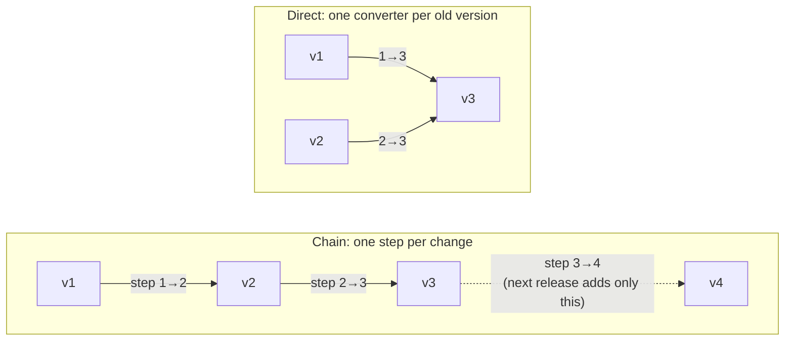
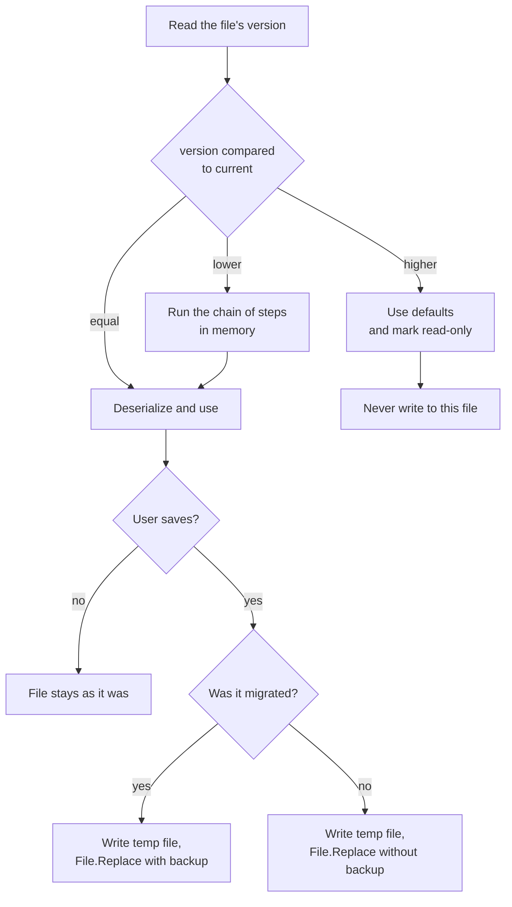

# Versioned file formats and migration chains

## TL;DR

- A program that stores data in a file reads, years later, files written by every release before it. The file carries a **format version**, and each change to the format comes with a **migration step** that turns a version-$n$ file into a version-$(n+1)$ file.

- The steps form a **chain**: a v1 file runs v1→v2, then v2→v3. Each step is written once, in the release that changes the format, and never touched again.

- A file from a **newer** release (the user downgraded, or two releases share the file) is not loaded and never overwritten. The older release uses defaults instead. A **tolerant reader**, which ignores unknown fields, or a **read-only mode** are alternatives with their own risks.

- Migrate in memory on every load, and **write the migrated file back on the next save**, not at load time. Before that first overwrite, keep the old file as a **backup**.

## Key claims

- <a id="c1"></a>**C1.** In a migration chain, there is one step per format change, from version $n$ to version $n+1$. Loading a version-$k$ file runs the steps $k \to k+1$, $k+1 \to k+2$, … up to the current version, in order. A release that changes the format adds one new step and leaves all earlier steps unchanged.

- <a id="c2"></a>**C2.** The alternative, one converter from each old version straight to the newest, needs every converter to be changed whenever the format changes again. With a chain, each step is written and tested once. With direct converters, a release that brings version $n$ must touch $n-1$ converters.

- <a id="c3"></a>**C3.** A chain step sees only what the steps before it kept. Data that one step drops is gone for every later step, so a later version cannot bring it back from a migrated file.

- <a id="c4"></a>**C4.** A release that finds a file with a higher version than it knows cannot tell what changed. The safe default: do not interpret the file, start with defaults, and never write to that file. Writing would replace the newer release's data with an older format.

- <a id="c5"></a>**C5.** A **tolerant reader** ignores fields it does not know and loads a newer file anyway. That is correct only if the newer release merely *added* fields. A renamed field or a field whose meaning changed is misread without any error. Saving the file then drops the unknown fields, unless the reader keeps them, for example with `[JsonExtensionData]` in System.Text.Json.

- <a id="c6"></a>**C6.** A format can let the *newer* writer say how compatible it is. SQLite's database header holds two numbers: a *read version* and a *write version*. A release that knows the read version but not the write version opens the file read-only. A release that does not know the read version refuses the file.

- <a id="c7"></a>**C7.** Writing the migrated file back **at load time** makes it unreadable for the older release at once, even if the user changed nothing. Writing it back **on the next save** leaves untouched files readable by older releases. It costs running the migration again on each load.

- <a id="c8"></a>**C8.** The first save after a migration should keep the old file as a backup, such as `bookmarks.json.v1.bak`. Writing to a temporary file and swapping it in with `File.Replace(temp, path, backup)` keeps the backup and never leaves a half-written file. `File.Replace` needs all three files on the same volume.

## Explanation

### Why a chain

Take a bookmarks file of a document viewer, whose format changed twice: v2 added a field, v3 renamed one. The current release must read v1, v2 and v3 files. There are two ways to organise the code.



With **direct converters**, each old version has its own converter to the newest format. When v4 arrives, "newest" moves: 1→3 and 2→3 must both become converters to v4, and 3→4 is new ([C2](#c2)). Every release touches every converter, and every converter needs new tests. After ten format changes that is nine converters rewritten in the tenth release alone.

With a **chain**, the v4 release adds only the step 3→4 ([C1](#c1)). The steps 1→2 and 2→3 already shipped, were tested against real files, and stay as they are. A v1 file passes through all three steps. Each step only has to know two neighbouring formats, which is the smallest thing that can be got right.

The cost of the chain: a very old file runs many steps. For a settings file that is microseconds. A second cost is [C3](#c3): if step 2→3 drops a field, no later step can get it back. With direct converters, 1→4 could still read the field from a v1 file. In practice that is rarely worth giving up the chain for.

### A file from a newer release

A version field also tells an old release that a file is *newer* than it is. That happens after a downgrade, or when two releases share a file, for example on a PC where one user still runs an older version.

The old release has no step for v4 and cannot know what v4 changed ([C4](#c4)). It might have added a field, which would be harmless. It might have changed what a number means, which would not. So the safe default is:

1. Do not load the file's contents.
2. Start with defaults, and tell the user why, for example in a log line or a status message.
3. **Never write to that file.** The newer release still needs it. Writing an older format over it destroys its data.

Saving the user's changes elsewhere, or not at all, is a product decision. Overwriting the newer file is never the answer.

There are two alternatives, each with a cost.

**Tolerant reader** ([C5](#c5)). Martin Fowler's name for a reader that takes only what it needs and ignores the rest. For JSON, that is System.Text.Json's default: unknown properties are skipped. It works as long as newer releases only add fields. But the reader can't tell an added field from a renamed one. If v4 renamed `location` to `uri`, the old release sees no `location`, gets `null`, and reports no error. On save, the unknown `uri` is lost, unless the type keeps unknown properties in a `[JsonExtensionData]` dictionary, which writes them back out.

**Read-only mode** ([C6](#c6)). SQLite solves the "what did the newer release change?" problem with two numbers in its header. The *write version* changes when older releases may still read the file but must not write it. The *read version* changes when older releases can't even read it. An older SQLite opens a file with an unknown write version read-only, and refuses one with an unknown read version. The newer writer, who knows what changed, decides. A plain JSON file can copy the idea with a second field, such as `"minReaderVersion"`.



### When to write the migrated data back

Migration happens in memory at load. Writing the result back to disk is a separate decision ([C7](#c7)).

- **At load.** The file on disk is always current, and each file is migrated once. But merely starting the new release changes the user's files. If the user goes back to the older release, it now finds a newer file and falls back to defaults ([C4](#c4)), although the user changed nothing.
- **On the next save.** A file the user only reads stays in its old format, so an older release can still use it. The migration runs again on every load, which costs nothing noticeable for a settings file.

For a settings file, the second is the better default: an upgrade does not break a downgrade until the user actually saves.

### Keep a backup

When the migrated file is first written back, the old file is the only copy of the old format. Keep it ([C8](#c8)). A name that includes its version, such as `bookmarks.json.v1.bak`, tells a user or a support engineer what it is. After a downgrade, renaming it back restores the old release's state.

`File.Replace(sourceFileName, destinationFileName, destinationBackupFileName)` does the swap in one call. It replaces the destination with the source and keeps the old destination under the backup name. Combined with writing to a temporary file first, a crash during the write leaves the old file intact. The files must be on the same volume. A temporary file next to the target, such as `bookmarks.json.tmp`, always is.

## Examples

A document viewer keeps its bookmarks in a JSON file, in three versions. v2 added a `color` per bookmark. v3 renamed `path` to `location` and dropped the top-level `lastOpened`. A v1 file:

```json
{ "version": 1, "lastOpened": "Manual", "bookmarks": [ { "name": "Manual", "path": "docs/manual.pdf" } ] }
```

The store reads the file as a `JsonObject`, runs the missing steps on it, and only then deserializes it into the current types. The old formats never need C# types of their own.

```csharp
using System.Text.Json;
using System.Text.Json.Nodes;

public sealed record Bookmark(string Name, string Location, string Color);
public sealed record BookmarkFile(int Version, Bookmark[] Bookmarks);
public sealed record LoadResult(BookmarkFile File, int FromVersion, bool ReadOnly);

public static class BookmarkStore
{
    public const int CurrentVersion = 3;

    static readonly JsonSerializerOptions Options = new(JsonSerializerDefaults.Web) { WriteIndented = true };

    // Steps[k] turns a version-k document into version k+1.
    static readonly Dictionary<int, Action<JsonObject>> Steps = new()
    {
        [1] = V1ToV2,
        [2] = V2ToV3,
    };

    // v2 added a colour per bookmark.
    static void V1ToV2(JsonObject doc)
    {
        foreach (var bookmark in doc["bookmarks"]!.AsArray())
            bookmark!["color"] = "yellow";          // new field: default
    }

    // v3 renamed "path" to "location" and dropped the top-level "lastOpened".
    static void V2ToV3(JsonObject doc)
    {
        foreach (var node in doc["bookmarks"]!.AsArray())
        {
            var bookmark = node!.AsObject();
            var path = bookmark["path"];
            bookmark.Remove("path");                // detach before re-adding
            bookmark["location"] = path;            // renamed field: move
        }
        doc.Remove("lastOpened");                   // removed field: drop
    }

    public static LoadResult Load(string path)
    {
        var doc = JsonNode.Parse(File.ReadAllText(path))!.AsObject();
        int fromVersion = doc["version"]!.GetValue<int>();

        if (fromVersion > CurrentVersion)           // written by a newer release
            return new LoadResult(Defaults(), fromVersion, ReadOnly: true);

        for (int v = fromVersion; v < CurrentVersion; v++)
        {
            Steps[v](doc);
            doc["version"] = v + 1;
        }

        var file = doc.Deserialize<BookmarkFile>(Options)!;
        return new LoadResult(file, fromVersion, ReadOnly: false);
    }

    public static void Save(string path, LoadResult loaded)
    {
        if (loaded.ReadOnly)
            throw new InvalidOperationException("Never overwrite a file from a newer version.");

        string temp = path + ".tmp";
        File.WriteAllText(temp, JsonSerializer.Serialize(loaded.File, Options));

        // First save after a migration: keep the old file as a backup.
        string? backup = loaded.FromVersion < CurrentVersion
            ? $"{path}.v{loaded.FromVersion}.bak"
            : null;
        File.Replace(temp, path, backup);
    }

    static BookmarkFile Defaults() => new(CurrentVersion, []);
}
```

Reading it:

- `Steps` is the chain ([C1](#c1)). A v4 release adds `[3] = V3ToV4` and changes nothing else.
- The loop sets `version` after each step, so a step never has to.
- `JsonNode` objects belong to one parent. `bookmark.Remove("path")` detaches the value before it is attached again under its new name. Without it, the assignment throws `InvalidOperationException` ("The node already has a parent").
- `Save` refuses a read-only result ([C4](#c4)). The backup name is only passed on the first save after a migration ([C8](#c8)).

Loading a v1, a v3 and a v4 file, then saving each one that is not read-only, prints:

```text
v1.json: from v1, readOnly=False, bookmarks=Manual -> docs/manual.pdf (yellow)
v3.json: from v3, readOnly=False, bookmarks=Notes -> notes.txt (green)
v4.json: from v4, readOnly=True, bookmarks=
```

Afterwards the folder holds `v1.json` (now in v3 format, without `lastOpened`), `v1.json.v1.bak` (the original), `v3.json` (rewritten, no backup) and `v4.json` (untouched).

## Good habits

- Never write to a file whose version is higher than the current one ([C4](#c4); SQLite file format, section 1.3.3).

- Write to a temporary file and swap it in with `File.Replace`, keeping a backup on the first save after a migration ([C8](#c8); `File.Replace` reference).

## Pitfalls

- **Bumping the version without a step.** A release that changes the format but forgets the step reads old files through the new types. Missing fields silently get the C# default, `0` or `null`, instead of the intended default.

- **Deserializing before migrating.** If a v1 file is deserialized straight into the v3 type, the renamed `path` is ignored and `Location` is `null`. Migrate the untyped `JsonObject` first, then deserialize ([C1](#c1)).

- **Editing a step that has shipped.** Files already migrated by the old step stay as they are. Files migrated later go through the new one. The same version number then means two different things ([C1](#c1)).

- **Treating a newer file as corrupt.** Deleting or "repairing" a file because its version is unknown destroys the newer release's data ([C4](#c4)).

- **Trusting a tolerant reader with renames.** Ignoring unknown fields hides a rename instead of reporting it ([C5](#c5)).

- **Migrating on load by default.** A user who only tries the new release and goes back finds their settings gone ([C7](#c7)).

## Exercises

1. **Count.** A format is at version 6. How many migration steps does a chain have, and how many converters does the direct approach have? How many of each does the release that introduces version 7 have to write or change?

   <details><summary>Solution</summary>

   Chain: five steps (1→2 to 5→6). The v7 release writes one new step, 6→7, and changes none ([C1](#c1)). Direct: five converters (1→6 to 5→6). The v7 release changes all five to target v7 and writes 6→7, so six converters are written or changed ([C2](#c2)).

   </details>

2. **Decide.** Release 3.0 of an app writes `"version": 5`. A user goes back to release 2.4, which knows versions up to 4. What does 2.4 do with the file, and what must it not do? What could 3.0 have done so that 2.4 could at least show the data?

   <details><summary>Solution</summary>

   2.4 does not interpret the file, starts with defaults, and never writes to it ([C4](#c4)). If 3.0 had recorded that version 5 is still readable by a version-4 reader, for example with a separate read version as SQLite does, 2.4 could have opened it read-only ([C6](#c6)).

   </details>

3. **Explain.** Why is it a problem if step 2→3 drops a field that the v5 format later wants again?

   <details><summary>Solution</summary>

   Every file older than v3 passes through 2→3, which removes the field. Steps 3→4 and 4→5 never see it, so v5 can only fill in a default ([C3](#c3)). Only a backup of the original file still holds the value ([C8](#c8)).

   </details>

## Sources

- Martin Kleppmann, *Designing Data-Intensive Applications* (O'Reilly, 2017), chapter 4, "Encoding and Evolution": backward and forward compatibility, and why old code must preserve fields it does not know.
- [Database file format](https://sqlite.org/fileformat.html), section 1.3.3 "File format version numbers", SQLite documentation.
- Martin Fowler, [Tolerant Reader](https://martinfowler.com/bliki/TolerantReader.html), bliki, 2011.
- [How to handle overflow JSON or use JsonElement or JsonNode](https://learn.microsoft.com/en-us/dotnet/standard/serialization/system-text-json/handle-overflow) (`[JsonExtensionData]`), and [Use a JSON DOM](https://learn.microsoft.com/en-us/dotnet/standard/serialization/system-text-json/use-dom) (`JsonNode`, `JsonObject`), .NET documentation, Microsoft Learn.
- [File.Replace](https://learn.microsoft.com/en-us/dotnet/api/system.io.file.replace), .NET API reference, Microsoft Learn.
- Claude session at work, 2026-11-24.
