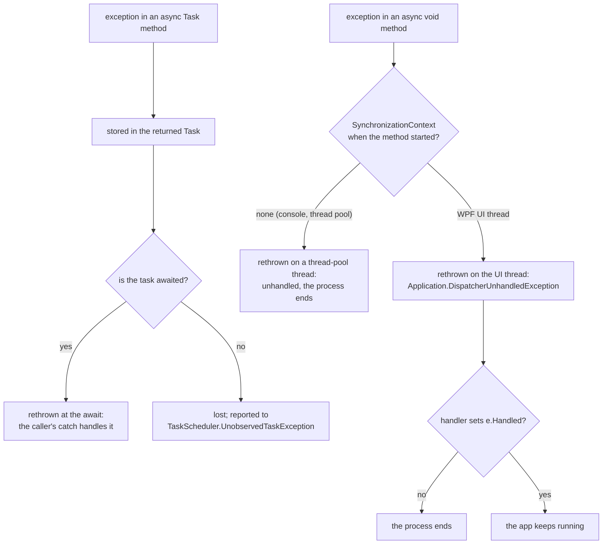

# async void and event handlers

## TL;DR

- An `async Task` method stores an exception in its task. Whoever awaits the task gets it; nobody else is disturbed.

- An `async void` method has no task to store it in. The exception is rethrown on the `SynchronizationContext` that was current when the method started (the UI thread in WPF) or, without one, on the thread pool. There it is unhandled. An unhandled exception ends the process.

- The caller of an `async void` method can't catch its exceptions and can't wait for it to finish, not even for an exception thrown before the first `await`.

- Event handlers are the one legitimate use: their signature is fixed to return `void`. Whoever raises the event doesn't await it. MVVM's `ICommand.Execute` is the same case.

- So an `async void` handler catches every exception itself: its whole body sits in `try { … } catch (Exception ex) { /* log, tell the user */ }`. Everything else returns `Task`.

## Key claims

- <a id="c1"></a>**C1.** An exception thrown in an `async Task` method, before or after its first `await`, is stored in the returned task. It reaches code that awaits the task (or reads `Result`, or calls `Wait`) and no one else.

- <a id="c2"></a>**C2.** An exception that leaves an `async void` method is rethrown on the `SynchronizationContext` captured when the method started. If there was none, it is rethrown on a thread-pool thread.

- <a id="c3"></a>**C3.** An exception rethrown on the thread pool is unhandled and ends the process. In WPF, one rethrown on the UI thread raises `Application.DispatcherUnhandledException`. The process then ends unless a handler sets `e.Handled = true`.

- <a id="c4"></a>**C4.** A `try`/`catch` around a call to an `async void` method never catches the method's exceptions, even one thrown before its first `await`. The call returns at the method's first `await` that doesn't complete at once, and the caller can't wait for the rest.

- <a id="c5"></a>**C5.** A faulted task that nobody awaits does not end the process (since .NET Framework 4.5). Its exception is reported through `TaskScheduler.UnobservedTaskException` when the task is garbage-collected, and is otherwise lost.

- <a id="c6"></a>**C6.** `async void` is meant for event handlers: a delegate type such as `EventHandler` returns `void`, so an `async` method that matches it must return `void`. Microsoft's guidance is to avoid `async void` everywhere else.

- <a id="c7"></a>**C7.** An `async void` event handler that must not end the process wraps its whole body in `try`/`catch (Exception)`. That catch is the place where the exception is handled, because no caller can do it.

## Explanation

The snippets are top-level C# programs, run as console apps with .NET 10. A console app has no `SynchronizationContext`, so they show the thread-pool case of [C2](#c2).

### Where an async method's exception goes

An `async` method is compiled into a state machine plus a **builder** that represents the method to its caller. For `async Task`, the builder creates the task the method returns. When the body throws, the builder catches the exception and stores it in that task, which becomes *faulted* ([C1](#c1)). `await` on a faulted task rethrows the stored exception in the awaiting code. So exceptions flow up the chain of `await`s, just like they flow up a chain of ordinary calls.

`async void` returns nothing, so its builder has nowhere to put the exception. It throws it "into the void" instead: it posts the rethrow to the `SynchronizationContext` the method started on, or queues it to the thread pool if there was none ([C2](#c2)). A **`SynchronizationContext`** is .NET's abstraction for "run this on the right thread": WPF's posts work to the `Dispatcher` of the UI thread, much like `Dispatcher.BeginInvoke`.



### What the caller sees

The program below calls an `async void` method inside a `try`, then waits half a second:

```csharp
try
{
    FailAsVoid();
    Console.WriteLine("returned from FailAsVoid");
}
catch (Exception e)
{
    Console.WriteLine($"caught by caller: {e.Message}");
}
await Task.Delay(500);
Console.WriteLine("never printed");

static async void FailAsVoid()
{
    await Task.Delay(50);
    throw new InvalidOperationException("boom");
}
```

```text
returned from FailAsVoid
Unhandled exception. System.InvalidOperationException: boom
   at Program.<<Main>$>g__FailAsVoid|0_0() in ...\Program.cs:line …
   at System.Threading.Tasks.Task.<>c.<ThrowAsync>b__124_1(Object state)
   at System.Threading.ThreadPoolWorkQueue.Dispatch()
```

Reading it:

- `FailAsVoid` returned at its `await` ([C4](#c4)). The `catch` never ran: by the time the exception was thrown, the `try` block was long finished.
- The stack trace ends in `ThreadPoolWorkQueue.Dispatch`: the exception was rethrown on a thread-pool thread ([C2](#c2)). Nothing caught it there. The process ended with exit code `0xE0434352`, the code Windows uses for an unhandled .NET exception ([C3](#c3)). "never printed" wasn't.

Moving the `throw` before the `await` changes nothing in the output. In an `async Task` method, such an early exception still goes into the task. In an `async void` method, it still goes to the builder, which rethrows it on the thread pool ([C4](#c4)).

The same method as `async Task`, called without `await`, is harmless to the process:

```csharp
_ = FailAsTask();
await Task.Delay(200);
GC.Collect();
GC.WaitForPendingFinalizers();
Console.WriteLine("async Task: still running");
```

```text
async Task: still running
```

The task faulted. Nobody looked, so the exception went nowhere visible ([C5](#c5)). That's not good either: the error is silently lost. But it is the caller's choice. The caller of an `async void` method has no choice at all.

### Why event handlers are the exception

An event's delegate type fixes the handler's signature. `EventHandler` is `void (object? sender, EventArgs e)`. WPF's `RoutedEventHandler` is the same shape. A handler that wants to `await` must be `async`, and to match the delegate it must return `void` ([C6](#c6)). There is no `async Task` option, so `async void` was added to the language for exactly this case.

Nothing is lost by it, either. Whoever raises an event never waits for its handlers' asynchronous work, and doesn't expect their exceptions. A button doesn't care whether its click handler's download succeeded. The `async void` problems ([C2](#c2), [C4](#c4)) hurt when a *caller* needs the result or the exception, and an event's raiser doesn't.

The same holds for MVVM's `ICommand.Execute(object? parameter)`, which returns `void` and is called by WPF when a button is clicked. An `async` command implementation ends up in an `async void` method somewhere, even when a library hides it.

Everywhere else, return `Task`. A helper method written as `async void` "because nobody needs the result" gives up both the exception and the moment it finishes. A test can't even wait for it.

### Handling the exception inside the handler

Since no caller can handle the exception, the handler must ([C7](#c7)). It catches everything, logs it, and tells the user:

```csharp
private async void SaveButton_Click(object sender, RoutedEventArgs e)
{
    try
    {
        SaveButton.IsEnabled = false;
        await _repository.SaveAsync(_document);
        StatusText.Text = "Saved.";
    }
    catch (Exception ex)
    {
        _log.Error(ex, "Saving failed");
        StatusText.Text = $"Saving failed: {ex.Message}";
    }
    finally
    {
        SaveButton.IsEnabled = true;
    }
}
```

Reading it:

- The whole body is inside the `try`, including the code before the first `await`. Any line could throw.
- `catch (Exception)` is usually a smell, but here it is the right place. This handler is the top of its call chain, the same role as an `Application.DispatcherUnhandledException` handler, and the last chance to keep the process alive.
- The `finally` puts the UI back whether the save worked or not.

The handler stays thin: real work goes into an `async Task` method (`SaveAsync` here) that can be awaited and tested. A console program run with the same pattern instead of `FailAsVoid` printed the handler's log line and kept running.

## Good habits

- Return `Task` from every `async` method except event handlers and their equivalents such as `ICommand.Execute` ([C6](#c6); Cleary, "Async/Await – Best Practices"; analyser rule VSTHRD100).

- Wrap the entire body of an `async void` handler in `try`/`catch (Exception)`, and handle the error there ([C2](#c2), [C7](#c7); Cleary).

- Keep the handler thin: let it await an `async Task` method that holds the logic ([C1](#c1), [C4](#c4); Cleary).

## Pitfalls

- **Putting `try`/`catch` around the call instead of inside the method.** The call has returned before the exception happens ([C4](#c4)).

- **Assuming an exception before the first `await` is still synchronous.** In `async void` it, too, goes to the context or the thread pool ([C4](#c4)).

- **Writing a helper as `async void` because its result isn't needed.** Its exceptions now end the process. No one can await it either ([C2](#c2), [C3](#c3)).

- **Relying on `DispatcherUnhandledException` as the error handling.** It only covers exceptions rethrown on the UI thread. Setting `e.Handled = true` there leaves the app in whatever state the failed handler left it ([C3](#c3)).

- **Thinking an unawaited `async Task` is safe because it doesn't crash.** Its exception is silently lost ([C5](#c5)).

## Exercises

1. **Predict.** A console app calls an `async void` method that throws before any `await`, wrapped in `try`/`catch (Exception)`, then sleeps a second. What happens?

   <details><summary>Solution</summary>

   The `catch` doesn't run. The exception is rethrown on a thread-pool thread, where it is unhandled. The process ends ([C2](#c2), [C3](#c3), [C4](#c4)).

   </details>

2. **Explain.** Why can't a click handler in WPF be `async Task`, and why does that not matter as much as for an ordinary method?

   <details><summary>Solution</summary>

   The delegate type `RoutedEventHandler` returns `void`, so the handler must too ([C6](#c6)). The control that raises the event never awaits its handlers or expects their exceptions, so the missing task costs nothing, provided the handler handles its own exceptions ([C7](#c7)).

   </details>

3. **Predict.** The same failing method is `async Task` and is called as `_ = FailAsync();`. Does the process end?

   <details><summary>Solution</summary>

   No. The exception is stored in the task, which nobody awaits. It surfaces at most through `TaskScheduler.UnobservedTaskException` and is otherwise lost ([C1](#c1), [C5](#c5)).

   </details>

## Sources

- Stephen Cleary, [Async/Await – Best Practices in Asynchronous Programming](https://learn.microsoft.com/en-us/archive/msdn-magazine/2013/march/async-await-best-practices-in-asynchronous-programming), MSDN Magazine, March 2013: "Avoid async void", where its exceptions go, event handlers as the exception.
- Microsoft Learn, [Async return types: Void return type](https://learn.microsoft.com/en-us/dotnet/csharp/asynchronous-programming/async-return-types#void-return-type).
- Microsoft Learn, [`Application.DispatcherUnhandledException`](https://learn.microsoft.com/en-us/dotnet/api/system.windows.application.dispatcherunhandledexception) and [`TaskScheduler.UnobservedTaskException`](https://learn.microsoft.com/en-us/dotnet/api/system.threading.tasks.taskscheduler.unobservedtaskexception).
- Microsoft, [VSTHRD100: Avoid `async void` methods](https://github.com/microsoft/vs-threading/blob/main/doc/analyzers/VSTHRD100.md).
- Claude session on GhostKey, 2026-11-24: the console snippets were run there with .NET 10.
