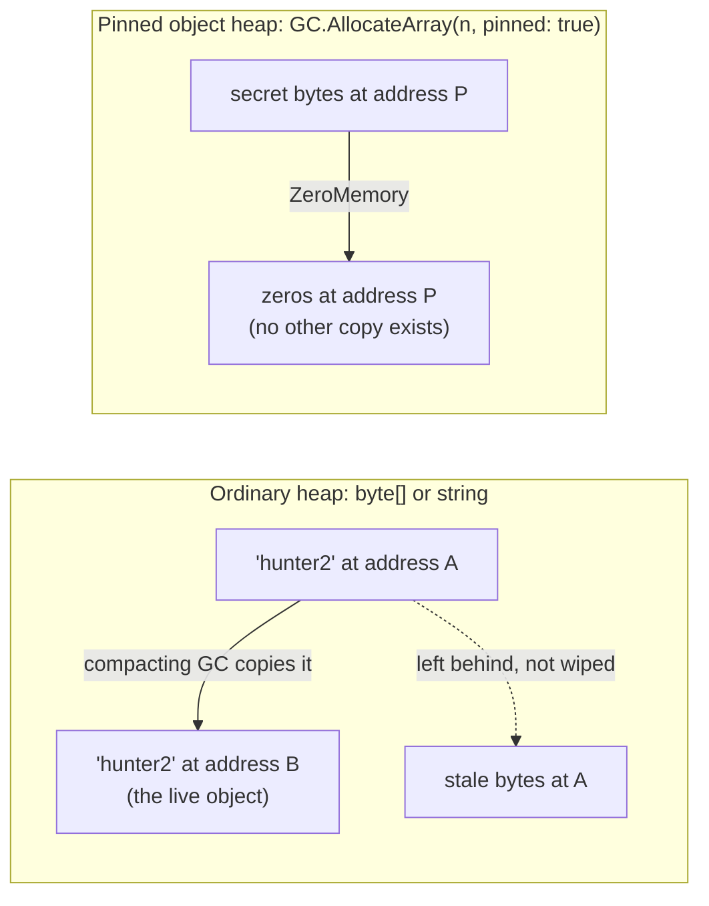

# Keeping secrets in .NET memory

## TL;DR

- A password in a .NET `string` can't be erased. Strings are immutable, literals live until the process ends, the GC may copy them, and every operation on a string makes another copy.

- `SecureString` was meant to solve this. Microsoft now advises against it: it isn't encrypted outside Windows, and using the secret almost always means turning it back into a `string`.

- What works: keep the secret in a `byte[]` or `char[]` you control, and overwrite it with `CryptographicOperations.ZeroMemory` as soon as you are done. A plain loop of zeros may be optimised away; `ZeroMemory` won't be.

- Allocate that array with `GC.AllocateArray<byte>(n, pinned: true)`. An ordinary array may be moved by the GC, which leaves the old bytes behind unwiped. A pinned array exists in one place only.

- Wrap it in a small `IDisposable` type that zeroes it in `Dispose`, and hold it in a `using`. Then an exception can't skip the wiping.

## Key claims

- <a id="c1"></a>**C1.** A .NET `string` can't safely hold a secret: it is immutable, so it can't be wiped; string literals are interned and live as long as the process; the GC may copy it while compacting; and every operation on it (`Substring`, concatenation, formatting, a `TextBox`) makes new copies outside your control.

- <a id="c2"></a>**C2.** Microsoft recommends against `SecureString` for new code (platform-compat diagnostic DE0001). It is encrypted only on Windows, and most APIs that consume it turn it into a `string` or plain memory anyway.

- <a id="c3"></a>**C3.** When a compacting garbage collection moves an object, the bytes at its old address are not overwritten. A secret in an ordinary array can therefore leave stale copies in memory that no later wipe reaches.

- <a id="c4"></a>**C4.** `GC.AllocateArray<T>(length, pinned: true)` (.NET 5 and later) allocates an array on the pinned object heap, where the GC never moves it. A secret in such an array exists at one address only, so one wipe erases it.

- <a id="c5"></a>**C5.** `CryptographicOperations.ZeroMemory(span)` overwrites memory with zeros in a way the compiler and JIT may not optimise away. A plain loop that writes zeros into a buffer that is never read again may be removed.

- <a id="c6"></a>**C6.** A secret buffer can be wrapped in an `IDisposable` type whose `Dispose` calls `ZeroMemory`. Used with `using`, the buffer is zeroed when the block is left, also when an exception leaves it. Copies made from the buffer's contents are not zeroed.

- <a id="c7"></a>**C7.** A secret copied into native memory (for example with `Marshal.AllocHGlobal` and `Marshal.Copy`) is a separate copy. It has to be wiped before it is freed, because freeing doesn't overwrite it.

## Explanation

Each snippet below is a complete `Program.cs` for a console project with `<AllowUnsafeBlocks>true</AllowUnsafeBlocks>`, run with .NET 10.

### Why not a string?

A password tool has to hold a password in memory for a moment: when the user types it, or when it goes to the clipboard. Anyone who can read the process's memory, or a crash dump of it, sees whatever is there at that moment. The goal is to keep that moment short and leave nothing behind. A `string` makes that impossible ([C1](#c1)):

- **Immutable.** There is no supported way to overwrite a string's characters. You can only drop the reference and wait.
- **Interned.** A string literal is shared and lives until the process ends.
- **Moved.** A string lives on the ordinary heap, so compaction can leave copies behind (see [below](#the-gc-moves-things-and-leaves-copies)).
- **Copied.** `Substring`, `+`, `$"…"`, `ToString`, a WPF `TextBox`, a log call: each makes a new string you can't wipe.

The snippet builds the same text twice, once as a literal and once by concatenation:

```csharp
string a = "hunter2";
string b = string.Concat("hunter", "2".AsSpan());
Console.WriteLine($"equal text: {a == b}, same object: {ReferenceEquals(a, b)}");
Console.WriteLine($"the literal is interned: {ReferenceEquals(a, string.IsInterned(b))}");
```

```text
equal text: True, same object: False
the literal is interned: True
```

`b` has the same text as `a` but is a separate object: a second copy of the "password" now exists. `string.IsInterned(b)` returns the literal's instance, which lives until the process ends.

In memory, a string on 64-bit .NET is an object header (8 bytes), a method-table pointer (8 bytes), a 4-byte length, then the characters in UTF-16 and a terminating zero character. The password sits there as plain UTF-16.

`SecureString` was meant to fix this. Microsoft now advises against it ([C2](#c2)): on Linux and macOS it isn't encrypted at all, and to *use* the secret (send it, show it, hash it) you almost always convert it to a `string` or plain memory first. The guidance is to avoid holding credentials in the process where possible, and otherwise to keep the window short: plain bytes in a buffer you control, wiped right after use.

### The GC moves things, and leaves copies

The GC compacts the heap: it copies live objects together to close the gaps, and updates every reference to them. It doesn't wipe the place it copied from ([C3](#c3)). Those bytes stay in memory until something else happens to be written there. For an ordinary `byte[]` holding a password, every compaction can leave one more copy, and `ZeroMemory` on the array only reaches the live one.

An array on the **pinned object heap** never moves ([C4](#c4)). `GC.AllocateArray<byte>(n, pinned: true)` puts it there. It exists in one place, so one wipe erases it.



### Wiping: ZeroMemory

Writing zeros in a loop into a buffer that is never read again is a "dead store". An optimising compiler may delete it, because no observable behaviour changes. `CryptographicOperations.ZeroMemory` is guaranteed not to be removed ([C5](#c5)). It takes a `Span<byte>`, so it works on arrays and on native memory alike. For a `char[]`, pass `MemoryMarshal.AsBytes(chars.AsSpan())`.

Native memory needs the same care ([C7](#c7)). If a secret is copied into a block from `Marshal.AllocHGlobal`, for example to hand it to a Win32 function, that block is a second copy. `FreeHGlobal` gives the block back but doesn't overwrite it. The snippet keeps a secret in a pinned array, copies it into native memory, and wipes both:

```csharp
using System.Runtime.InteropServices;
using System.Security.Cryptography;

byte[] secret = GC.AllocateArray<byte>(8, pinned: true);
"s3cr3t!?"u8.CopyTo(secret);

nint p = Marshal.AllocHGlobal(secret.Length);   // native memory, invisible to the GC
Marshal.Copy(secret, 0, p, secret.Length);
unsafe
{
    var native = new Span<byte>((byte*)p, secret.Length);
    CryptographicOperations.ZeroMemory(native);
    Console.WriteLine($"native zeroed: {native.IndexOfAnyExcept((byte)0) < 0}");
}
Marshal.FreeHGlobal(p);

CryptographicOperations.ZeroMemory(secret);
Console.WriteLine($"managed zeroed: {secret.AsSpan().IndexOfAnyExcept((byte)0) < 0}");
```

```text
native zeroed: True
managed zeroed: True
```

Step by step:

1. `GC.AllocateArray<byte>(8, pinned: true)` makes an 8-byte managed array that never moves, and the secret is copied into it.
2. `Marshal.AllocHGlobal(8)` allocates 8 bytes of native memory and returns its address as an `nint`, here `p`. It plays the role of C's `malloc`; the memory is invisible to the GC.
3. `Marshal.Copy(secret, 0, p, secret.Length)` copies `secret.Length` bytes from the array, starting at index 0, to the address `p`. It is `memcpy` with a managed array on one side.
4. The `unsafe` block casts `p` to a `byte*` and wraps it in a `Span<byte>` of 8 bytes. `ZeroMemory` wipes them through the span. The [note on pointers and unsafe code](unsafe-code-and-pointers.md) explains the cast, the `unsafe` block and the span.
5. `Marshal.FreeHGlobal(p)` gives the native block back, like C's `free`. After this, `p` must not be used.
6. Last, the managed copy is wiped as well. Both checks print `True`: no byte other than 0 is left.

### Wiping by Dispose

Calling `ZeroMemory` by hand has the problem every manual cleanup has: an exception or an early `return` skips it. .NET's answer for cleanup is `IDisposable` with `using`, and it fits here too ([C6](#c6)). A small `SecretBuffer` class owns a pinned array, hands it out only as a `Span<byte>`, and zeroes it in `Dispose`. Held in a `using`, the buffer is zeroed when the block is left, whether normally or by an exception.

The snippet checks three cases: a normal end of the `using` block, an exception inside it, and use after `Dispose`. `DangerousArray` exists only so the demo can look at the array after disposal:

```csharp
using System.Security.Cryptography;
using System.Text;

byte[] seen;
using (var secret = new SecretBuffer(7))
{
    Encoding.UTF8.GetBytes("hunter2", secret.Span);
    seen = secret.DangerousArray;
    Console.WriteLine(Encoding.UTF8.GetString(secret.Span));
}
Console.WriteLine($"after using: all zero = {seen.AsSpan().IndexOfAnyExcept((byte)0) < 0}");

try
{
    using var s2 = new SecretBuffer(4);
    seen = s2.DangerousArray;
    s2.Span.Fill(0xAA);
    throw new InvalidOperationException("boom");
}
catch (InvalidOperationException)
{
    Console.WriteLine($"after exception: all zero = {seen.AsSpan().IndexOfAnyExcept((byte)0) < 0}");
}

var s3 = new SecretBuffer(4);
s3.Dispose();
try { _ = s3.Span; } catch (ObjectDisposedException) { Console.WriteLine("use after Dispose: ObjectDisposedException"); }

/// <summary>A pinned byte buffer for a secret that is zeroed on Dispose.</summary>
public sealed class SecretBuffer : IDisposable
{
    private byte[]? _bytes;

    public SecretBuffer(int length) => _bytes = GC.AllocateArray<byte>(length, pinned: true);

    public Span<byte> Span => _bytes ?? throw new ObjectDisposedException(nameof(SecretBuffer));

    internal byte[] DangerousArray => _bytes!;   // for the demo only

    public void Dispose()
    {
        if (_bytes is null) return;
        CryptographicOperations.ZeroMemory(_bytes);
        _bytes = null;
    }
}
```

```text
hunter2
after using: all zero = True
after exception: all zero = True
use after Dispose: ObjectDisposedException
```

Two limits remain. `using` only zeroes the buffer itself: a `string` or another array made from its contents is a copy outside the wrapper. The demo breaks that rule on purpose: `"hunter2"` is a string literal, and `Encoding.UTF8.GetString` makes another string. Real code fills the buffer from a source that isn't a `string`, such as a decryption result copied in and zeroed, or characters read one at a time from a password box. And if the caller forgets `using`, nothing zeroes it. A finaliser could, but only at some later garbage collection, so the analyzer warning CA2000 (dispose objects before losing scope) is the better safety net.

## Good habits

- Keep secrets in a pinned `byte[]` or `char[]`, never in a `string` ([C1](#c1), [C3](#c3), [C4](#c4); .NET documentation of `SecureString`).

- Wipe them with `CryptographicOperations.ZeroMemory` as soon as they are used, native copies included ([C5](#c5), [C7](#c7); .NET documentation of `ZeroMemory`).

- Put the buffer in a disposable wrapper that zeroes it, and hold the wrapper in a `using` ([C6](#c6); .NET design guidelines, *Dispose pattern*, and analyzer rule CA2000).

## Pitfalls

- **"Wiping" a string with unsafe code.** Writing into a string through a pointer breaks .NET's assumptions (interning, hash codes) and doesn't reach the copies already made ([C1](#c1)).

- **Converting a `SecureString` to a `string` to use it.** That undoes the whole point ([C2](#c2)).

- **Zeroing an ordinary `new byte[n]` and calling it erased.** The GC may already have left copies elsewhere ([C3](#c3)).

- **Wiping with a `for` loop.** The optimiser may remove it ([C5](#c5)).

- **Freeing native memory that held a secret without wiping it first.** The bytes stay where they were ([C7](#c7)).

## Exercises

1. **Explain.** A colleague keeps the master password in a `byte[]` from `new byte[32]` and calls `ZeroMemory` on it after use. Why can a copy of the password still be in memory, and what one change fixes that?

   <details><summary>Solution</summary>

   An ordinary array may be moved by a compacting GC, which leaves the old bytes unwiped at the old address ([C3](#c3)). Allocate it with `GC.AllocateArray<byte>(32, pinned: true)`, so there is only ever one copy to wipe ([C4](#c4)).

   </details>

2. **Explain.** List three ways a password typed into a desktop app could end up in memory you can't wipe if the code holds it in a `string`.

   <details><summary>Solution</summary>

   Any three of: the string itself can't be overwritten; the GC may have copied it during compaction; a `Substring`, concatenation or format call made another string; a WPF `TextBox.Text` holds its own copy; a literal (in a test) is interned for the process's lifetime ([C1](#c1)).

   </details>

3. **Predict.** Inside `using (var s = new SecretBuffer(16)) { … }`, the code calls `Encoding.UTF8.GetString(s.Span)` to log the length of the password. After the block, which copies of the password are wiped?

   <details><summary>Solution</summary>

   Only the buffer inside `SecretBuffer` ([C6](#c6)). The `string` made by `GetString` is a separate copy that can't be wiped ([C1](#c1)). Logging the length needs no string: `s.Span.Length` gives it.

   </details>

## Sources

- Microsoft Learn, [`SecureString` class](https://learn.microsoft.com/en-us/dotnet/api/system.security.securestring), section *Remarks*, and [DE0001: SecureString shouldn't be used](https://github.com/dotnet/platform-compat/blob/master/docs/DE0001.md).
- Microsoft Learn, [`GC.AllocateArray`](https://learn.microsoft.com/en-us/dotnet/api/system.gc.allocatearray) and [`CryptographicOperations.ZeroMemory`](https://learn.microsoft.com/en-us/dotnet/api/system.security.cryptography.cryptographicoperations.zeromemory).
- Microsoft Learn, [`Marshal.AllocHGlobal`](https://learn.microsoft.com/en-us/dotnet/api/system.runtime.interopservices.marshal.allochglobal) and [`Marshal.Copy`](https://learn.microsoft.com/en-us/dotnet/api/system.runtime.interopservices.marshal.copy).
- Microsoft Learn, [CA2000: Dispose objects before losing scope](https://learn.microsoft.com/en-us/dotnet/fundamentals/code-analysis/quality-rules/ca2000).
- Claude session, 2026-11-18: every snippet was run there with .NET 10.
