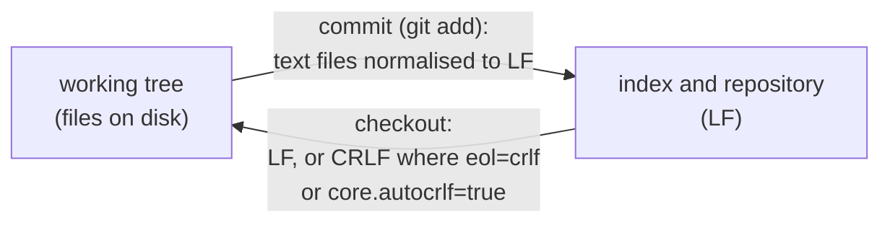

# Line endings and .gitattributes

## TL;DR

- Text files end their lines with **LF** (`\n`, Unix) or **CRLF** (`\r\n`, Windows). Git can convert between the two when files enter and leave the repository.
- `.gitattributes` is a file in the repository that sets **attributes** per path pattern. `text` and `eol` control line endings.
- `* text=auto eol=lf` makes every text file LF in every checkout, on every OS. A later line such as `*.ps1 text eol=crlf` overrides it for the files it matches.
- The point is identical bytes in every checkout, so a diff never shows a whole file changed only by its line endings.
- Changing `.gitattributes` does not rewrite files already on disk. `git ls-files --eol` shows what each file really has.

## Key claims

- <a id="c1"></a>**C1.** `.gitattributes` assigns attributes to files by path pattern, one pattern per line followed by its attributes; when several lines match a file and set the same attribute, the last of them wins.
- <a id="c2"></a>**C2.** The attribute `text` marks a file as text, whose line endings git normalises to LF when the file is committed; `text=auto` lets git decide per file whether it is text, so binary files are left untouched.
- <a id="c3"></a>**C3.** The attribute `eol=lf` or `eol=crlf` sets the line ending a text file gets in the working tree at checkout, on every operating system, regardless of the user's `core.autocrlf` setting.
- <a id="c4"></a>**C4.** Without an `eol` attribute, `core.autocrlf=true` (the usual Git for Windows setting) converts LF to CRLF on checkout and back on commit; this is the source of the warning "LF will be replaced by CRLF the next time Git touches it".
- <a id="c5"></a>**C5.** Adding or changing `.gitattributes` does not rewrite files already in the working tree; they get the new line endings only when git writes them again, for example after deleting them and running `git checkout -- <path>`.
- <a id="c6"></a>**C6.** `git ls-files --eol` lists, per tracked file, the line endings in the index (`i/`), in the working tree (`w/`) and the attributes that apply (`attr/`).
- <a id="c7"></a>**C7.** `git diff --no-index <a> <b>` compares two arbitrary paths, inside a repository or not, and exits with code 1 when they differ and 0 when they are equal.

## Explanation

### Two conventions, one repository

Unix ends a line with one byte, LF (line feed, `0x0A`, `\n`). Windows uses two, CR LF (`0x0D 0x0A`, `\r\n`). Most editors and compilers accept both. Diffs do not: a file whose every line changed from LF to CRLF shows up as entirely rewritten.

Git therefore distinguishes three places. The **repository** (and the **index**, the staging area) holds what was committed. The **working tree** holds the files on disk. Conversion happens on the way between them:



### `.gitattributes`

`.gitattributes` is a text file committed with the repository, so it applies to everyone who clones it ([C1](#c1)). Each line is a pattern, in `.gitignore` syntax, followed by attributes. Lines further down override lines above for the files both match.

The two attributes for line endings:

- `text` ([C2](#c2)) says "this is text, normalise it to LF in the repository". `text=auto` leaves the decision to git, which looks at the content. An image stays byte for byte as it is.
- `eol` ([C3](#c3)) says what the working tree gets on checkout. It wins over each user's own `core.autocrlf` setting ([C4](#c4)), which is what makes checkouts identical across machines.

The file from the claude-config repository:

```gitattributes
* text=auto eol=lf
*.ps1 text eol=crlf
```

Line 1 applies to every file: git decides what is text. Text is LF everywhere. Line 2 matches PowerShell scripts again and, being later, overrides `eol` for them: CRLF, the Windows convention for a Windows-only script. It also sets `text` without `auto`, so a `.ps1` is always treated as text.

The nearest .NET analogue is `end_of_line` in `.editorconfig`. The difference: the editor applies `.editorconfig` when saving, git applies `.gitattributes` at commit and checkout.

### The attributes do not rewrite what is already there

Git converts a file only when it writes it ([C5](#c5)). After a new `.gitattributes` is committed, existing files keep their old bytes until they are checked out again. `git ls-files --eol` ([C6](#c6)) shows the gap. In the claude-config worktree, created before the `*.ps1` line existed, it shows:

```text
i/lf    w/lf    attr/text eol=crlf      scripts/install.ps1
```

The attribute asks for CRLF, the file on disk still has LF.

### Comparing files outside the repository

`git diff` normally compares versions of tracked files. With `--no-index` ([C7](#c7)) it compares any two paths, like `fc` or `diff` would, with git's output and options. Like `diff`, it signals the result through its exit code: 0 for equal, 1 for different. The install script uses it to compare a backup with the repository's copy, with `--ignore-cr-at-eol` so that line endings alone don't count as a difference.

## Examples

### Before and after re-checkout

Git Bash, Git for Windows 2.55, `core.autocrlf=true`; `a.ps1` and `b.txt` are committed with LF:

```bash
printf '* text=auto eol=lf\n*.ps1 text eol=crlf\n' > .gitattributes
git ls-files --eol
rm a.ps1 b.txt && git checkout -- .
git ls-files --eol
```

Output:

```text
i/lf    w/crlf  attr/text eol=crlf    	a.ps1
i/lf    w/crlf  attr/text=auto eol=lf 	b.txt
i/lf    w/crlf  attr/text eol=crlf    	a.ps1
i/lf    w/lf    attr/text=auto eol=lf 	b.txt
```

Before the re-checkout both files still have the CRLF that `core.autocrlf` gave them. After it, `b.txt` follows its attribute and is LF.

### `git diff --no-index` and its exit code

```bash
printf 'a\n' > x && printf 'b\n' > y
git diff --no-index --stat x y; echo "exit=$?"
git diff --no-index --quiet x x; echo "exit=$?"
```

Output:

```text
 x => y | 2 +-
 1 file changed, 1 insertion(+), 1 deletion(-)
exit=1
exit=0
```

## Pitfalls

- **Expecting a new `.gitattributes` to fix files at once.** It doesn't ([C5](#c5)). For the index, `git add --renormalize .` re-applies `text`. For the working tree, check the files out again.
- **Exit code 1 from `git diff --no-index` is not only "different".** In Git for Windows 2.55, a path that does not exist ("Could not access 'missing'") also exits with 1. Check that both paths exist first.
- **Comparing with `git diff --no-index` under `core.autocrlf=true`.** Git applies its line-ending conversion while reading the files. Two files that differ only in CRLF versus LF then compare as equal. The install script passes `-c core.autocrlf=false` and `--ignore-cr-at-eol` so that the result doesn't depend on the user's settings.

## Sources

- Review thread on `.gitattributes` in [claude-config PR #1](https://github.com/thomaswening/claude-config/pull/1) ("What does this mean?"), Claude session on claude-config, 2026-10-23.
- [gitattributes documentation](https://git-scm.com/docs/gitattributes), sections `text` and `eol`.
- [git-config documentation, `core.autocrlf`](https://git-scm.com/docs/git-config#Documentation/git-config.txt-coreautocrlf).
- [git-diff documentation, `--no-index`](https://git-scm.com/docs/git-diff).
- [GitHub Docs: Configuring Git to handle line endings](https://docs.github.com/en/get-started/git-basics/configuring-git-to-handle-line-endings).
