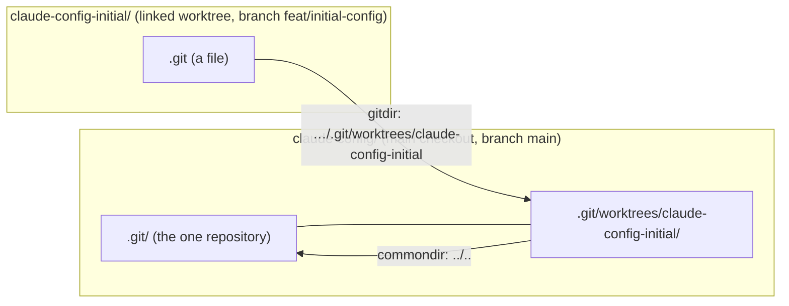

# Git worktrees and telling them from the main checkout

## TL;DR

- A **branch** is only a named pointer to a commit. A **working tree** is a folder holding the files of one checked-out commit: the folder you edit in.
- `git worktree add` gives one repository a second working tree, in another folder and on another branch. Both folders share one `.git`: one history, one set of branches, one set of remotes.
- The original folder is the **main checkout**. In every additional (**linked**) worktree, `.git` is a one-line file that points back to `.git/worktrees/<name>` in the main checkout.
- A script tells the two apart with `git rev-parse --path-format=absolute --git-dir` and `--git-common-dir`: the answers are equal only in the main checkout.
- `rev-parse` is a **plumbing** command, made for scripts. It turns names such as `HEAD` into commits and answers questions about the repository.

## Key claims

- <a id="c1"></a>**C1.** `git worktree add <path> -b <branch>` creates a new folder at `<path>` with `<branch>` checked out; the new working tree shares the object database, the branches and the remotes of the repository it was added to.
- <a id="c2"></a>**C2.** A commit made in one worktree is visible in every other worktree of the same repository at once, without a fetch, because all of them read the same `.git` directory.
- <a id="c3"></a>**C3.** A branch can be checked out in only one worktree at a time; `git switch <branch>` fails with "already used by worktree at …" while another worktree has it checked out.
- <a id="c4"></a>**C4.** In a linked worktree, `.git` is a file, not a folder; it contains one line, `gitdir: <main checkout>/.git/worktrees/<name>`.
- <a id="c5"></a>**C5.** `git rev-parse --git-dir` names the git directory of the current working tree; `git rev-parse --git-common-dir` names the directory all worktrees share; the two are the same directory only in the main checkout.
- <a id="c6"></a>**C6.** Without `--path-format=absolute`, `rev-parse` may answer with a relative path for one option and an absolute path for the other (for example `C:/r/.git` and `../.git` from a subfolder), so the answers can only be compared as strings once both are absolute.
- <a id="c7"></a>**C7.** `git -C <dir> <command>` runs `<command>` as if git had been started in `<dir>`, without changing the caller's current folder.
- <a id="c8"></a>**C8.** `git rev-parse --abbrev-ref HEAD` prints the name of the checked-out branch, such as `main`; with a detached `HEAD` it prints `HEAD`.

## Explanation

### Branch, working tree, worktree

A **branch** is a name for a commit, nothing more: a file in `.git` holding a hash. A **working tree** is the folder of real files you edit, build and test. A normal clone has exactly one working tree. To work on another branch you switch that folder over (`git switch`), which rewrites its files.

A **worktree** is an additional working tree of the same repository ([C1](#c1)). It is not a side branch and not a clone. It is a second folder in which another branch is checked out. The **repository** proper, the `.git` directory with all commits and branches, still exists once. So a commit made in one folder is in the other folder's history immediately ([C2](#c2)). Two clones would need a push and a fetch for that.

A .NET comparison: the same Git repository open in two Visual Studio instances at once, each solution folder on a different branch, with no second clone.

Git forbids one thing: the same branch in two worktrees ([C3](#c3)). Otherwise a commit in one folder would move the branch under the other folder's feet.



### What the linked worktree's `.git` holds

In the main checkout `.git` is a folder. In a linked worktree it is a text file of one line ([C4](#c4)), for example:

```text
gitdir: C:/Users/thoma/source/repos/claude-config/.git/worktrees/claude-config-initial
```

That folder under `.git/worktrees/` holds what belongs to this working tree alone: its `HEAD` and its index (the staging area). Everything else, commits and branches included, lives in the shared `.git`.

### Asking git which kind of checkout this is

`git rev-parse` is a **plumbing** command. Git sorts its commands into *porcelain*, meant for people (`git status`, `git log`), and plumbing, with stable output meant for scripts. `rev-parse` has two jobs. The first gives it its name ("parse a revision"): it turns names such as `HEAD`, `main` or `main~2` into commit hashes. The second is answering questions about the repository, through options such as `--git-dir`.

Two of those questions together tell a main checkout from a linked worktree ([C5](#c5)):

| Asked in | `--git-dir` | `--git-common-dir` |
|---|---|---|
| main checkout | `…/claude-config/.git` | `…/claude-config/.git` |
| linked worktree | `…/claude-config/.git/worktrees/claude-config-initial` | `…/claude-config/.git` |

Equal answers mean the main checkout. Different answers mean a linked worktree.

The comparison is between strings, so both must be written the same way. By default git chooses: from a subfolder of the main checkout, `--git-dir` comes back absolute and `--git-common-dir` relative ([C6](#c6)). `--path-format=absolute` makes both absolute.

`git -C <dir>` ([C7](#c7)) lets a script ask about a folder without moving into it. It is like passing `WorkingDirectory` in a `ProcessStartInfo`, instead of changing `Environment.CurrentDirectory` for the whole process.

The second job of `rev-parse` shows up in `--abbrev-ref HEAD` ([C8](#c8)). `HEAD` usually names a branch. `--abbrev-ref` asks for that branch's short name instead of a hash.

## Examples

### A worktree from scratch

Run in Git Bash (Git for Windows 2.55):

```bash
git init -q -b main repo && cd repo
git commit -q --allow-empty -m init
git worktree add -q ../repo-topic -b topic
git worktree list
cat ../repo-topic/.git
git switch topic
```

Output (paths shortened to `C:/t`, hashes vary):

```text
C:/t/repo        77e56da [main]
C:/t/repo-topic  77e56da [topic]
gitdir: C:/t/repo/.git/worktrees/repo-topic
fatal: 'topic' is already used by worktree at 'C:/t/repo-topic'
```

### The check from `install.ps1`

The install script of Thomas's Claude Code configuration must run from the main checkout, because the links it creates point at that folder. Its guard, in PowerShell (see [PowerShell for C# developers](../powershell/powershell-for-csharp-developers.md) for the syntax):

```powershell
$gitDir    = (git -C $Repo rev-parse --path-format=absolute --git-dir).Trim()
$commonDir = (git -C $Repo rev-parse --path-format=absolute --git-common-dir).Trim()
if ($gitDir -ne $commonDir) {
    throw "Run this from the main checkout, not from a worktree ($Repo)."
}
$branch = (git -C $Repo rev-parse --abbrev-ref HEAD).Trim()
if ($branch -ne 'main') {
    throw "The main checkout is on '$branch'; switch it back to main first."
}
```

What the two `rev-parse` calls print without `--path-format=absolute`, run from `repo/sub`:

```text
$ git rev-parse --git-dir --git-common-dir
C:/t/repo/.git
../.git
```

Same directory, different strings: the guard would wrongly report a worktree.

## Pitfalls

- **"A worktree is a branch."** It is a folder. The branch is what is checked out in it.
- **Testing for a worktree with `Test-Path .git -PathType Container`** works only at the top of the working tree. `rev-parse` answers from any subfolder.
- **Deleting a worktree folder by hand** leaves its bookkeeping in `.git/worktrees/` and keeps its branch locked ([C3](#c3)). Use `git worktree remove <path>`, or `git worktree prune` after the fact.

## Sources

- Review threads on `scripts/install.ps1` in [claude-config PR #1](https://github.com/thomaswening/claude-config/pull/1) ("What is a worktree anyway?", "What does the git command do, how to read it?"), Claude session on claude-config, 2026-10-23.
- [git-worktree documentation](https://git-scm.com/docs/git-worktree).
- [git-rev-parse documentation](https://git-scm.com/docs/git-rev-parse), options `--git-dir`, `--git-common-dir`, `--path-format` and `--abbrev-ref`.
- [Pro Git, section 10.1 "Plumbing and Porcelain"](https://git-scm.com/book/en/v2/Git-Internals-Plumbing-and-Porcelain).
