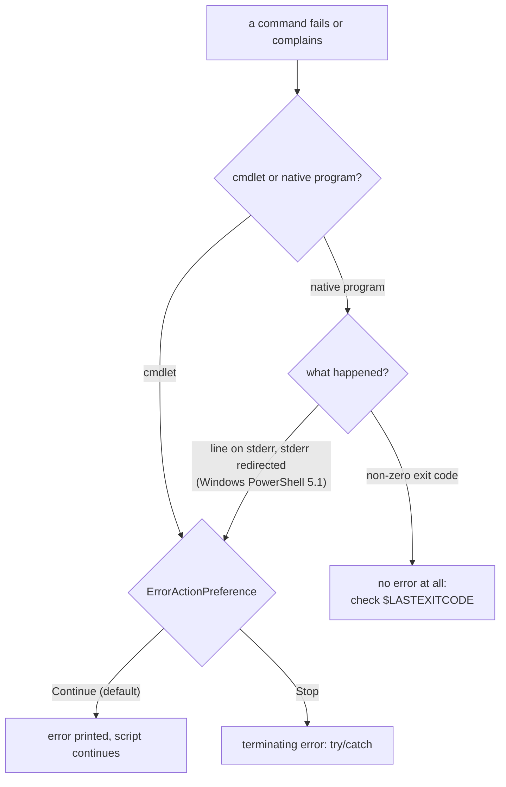

# PowerShell for C# developers

## TL;DR

- PowerShell runs on .NET and looks like C#, but it is a shell. Commands take space-separated arguments. Everything a command outputs flows down the pipeline.
- Functions are called like commands, `Test-It $a $b`, never `Test-It($a, $b)`. .NET methods keep C# syntax, `[IO.File]::WriteAllText($p, $s)`.
- Anything a function outputs and doesn't capture becomes part of its return value. `| Out-Null` throws output away.
- Operators are words (`-eq`, `-ne`, `-replace`). String comparison ignores case by default.
- `$ErrorActionPreference = 'Stop'` turns cmdlet errors into exceptions. Native programs such as `git` never throw: their result is in `$LASTEXITCODE`.
- This note is about **Windows PowerShell 5.1**, the version built into Windows (`powershell.exe`). PowerShell 7 (`pwsh.exe`) differs in some details.

## Key claims

- <a id="c1"></a>**C1.** A script or function declares its parameters with `param(...)`; a parameter of type `[switch]` is a boolean flag that is `$true` when the caller writes `-Name` and `$false` when the caller leaves it out.
- <a id="c2"></a>**C2.** A PowerShell function is called with space-separated arguments and no parentheses, as in `Test-JunctionTo $a $b`; writing `Test-JunctionTo($a, $b)` passes a single array as the first argument.
- <a id="c3"></a>**C3.** Every value a function writes to the output and does not capture or discard becomes part of its return value, so `return 42` after an uncaptured `New-Item` returns an array of the new item and `42`; `| Out-Null` (or assigning to `$null`) discards output.
- <a id="c4"></a>**C4.** Single-quoted strings are literal; double-quoted strings expand `$variable` and `$(expression)`; the escape character is the backtick, so `` "`n" `` is a newline; `@" … "@` is a multi-line here-string that expands like a double-quoted string.
- <a id="c5"></a>**C5.** Comparison operators are words (`-eq`, `-ne`, `-lt`, `-not`); on strings, `-eq` ignores case by default, `-ceq` compares case-sensitively and `-ieq` states case-insensitivity explicitly; `-replace` replaces by regular expression.
- <a id="c6"></a>**C6.** `if` is an expression whose result can be assigned, as in `$x = if ($c) { 'a' } else { 'b' }`, which plays the role of C#'s `c ? "a" : "b"`.
- <a id="c7"></a>**C7.** `$ErrorActionPreference = 'Stop'` makes every cmdlet error a terminating error that `try`/`catch` can catch; a native program that exits with a non-zero code never throws under it, so a script must read `$LASTEXITCODE`.
- <a id="c8"></a>**C8.** In Windows PowerShell 5.1, with `$ErrorActionPreference = 'Stop'`, a native program that writes to standard error while its standard error is redirected, even with `2>$null`, throws a `NativeCommandError`, even if the program exits with code 0.
- <a id="c9"></a>**C9.** .NET types are written in square brackets and their static members are reached with `::`, as in `[IO.File]::WriteAllText($path, $text)`; .NET methods, unlike PowerShell functions, are called with parentheses and commas.
- <a id="c10"></a>**C10.** In Windows PowerShell 5.1, `(Get-Item -LiteralPath $junction -Force).Delete()` removes a directory junction without touching the folder it points to, while `Remove-Item` without `-Recurse` on the junction fails with "Object reference not set to an instance of an object".

## Explanation

### A shell first

PowerShell is a command shell that runs on .NET. Its commands are **cmdlets** (compiled commands named Verb-Noun, such as `Get-Item`), functions written in PowerShell, and **native programs** (any `.exe`, such as `git`). Variables start with `$`. Types are optional. Every value is a .NET object. A C# reader recognises much of it. The differences come from the shell heritage.

### Parameters and calls

`param(...)` at the top of a script is its signature ([C1](#c1)), like `Main(string[] args)` but named and typed. `[CmdletBinding()]` before it adds the standard switches, such as `-Verbose`.

```powershell
[CmdletBinding()]
param(
    [switch] $Uninstall    # $true when called as  install.ps1 -Uninstall
)
```

Functions are called the way commands are typed at a prompt ([C2](#c2)). Arguments are separated by spaces. Commas build arrays. So `F($a, $b)` reads as "call `F` with one argument, the array `($a, $b)`". .NET methods are the exception: they keep C# syntax ([C9](#c9)). This mix is the most common trap for C# developers.

### Output is the return value

In C#, a method returns what `return` names. In PowerShell, a function returns *everything it outputs* ([C3](#c3)). Any expression whose value isn't assigned, piped away or cast to `[void]` is output. `return $x` only adds `$x` to that and leaves the function. Many cmdlets output the object they create, for example `New-Item`. Hence the frequent `| Out-Null`.

### Strings and operators

Quotes decide interpolation ([C4](#c4)): `'...'` is literal, `"..."` is like C#'s `$"..."`. Inside, `$name` inserts a variable and `$(...)` any expression. Because `\` is the path separator on Windows, PowerShell's escape character is the backtick: `` `n ``, `` `t ``, `` `" ``. A here-string `@" ... "@` spans several lines. Its opening `@"` must end its line and its closing `"@` must start one.

Operators are words because `<` and `>` are redirection in a shell ([C5](#c5)). `-eq` on strings ignores case, unlike C#'s `==`. `-ieq` says the same thing explicitly, `-ceq` is the case-sensitive form. `-replace` takes a regular expression, so `'a\b' -replace '\\', '/'` needs the doubled backslash.

`if`, `switch` and loops are expressions ([C6](#c6)). Their output can be assigned like any other.

### Errors: cmdlets throw, native programs don't

PowerShell distinguishes two kinds of error. A **non-terminating error** is printed and the script carries on. A **terminating error** works like an exception. By default cmdlet errors are non-terminating. `$ErrorActionPreference = 'Stop'` makes them terminating for the rest of the script ([C7](#c7)), the usual first line of a careful script. A single call can override it with `-ErrorAction SilentlyContinue`. `Get-Item $p -ErrorAction SilentlyContinue` then returns `$null` for a missing path instead of failing.

A native program is not a cmdlet. It reports failure only through its exit code, which PowerShell puts in `$LASTEXITCODE`. Under `'Stop'` a non-zero exit code still throws nothing. The script must check.

Windows PowerShell 5.1 adds a twist ([C8](#c8)). When a native program's standard error is redirected, 5.1 wraps each stderr line in an error record. Under `'Stop'` the first such line throws, whatever the exit code. `2>$null` is a redirection too, so it does not prevent this. Git writes warnings to stderr, so a successful `git` call can throw. The install script sets `'Continue'` around such a call:



### .NET is one bracket away

Any .NET type is available ([C9](#c9)): `[StringComparison]::OrdinalIgnoreCase`, `[IO.File]::WriteAllText(...)`. `New-Object Text.UTF8Encoding $false` calls a constructor, like `new UTF8Encoding(false)`. Objects returned by cmdlets are .NET objects too. `Get-Item` on a folder returns a `System.IO.DirectoryInfo`, with all its methods.

### Deleting a junction

A **directory junction** is an NTFS reparse point: a folder entry that redirects to another folder on a local drive. It is Windows' older, folder-only cousin of a symbolic link. Creating a junction needs no special rights. Creating a symbolic link needs administrator rights or Developer Mode. That is why the install script links `~/.claude/skills` to the repository with a junction:

```powershell
New-Item -ItemType Junction -Path $LiveSkills -Target $RepoSkills | Out-Null
```

Removing it again is where 5.1 is awkward ([C10](#c10)). `Remove-Item` without `-Recurse` fails with a null-reference error. With `-Recurse`, whether it follows the junction into the target has varied between versions. The robust way is the .NET method on the `DirectoryInfo` that `Get-Item` returns. `DirectoryInfo.Delete()` without the recursive flag never deletes anything inside a folder. On a junction it removes the reparse point itself, so only the link goes.

```powershell
(Get-Item -LiteralPath $Path -Force).Delete()
```

## Examples

All run with Windows PowerShell 5.1.26100 (`powershell.exe -NoProfile -File t.ps1 -Flag`).

### Calls, output and strings

```powershell
param([switch] $Flag)
"flag=$Flag"
function Add-Two([int] $a, [int] $b) { "a=$a b=$b" }
Add-Two 1 2
try { Add-Two(1, 2) } catch { "trap: $($_.Exception.Message)" }

function Get-Answer { New-Item -ItemType Directory -Force "$env:TEMP\demo"; return 42 }
$r = Get-Answer
"count=$($r.Count) types=$(($r | ForEach-Object { $_.GetType().Name }) -join ',')"

$x = if ($Flag) { 'on' } else { 'off' }
'single $x `n'
"double $x $(1+2)"
"abc" -eq "ABC"; "abc" -ceq "ABC"
'a\b\c' -replace '\\', '/'
```

Output:

```text
flag=True
a=1 b=2
trap: Cannot process argument transformation on parameter 'a'. Cannot convert the "System.Object[]" value of type "System.Object[]" to type "System.Int32".
count=2 types=DirectoryInfo,Int32
single $x `n
double on 3
True
False
a/b/c
```

### Native programs under `'Stop'`

```powershell
$ErrorActionPreference = 'Stop'
cmd /c exit 3
"exit code only: no throw, LASTEXITCODE=$LASTEXITCODE"
try   { cmd /c "echo warn 1>&2" 2>$null; "no throw" }
catch { "stderr redirected, exit code 0: threw $($_.FullyQualifiedErrorId)" }
```

Output:

```text
exit code only: no throw, LASTEXITCODE=3
stderr redirected, exit code 0: threw NativeCommandError
```

### The pattern from `install.ps1`

```powershell
$ErrorActionPreference = 'Continue'   # git's stderr warnings must not throw (C8)
$stat = git -c core.autocrlf=false diff --no-index --ignore-cr-at-eol --stat -- $backup $RepoCopy 2>$null
$differs = $LASTEXITCODE -eq 1        # 1 means the two paths differ
$ErrorActionPreference = 'Stop'
```

`git diff --no-index` is explained in [Line endings and .gitattributes](../git/line-endings.md).

## Pitfalls

- **`F($a, $b)`** passes one array ([C2](#c2)). With typed parameters this fails loudly, as above. With untyped ones it silently binds the array to the first parameter.
- **A function that "returns" an array** often has an uncaptured value somewhere ([C3](#c3)), for example a `New-Item` or an `ArrayList.Add`, which outputs the new index.
- **`-eq` ignoring case** ([C5](#c5)) where C#'s `==` would not: `'Main' -eq 'main'` is `$true`.
- **Trusting `'Stop'` with native programs** ([C7](#c7)). `git push` can fail and the script carries on. PowerShell 7.4 adds `$PSNativeCommandUseErrorActionPreference = $true`, which together with `'Stop'` makes a non-zero exit code throw. Windows PowerShell 5.1 has no such setting.
- **Saving a 5.1 script as UTF-8 without a byte-order mark** when it contains non-ASCII characters. Windows PowerShell 5.1 then reads it in the system's ANSI code page. The other way round, `Set-Content` and `Out-File` in 5.1 do not write BOM-less UTF-8, which is why the install script uses `[IO.File]::WriteAllText` with `New-Object Text.UTF8Encoding $false`.

## Sources

- Review thread on `scripts/install.ps1` in [claude-config PR #1](https://github.com/thomaswening/claude-config/pull/1) ("I'm not fluent in PowerShell. Can you please explain the main parts to me"), Claude session on claude-config, 2026-10-23.
- [about_Functions](https://learn.microsoft.com/powershell/module/microsoft.powershell.core/about/about_functions), [about_Return](https://learn.microsoft.com/powershell/module/microsoft.powershell.core/about/about_return), [about_Quoting_Rules](https://learn.microsoft.com/powershell/module/microsoft.powershell.core/about/about_quoting_rules), [about_Comparison_Operators](https://learn.microsoft.com/powershell/module/microsoft.powershell.core/about/about_comparison_operators), [about_Preference_Variables](https://learn.microsoft.com/powershell/module/microsoft.powershell.core/about/about_preference_variables) on Microsoft Learn.
- [Everything you wanted to know about exceptions](https://learn.microsoft.com/powershell/scripting/learn/deep-dives/everything-about-exceptions), Microsoft Learn.
- [about_Redirection](https://learn.microsoft.com/powershell/module/microsoft.powershell.core/about/about_redirection) for how native stderr is handled.
- [Hard links and junctions](https://learn.microsoft.com/windows/win32/fileio/hard-links-and-junctions) and [Create symbolic links](https://learn.microsoft.com/windows/security/threat-protection/security-policy-settings/create-symbolic-links), Microsoft Learn.
