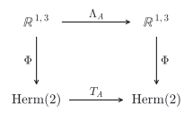

# SL(2,ℂ) as the double cover of the Lorentz group

## TL;DR

- **A four-vector is a Hermitian 2×2 matrix.** The map $`\Phi`$ writes $`x = (x^0, \mathbf{x})`$ as a matrix whose determinant is the Minkowski square of $x$:

  $`\displaystyle \Phi(x) = x^0 I + \mathbf{x} \cdot \boldsymbol{\sigma}, \qquad \det \Phi(x) = (x^0)^2 - |\mathbf{x}|^2.`$

- **A complex 2×2 matrix with determinant 1 acts on these matrices by $`X \mapsto A X A^\dagger`$.** The result is again Hermitian with the same determinant. Translated back through $`\Phi`$, every $`A \in SL(2,\mathbb{C})`$ gives a Lorentz transformation $`\Lambda_A`$.

- **The map $`\pi : A \mapsto \Lambda_A`$ respects multiplication, hits every proper orthochronous Lorentz transformation, and sends exactly $A$ and $-A$ to the same one.** So, as groups,

  $`\displaystyle SO^+(1,3) \cong SL(2,\mathbb{C})/\{\pm I\}.`$

- **Unitary $A$ give rotations, Hermitian $A$ give boosts.** The rotation by $`\theta`$ about $z$ and the boost along $z$ with rapidity $`\eta`$ come from

  $`\displaystyle e^{-i\theta\sigma_3/2} \quad \text{and} \quad e^{\eta\sigma_3/2}.`$

- **The rotation by $`2\pi`$ is $-I$ in SL(2,ℂ).** It is the identity on four-vectors but flips the sign of anything on which $A$ acts directly. Those objects are spinors, the subject of the [next note](weyl-spinor-representations.md).

## Key claims

Conventions: the metric is mostly minus, as in Schwartz. Minkowski space $`\mathbb{R}^{1,3}`$ is $`\mathbb{R}^4`$ with the product below. $`\mathrm{Herm}(2)`$ is the set of Hermitian 2×2 complex matrices, a real vector space. $`\sigma_1, \sigma_2, \sigma_3`$ are the Pauli matrices and $`\sigma_0 = I`$. Bold letters are three-vectors: $`\mathbf{x} = (x^1, x^2, x^3)`$ and $`\boldsymbol{\sigma} = (\sigma_1, \sigma_2, \sigma_3)`$.

```math
x \cdot y = x^0 y^0 - \mathbf{x} \cdot \mathbf{y} .
```

- <a id="c1"></a>**C1.** The map

  $`\displaystyle \Phi : \mathbb{R}^{1,3} \to \mathrm{Herm}(2), \qquad x \mapsto x^0 I + x^1\sigma_1 + x^2\sigma_2 + x^3\sigma_3`$

  is a real-linear bijection. Its inverse reads off the components:

  $`\displaystyle x^\mu = \frac12 \mathrm{tr}\big(\sigma_\mu \Phi(x)\big).`$

- <a id="c2"></a>**C2.** The determinant of $`\Phi(x)`$ is the Minkowski square of $x$:

  $`\displaystyle \det \Phi(x) = (x^0)^2 - |\mathbf{x}|^2 = x \cdot x.`$

- <a id="c3"></a>**C3.** For $`A \in SL(2,\mathbb{C})`$, the map

  $`\displaystyle T_A : \mathrm{Herm}(2) \to \mathrm{Herm}(2), \qquad X \mapsto A X A^\dagger`$

  is real-linear and keeps the determinant. So the map

  $`\displaystyle \Lambda_A = \Phi^{-1} \circ T_A \circ \Phi : \mathbb{R}^{1,3} \to \mathbb{R}^{1,3}`$

  is linear and keeps the Minkowski square, $`\Lambda_A x \cdot \Lambda_A x = x \cdot x`$: it is a Lorentz transformation. Its matrix is

  $`\displaystyle (\Lambda_A)^\mu{}_\nu = \frac12 \mathrm{tr}(\sigma_\mu A \sigma_\nu A^\dagger).`$

- <a id="c4"></a>**C4.** The map

  $`\displaystyle \pi : SL(2,\mathbb{C}) \to O(1,3), \qquad A \mapsto \Lambda_A`$

  is a group homomorphism: $`\Lambda_{AB} = \Lambda_A\Lambda_B`$ and $`\Lambda_I = 1`$. It is continuous, since the entries of $`\Lambda_A`$ are polynomials in the entries of $A$ and $`\bar{A}`$.

- <a id="c5"></a>**C5.** Every $`\Lambda_A`$ is proper and orthochronous:

  $`\displaystyle (\Lambda_A)^0{}_0 = \frac12 \mathrm{tr}(A A^\dagger) \ge 1, \qquad \det \Lambda_A = 1.`$

- <a id="c6"></a>**C6.** $`\Lambda_A = 1`$ exactly for $`A = \pm I`$. Hence $`\Lambda_A = \Lambda_B`$ exactly when $`B = \pm A`$.

- <a id="c7"></a>**C7.** Let $`R_z(\theta)`$ and $`R_y(\theta)`$ be the rotations by $`\theta`$ about the $z$- and $y$-axes, and $`B_z(\eta)`$ the boost along $+z$ with rapidity $`\eta`$. Then

  $`\displaystyle \pi\big(e^{-i\theta\sigma_3/2}\big) = R_z(\theta), \qquad \pi\big(e^{-i\theta\sigma_2/2}\big) = R_y(\theta), \qquad \pi\big(e^{\eta\sigma_3/2}\big) = B_z(\eta).`$

  The boost scales the light-cone coordinates:

  $`\displaystyle x^0 \pm x^3 \mapsto e^{\pm\eta}(x^0 \pm x^3).`$

  For unitary $A$, $`\Lambda_A`$ fixes $x^0$ and is a rotation, so $`\pi`$ restricts to a homomorphism $`SU(2) \to SO(3)`$.

- <a id="c8"></a>**C8.** The homomorphism $`\pi : SL(2,\mathbb{C}) \to SO^+(1,3)`$ is surjective. Together with [C4](#c4) and [C6](#c6), as groups,

  $`\displaystyle SO^+(1,3) \cong SL(2,\mathbb{C})/\{\pm I\},`$

  where the quotient is the group of pairs $`\{A, -A\}`$. SL(2,ℂ) is a double cover of $SO^+(1,3)$.

- <a id="c9"></a>**C9.** The path

  $`\displaystyle A : [0, 2\pi] \to SL(2,\mathbb{C}), \qquad t \mapsto e^{-it\sigma_3/2},`$

  runs from $I$ to $`A(2\pi) = -I`$. Its image $`\pi(A(t))`$ is the full rotation about $z$, a closed loop in $SO^+(1,3)$. So a vector $`\psi \in \mathbb{C}^2`$ on which $A$ acts as $`\psi \mapsto A\psi`$ returns as $`-\psi`$ after a $`2\pi`$ rotation.

## Explanation

### Why look for a second group at all

The Lorentz group acts on four-vectors. The Dirac equation needs more: objects that transform under Lorentz transformations but change sign under a rotation by $`2\pi`$.

**Why does the Dirac equation need that?** The Dirac field describes particles of spin ½, such as the electron. In quantum mechanics, a spin-½ state is rotated by $`\theta`$ about the axis $`\hat{n}`$ with the operator $`e^{-i\theta\,\hat{n}\cdot\boldsymbol{\sigma}/2}`$. The factor ½ is the spin.

Where does that operator come from? Two results of quantum mechanics, both *(cited: Sakurai and Napolitano, sections 3.1 and 3.2)*. First, angular momentum generates rotations: a rotation by $`\theta`$ about $`\hat{n}`$ acts on states as $`e^{-i\theta\,\hat{n}\cdot\mathbf{J}/\hbar}`$, where $`\mathbf{J}`$ is the angular momentum. This is the rotation counterpart of momentum generating translations. Second, for a spin-½ particle at rest the angular momentum is the spin, $`\mathbf{S} = \hbar\boldsymbol{\sigma}/2`$. Its components have the two eigenvalues $`\pm\hbar/2`$, the two beams of a Stern–Gerlach experiment. Inserting the second into the first gives the operator above.

At $`\theta = 2\pi`$ this operator is $-I$: the state changes sign. That is not an artefact of notation. A neutron beam split in two, with one half rotated by $`2\pi`$ in a magnetic field, interferes destructively with the other half when the two are recombined *(cited: Rauch et al. 1975; Werner et al. 1975)*. The Dirac equation is built so that its solutions carry spin ½. Its Lorentz transformations must therefore contain these rotation operators, sign included.

No representation of $SO^+(1,3)$ itself can do that, because the $`2\pi`$ rotation *is* the identity there. The way out is a bigger group that maps onto the Lorentz group, two elements to one, so that the signs $+$ and $-$ survive upstairs. That group is SL(2,ℂ), the complex 2×2 matrices with determinant 1. This note builds the map. The [next note](weyl-spinor-representations.md) builds the spinors that live on SL(2,ℂ).

Rotations alone show the same pattern one level down, with SU(2) and SO(3). This note contains that case: restrict everything to unitary $A$ ([C7](#c7)).

### Four-vectors as Hermitian matrices

**Definition (the matrix of a four-vector).** Let $`\mathrm{Herm}(2)`$ be the Hermitian 2×2 complex matrices. Define

```math
\Phi : \mathbb{R}^{1,3} \to \mathrm{Herm}(2), \qquad \Phi(x) = x^0 I + x^1 \sigma_1 + x^2 \sigma_2 + x^3 \sigma_3
     = \begin{pmatrix} x^0 + x^3 & x^1 - i x^2 \\ x^1 + i x^2 & x^0 - x^3 \end{pmatrix} .
```

In words: the time component sits on the diagonal as the average, $z$ as the difference of the diagonal entries, and $x$ and $y$ as the real and imaginary parts off the diagonal. The matrix is Hermitian, $`\Phi(x)^\dagger = \Phi(x)`$, because the diagonal is real and the off-diagonal entries are complex conjugates of each other. Below, $X$ is short for $`\Phi(x)`$ when $x$ is clear.

Every Hermitian 2×2 matrix arises this way, exactly once ([C1](#c1)). A Hermitian 2×2 matrix has two real diagonal entries and one complex off-diagonal entry: four real numbers, matching $`x^0, \dots, x^3`$. To read them back, use

```math
\mathrm{tr}(\sigma_\mu \sigma_\nu) = 2\delta_{\mu\nu} \qquad \text{for } \mu, \nu \in \{0, 1, 2, 3\} .
```

Multiplying $X$ by $`\sigma_\mu`$ and taking half the trace picks out $`x^\mu`$.

The determinant is the Minkowski square ([C2](#c2)):

```math
\det X = (x^0 + x^3)(x^0 - x^3) - (x^1 - i x^2)(x^1 + i x^2) = (x^0)^2 - (x^3)^2 - (x^1)^2 - (x^2)^2 .
```

This is the whole trick. Matrix multiplication keeps determinants under control, and the determinant here *is* the quantity that Lorentz transformations keep.

Two cases to picture:

- $x = (1, 0, 0, 0)$, a particle at rest: $X = I$, with $`\det X = 1`$.
- $x = (E, 0, 0, E)$, a massless particle moving along $z$: $`X = \mathrm{diag}(2E, 0)`$, with $`\det X = 0`$. The matrix of a light-like vector has rank 1. This observation is the seed of spinor helicity: a rank-1 matrix is a column times a row, so a light-like momentum factorises into two spinors ([next note, C7](weyl-spinor-representations.md#c7)).

### SL(2,ℂ) acts on four-vectors

**Definition.** SL(2,ℂ) is the group, under matrix multiplication, of complex 2×2 matrices with determinant 1:

```math
SL(2,\mathbb{C}) = \{ A \in \mathbb{C}^{2 \times 2} : \det A = 1 \} .
```

Three maps are involved, and it pays to keep them apart:

- $`\Phi`$, from Minkowski space to Hermitian matrices ([C1](#c1)). It is fixed once and for all.
- For each $A$, the action $`T_A`$ on Hermitian matrices, $`X \mapsto AXA^\dagger`$.
- For each $A$, the Lorentz transformation $`\Lambda_A`$ on Minkowski space. It does what $`T_A`$ does, translated through $`\Phi`$.

**Definition (the action and the Lorentz transformation of $A$).** For $`A \in SL(2,\mathbb{C})`$, let

```math
T_A : \mathrm{Herm}(2) \to \mathrm{Herm}(2), \qquad T_A(X) = A X A^\dagger ,
```

```math
\Lambda_A = \Phi^{-1} \circ T_A \circ \Phi : \mathbb{R}^{1,3} \to \mathbb{R}^{1,3} .
```

To apply $`\Lambda_A`$ to $x$: turn $x$ into the matrix $`\Phi(x)`$, act with $A$, and read the four components of the result back off with $`\Phi^{-1}`$. The diagram commutes: both routes from the top left to the bottom right give the same matrix, $`\Phi(\Lambda_A x) = A\,\Phi(x)\,A^\dagger`$.

<picture>
  <source media="(prefers-color-scheme: dark)" srcset="figures/sl2c-commutative-square-dark.svg">
  
</picture>

Finally, collecting all $A$ gives one more map, from the group to the Lorentz transformations:

```math
\pi : SL(2,\mathbb{C}) \to O(1,3), \qquad A \mapsto \Lambda_A .
```

The letter $`\pi`$ is the usual name for a covering map, a projection from the bigger group down onto the smaller one. $`\Lambda`$ stays reserved for a Lorentz transformation, an element of $O(1,3)$: $`\pi`$ takes a matrix $A$ and returns the Lorentz transformation $`\Lambda_A`$.

[C3](#c3) shows that each $`\Lambda_A`$ really lies in $O(1,3)$. [C4](#c4) shows that $`\pi`$ respects multiplication.

**Proposition ([C3](#c3)).** For $`A \in SL(2,\mathbb{C})`$, $`T_A`$ maps $`\mathrm{Herm}(2)`$ to itself and keeps the determinant. Hence $`\Lambda_A \in O(1,3)`$.

*Proof idea.* The dagger of $`AXA^\dagger`$ is $`AX^\dagger A^\dagger`$, and the determinant of a product is the product of the determinants.

<details><summary>Proof</summary>

Let $X$ be Hermitian. Using $`(MN)^\dagger = N^\dagger M^\dagger`$,

$`\displaystyle (A X A^\dagger)^\dagger = (A^\dagger)^\dagger X^\dagger A^\dagger = A X A^\dagger ,`$

so $`T_A(X)`$ is Hermitian. By the product rule for determinants, $`\det(MN) = \det M \det N`$, and $`\det A^\dagger = \overline{\det A}`$,

$`\displaystyle \det(A X A^\dagger) = \det A \cdot \det X \cdot \overline{\det A} = |\det A|^2 \det X = \det X ,`$

since $`\det A = 1`$. $`T_A`$ is real-linear because matrix multiplication is linear in each factor. $`\Phi`$ is a real-linear bijection ([C1](#c1)), so $`\Lambda_A = \Phi^{-1} \circ T_A \circ \Phi`$ is real-linear, as a composition of linear maps. By [C2](#c2),

$`\displaystyle \Lambda_A x \cdot \Lambda_A x = \det \Phi(\Lambda_A x) = \det T_A(\Phi(x)) = \det \Phi(x) = x \cdot x .`$

A linear map that keeps $`x \cdot x`$ for all $x$ keeps $`x \cdot y`$ for all $x, y$, by the polarisation identity

$`\displaystyle x \cdot y = \tfrac14\big[(x+y)\cdot(x+y) - (x-y)\cdot(x-y)\big] ,`$

so $`\Lambda_A \in O(1,3)`$. The matrix entries follow from the inverse in [C1](#c1): column $`\nu`$ of $`\Lambda_A`$ is the image of the basis vector $`e_\nu`$, and $`\Phi(e_\nu) = \sigma_\nu`$. Its component $`\mu`$ is

$`\displaystyle (\Lambda_A)^\mu{}_\nu = \frac12 \mathrm{tr}\big(\sigma_\mu\, T_A(\sigma_\nu)\big) = \frac12 \mathrm{tr}(\sigma_\mu A \sigma_\nu A^\dagger) . \qquad ∎`$

</details>

**Why determinant 1 and not something simpler?** Only $`|\det A| = 1`$ is needed to keep $`\det X`$. But $A$ and $`e^{i\varphi} A`$ give the same map, since the phases cancel in $`A X A^\dagger`$. Fixing $`\det A = 1`$ removes this redundant phase, except for one leftover sign: $`\det(-A) = \det A`$ for 2×2 matrices. That leftover sign is the "double" in double cover ([C6](#c6)).

**Proposition ([C4](#c4)).** $`\pi : SL(2,\mathbb{C}) \to O(1,3)`$ is a continuous group homomorphism.

*Proof idea.* Acting with $B$ and then with $A$ is acting with $AB$:

```math
T_A \circ T_B = T_{AB}, \qquad \text{because} \quad A(BXB^\dagger)A^\dagger = (AB)X(AB)^\dagger .
```

<details><summary>Proof</summary>

By the definition of $`\pi`$ and $`T_A \circ T_B = T_{AB}`$,

$`\displaystyle \Lambda_A\Lambda_B = \Phi^{-1} T_A \Phi\, \Phi^{-1} T_B \Phi = \Phi^{-1} T_A T_B \Phi = \Phi^{-1} T_{AB} \Phi = \Lambda_{AB} .`$

$`\Lambda_I = 1`$ because $`T_I`$ is the identity. Continuity: by [C3](#c3), each entry of $`\Lambda_A`$ is a sum of products of one entry of $A$ and one entry of $`\bar{A}`$, a polynomial and therefore continuous. ∎

</details>

### Which Lorentz transformations come out

The Lorentz group $O(1,3)$ has four pieces. A transformation can reverse time or not (the sign of its time-time entry $`\Lambda^0{}_0`$), and it can reverse orientation or not (the sign of $`\det \Lambda`$). The proper orthochronous piece $SO^+(1,3)$, with $`\Lambda^0{}_0 \ge 1`$ and $`\det\Lambda = 1`$, is the one connected to the identity: rotations, boosts and their products.

**Proposition ([C5](#c5)).** $`\Lambda_A \in SO^+(1,3)`$ for every $`A \in SL(2,\mathbb{C})`$.

*Proof idea.* For the time direction, compute $`\Lambda^0{}_0`$ directly. For the orientation, use continuity: $`\det\Lambda_A`$ is $`\pm 1`$, it is $+1$ at $A = I$, and SL(2,ℂ) is path-connected, so it cannot jump to $-1$. Two lemmas below make the second half precise.

**Lemma (polar decomposition in SL(2,ℂ)).** Every $`A \in SL(2,\mathbb{C})`$ is a product $`A = U e^{H}`$ with $`U \in SU(2)`$ and $H$ Hermitian and traceless.

This generalises writing a complex number as $`z = e^{i\varphi} r`$, a phase times a positive length. $U$ plays the phase: it is unitary, a "rotation". $`e^H`$ plays the length: it is positive definite, a "stretch". In the language of [C7](#c7), every element of SL(2,ℂ) is a boost followed by a rotation.

*Proof idea.* $`A^\dagger A`$ is positive definite, so it has a positive square root $P$. Then $`U = AP^{-1}`$ turns out unitary, and $P$ is $`e^H`$ for a Hermitian $H$.

<details><summary>Proof</summary>

$`A^\dagger A`$ is Hermitian. It is positive definite, because $`v^\dagger A^\dagger A v = |Av|^2 > 0`$ for $`v \ne 0`$, since $A$ is invertible. By the spectral theorem for Hermitian matrices *(cited)*, $`A^\dagger A = V\,\mathrm{diag}(\mu_1, \mu_2)\,V^\dagger`$ with $V$ unitary and $`\mu_1, \mu_2 > 0`$. Let

$`\displaystyle H = V\,\mathrm{diag}\big(\tfrac12\ln\mu_1, \tfrac12\ln\mu_2\big)\,V^\dagger , \qquad P = e^H = V\,\mathrm{diag}\big(\sqrt{\mu_1}, \sqrt{\mu_2}\big)\,V^\dagger .`$

$H$ is Hermitian and $`P^2 = A^\dagger A`$. Its trace is $`\frac12\ln(\mu_1\mu_2) = \frac12\ln\det(A^\dagger A) = \frac12\ln|\det A|^2 = 0`$. Let $`U = AP^{-1}`$. Using $`P^\dagger = P`$,

$`\displaystyle U^\dagger U = P^{-1} A^\dagger A P^{-1} = P^{-1} P^2 P^{-1} = I ,`$

so $U$ is unitary. By the product rule for determinants, $`\det U = \det A / \det P = 1 / e^{\mathrm{tr} H} = 1`$, using $`\det e^H = e^{\mathrm{tr}H}`$ (true for diagonalisable $H$, since both sides are products over eigenvalues). So $`U \in SU(2)`$ and $`A = UP = Ue^H`$. ∎

</details>

**Lemma (a continuous sign is constant).** Let $S$ be a path-connected space and $`f : S \to \{+1, -1\}`$ continuous, with $`\{+1, -1\}`$ as a subset of $`\mathbb{R}`$. Then $f$ is constant.

*Proof idea.* Along a path, $f$ would have to jump from $+1$ to $-1$. The intermediate value theorem forbids jumps: a continuous real function on an interval takes every value in between, here 0, which $f$ never takes.

<details><summary>Proof</summary>

Let $`s, s' \in S`$ and let $`\gamma : [0,1] \to S`$ be a path with $`\gamma(0) = s`$ and $`\gamma(1) = s'`$. Then $`g = f \circ \gamma : [0,1] \to \mathbb{R}`$ is continuous, as a composition of continuous maps. If $`g(0) \ne g(1)`$, one of them is $+1$ and the other $-1$. By the intermediate value theorem, $g$ takes the value 0 somewhere on $[0,1]$. But $g$ only takes the values $`\pm 1`$. So $`f(s) = g(0) = g(1) = f(s')`$. ∎

</details>

<details><summary>Proof of C5</summary>

*Time direction.* Write $A$ with entries $a, b, c, d$:

$`\displaystyle A = \begin{pmatrix} a & b \\ c & d\end{pmatrix} .`$

By [C3](#c3) with $`\mu = \nu = 0`$,

$`\displaystyle (\Lambda_A)^0{}_0 = \frac12 \mathrm{tr}(A A^\dagger) = \frac12\big(|a|^2 + |b|^2 + |c|^2 + |d|^2\big) .`$

Now estimate $`1 = \det A = ad - bc`$ in two steps. The triangle inequality, $`|z + w| \le |z| + |w|`$, together with $`|zw| = |z||w|`$, gives the first. The inequality $`uv \le \frac12(u^2 + v^2)`$ for real $u, v$, applied twice, gives the second. It holds because $`u^2 + v^2 - 2uv = (u - v)^2 \ge 0`$.

$`\displaystyle 1 = |ad - bc| \le |a||d| + |b||c| \le \frac12\big(|a|^2 + |d|^2\big) + \frac12\big(|b|^2 + |c|^2\big) = (\Lambda_A)^0{}_0 .`$

*Orientation.* $`\Lambda_A \in O(1,3)`$ ([C3](#c3)), so $`\Lambda_A^T g \Lambda_A = g`$. By the product rule for determinants, $`(\det\Lambda_A)^2 \det g = \det g`$, so $`\det \Lambda_A = \pm 1`$. The function

$`\displaystyle f : SL(2,\mathbb{C}) \to \{+1, -1\}, \qquad A \mapsto \det\Lambda_A`$

is continuous, as a composition of $`\pi`$ ([C4](#c4)) and the determinant, which is a polynomial.

SL(2,ℂ) is path-connected. By the polar decomposition, $`A = Ue^H`$. The path $`t \mapsto U e^{tH}`$, $`t \in [0, 1]`$, runs from $U$ to $A$ inside SL(2,ℂ), since $`\det e^{tH} = e^{t\,\mathrm{tr}H} = 1`$. And $U$ connects to $I$ inside SU(2): by the spectral theorem for unitary matrices *(cited)*, $`U = W\,\mathrm{diag}(e^{i\varphi}, e^{-i\varphi})\,W^\dagger`$ with $W$ unitary, the two eigenvalues being inverse to each other because $`\det U = 1`$. The path $`t \mapsto W\,\mathrm{diag}(e^{it\varphi}, e^{-it\varphi})\,W^\dagger`$ runs from $I$ to $U$ inside SU(2).

By the lemma on continuous signs, $f$ is constant. At $A = I$ it is $`\det 1 = 1`$. ∎

</details>

**Proposition ([C6](#c6)).** $`\Lambda_A = 1`$ exactly for $`A = \pm I`$.

*Proof idea.* If $`A X A^\dagger = X`$ for every Hermitian $X$, take $X = I$: $A$ must be unitary. Then $A$ commutes with every Pauli matrix, so it is a multiple of $I$, and $`\det A = 1`$ leaves $`\pm I`$.

<details><summary>Proof</summary>

$`\Lambda_A = 1`$ means $`T_A`$ is the identity, because $`\Phi`$ is a bijection ([C1](#c1)). So suppose $`AXA^\dagger = X`$ for all Hermitian $X$. With $X = I$: $`AA^\dagger = I`$, so $`A^\dagger = A^{-1}`$, and the condition becomes $A X A^{-1} = X$, that is $AX = XA$. With $`X = \sigma_3`$: $A$ commutes with $`\mathrm{diag}(1,-1)`$, which forces $A$ to be diagonal. With $`X = \sigma_1`$: a diagonal $`A = \mathrm{diag}(a, d)`$ commutes with $`\sigma_1`$ only if $a = d$. So $A = aI$, and $`\det A = a^2 = 1`$ gives $`a = \pm 1`$. Conversely $`(\pm I) X (\pm I)^\dagger = X`$.

For the second statement: $`\Lambda_A = \Lambda_B`$ means $`\Lambda_{B^{-1}A} = 1`$ by [C4](#c4), so $`B^{-1}A = \pm I`$. ∎

</details>

### Rotations and boosts

**Where do the matrices come from?** A matrix close to $I$ can be written as an exponential $`e^M`$. It lies in SL(2,ℂ) for every multiple $tM$ exactly when $M$ is traceless, by the identity $`\det e^{M} = e^{\mathrm{tr} M}`$ *(cited: Hall, ch. 2)*. The traceless complex 2×2 matrices are the complex combinations of $`\sigma_1, \sigma_2, \sigma_3`$. As a real vector space, they have the six basis matrices $`\sigma_k`$ and $`i\sigma_k`$. These are the generators of SL(2,ℂ), its Lie algebra *(cited: Hall, ch. 3)*. Six real directions match the six parameters of a Lorentz transformation: three rotation angles and three rapidities. Two observations sort them:

- $`e^{M}`$ is unitary when $M$ is anti-Hermitian, which is $`-i\theta\,\hat{n}\cdot\boldsymbol{\sigma}/2`$. Unitary $A$ give rotations (end of this section). This is also the spin-½ rotation operator of quantum mechanics.
- $`e^{M}`$ is Hermitian when $M$ is Hermitian, which is $`\eta\,\hat{n}\cdot\boldsymbol{\sigma}/2`$. These give the boosts.

The factor ½ makes $`\theta`$ the rotation angle and $`\eta`$ the rapidity, as the calculation below shows. Without it, the angle would come out doubled, because $A$ appears twice in $`AXA^\dagger`$.

Now compute what these matrices do ([C7](#c7)). Take

```math
A = e^{-i\theta\sigma_3/2} = \mathrm{diag}(e^{-i\theta/2}, e^{i\theta/2}) , \qquad A^\dagger = \mathrm{diag}(e^{i\theta/2}, e^{-i\theta/2}) .
```

Multiplying out:

```math
A X A^\dagger = \begin{pmatrix} x^0 + x^3 & e^{-i\theta}(x^1 - i x^2) \\ e^{i\theta}(x^1 + i x^2) & x^0 - x^3 \end{pmatrix} .
```

The diagonal is untouched, so $x^0$ and $x^3$ stay. The combination $x^1 + i x^2$ is multiplied by $`e^{i\theta}`$: in the $xy$-plane, the point $(x^1, x^2)$ turns counterclockwise by $`\theta`$. That is the rotation by $`\theta`$ about $z$.

Now take a Hermitian matrix that is not unitary:

```math
A = e^{\eta\sigma_3/2} = \mathrm{diag}(e^{\eta/2}, e^{-\eta/2}) .
```

Then

```math
A X A^\dagger = \begin{pmatrix} e^{\eta}(x^0 + x^3) & x^1 - i x^2 \\ x^1 + i x^2 & e^{-\eta}(x^0 - x^3) \end{pmatrix} .
```

The light-cone coordinates $`x^0 \pm x^3`$ are scaled by $`e^{\pm\eta}`$, and $x^1, x^2$ stay. That is a boost along $+z$ with rapidity $`\eta`$: the rest vector $(1, 0, 0, 0)$ goes to $`(\cosh\eta, 0, 0, \sinh\eta)`$.

The pattern holds in general. A unitary $A$ keeps the trace of $X$, which is $2x^0$, by the cyclicity of the trace:

```math
\mathrm{tr}(AXA^{-1}) = \mathrm{tr}(A^{-1}AX) = \mathrm{tr}\,X .
```

So $`\Lambda_A`$ fixes time and is a rotation. Restricted to SU(2), $`\pi`$ is therefore a homomorphism onto rotations. The topological picture of this map, with SU(2) as the 3-sphere, is in the open pull request [doubting-thomas#40](https://github.com/thomaswening/doubting-thomas/pull/40). That pull request leaves $p(UV) = p(U)p(V)$ open. [C4](#c4) supplies it.

### Every proper orthochronous Lorentz transformation is reached

**Theorem ([C8](#c8)).** $`\pi(SL(2,\mathbb{C})) = SO^+(1,3)`$.

*Proof idea.* Surjective means: every $`\Lambda \in SO^+(1,3)`$ has a preimage, some $A$ with $`\pi(A) = \Lambda`$. So far only rotations about $z$ and $y$ and boosts along $z$ are known to have one ([C7](#c7)). The plan is to write an arbitrary $`\Lambda`$ as a product of transformations of that kind. Then the homomorphism property ([C4](#c4)) multiplies their preimages into a preimage of $`\Lambda`$.

The key observation: a Lorentz transformation is almost fixed by one vector, the image $`u = \Lambda e_0`$ of the time axis. Any two Lorentz transformations that send $`e_0`$ to the same $u$ differ only by a transformation that fixes $`e_0`$, and such a transformation is a rotation. So the proof builds one transformation $RB$ from the known pieces that also sends $`e_0`$ to $u$: the boost $B$ produces the right time component and the right length of the spatial part, and the rotation $R$ turns the spatial part into the right direction. The rest, $`R' = (RB)^{-1}\Lambda`$, fixes $`e_0`$, so it is a rotation. Every rotation has a preimage (step 1).

<details><summary>Proof</summary>

*Step 1: every rotation has a preimage.* By [C7](#c7), every rotation about $z$ and every rotation about $y$ has a preimage:

$`\displaystyle R_z(\alpha) = \pi\big(e^{-i\alpha\sigma_3/2}\big), \qquad R_y(\beta) = \pi\big(e^{-i\beta\sigma_2/2}\big).`$

By Euler's angle decomposition *(cited)*, every rotation $Q \in SO(3)$ is a product $`Q = R_z(\alpha) R_y(\beta) R_z(\gamma)`$ for some angles. The homomorphism property ([C4](#c4)) turns the product of the three preimages into a preimage of $Q$:

$`\displaystyle Q = \pi\big(e^{-i\alpha\sigma_3/2}\big)\,\pi\big(e^{-i\beta\sigma_2/2}\big)\,\pi\big(e^{-i\gamma\sigma_3/2}\big) = \pi\big(e^{-i\alpha\sigma_3/2}\, e^{-i\beta\sigma_2/2}\, e^{-i\gamma\sigma_3/2}\big).`$

*Step 2: where $`\Lambda`$ sends the time axis.* Let $`\Lambda \in SO^+(1,3)`$, $`e_0 = (1, 0, 0, 0)`$ and $`u = \Lambda e_0`$, the first column of $`\Lambda`$. Two facts restrict $u$. $`\Lambda`$ keeps the Minkowski product, so $`u \cdot u = e_0 \cdot e_0 = 1`$. $`\Lambda`$ is orthochronous, so $`u^0 = \Lambda^0{}_0 \ge 1`$. Let $`\eta = \mathrm{arcosh}\, u^0 \ge 0`$. From $`(u^0)^2 - |\mathbf{u}|^2 = 1`$ and the identity $`\cosh^2\eta - \sinh^2\eta = 1`$, $`|\mathbf{u}| = \sinh\eta`$. So, with a unit vector $`\hat{n}`$ in the direction of $`\mathbf{u}`$ (any unit vector if $`\mathbf{u} = 0`$),

$`\displaystyle u = (\cosh\eta, \sinh\eta\, \hat{n}) .`$

*Step 3: a known transformation with the same image of the time axis.* Let $B$ be the $z$-boost with rapidity $`\eta`$. It sends $`e_0`$ to $`(\cosh\eta, 0, 0, \sinh\eta)`$: the right time component and the right spatial length, but along $\hat{z}$ instead of $`\hat{n}`$. Write $`\hat{n}`$ in spherical angles,

$`\displaystyle \hat{n} = (\sin\theta\cos\varphi,\ \sin\theta\sin\varphi,\ \cos\theta) ,`$

and let $`R = R_z(\varphi) R_y(\theta)`$. $`R_y(\theta)`$ tilts $\hat{z}$ by $`\theta`$ towards $\hat{x}$, and $`R_z(\varphi)`$ then turns it by $`\varphi`$ about $z$, so $`R\hat{z} = \hat{n}`$. A rotation leaves the time component alone, so

$`\displaystyle RBe_0 = R(\cosh\eta, 0, 0, \sinh\eta) = (\cosh\eta, \sinh\eta\, \hat{n}) = u = \Lambda e_0 .`$

*Step 4: the remainder fixes the time axis.* Define $`R' = (RB)^{-1}\Lambda`$, so that $`\Lambda = RBR'`$. Then

$`\displaystyle R'e_0 = (RB)^{-1}\Lambda e_0 = (RB)^{-1} u = e_0 ,`$

by step 3. So the first column of $R'$ is $`e_0`$.

*Step 5: the remainder is a rotation.* $R'$ is a product of Lorentz transformations, so it keeps the Minkowski product. First, it maps the spatial subspace $`\{x : x^0 = 0\}`$ to itself. A vector $y$ is spatial exactly when $`y \cdot e_0 = y^0 = 0`$. For spatial $y$,

$`\displaystyle (R'y)^0 = R'y \cdot e_0 = R'y \cdot R'e_0 = y \cdot e_0 = 0 ,`$

using $`R'e_0 = e_0`$ (step 4) in the second equality. Written in components, for every spatial $y$:

$`\displaystyle (R'y)^0 = \sum_{j=1}^{3} R'^0{}_j\, y^j = 0 .`$

Taking $y$ along each spatial axis gives $`R'^0{}_j = 0`$ for $j = 1, 2, 3$. With $`R'^0{}_0 = 1`$ from step 4, the first row of $R'$ is $`(1, 0, 0, 0)`$. Together with the first column, $R'$ has block form, with a real 3×3 matrix $Q$:

$`\displaystyle R' = \begin{pmatrix} 1 & 0 \\ 0 & Q \end{pmatrix} .`$

Second, $Q$ is orthogonal. Keeping the Minkowski product means $`R'^T g R' = g`$ with $`g = \mathrm{diag}(1, -1, -1, -1)`$. In blocks, the lower right block of this equation reads $`-Q^TQ = -I`$, so $`Q^TQ = I`$. Third, $`\det Q = 1`$. By the product rule for determinants, $`\det R' = \det(RB)^{-1} \det\Lambda = 1`$, because $R$, $B$ and $`\Lambda`$ all have determinant 1. The determinant of a block-diagonal matrix is the product of the blocks' determinants, so $`\det Q = \det R' = 1`$. Hence $Q \in SO(3)$, and $R'$ is the rotation $Q$ of space.

*Step 6: a preimage of $`\Lambda`$.* All three factors of $`\Lambda = RBR'`$ have preimages. $R$ and $R'$ are rotations (step 1): $`R = \pi(A_R)`$ and $`R' = \pi(A_{R'})`$. $B$ is a $z$-boost ([C7](#c7)): $`B = \pi(A_B)`$ with $`A_B = e^{\eta\sigma_3/2}`$. By the homomorphism property ([C4](#c4)),

$`\displaystyle \Lambda = RBR' = \pi(A_R)\,\pi(A_B)\,\pi(A_{R'}) = \pi(A_R A_B A_{R'}) .`$

So $`A_R A_B A_{R'}`$ is a preimage of $`\Lambda`$. Since $`\Lambda`$ was arbitrary, $`\pi`$ is surjective. ∎

</details>

### The quotient SL(2,ℂ)/{±I}

$`\pi`$ is now onto, but not one-to-one: $A$ and $-A$ give the same Lorentz transformation ([C6](#c6)). The quotient makes it one-to-one by treating $A$ and $-A$ as one element.

**Definition (coset, quotient).** Let $`K = \{I, -I\}`$, the kernel of $`\pi`$ ([C6](#c6)). The **coset** of $A$ is the set of all products of $A$ with an element of $K$:

```math
AK = \{AI, A(-I)\} = \{A, -A\} .
```

The **quotient** $`SL(2,\mathbb{C})/\{\pm I\}`$ is the set of these cosets, with the product

```math
(AK)(BK) = (AB)K .
```

In words: each element of the quotient is a pair $`\{A, -A\}`$, and two pairs multiply by multiplying any representatives. The choice of representative doesn't matter: replacing $A$ by $-A$ or $B$ by $-B$ changes $AB$ at most by a sign, which stays in the same pair. As a picture: the quotient glues each matrix to its negative, as the real projective plane glues each point of a sphere to its antipode.

**Why each coset is one Lorentz transformation.** By [C6](#c6), $`\pi(A) = \pi(B)`$ exactly when $`B = \pm A`$, that is when $B$ lies in the coset $AK$. So the cosets are exactly the sets of matrices that give the same Lorentz transformation. This is why the quotient is the right object: it has one element for each value of $`\pi`$.

**Proposition ([C8](#c8)).** The map

```math
\bar{\pi} : SL(2,\mathbb{C})/\{\pm I\} \to SO^+(1,3), \qquad \{A, -A\} \mapsto \Lambda_A
```

is a group isomorphism.

*Proof idea.* $`\bar{\pi}`$ is $`\pi`$ read on pairs. It is well defined because both members of a pair give the same $`\Lambda_A`$. It is one-to-one because different pairs give different transformations (C6), and onto because $`\pi`$ is (C8).

<details><summary>Proof</summary>

*Well defined.* $`\pi(-A) = \pi(A)`$ ([C6](#c6)), so the value doesn't depend on the representative.

*Homomorphism.* By the product of cosets and [C4](#c4):

$`\displaystyle \bar{\pi}\big((AK)(BK)\big) = \bar{\pi}\big((AB)K\big) = \Lambda_{AB} = \Lambda_A \Lambda_B = \bar{\pi}(AK)\,\bar{\pi}(BK) .`$

*One-to-one.* If $`\bar{\pi}(AK) = \bar{\pi}(BK)`$, then $`\Lambda_A = \Lambda_B`$, so $`B = \pm A`$ by [C6](#c6), and $BK = AK$.

*Onto.* Every $`\Lambda \in SO^+(1,3)`$ is $`\pi(A)`$ for some $A$ (theorem above), so $`\Lambda = \bar{\pi}(AK)`$.

A bijective homomorphism is an isomorphism. ∎

</details>

This is the first isomorphism theorem for groups, proved here for this one case: a surjective homomorphism becomes an isomorphism once the elements that differ by its kernel are identified. The same steps, with the kernel of any surjective homomorphism in place of $`\{\pm I\}`$, prove the general theorem.

"Double cover" means: two elements upstairs, $A$ and $-A$, for each Lorentz transformation downstairs, with the map continuous.

SL(2,ℂ) is moreover simply connected. By the polar decomposition, it is homeomorphic to a product of a 3-sphere and a 3-dimensional space *(cited)*:

```math
SL(2,\mathbb{C}) \cong SU(2) \times \mathbb{R}^3 \cong S^3 \times \mathbb{R}^3 .
```

That makes it *the* universal cover of $SO^+(1,3)$. Nothing in the spinor-helicity course depends on this.

### The 2π rotation

Follow $`A(t) = e^{-it\sigma_3/2}`$ from $t = 0$ to $`t = 2\pi`$ ([C9](#c9)). Downstairs, $`\pi(A(t))`$ is the rotation by $t$ about $z$ ([C7](#c7)), which returns to the identity at $`t = 2\pi`$. Upstairs, the path ends at

```math
A(2\pi) = \mathrm{diag}(e^{-i\pi}, e^{i\pi}) = -I .
```

The path does not close.

On four-vectors this makes no difference, since $-I$ and $I$ act the same ([C6](#c6)). But a two-component object $`\psi \in \mathbb{C}^2`$ on which $A$ acts as $`\psi \mapsto A\psi`$ notices: it returns as $`-\psi`$. Such objects are spinors. They are not functions of the Lorentz transformation $`\Lambda`$, only of $A$, which is why the physics of spin-½ needs SL(2,ℂ) and not just $SO^+(1,3)$.

## Examples

**A boost, computed.** Take $`A = e^{\eta\sigma_3/2}`$ with $`\eta = 0.4`$ and the vector $x = (1, 0, 0, 0)$. Then $X = I$ and

```math
A X A^\dagger = A^2 = \mathrm{diag}(e^{0.4}, e^{-0.4}) .
```

Reading off with [C1](#c1):

```math
x'^0 = \frac12(e^{0.4} + e^{-0.4}) = \cosh 0.4 \approx 1.0811 , \qquad x'^3 = \frac12(e^{0.4} - e^{-0.4}) = \sinh 0.4 \approx 0.4108 .
```

Check: $`\cosh^2 - \sinh^2 = 1`$, as [C2](#c2) requires.

**Two matrices, one rotation.** These two matrices both rotate by $`\theta`$ about $z$:

```math
e^{-i\theta\sigma_3/2} \quad \text{and} \quad -e^{-i\theta\sigma_3/2} = e^{-i(\theta + 2\pi)\sigma_3/2} .
```

The second is the rotation by $`\theta + 2\pi`$, which is the same rotation ([C6](#c6)).

**A light-like vector.** $p = (E, 0, 0, E)$ has

```math
P = \Phi(p) = \mathrm{diag}(2E, 0) = \begin{pmatrix}\sqrt{2E} \\ 0\end{pmatrix}\begin{pmatrix}\sqrt{2E} & 0\end{pmatrix} ,
```

a column times its conjugate transpose. With $`\lambda = (\sqrt{2E}, 0)^T`$, the matrix $A$ acts as

```math
T_A(P) = A P A^\dagger = (A\lambda)(A\lambda)^\dagger .
```

So the momentum transforms because the spinor $`\lambda`$ does.

## Pitfalls

- **"SL(2,ℂ) is the Lorentz group."** It is not. It is twice as large: $A$ and $-A$ are different elements with the same Lorentz transformation ([C6](#c6)).

- **"Unitary means Lorentz."** Only unitary $A$ give rotations ([C7](#c7)). Boosts come from Hermitian $A$, which are not unitary. This is why the spinor representations of the Lorentz group cannot be unitary, unlike those of the rotation group.

- **Confusing $`A X A^\dagger`$ with $A X A^{-1}$.** For unitary $A$ they agree. For a boost they do not, and $A X A^{-1}$ would not keep $X$ Hermitian.

- **Mixing up $`T_A`$ and $`\Lambda_A`$.** $`T_A`$ acts on Hermitian matrices, $`\Lambda_A`$ on four-vectors. They are the same transformation seen through $`\Phi`$ ([C3](#c3)), but a formula for one doesn't apply to the other without $`\Phi`$.

- **Forgetting that $`\det(-A) = \det A`$ only in even dimension.** For 2×2 matrices it holds, which is why the kernel is $`\{\pm I\}`$ and not just $`\{I\}`$.

## Exercises

1. **Read off.** Write the matrix $`\Phi(x)`$ of $x = (2, 1, 0, 1)$ and compute its determinant. Is $x$ time-like, space-like or light-like? Practises [C1](#c1), [C2](#c2).

   <details><summary>Solution</summary>

   $`\displaystyle \Phi(x) = \begin{pmatrix} 3 & 1 \\ 1 & 1\end{pmatrix}, \qquad \det \Phi(x) = 3 - 1 = 2 = 4 - 1 - 0 - 1.`$

   Positive, so time-like ([C2](#c2)).

   </details>

2. **Which condition fails?** Let $A = 2I$. Does $`X \mapsto AXA^\dagger`$ give a Lorentz transformation? Practises [C3](#c3).

   <details><summary>Solution</summary>

   No. $`AXA^\dagger = 4X`$, and $`\det(4X) = 16 \det X`$. The determinant condition $`\det A = 1`$, or at least $`|\det A| = 1`$, is what keeps $`x \cdot x`$ ([C3](#c3)).

   </details>

3. **Boost along $x$.** Which $A$ boosts along $+x$ with rapidity $`\eta`$? Check it on $x = (1, 0, 0, 0)$. Practises [C7](#c7).

   <details><summary>Solution</summary>

   $`\displaystyle A = e^{\eta\sigma_1/2} = \cosh\frac{\eta}{2}\, I + \sinh\frac{\eta}{2}\,\sigma_1.`$

   Then

   $`\displaystyle AIA^\dagger = A^2 = e^{\eta\sigma_1} = \cosh\eta\, I + \sinh\eta\, \sigma_1,`$

   which by [C1](#c1) is $`(\cosh\eta, \sinh\eta, 0, 0)`$.

   </details>

4. **Reconstruct.** Reconstruct the proof of [C6](#c6) from its idea: why does $X = I$ make $A$ unitary, and why do $`\sigma_3`$ and $`\sigma_1`$ suffice to make it a multiple of $I$?

   <details><summary>Solution</summary>

   $`AIA^\dagger = AA^\dagger = I`$. Commuting with $`\sigma_3 = \mathrm{diag}(1,-1)`$ kills the off-diagonal entries, because

   $`\displaystyle (A\sigma_3)_{12} = -A_{12} \quad \text{but} \quad (\sigma_3 A)_{12} = A_{12}.`$

   Commuting with $`\sigma_1`$ swaps the diagonal entries of a diagonal matrix,

   $`\displaystyle \sigma_1\, \mathrm{diag}(a,d)\, \sigma_1 = \mathrm{diag}(d, a),`$

   so $a = d$.

   </details>

5. **2π and 4π.** What is $`A(4\pi)`$ for $`A(t) = e^{-it\sigma_3/2}`$? What does a spinor do under a $`4\pi`$ rotation? Practises [C9](#c9).

   <details><summary>Solution</summary>

   $`\displaystyle A(4\pi) = \mathrm{diag}(e^{-2\pi i}, e^{2\pi i}) = I.`$

   The spinor returns to itself.

   </details>

6. **Polar decomposition by hand.** Find the polar decomposition $`A = Ue^H`$ of the boost $`A = e^{\eta\sigma_3/2}`$ and of the rotation $`A = e^{-i\theta\sigma_3/2}`$. Practises the polar decomposition lemma and [C7](#c7).

   <details><summary>Solution</summary>

   The boost is Hermitian and positive definite, so $U = I$ and $`H = \eta\sigma_3/2`$. The rotation is unitary, so $`A^\dagger A = I`$, $H = 0$ and $U = A$. In general, $U$ is the rotation part and $`e^H`$ the boost part.

   </details>

## Sources

- Claude session on the spinor-helicity course, 2026-11-12, and Thomas's review of [#43](https://github.com/thomaswening/doubting-thomas/pull/43).
- Mark Srednicki, *Quantum Field Theory* (Cambridge, 2007), chapter 33, "Representations of the Lorentz Group", and chapter 2 for the Lorentz group itself. Srednicki uses the mostly-plus metric. The construction here is metric-independent, but signs in $`x \cdot x`$ flip.
- Matthew D. Schwartz, *Quantum Field Theory and the Standard Model* (Cambridge, 2014), chapter 10, "Spinors". Source of the mostly-minus conventions used here.
- Brian C. Hall, *Lie Groups, Lie Algebras, and Representations* (2nd ed., Springer, 2015): chapter 1 for the connectedness and simple connectedness of SL(n,ℂ) via the polar decomposition, and the SU(2) → SO(3) homomorphism; chapter 3 for the Lie algebra of a matrix group, here the traceless matrices. The spectral theorem for Hermitian and unitary matrices and Euler's angle decomposition are standard results of linear algebra and rotation geometry.
- J. J. Sakurai and Jim Napolitano, *Modern Quantum Mechanics* (2nd ed., Addison-Wesley, 2011): section 3.1 for rotations generated by angular momentum, section 3.2 for spin-½ systems and finite rotations.
- H. Rauch et al., "Verification of coherent spinor rotation of fermions", *Physics Letters A* 54 (1975) 425; S. A. Werner et al., "Observation of the phase shift of a neutron due to precession in a magnetic field", *Physical Review Letters* 35 (1975) 1053. The neutron experiments that show the sign change of a spin-½ state under a $`2\pi`$ rotation.
- H. K. Dreiner, H. E. Haber, S. P. Martin, "Two-component spinor techniques and Feynman rules for quantum field theory and supersymmetry", [arXiv:0812.1594](https://arxiv.org/abs/0812.1594), section 2, for the same map in two-component notation.
