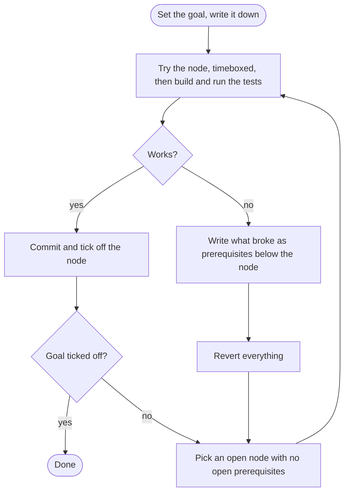
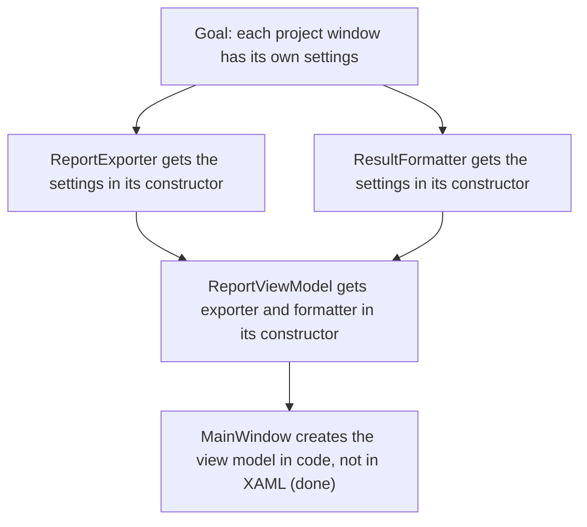

# Mikado Method

## TL;DR

- The problem: a WPF app reads its settings from a static class `AppSettings`. Now each open project window needs its own settings. You make `AppSettings` an ordinary class, and the build breaks in two places. You fix those, and three more break. After two days the branch is still red, and nobody can tell how far away the end is.

- The **Mikado Method** replaces this with short experiments. Try the change for ten minutes. Write down what broke, as things that must be true first (**prerequisites**). Then **revert** everything. Repeat for each prerequisite until you reach one that works without breaking anything (a **leaf**).

- The notes form a **Mikado graph**: the goal at the top, its prerequisites below it. Then you work upward from the leaves. Each leaf is a small change that leaves the build green, so you commit it and could ship it.

- The revert is the part that feels wrong, and it is the point. The knowledge stays in the graph. The code goes back to a state that works.

## Key claims

- <a id="c1"></a>**C1.** The Mikado Method makes a change that is too big for one step as a series of small steps. You set a goal, try it directly within a short timebox, write down what is missing as prerequisites, revert, and repeat the same for each prerequisite.

- <a id="c2"></a>**C2.** The prerequisites are recorded in a **Mikado graph**: the goal at the top, each prerequisite below what needs it. The graph is discovered by the experiments, not planned in advance. It is the map of the change.

- <a id="c3"></a>**C3.** After a failed attempt, all its changes are reverted, so each experiment starts from code in a known working state. What the attempt taught is kept in the graph, not in the code.

- <a id="c4"></a>**C4.** The work is done from the leaves upward. A leaf is a prerequisite that can be done without breaking anything. Each finished leaf leaves the code working and is committed, so the work can stop or ship after any of them.

- <a id="c5"></a>**C5.** An attempt is timeboxed, typically to a few minutes, such as ten. If the change isn't done when the time is up, it counts as failed. The timebox limits one attempt, not the whole change: a change that takes weeks is made of many such attempts.

- <a id="c6"></a>**C6.** The name comes from the game Mikado (pick-up sticks): to get the Mikado stick you must first remove the sticks lying on it, one at a time, without moving the rest.

- <a id="c7"></a>**C7.** The method is made for restructurings that take days or weeks, and for teams. Several people can work on different leaves, and the graph shows everyone how far the change has come.

- <a id="c8"></a>**C8.** "Try it" means build *and* run the tests. Some prerequisites show up only at run time, for example a XAML file that creates a view model through its parameterless constructor.

## Explanation

### The change that never ends

The usual way to make a big change is to make it and then fix what breaks. Each fix breaks something else. The branch stays red for days. It drifts away from `main`. Nobody can say whether the end is one hour or one week away. If you have to stop, there is nothing you can keep.

The Mikado Method, from Ola Ellnestam and Daniel Brolund's book (2014), turns this around. You still start by trying the change. But you treat the attempt as an experiment, not as the start of the work ([C1](#c1)).

### The loop

1. **Set a goal** and write it at the top of a sheet of paper (or a Mermaid file): "Each project window has its own settings."
2. **Try it** directly, within a timebox of a few minutes ([C5](#c5)). Build, and run the tests ([C8](#c8)).
3. **It works?** Commit. Tick the node off in the graph.
4. **It breaks?** Look at what broke. Write each missing thing as a prerequisite below the node you were trying ([C2](#c2)).
5. **Revert.** All of it ([C3](#c3)).
6. Pick a prerequisite that has none of its own yet, and go to step 2 with it.



It ends when the goal itself is ticked off. Working on a leaf is the same loop: a leaf is just a node whose attempt succeeds ([C4](#c4)).

### Why revert?

Because a half-made change hides what else it needs. Once you have fixed three compile errors in your own way, the fourth error is about your fixes, not about the original problem. The next experiment would start from code that doesn't work.

Revert, and the code is green again. Nothing is lost: what you learned is in the graph. The attempt took ten minutes, and redoing it later, in the right order, takes a few. The book admits that this feels "very unintuitive and wasteful".

In .NET terms: an attempt is like a `try` block run against a copy, and the graph is what you write into the `catch`. Only the graph survives. `git restore .` is the revert.

### Why not stash the attempt and reapply it later?

It's tempting: `git stash` each failed attempt, do the leaves, then `git stash pop` the attempts in the right order. It rarely pays off, for three reasons:

- **The code under it has moved.** The attempt was written against the code *before* its prerequisites were done. Once the leaves are in, the same lines look different, so the stash conflicts or no longer fits.
- **It holds the wrong fixes.** An attempt contains the goal change plus whatever you poked at while it was red. That is exactly the half-made state the revert is meant to throw away ([C3](#c3)).
- **Redoing is cheap.** An attempt is at most a few minutes of typing ([C5](#c5)). Done again after its prerequisites, it is usually shorter and goes in cleanly.

If you want to look back at what you tried, keeping the attempt as a stash or a throwaway branch *to read* does no harm. Just don't apply it. That last point is this note's own advice, not the sources'.

### How big does a change have to be?

The loop works at any size. For a refactoring you can finish in one sitting, a small graph on paper is enough. The revert can be the IDE's undo, and the leaves don't each need their own commit. Use undo with care: in Visual Studio it works per file, so after edits in several files, `git restore .` is the more reliable revert.

The method pays off most when the whole change takes days or weeks ([C7](#c7)). That doesn't contradict the ten-minute timebox ([C5](#c5)). The timebox is for one attempt, and the days come from the number of nodes. Forty nodes, each with one or two attempts of ten minutes and a leaf done in a few minutes more, add up to several days. Then the graph has dozens of nodes, and the per-leaf commits matter. You can stop after any of them, and other people can pick up other leaves. The example below is kept small so that it fits into a note. Its steps are as small as real leaves usually are.

### The graph is not a tree

A prerequisite can be needed by more than one node. Draw it once, with an arrow from each node that needs it. You do it once. Both parents can then go ahead. The example below has such a node.

The graph is also not a plan made in advance ([C2](#c2)). You only find out what the goal needs by trying it. A team that draws the graph in a meeting without trying anything has made a guess, not a Mikado graph.

### What a node has to say

A node is not a record of what you did in an attempt. Nobody replays an attempt from the graph. A node says what must be *true* of the code: "`ReportExporter` gets the settings in its constructor". When someone picks it up days later, they don't reconstruct anything. They try it again on today's code, and the compiler and the tests show again what breaks. The knowledge the graph must keep is small: which states the goal needs, and which comes before which.

So the graph needs less writing discipline than it seems. Three habits keep it usable in a team that doesn't like writing:

- **One line per node, as a result you can check.** "`MainWindow` creates the view model in code, not in XAML" can be checked by looking at the code. "Fix the settings stuff" can't. A vague node is the one real way the graph fails.
- **The node is the commit message.** When a leaf is done, its line becomes the commit message. The graph writes the messages that people otherwise skip. A reviewer compares the diff with one line.
- **The graph lives in the repository.** A Mermaid file next to the code, updated in the same commit as the leaf. Then the graph and the code can't drift apart, and the history shows who ticked off what.

If a node is unclear anyway, nothing is lost: try it. A ten-minute attempt rebuilds what it was about ([C5](#c5)). These three habits are this note's own advice. The sources only say to write the goal and the prerequisites down.

### Compile errors are only the visible part

In C#, the compiler finds most prerequisites for you: a missing constructor argument, a static member used as an instance member. But some dependencies are invisible to it. XAML creates objects by reflection. A binding names its property in a string. A DI container resolves types at run time. These break only when the code runs, so an attempt includes the tests ([C8](#c8)). In legacy code without tests, a leaf may need [characterization tests](characterization-tests.md) first. That is a prerequisite of its own, and it goes into the graph.

### Where it fits with the other notes

[Seams](seams.md) and [characterization tests](characterization-tests.md) make one place safe to change. The [Strangler Fig](strangler-fig.md) decides which part of the system is replaced, and in what order, behind a facade. The Mikado Method sits in between. It finds the order of small, green steps for one change that ripples through the code, for example the change that puts a seam or a facade into place. That combination is this note's own framing, not a claim of the sources.

## Examples

### Settings per project window

The app before the change. `AppSettings` is static, so every window shares one set of settings:

```csharp
using System.Globalization;

public static class AppSettings
{
    public static int Decimals { get; set; } = 2;
    public static string ExportFolder { get; set; } = @"C:\Exports";
}

public class ReportExporter
{
    public string TargetPath(string reportName) =>
        Path.Combine(AppSettings.ExportFolder, reportName + ".csv");
}

public class ResultFormatter
{
    public string Format(double value) =>
        value.ToString("F" + AppSettings.Decimals, CultureInfo.InvariantCulture);
}

public class ReportViewModel
{
    private readonly ReportExporter _exporter = new();
    private readonly ResultFormatter _formatter = new();

    public string Describe(double value, string reportName) =>
        $"{_formatter.Format(value)} -> {_exporter.TargetPath(reportName)}";
}
```

And in `MainWindow.xaml`, the view model is created by XAML:

```xml
<Window.DataContext>
    <local:ReportViewModel />
</Window.DataContext>
```

**Attempt 1: the goal.** Make `AppSettings` a normal class with instance properties. The build fails:

```text
error CS0120: An object reference is required for the non-static field, method, or property 'AppSettings.Decimals'
error CS0120: An object reference is required for the non-static field, method, or property 'AppSettings.ExportFolder'
```

The first comes from `ResultFormatter`, the second from `ReportExporter`. Each needs an instance of the settings. Write two prerequisites: "`ReportExporter` gets the settings in its constructor" and "`ResultFormatter` gets the settings in its constructor". **Revert.**

**Attempt 2: the exporter.** Add a record `ProjectSettings(int Decimals, string ExportFolder)` and a constructor parameter of that type to `ReportExporter`. The build fails again:

```text
error CS7036: There is no argument given that corresponds to the required parameter 'settings' of 'ReportExporter.ReportExporter(ProjectSettings)'
```

It comes from the field initializer `new()` in `ReportViewModel`, which has no settings to pass. New prerequisite: "`ReportViewModel` gets its exporter and formatter in its constructor". The formatter will run into the same wall, so the new node hangs below both. **Revert.**

**Attempt 3: the view model.** Give `ReportViewModel` a constructor that takes the exporter and the formatter. It compiles. But when the window opens (in the app, or in a test that opens it), it fails at run time:

```text
XamlParseException: 'No matching constructor found on type 'ReportViewModel'...
```

XAML creates the view model through its parameterless constructor, and that one is gone. The compiler never saw it ([C8](#c8)). New prerequisite: "`MainWindow` creates the view model in code, not in XAML". **Revert.**

**Attempt 4: the window.** Move the creation to the code-behind: `DataContext = new ReportViewModel();`. It builds and the tests pass. That's a leaf. **Commit.**

The graph at this point:



Now upward from the leaf ([C4](#c4)). Each step is its own green commit:

1. `ReportViewModel` takes exporter and formatter in its constructor. `MainWindow` passes `new ReportExporter()` and `new ResultFormatter()`.
2. `ReportExporter` takes the settings in its constructor. `MainWindow` passes a `ProjectSettings` filled from the static `AppSettings` for now.
3. `ResultFormatter` does the same.
4. The goal: each window loads its own `ProjectSettings` from its project when it opens. Nothing reads `AppSettings` any more, so it can be deleted. The goal that failed first is now one small step.

After step 1, the team could stop for a week and lose nothing. Every commit on the way is a working app. In a change this small you would probably put all four steps into one pull request, or skip the per-step commits altogether. In a real graph with dozens of nodes, each commit is a point where you can stop.

## Pitfalls

- **Not reverting.** "It's almost compiling, I'll keep it." The next attempt then starts from broken code, and the graph stops matching reality ([C3](#c3)). Revert means `git restore .`, every time.

- **Fixing errors inside an attempt.** Fixing the first error during the attempt is the old way in disguise. During an attempt you only look and write down. You make changes only in an attempt at a leaf.

- **Too long a timebox.** After an hour of trying, nobody wants to revert. Keep it short ([C5](#c5)): if the change isn't done in ten minutes, it's not a leaf.

- **The graph only in your head.** By the fourth level you won't remember why a node is there. Write it down: paper, a whiteboard, or a Mermaid file next to the code. It also tells the team where things stand ([C7](#c7)).

- **Nodes that describe the work, not the result.** "Refactored the exporter a bit" can't be checked or retried. Write what must be true when the node is done ([What a node has to say](#what-a-node-has-to-say)).

- **Trusting the compiler alone.** In WPF, XAML, string bindings and DI hide dependencies the build doesn't check. Run the tests in each attempt ([C8](#c8)).

- **Planning the graph instead of discovering it.** A graph drawn in a meeting is a guess. The prerequisites come from attempts ([C2](#c2)).

## Exercises

1. **Why revert?** You tried the goal, wrote down two prerequisites, and fixed half of the compile errors along the way. A colleague says: "Don't revert, you've already done part of it." What do you answer?

   <details><summary>Solution</summary>

   The half-fixed code is not a known working state. The next errors would partly be about those fixes, not about the change. What I learned is in the graph, so reverting loses only ten minutes of typing. Redoing it in the right order later is quick ([C3](#c3)).

   </details>

2. **Find the leaf.** Goal: "`OrderService` writes to `IOrderRepository` instead of the static `Db` class". Trying it, you find that `OrderService` is created in 14 places with `new OrderService()`, and that `IOrderRepository` doesn't exist yet. Draw the first two levels of the graph. Which node do you try first?

   <details><summary>Solution</summary>

   Goal → "`OrderService` gets an `IOrderRepository` in its constructor" → "`IOrderRepository` exists, with an implementation that calls `Db`". The second is likely a leaf: adding an interface and a class breaks nothing. Try it first. The 14 call sites may give more prerequisites when you try the constructor. One way through is a constructor chain that keeps the parameterless constructor for now, which is a [seam](seams.md) ([C2](#c2), [C4](#c4)).

   </details>

3. **Invisible prerequisite.** All attempts compile, but the app crashes when a window opens. What kind of prerequisite did the compiler miss, and how do you make such prerequisites visible in the next attempt?

   <details><summary>Solution</summary>

   A dependency resolved at run time: XAML creating an object through a constructor that no longer exists, a binding by property name, or a type the DI container can't resolve. Run the tests in every attempt, and add a test that opens the window, if there is none. In untested code, that test is a prerequisite of its own ([C8](#c8)).

   </details>

## Sources

- Ola Ellnestam and Daniel Brolund, [*The Mikado Method*](https://www.manning.com/books/the-mikado-method), Manning, 2014 (ISBN 9781617291210): the method, the Mikado graph and the pick-up sticks metaphor.
- Ola Ellnestam and Daniel Brolund, [*The Mikado Method*](https://www.methodsandtools.com/archive/mikado.php), Methods & Tools, an article from the book's first chapter: set a goal, experiments, visualization and undo; why to revert; change without a broken codebase.
- [mikadomethod.info](https://mikadomethod.info/), the authors' site: the graph as a map, restructurings that take days or weeks, use in teams.
- Nicolas Carlo, [A process to do safe changes in a complex codebase](https://understandlegacycode.com/blog/a-process-to-do-safe-changes-in-a-complex-codebase/), Understand Legacy Code: the loop step by step, a timebox of about ten minutes, commit when a node is checked, start from the leaves.
- Claude session at work, 2026-11-17.
