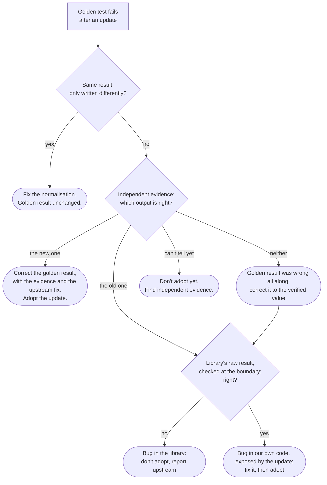

# Golden results and dependency updates

## TL;DR

- A **golden test** (also called a snapshot or approval test) compares a program's output with a stored expected result. It detects **change**, not error.
- When a dependency update changes the output, the failing test means **investigate**, not "accept the new snapshot".
- The expected result is corrected only with **independent evidence** that the new output is right, and that evidence goes into the commit.
- A changed output doesn't say **where** the bug is. It can be in the dependency, in your own code, or in the stored result itself.
- Golden tests only work if correct output is **unique**, so normalise first. Otherwise a harmless convention change breaks them.
- **Pin versions**, so that output can only change in a deliberate update commit.

## Key claims

- <a id="c1"></a>**C1.** A golden test compares output with a stored expected result. A pass shows the output is unchanged since the result was stored, and it shows correctness only to the extent that the stored result is correct.
- <a id="c2"></a>**C2.** A golden result recorded from the program's own output, and never checked independently, only proves that nothing has changed since recording. If the program was wrong then, the test protects the wrong answer.
- <a id="c3"></a>**C3.** Accepting the new output whenever a golden test fails turns the test into a record of whatever the code currently does, and lets a regression through unnoticed.
- <a id="c4"></a>**C4.** IF a dependency update changes an output whose correct value is unique, THEN at least one of the old and new outputs is wrong, and the test failure is the signal to find out which.
- <a id="c5"></a>**C5.** The expected result is corrected only on independent evidence that the new output is right: a second implementation, a check by a different method (such as multiplying factors back), or an external source. The evidence and a reference to the upstream fix go in the same commit.
- <a id="c6"></a>**C6.** Evidence is independent only if it doesn't share the code path under test: rerunning the same library, or a second program built on the same library, is not independent.
- <a id="c7"></a>**C7.** If several outputs are equally correct (a GCD's sign, the order of factors), the output must be normalised to a canonical form before it is compared. Otherwise golden tests fail on harmless changes of convention, and people learn to accept failures without looking.
- <a id="c8"></a>**C8.** Dependency versions are pinned (NuGet's `packages.lock.json`, vcpkg's `builtin-baseline`), so that output changes only in a deliberate update commit, where the failing tests can be traced to that one update.
- <a id="c9"></a>**C9.** A wrong new output after an update doesn't prove the update is at fault. The bug may be in your own code, which the update only exposed. Checking the dependency's raw result at the boundary, before your own code processes it, tells the two apart.
- <a id="c10"></a>**C10.** Two bugs can cancel: if the dependency and your own code each make an error and the errors offset, the output is correct and the golden test passes. When an update fixes the dependency's error, your own error shows up as a changed, wrong output.

## Explanation

### What a golden test really checks

You know this from .NET as snapshot testing, for example with the Verify library: the test writes `MyTest.received.txt`, compares it with `MyTest.verified.txt`, and fails if they differ. Accepting the change means copying received over verified. This is useful because output is often too large to write assertions for by hand, such as a printed expression with a thousand terms. But the test only compares two files. It can't tell an improvement from a regression ([C1](#c1)).

| A golden test answers | A golden test does not answer |
|---|---|
| Has the output changed since the expected result was stored? | Is the output correct? Only as far as the stored result was checked ([C2](#c2)). |
| For which inputs did it change, and how? (the diff) | Is the change a fix or a regression? ([C4](#c4)) |
| | Is the bug in the dependency, in your own code or in the stored result? ([C9](#c9)) |
| | Are there bugs that don't change the output, such as two that cancel? ([C10](#c10)) |

### An everyday golden test

A publisher reprints a book. Before the new print run ships, a proofreader compares it page by page with the approved copy of the last edition. The approved copy is the golden result. The new print run is the new output.

- Every difference is flagged. That is all the comparison can do.
- A difference doesn't say which side is right. Perhaps the printer introduced a typo. Perhaps the last edition had a typo that someone has now fixed.
- To decide, the proofreader goes to an independent source: the author's manuscript ([C5](#c5)). Asking the printer, the source of the new version, doesn't count ([C6](#c6)).
- If the approved copy was itself never checked against the manuscript, "the reprint matches" only means "the reprint repeats whatever the last edition said" ([C2](#c2)).
- A change in layout, such as a different font, with the same words is not an error ([C7](#c7)). Compare the words, not the pixels.

Where the expected result came from decides what a pass means ([C2](#c2)). In [Tante](https://github.com/thomaswening/Tante), the expected results come from a corpus of known answers (results from the literature, factorisations checked by multiplying back, a second implementation). They are not simply whatever the program printed first. That is why a pass there means "correct", not just "unchanged".

### When an update changes the output

Suppose a new FLINT version prints a different factorisation of the same polynomial. After normalisation, a factorisation over the rationals has exactly one correct printed form ([C4](#c4)). So the old version or the new one is wrong. There are two ways to handle the failing test:

- **Accept the snapshot** ([C3](#c3)). Quick, but blind: if the new version introduced a bug, you have just written the bug into the expected result, and the test will now defend it.
- **Investigate** ([C5](#c5)). Check both outputs with something that doesn't use FLINT ([C6](#c6)): Tante's own polynomial implementation, multiplying the factors back, or the corpus entry's source. If the new output is right, the old version had a bug: correct the expected result, and record why in the commit, with a link to the upstream fix. If the new output is wrong, find out *where* before you blame the update ([C9](#c9)). Check the library's raw result at the boundary, before Tante's own code touches it. If that raw result is wrong, the new version has a bug: don't adopt it, and report it upstream. If it is right, the bug is in Tante's own code, and the update only exposed it ([C10](#c10)).

The whole decision as a flowchart. Diamonds are questions, rounded boxes are what to do:



Treating a failure as "investigate" doesn't block bug fixes. It makes sure a bug fix is recognised as one, with evidence, instead of being waved through together with the regressions.

### Normalise first, or the tests cry wolf

If the same correct answer can be printed in several ways ([C7](#c7)), an update that only changes, say, the order of the factors fails every test, although nothing is wrong. After a few such false alarms, people accept failures without reading them, and [C3](#c3) happens by habit. Normalising every result to a canonical form (see [content and primitive part](../algebra/content-and-primitive-part.md)) means that a failing test always points at a real difference.

### Pin versions

If dependency versions float, output can change on any build, and a failing test can't be traced to a cause ([C8](#c8)). With a lock file, a version changes only in a commit that says so, and every test that fails in that commit is about that update.

## Examples

### A failing golden test

```csharp
// A golden test: compare today's output with the stored expected result.
File.WriteAllText("factor.golden.txt", "6 * (x - y) * (x + y)\n");   // recorded earlier

string actual = "-6 * (y - x) * (x + y)\n";                        // what a new library version printed

string expected = File.ReadAllText("factor.golden.txt");
if (actual != expected)
{
    File.WriteAllText("factor.received.txt", actual);
    Console.WriteLine("FAIL: output changed; compare factor.received.txt with factor.golden.txt");
}
else
{
    Console.WriteLine("PASS");
}
```

Output (run with `dotnet run golden.cs`, .NET 10):

```text
FAIL: output changed; compare factor.received.txt with factor.golden.txt
```

Both strings describe the same correct factorisation of $6x^2 - 6y^2$: the new version only moved a sign. This is the false alarm of [C7](#c7). The fix is not to update `factor.golden.txt` but to normalise before comparing. After normalisation, both print `6 * (x - y) * (x + y)` and the test passes.

### Six ways the same test can fail

All six cases test the factorisation of $6x^2 - 6y^2$, whose only correct normalised form is `6 * (x - y) * (x + y)`. "Raw result" is what the library returned before our own code sorted, normalised and printed it. Each row follows one path through the flowchart above.

| Case | Golden (old output) | New output | Independent check | Bug is in | What to do |
|---|---|---|---|---|---|
| 1. Convention changed | `6 * (x - y) * (x + y)` | `-6 * (y - x) * (x + y)` | both correct | nowhere: our comparison lacks normalisation | normalise; golden unchanged ([C7](#c7)) |
| 2. Update introduces a bug | `6 * (x - y) * (x + y)` | `6 * (x^2 - y^2)` | old right: $x^2 - y^2$ splits further | new library (raw result wrong) | don't adopt; report upstream |
| 3. Update fixes a bug | `6 * (x^2 - y^2)`, recorded unchecked | `6 * (x - y) * (x + y)` | new right | old library | correct golden, with evidence ([C5](#c5)) |
| 4. Our bug, exposed | `6 * (x - y) * (x + y)` | `(x - y) * (x + y)` | old right; raw result correct | our code: it took the first list entry as the constant, and the new version lists the constant last | fix our code; adopt ([C9](#c9)) |
| 5. Both wrong | `6 * (x^2 - y^2)`, recorded unchecked | `6 * (x - y)^2` | neither: multiplying back gives $6x^2 - 12xy + 6y^2$ | old and new library | correct golden to the verified value; don't adopt; report |
| 6. Two bugs cancelled | `6 * (x - y) * (x + y)` | `-6 * (x - y) * (x + y)` | old right; raw result now correct | our code, all along | fix our code; adopt ([C10](#c10)) |

Case 4 and case 6 look like the update's fault and are not. Only the check at the boundary shows it ([C9](#c9)).

### Two bugs that cancel

Case 6 in detail. The old library returned the constant of the factorisation with the wrong sign: $-6$ instead of $6$. Our normalisation code had a sign error of its own, which flipped the constant once more. The two errors cancelled ([C10](#c10)):

```text
old library:  raw constant -6   (wrong)  -> our code flips it ->  6   (printed right, test passes)
new library:  raw constant  6   (fixed)  -> our code flips it -> -6   (printed wrong, test fails)
```

The test passed for as long as both bugs were there, because a golden test sees only the final output. The library's fix made our bug visible. The tempting conclusion, "the update broke it", is wrong. Checking the raw result at the boundary shows the new library is right, so the fix belongs in our code, and the update is adopted.

This is why a test of each library adapter on its own, at the interface, is worth having next to the end-to-end tests. In [Tante](https://github.com/thomaswening/Tante) that would mean testing the FLINT adapter's raw results directly. Such a test would have caught the old library's sign error before it could hide behind ours.

### The rule in Tante

[ADR-0003](https://github.com/thomaswening/Tante/blob/main/docs/adr/0003-flint-gmp-arb-behind-own-interfaces.md) §1 of Tante, as clarified on 20 October 2026, says this in one sentence: a change of output across a version update fails the tests and is investigated; IF independent evidence shows the new output is correct, THEN the expected result is corrected in the same commit, with that evidence and a reference to the upstream fix; it is never updated merely because the new version produced it.

## Pitfalls

- **"Fails = blocks the upgrade."** No. It means "find out which version is right" ([C4](#c4)). A real bug fix is adopted, with evidence.
- **"Fails = update the snapshot."** Also no ([C3](#c3)).
- **"The new output is wrong, so the update is to blame."** Not necessarily. Your own code may be wrong, and the update only exposed it ([C9](#c9), [C10](#c10)). Check the raw result at the boundary first.
- **Checking with the same tool.** A second program built on the same library agrees with it for the wrong reasons ([C6](#c6)).
- **Golden results that were never checked.** If the first recorded output was never compared with anything independent, a pass proves only consistency ([C2](#c2)).

## Sources

- Learned while reviewing [ADR-0003](https://github.com/thomaswening/Tante/blob/main/docs/adr/0003-flint-gmp-arb-behind-own-interfaces.md) of [Tante](https://github.com/thomaswening/Tante), whose version-update rule was clarified in [Tante PR #4](https://github.com/thomaswening/Tante/pull/4); Claude session on Tante, 20 October 2026.
- [Verify](https://github.com/VerifyTests/Verify): snapshot testing for .NET, with the received and verified files described above.
- Microsoft Learn, [Locking dependencies with `packages.lock.json`](https://learn.microsoft.com/en-us/nuget/consume-packages/package-references-in-project-files#locking-dependencies).
