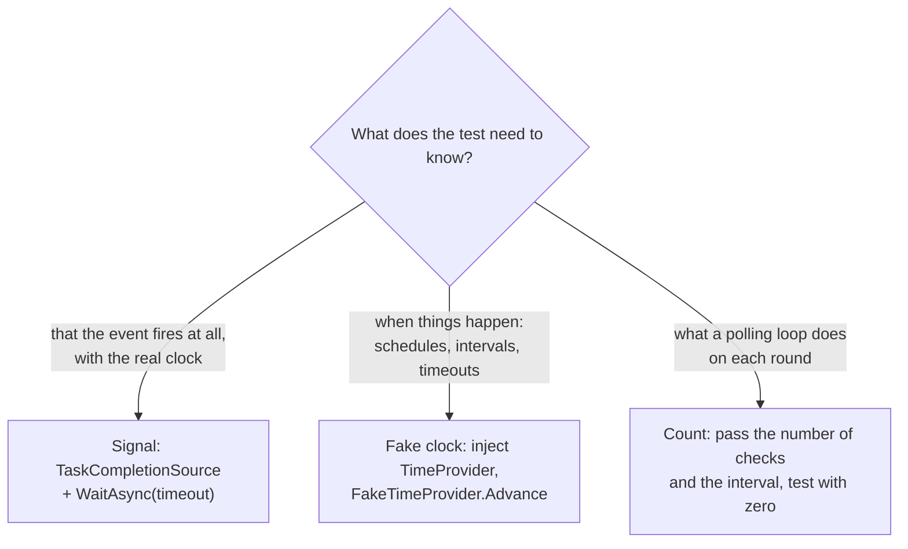

# Testing timer-driven code without sleeping

## TL;DR

- A test that calls `Thread.Sleep` and then checks whether a timer fired is slow *and* flaky: it waits the full time on every run. On a busy CI machine, the timer may not have fired yet.

- **Wait for a signal instead.** Complete a `TaskCompletionSource` from the event the code raises, and `await` its task with `WaitAsync(timeout)`. The test continues as soon as the event fires and fails with a `TimeoutException` if it never does. Create it with `RunContinuationsAsynchronously`.

- **Control the clock.** Code that takes a `TimeProvider` can be driven by `FakeTimeProvider` from `Microsoft.Extensions.TimeProvider.Testing`: `Advance(TimeSpan)` fires the due timers at once, synchronously, without any real waiting.

- **Count instead of time.** Code that loops "check every second for two minutes" can take the number of checks and the interval as parameters. A test then passes three checks with a zero interval.

- The signal suits a test against the real clock; the fake clock suits schedules and timing logic; the count suits simple polling loops.

## Key claims

- <a id="c1"></a>**C1.** A test that sleeps for a fixed time before asserting on timer-driven behaviour fails whenever the timer is late, and is slow whenever it is on time. No sleep duration fixes both.

- <a id="c2"></a>**C2.** `await tcs.Task.WaitAsync(timeout)` completes when the `TaskCompletionSource` is completed and throws `TimeoutException` once `timeout` passes without that. A test that awaits it continues as soon as the signal arrives and fails instead of hanging when it never does.

- <a id="c3"></a>**C3.** Without `TaskCreationOptions.RunContinuationsAsynchronously`, completing a `TaskCompletionSource` may run the awaiting code synchronously, on the completing thread, before `SetResult` returns. With the option, the continuation is queued to the thread pool and `SetResult` returns first.

- <a id="c4"></a>**C4.** `TimeProvider` (.NET 8) is an abstract class for the current time and for timers. `TimeProvider.System` is the real clock. Code that creates its timers with `CreateTimer`, or passes the provider to `Task.Delay` or `PeriodicTimer`, can be given a different clock.

- <a id="c5"></a>**C5.** `FakeTimeProvider.Advance(delta)` moves the fake clock forward and invokes every timer callback that falls due, synchronously on the calling thread before it returns. A periodic timer fires once for each period crossed: advancing a one-minute timer by five minutes fires it five times.

- <a id="c6"></a>**C6.** A polling loop parameterised by a number of checks and an interval can be tested with a zero interval and a small count. The test then covers the loop's logic but not its real timing.

## Explanation

### Why sleeping fails

Take a class that raises `Saved` every minute. A first test starts it with a short interval, sleeps a bit longer than the interval, and asserts that `Saved` fired:

```csharp
var saver = new AutoSaver(TimeSpan.FromMilliseconds(50));
int saves = 0;
saver.Saved += (_, _) => saves++;
saver.Start();
Thread.Sleep(200);
Assert.True(saves > 0);
```

This test makes two promises it can't keep ([C1](#c1)). It always takes 200 ms, even when the event came after 50. And 200 ms is a guess: on a loaded build agent, the timer thread may not have run yet. Then the test fails although the code is right. Raising the sleep makes it slower; lowering it makes it flakier. The problem is that the test waits for *time* when it means to wait for an *event*.

The three approaches below each remove the guess in a different way:



### Waiting for a signal

A `TaskCompletionSource` is a task you complete by hand. Its `Task` property stays pending until someone calls `SetResult` (or `TrySetResult`). That makes it the bridge from an event to `await`: the handler completes it, the test awaits it.

```csharp
var saver = new AutoSaver(TimeSpan.FromMilliseconds(50));
var saved = new TaskCompletionSource(TaskCreationOptions.RunContinuationsAsynchronously);
saver.Saved += (_, _) => saved.TrySetResult();
saver.Start();

await saved.Task.WaitAsync(TimeSpan.FromSeconds(5));
```

Reading it:

- `TrySetResult`, not `SetResult`: the timer fires again after the task is complete. `SetResult` on a completed source throws.
- The test continues the moment `Saved` fires, usually after about 50 ms ([C2](#c2)).
- The five seconds are a ceiling, not a wait. They are reached only when the code is broken. Then `WaitAsync` throws `TimeoutException`, and the test fails with a clear reason. Without `WaitAsync`, a missing event would hang the test run until the test framework's own timeout, if it has one.

The timeout can be generous because it costs nothing on success. Pick it so large that a slow machine never reaches it.

**Why `RunContinuationsAsynchronously`.** When a task completes, the code waiting on it (its *continuation*) has to run somewhere. By default .NET may run it right there, inside `SetResult`, on the thread that called it ([C3](#c3)). Here that is the timer's thread, in the middle of `AutoSaver` raising its event. The rest of the test, including its asserts and the disposal of `saver`, would then run inside the event handler. The timer callback would return only when the test is done. That can deadlock when the test waits for something the timer thread should do next. The option sends the continuation to the thread pool instead. The event handler returns at once.

The experiment below shows the difference. A task on the thread pool awaits the source; the main code completes it and prints when `SetResult` has returned:

```csharp
static async Task Show(TaskCreationOptions options)
{
    var tcs = new TaskCompletionSource(options);
    var waiter = Task.Run(async () =>
    {
        await tcs.Task;
        Console.WriteLine("  continuation runs");
        Thread.Sleep(300);
    });
    await Task.Delay(100);          // let the waiter reach its await
    tcs.SetResult();
    Console.WriteLine($"  SetResult returned ({options})");
    await waiter;
}

await Show(TaskCreationOptions.None);
await Show(TaskCreationOptions.RunContinuationsAsynchronously);
```

```text
  continuation runs
  SetResult returned (None)
  SetResult returned (RunContinuationsAsynchronously)
  continuation runs
```

With `None`, the continuation ran (and slept 300 ms) inside `SetResult`. With the option, `SetResult` returned first.

### Controlling the clock

The signal still runs on the real clock. It can't test "saves every minute" without waiting a minute, nor "gives up after two hours". For that, the code must not read the clock itself. It asks a `TimeProvider` it was given ([C4](#c4)), much as a class gets an `ILogger` injected instead of writing to the console. The [seams note](../refactoring/seams.md) calls such a replaceable dependency an object seam.

```csharp
sealed class AutoSaver(TimeSpan interval, TimeProvider? clock = null) : IDisposable
{
    private readonly TimeProvider _clock = clock ?? TimeProvider.System;
    private ITimer? _timer;

    public event EventHandler? Saved;

    public void Start() =>
        _timer = _clock.CreateTimer(_ => Saved?.Invoke(this, EventArgs.Empty), null, interval, interval);

    public void Dispose() => _timer?.Dispose();
}
```

Production code passes nothing and gets the real clock. A test passes a `FakeTimeProvider` from the NuGet package `Microsoft.Extensions.TimeProvider.Testing`. Its time stands still until the test moves it with `Advance` ([C5](#c5)):

```csharp
var clock = new FakeTimeProvider();
using var saver = new AutoSaver(TimeSpan.FromMinutes(1), clock);
int saves = 0;
saver.Saved += (_, _) => saves++;
saver.Start();

clock.Advance(TimeSpan.FromSeconds(59));
Console.WriteLine($"after 59 s: {saves}");
clock.Advance(TimeSpan.FromSeconds(1));
Console.WriteLine($"after 60 s: {saves}");
clock.Advance(TimeSpan.FromMinutes(5));
Console.WriteLine($"after 6 min: {saves}");
```

```text
after 59 s: 0
after 60 s: 1
after 6 min: 6
```

Reading it:

- Six minutes of schedule ran in no time. The boundary is exact: not at 59 seconds, at 60.
- The five-minute step fired the timer five times, once per period ([C5](#c5)).
- `Advance` ran the callbacks on the test's own thread before returning, so `saves` can be read right after it without any waiting or locking. A check of the thread ID in the handler confirmed this.

The cost is a change to the production code: every place that reads the time or starts a timer must go through the provider. `DateTime.Now`, `new System.Threading.Timer(...)`, `Task.Delay(ms)` without a provider and a WPF `DispatcherTimer` all bypass it. `Task.Delay(delay, timeProvider)` and `new PeriodicTimer(period, timeProvider)` take one.

### Counting instead of timing

Some code is simply a loop: "every second for two minutes, check X". Its interesting behaviour is what it does on each round, not the timing. Then the simplest seam is to pass the two numbers in ([C6](#c6)):

```csharp
static async Task WatchAsync(Func<bool> isWrong, Action fix, int checks, TimeSpan interval)
{
    for (int i = 0; i < checks; i++)
    {
        await Task.Delay(interval);
        if (isWrong())
            fix();
    }
}

// In a test: three rounds, no waiting.
int fixes = 0;
var answers = new Queue<bool>([false, true, false]);
await WatchAsync(() => answers.Dequeue(), () => fixes++, checks: 3, interval: TimeSpan.Zero);
Assert.Equal(1, fixes);
```

The test covers the loop's logic in microseconds. It says nothing about whether the real interval and count are right, but those are two constants in `Main`, which a reader can check at a glance.

### When each pays off

| Approach | Test runs on | Changes production code | Good for |
|---|---|---|---|
| Signal (`TaskCompletionSource`) | the real clock, as fast as the code | no, if the code raises an event | "it happens at all", integration tests, code you can't change |
| Fake clock (`FakeTimeProvider`) | fake time, instantly | yes: inject `TimeProvider` everywhere | schedules, timeouts, retry back-off, long intervals |
| Count | no clock | yes: two parameters | simple polling loops |

The approaches combine. A test with a fake clock still needs a signal when the code awaits something else in between, such as a file write on the thread pool.

## Good habits

- Wait for an event, not for a duration: complete a `TaskCompletionSource` from the event and await it with `WaitAsync` ([C1](#c1), [C2](#c2); Microsoft Learn, `Task.WaitAsync`).

- Create every `TaskCompletionSource` used as a signal with `RunContinuationsAsynchronously` ([C3](#c3); Toub, "New Task APIs in .NET 4.6").

- In new code with timing logic, take a `TimeProvider` instead of reading `DateTime.Now` or creating timers directly ([C4](#c4); Microsoft Learn, What is TimeProvider?).

## Pitfalls

- **A `WaitAsync` timeout tuned to the expected time.** It is a ceiling for the broken case. Make it seconds, not milliseconds above the interval ([C2](#c2)).

- **`SetResult` in a handler that fires more than once.** The second call throws on the timer thread. Use `TrySetResult`.

- **A `TaskCompletionSource` without `RunContinuationsAsynchronously`.** The test's continuation runs inside the code under test's event, on its thread ([C3](#c3)).

- **Injecting a `TimeProvider` but keeping one `DateTime.Now` or `Task.Delay(ms)`.** That one spot runs on the real clock. `Advance` doesn't move it ([C4](#c4)).

- **Expecting `Advance` to fire a periodic timer once for a long step.** It fires once per period crossed ([C5](#c5)).

## Exercises

1. **Predict.** A test creates `new TaskCompletionSource()` without options, subscribes `tcs.SetResult()` to an event, and awaits `tcs.Task`. On which thread do the lines after the `await` probably run?

   <details><summary>Solution</summary>

   On the thread that raised the event, inside `SetResult`, before the event handler returns ([C3](#c3)).

   </details>

2. **Predict.** A timer created through a `FakeTimeProvider` has a due time and period of 10 seconds. The test calls `Advance(TimeSpan.FromSeconds(35))`. How often has the callback run when `Advance` returns?

   <details><summary>Solution</summary>

   Three times, at 10, 20 and 30 seconds, all before `Advance` returns ([C5](#c5)).

   </details>

3. **Choose.** A class retries a failed upload after 1, 2, 4 and 8 minutes, then gives up. Which approach tests the schedule, and why not the others?

   <details><summary>Solution</summary>

   The fake clock: the test is about *when* the retries happen ([C4](#c4), [C5](#c5)). A signal would wait 15 real minutes ([C2](#c2)). A count with zero intervals would lose the schedule itself ([C6](#c6)).

   </details>

## Sources

- Microsoft Learn, [What is TimeProvider?](https://learn.microsoft.com/en-us/dotnet/standard/datetime/timeprovider-overview) and [`FakeTimeProvider`](https://learn.microsoft.com/en-us/dotnet/api/microsoft.extensions.time.testing.faketimeprovider).
- Microsoft Learn, [`Task.WaitAsync`](https://learn.microsoft.com/en-us/dotnet/api/system.threading.tasks.task.waitasync) and [`TaskCreationOptions.RunContinuationsAsynchronously`](https://learn.microsoft.com/en-us/dotnet/api/system.threading.tasks.taskcreationoptions).
- Stephen Toub, [New Task APIs in .NET 4.6](https://devblogs.microsoft.com/pfxteam/new-task-apis-in-net-4-6/): why `RunContinuationsAsynchronously` was added.
- Claude session on GhostKey and KeyboardLayoutFix, 2026-11-24: the snippets were run there with .NET 10 and `Microsoft.Extensions.TimeProvider.Testing` 10.10.0.
