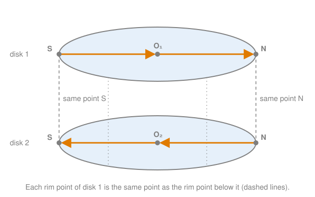

# Gluing two balls into a sphere

## TL;DR

- Take two closed disks and declare each point on the rim of the first to be **the same point** as the corresponding point on the rim of the second. The result is an ordinary sphere $S^2$: the disks are its two hemispheres, the shared rim its equator.
- Only the rim points are identified. The interiors stay two separate pieces. A path that reaches the rim of one disk continues into the other without a jump.
- One dimension up, two solid balls glued along their boundary spheres give the **3-sphere** $S^3$. It is not the solid four-dimensional ball $B^4$, and not the four-sphere $S^4$.
- A loop that runs through both balls can be contracted: push its part in ball 2 onto the shared boundary, where it also lies in ball 1, then shrink the whole loop inside ball 1.
- Contracting one loop shows nothing about every other loop.

## Key claims

- **C1.** The sphere $S^n$ is the set of unit vectors in $\mathbb{R}^{n+1}$ and is $n$-dimensional. The ball $B^n$ is the set of vectors of length at most 1 in $\mathbb{R}^n$, solid and $n$-dimensional. The boundary of $B^{n+1}$ is $S^n$. So $S^3$ is a three-dimensional space that sits in $\mathbb{R}^4$, $B^4$ is the solid ball it bounds, and $S^4$ sits in $\mathbb{R}^5$.
- **C2.** Gluing two closed disks $D_1$ and $D_2$ along their boundary circles means: keep both disks, and declare each boundary point of $D_1$ to be the same point as the corresponding boundary point of $D_2$. No interior point is identified with anything. The result, written $D_1 \cup_{S^1} D_2$, is homeomorphic to $S^2$: $D_1$ becomes the northern hemisphere, $D_2$ the southern one, and the shared circle the equator.
- **C3.** The same works in every dimension: $B^n_1 \cup_{S^{n-1}} B^n_2 \cong S^n$. For $n = 3$, two solid balls glued along their whole boundary 2-spheres give $S^3$. A point $(a, v)$ of $S^3$, with $a$ real and $v \in \mathbb{R}^3$, lies in ball 1 at position $v$ if $a \ge 0$ and in ball 2 at position $v$ if $a \le 0$. The points with $a = 0$ are the shared boundary and lie in both.
- **C4.** A path in the glued space is continuous if each part of it inside one ball is continuous and consecutive parts meet at the same boundary point. So a path can reach the boundary of ball 1 at a point $p$ and continue into ball 2 from that same $p$, without a jump.
- **C5.** A homeomorphism is a bijective continuous map whose inverse is also continuous. It preserves every property defined by continuity alone, such as whether a loop can be contracted. It need not preserve distances, angles or straightness, which is why a flat disk can be homeomorphic to a curved hemisphere.
- **C6.** A loop (a continuous closed path) in a space $X$ is contractible if it can be deformed continuously, staying in $X$ the whole time, into a loop that sits at one point. Every loop inside a closed ball is contractible: move each of its points along the straight line to the centre.
- **C7.** Label the centres of the two disks $O_1$ and $O_2$, and two opposite points of the shared rim $N$ and $S$. On $S^2$, the loop $O_1 \to N \to O_2 \to S \to O_1$ is a great circle. It is contractible: regarded as an equator, it shrinks through the circles of latitude to a pole.
- **C8.** In the two-ball picture of $S^3$, the loop $O_1 \to N \to O_2 \to S \to O_1$, with $N$ and $S$ opposite points of the shared boundary sphere, is contractible. Keep $N$ and $S$ fixed and slide the part inside ball 2 along straight lines in ball 2 onto a half great circle of the boundary sphere. The loop then lies in ball 1 and shrinks to $O_1$ by [C6](#c6). Any pair of opposite boundary points works: $N$ and $S$ are only labels.
- **C9.** Contracting one loop does not show that every loop in $S^3$ is contractible. That statement is true, but its proof has to handle every loop, including ones that cross the shared boundary infinitely often.

## Explanation

### Spheres and balls: count the dimensions

The names count the dimension of the space itself, not of the space around it ([C1](#c1)). The circle $S^1$ is one-dimensional: an ant on it can only go forwards or backwards, even though the circle is drawn in the plane. The sphere $S^2$, the surface of a globe, is two-dimensional, drawn in $\mathbb{R}^3$. The 3-sphere $S^3$ is three-dimensional: an ant inside it has three directions to move in, like in the room around you. To draw it as the set $a^2 + b^2 + c^2 + d^2 = 1$ you need four coordinates.

The ball is the solid version: $B^2$ is the filled disk, $B^3$ the filled ball, and its surface is $S^2$. So $S^3$ is the surface of $B^4$. It is not $B^4$ (which is four-dimensional and solid) and not $S^4$ (the surface of $B^5$).

$S^3$ can't be drawn in our space directly. The rest of this note builds a picture of it from two ordinary balls, starting one dimension lower, where everything can be drawn.

### Two disks become a sphere

Take two closed disks, and imagine them stacked, one floating above the other. Now declare: each point on the rim of the upper disk **is** the point on the rim directly below it. Not "is close to" or "is joined by a thread to": the two copies are one point ([C2](#c2)). Points inside the disks are left alone. The interior of disk 1 and the interior of disk 2 are still two separate regions.

Why is the result a sphere? Push the centre of the upper disk up, so that it bulges into a dome, and the centre of the lower disk down into a bowl. Since their rims are already one circle, dome and bowl together form a closed surface: a sphere. In coordinates, a point $(x, y, z)$ of $S^2$ with $z \ge 0$ is drawn in disk 1 at $(x, y)$, a point with $z \le 0$ in disk 2 at $(x, y)$. Points with $z = 0$ have $x^2 + y^2 = 1$, sit on both rims and are drawn in both disks at the same place, exactly as the gluing demands.

Bending a flat disk into a dome changes its distances and angles, so the two spaces are not the same geometrically. They are the same *topologically*: there is a homeomorphism between them ([C5](#c5)), a continuous bijection with a continuous inverse. Here it is the vertical projection from the hemisphere onto the disk. Topology only asks which points are close to which, and the projection keeps that.

### Crossing the seam

If you walk inside disk 1 towards its rim and reach it, can you carry on into disk 2? Yes ([C4](#c4)). The rim point where you arrive is also a rim point of disk 2. From there, the path continues into the interior of disk 2. There is no jump, because there is nothing to jump across: arrival point and departure point are one point. In the stacked picture, the walker reaches the edge of the upper disk and goes on along the lower disk, starting from the point directly below, which is the same point.

This is also what continuity means in the glued space. Near a rim point, "close by" includes points close by in disk 1 *and* points close by in disk 2. On the sphere, these are the points just north and just south of the equator.

### Contracting a loop

A loop is contractible if you can shrink it to a point by a continuous deformation that never leaves the space ([C6](#c6)). Think of a rubber band that must stay on the surface. In a ball, every loop is contractible: pull each point along the straight line to the centre, all at the same rate. The straight lines stay inside the ball because a ball is convex.

Now label the centre of disk 1 $O_1$, the centre of disk 2 $O_2$, and two opposite rim points $N$ and $S$. The loop $O_1 \to N \to O_2 \to S \to O_1$ runs along a diameter of disk 1, crosses into disk 2 at $N$, runs along a diameter of disk 2 back to the rim at $S$, and crosses back. On the sphere, $O_1$ and $O_2$ are the north and south poles, $N$ and $S$ are two opposite points on the equator, and the loop is a great circle through all four ([C7](#c7)).

It is contractible in two ways:

1. **Look at it as an equator.** A great circle is the equator for a suitable choice of poles. Take as pole the point $E$ on the equator halfway between $N$ and $S$. Our loop is then the equator with respect to $E$. Slide it up through the circles of latitude around $E$ until it shrinks to $E$.
2. **Push it into one disk.** This is the one that generalises. The half of the loop in disk 2, the diameter $N \to O_2 \to S$, has both ends on the rim. Slide each of its points along a straight line in disk 2 to the rim half-circle $N \to E \to S$, keeping $N$ and $S$ fixed. When this is done, that half lies on the rim, and rim points belong to disk 1 too. Now the whole loop lies in disk 1, and shrinks to $O_1$.

Why is step 2 continuous? Three facts make it so:

- Inside disk 2, each point moves along a straight line, and straight lines between points of the disk stay in the disk.
- The endpoints $N$ and $S$ don't move, so the moving half stays attached to the half in disk 1, which doesn't move at all.
- In the glued space, a deformation that is continuous on each disk and agrees on the shared rim is continuous overall. This is [C4](#c4) for deformations instead of paths.

### One dimension up: two balls become $S^3$

Now replace the disks with solid balls ([C3](#c3)). Take two closed balls, and declare every point of the boundary sphere of ball 1 to be the same point as the corresponding point of the boundary sphere of ball 2. The seam is now not a circle but a whole 2-sphere. The interiors are again two separate regions.

The result is $S^3$, by the same projection one dimension up. A point $(a, b, c, d)$ with $a^2 + b^2 + c^2 + d^2 = 1$ and $a \ge 0$ is drawn in ball 1 at $(b, c, d)$. One with $a \le 0$ is drawn in ball 2 at $(b, c, d)$. The points with $a = 0$ satisfy $b^2 + c^2 + d^2 = 1$: they form the shared boundary sphere and are drawn in both balls at the same place. You can't build the dome in our space any more, since the bulge goes into the fourth direction $a$. The two-ball picture doesn't need it. It already contains every point of $S^3$ and says which points are close to which.

Paths behave as before ([C4](#c4)). A walker in ball 1 who reaches the boundary sphere at some point continues into ball 2 from that point. Is the north pole of ball 1's boundary literally the same point as the north pole of ball 2's boundary? Yes: corresponding boundary points are identified, so there is only one north pole.

### The loop through both centres, and its contraction

Pick two opposite points of the boundary sphere and call them $N$ and $S$. Nothing about them is special: the boundary sphere is perfectly round, and any opposite pair would do. The names are only convenient labels. The loop $O_1 \to N \to O_2 \to S \to O_1$ runs along a diameter of ball 1 from its centre to $N$, crosses into ball 2, runs through the centre $O_2$ to $S$, and crosses back to finish at $O_1$.

The contraction is the same as on the sphere, step 2 ([C8](#c8)):

1. Take the part of the loop inside ball 2, the diameter $N \to O_2 \to S$.
2. Keeping $N$ and $S$ fixed, slide each of its points along a straight line in ball 2 to a half great circle of the boundary sphere from $N$ to $S$. Ball 2 is convex, so the lines stay in it.
3. Now that part lies on the shared boundary sphere, so it lies in ball 1 too.
4. The whole loop now lies in the closed ball 1.
5. Shrink it to $O_1$ along straight lines in ball 1.

The deformation is continuous for the three reasons given for the disks. Each stage is continuous inside each ball. The endpoints $N$ and $S$ hold the pieces together. Continuity in the glued space is checked ball by ball.

The way equator-to-pole did it on the sphere has a counterpart here as well: the loop is a great circle of $S^3$, and a great circle in $S^3$ can slide off to a point just like a great circle in $S^2$. The push into one ball is easier to see in the two-ball picture, though.

### What this does and doesn't show

The argument contracts one particular loop. It doesn't show that every loop in $S^3$ is contractible ([C9](#c9)). For that you would need a recipe that works for any loop. A loop may cross the boundary sphere infinitely often, or wind through ball 2 in ways where "slide onto the boundary along straight lines, keeping the crossing points fixed" isn't obviously possible piece by piece. The statement is true ($S^3$ is *simply connected*), but proving it takes an argument of a different kind.

## Examples

**The circle from two segments.** One dimension down, the same construction glues two closed segments $[-1, 1]$ at their endpoints: $-1$ of segment 1 is the same point as $-1$ of segment 2, and likewise $+1$. The result is a circle $S^1$: segment 1 is the upper half-circle, segment 2 the lower one. This is [C3](#c3) for $n = 1$.

**Where points of $S^3$ go.** With the drawing rule of [C3](#c3):

| Point $(a, b, c, d)$ of $S^3$ | Drawn where |
|---|---|
| $(1, 0, 0, 0)$ | centre of ball 1, $O_1$ |
| $(-1, 0, 0, 0)$ | centre of ball 2, $O_2$ |
| $(0, 0, 0, 1)$ | boundary sphere, point $(0, 0, 1)$: call it $N$ |
| $(0, 0, 0, -1)$ | boundary sphere, point $(0, 0, -1)$: call it $S$ |
| $(\tfrac{1}{\sqrt2}, 0, 0, \tfrac{1}{\sqrt2})$ | inside ball 1, halfway from $O_1$ to $N$ in the drawing |
| $(-\tfrac{1}{\sqrt2}, 0, 0, \tfrac{1}{\sqrt2})$ | inside ball 2, at the same drawn position $(0, 0, \tfrac{1}{\sqrt2})$ |

The last two rows are drawn at the same position $(0, 0, \tfrac{1}{\sqrt2})$, but in different balls, and they are different points of $S^3$: their $a$ coordinates differ. Only boundary points (with $a = 0$) are shared.

**The loop as a formula.** The loop of [C8](#c8) is $t \mapsto (\cos t, 0, 0, \sin t)$ for $t$ from $0$ to $2\pi$. At $t = 0$ it is at $O_1$, at $t = \tfrac{\pi}{2}$ at $N$, at $t = \pi$ at $O_2$, at $t = \tfrac{3\pi}{2}$ at $S$, and at $t = 2\pi$ back at $O_1$. The first and last quarters lie in ball 1, the middle half in ball 2.

## Pitfalls

- **Reading "identified" as "connected by a thread".** Glued boundary points are one point. There is no gap between them to cross, and no extra path.
- **Thinking the interiors are glued too.** Only boundary points are identified. A point inside ball 2 and the point drawn at the same position inside ball 1 are different points of $S^3$.
- **Confusing $S^3$ with $B^4$ or $S^4$.** The superscript is the dimension of the space itself ([C1](#c1)). $S^3$ is three-dimensional and has no inside; it is the boundary of $B^4$.
- **Treating $N$ and $S$ as special.** They are labels for one chosen pair of opposite boundary points. Rotating the boundary sphere moves them anywhere.
- **Concluding "every loop contracts" from one example.** [C9](#c9).

## Exercises

1. **Explain.** Why does gluing two disks along their boundary circles give a sphere? Describe the shape you get, and say which parts of the sphere the two disks become.

   

Solution

   Each rim point of disk 1 becomes the same point as the corresponding rim point of disk 2, so the two rims become one circle. Bulging disk 1 up into a dome and disk 2 down into a bowl gives a closed surface: the disks are the northern and southern hemispheres, the shared rim is the equator. The vertical projection from each hemisphere to its disk is the homeomorphism ([C2](#c2), [C5](#c5)).

   

2. **Explain.** After gluing, are the interiors of the two disks still distinct? What about the rims?

   

Solution

   The interiors are distinct: no interior point is identified with anything, so they become the open northern and southern hemispheres. The rims are not distinct any more: they are one circle, the equator ([C2](#c2)).

   

3. **Explain.** You start inside disk 1 and walk towards its rim. When you reach it, can you continue into disk 2? Why is there no jump?

   

Solution

   Yes. The rim point you reach is also a rim point of disk 2, so you are already in disk 2 and can walk on into its interior. There is no jump, because the arrival point in disk 1 and the departure point in disk 2 are one and the same point ([C4](#c4)).

   

4. **Explain.** In the two-ball picture of $S^3$, is the north pole of ball 1's boundary sphere literally the same point as the north pole of ball 2's? Is the north pole special in any way?

   

Solution

   Yes, it is the same point, because corresponding boundary points are identified ([C3](#c3)). It isn't special: the boundary sphere is round, so any point could have been named the north pole. "North" and "south" are labels for a chosen pair of opposite points ([C8](#c8)).

   

5. **Reconstruct.** On an ordinary sphere drawn as two glued disks, the loop $O_1 \to N \to O_2 \to S \to O_1$ is a great circle. Show two ways to contract it.

   

Solution

   (a) Pick the equator point $E$ halfway between $N$ and $S$ as a new pole. The loop is the equator for that pole; slide it through the circles of latitude around $E$ until it shrinks to $E$ ([C7](#c7)). (b) Keep $N$ and $S$ fixed and slide the half of the loop in disk 2 along straight lines in disk 2 onto the rim half-circle from $N$ through $E$ to $S$. Then the whole loop lies in disk 1, and shrinks to $O_1$ along straight lines ([C6](#c6)).

   

6. **Reconstruct.** Contract the loop $O_1 \to N \to O_2 \to S \to O_1$ in $S^3$ by pushing its ball-2 part onto the shared boundary. List the steps, and give the reasons why the deformation is continuous.

   

Solution

   Steps: slide the part $N \to O_2 \to S$ along straight lines in ball 2 onto a half great circle of the boundary sphere from $N$ to $S$, keeping $N$ and $S$ fixed. That part now lies on the boundary, hence also in ball 1, so the whole loop lies in ball 1. Shrink it to $O_1$ along straight lines ([C8](#c8)). Continuity: straight lines stay inside the convex ball 2; the fixed endpoints keep the moving part attached to the rest; and in the glued space, a deformation that is continuous in each ball and agrees on the boundary is continuous ([C4](#c4)).

   

7. **Distinguish.** Name the dimension of $S^3$, $B^4$ and $S^4$, and the smallest $\mathbb{R}^k$ each of them sits in as a set of vectors. Which of them is the boundary of which?

   

Solution

   $S^3$: three-dimensional, in $\mathbb{R}^4$. $B^4$: four-dimensional, solid, in $\mathbb{R}^4$. $S^4$: four-dimensional, in $\mathbb{R}^5$. $S^3$ is the boundary of $B^4$; $S^4$ is the boundary of $B^5$ ([C1](#c1)).

   

8. **Spot the gap.** "The loop $O_1 \to N \to O_2 \to S \to O_1$ is contractible in $S^3$, so every loop in $S^3$ is contractible." What is wrong with the argument?

   

Solution

   It generalises from one loop to all loops. The conclusion is true, but the argument shown only works for this loop. A proof must handle every loop, including ones that cross the boundary sphere infinitely often ([C9](#c9)).

   

## Sources

- Learning conversation on the topology of SU(2) and SO(3), 2026-11-12. The exercises are the questions Thomas asked in it.
- Allen Hatcher, [*Algebraic Topology*](https://pi.math.cornell.edu/~hatcher/AT/ATpage.html), chapter 0: cell complexes and attaching spaces, the formal version of gluing.
- [3-sphere](https://en.wikipedia.org/wiki/3-sphere), Wikipedia: the section on the 3-sphere as two solid balls glued along their boundary.
