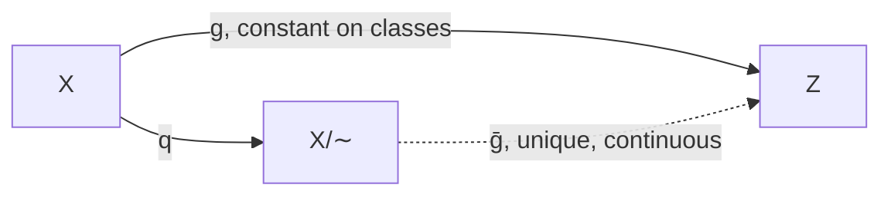
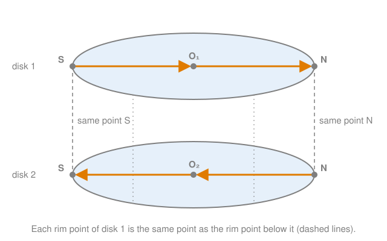

# The quotient topology

## TL;DR

- To glue or identify points, take an equivalence relation $\sim$ on a space $X$. The **quotient** $X/{\sim}$ has the equivalence classes as its points, and $q : X \to X/{\sim}$ sends each point to its class.
- A set of classes is **open** if and only if the set of all points in those classes is open in $X$. This is the largest topology for which $q$ is continuous.
- **Universal property:** a map out of $X/{\sim}$ is continuous if and only if it becomes continuous when composed with $q$. Every continuous map on $X$ that is constant on the classes passes to the quotient.
- With the [compact-to-Hausdorff theorem](compact-to-hausdorff.md#c8), this proves the gluing pictures: two disks glued along their rims are homeomorphic to $S^2$, and a path that crosses the seam is continuous.
- Quotients of compact spaces are compact, but quotients need not be Hausdorff. That has to be checked on the side you map to.

## Key claims

- <a id="c1"></a>**C1.** Let $X$ be a topological space and $\sim$ an equivalence relation on $X$. The quotient space $X/{\sim}$ is the set of equivalence classes $[x]$ with the quotient map $q(x) = [x]$, and a set $W \subseteq X/{\sim}$ is open if and only if $q^{-1}(W)$ is open in $X$. Then $q$ is continuous and surjective. ([Definition](#def-quotient))
- <a id="c2"></a>**C2.** The quotient topology is the finest topology on $X/{\sim}$ for which $q$ is continuous: every topology on $X/{\sim}$ that makes $q$ continuous is contained in it. ([Proposition](#prop-finest))
- <a id="c3"></a>**C3.** Universal property: a map $f : X/{\sim} \to Z$ is continuous if and only if $f \circ q$ is continuous. Consequently, every continuous $g : X \to Z$ that is constant on equivalence classes ($x \sim y \Rightarrow g(x) = g(y)$) induces exactly one map $\bar g : X/{\sim} \to Z$ with $\bar g \circ q = g$, and $\bar g$ is continuous. ([Theorem](#thm-universal))
- <a id="c4"></a>**C4.** The disjoint union $X \sqcup Y$ is the union of a copy of $X$ and a copy of $Y$ that share no points. A set is open in it if and only if its parts in both copies are open. A map $f : X \sqcup Y \to Z$ is continuous if and only if its restrictions to both copies are continuous. ([Definition](#def-disjoint-union))
- <a id="c5"></a>**C5.** A quotient of a compact space is compact. The interval with its ends identified, $[0, 1]/(0 \sim 1)$, is homeomorphic to the circle $S^1$ via $[t] \mapsto (\cos 2\pi t, \sin 2\pi t)$. ([Proposition](#prop-circle))
- <a id="c6"></a>**C6.** A quotient of a Hausdorff space need not be Hausdorff. Collapse the open interval $(0, 1)$ in $\mathbb{R}$ to a single point $c$. Then every open set containing $[0]$ also contains $c$. ([Proposition](#prop-not-hausdorff))
- <a id="c7"></a>**C7.** Let $`D_1`$, $`D_2`$ be two copies of the closed disk $D^2$, and identify each boundary point $x$ of $`D_1`$ with the same point $x$ of $`D_2`$. Then $`(D_1 \sqcup D_2)/{\sim} \cong S^2`$, via $x \mapsto (x, +\sqrt{1 - |x|^2})$ on $`D_1`$ and $x \mapsto (x, -\sqrt{1 - |x|^2})$ on $`D_2`$. The same works for two closed balls $B^n$, giving $S^n$. ([Theorem](#thm-two-disks))
- <a id="c8"></a>**C8.** In the glued space, a path that runs in disk 1 to a boundary point $p$ and continues in disk 2 from $p$ is continuous. Proof: on $[0, s]$ it is $`q \circ \gamma_1`$, on $[s, 1]$ it is $`q \circ \gamma_2`$, and the two agree at $s$ because $`q(p \text{ in } D_1) = q(p \text{ in } D_2)`$, so the gluing lemma applies. ([Proposition](#prop-crossing))

## Explanation

### What identifying points means

The note on gluing two balls into a sphere ([#40](https://github.com/thomaswening/doubting-thomas/pull/40)) says: "declare each rim point of disk 1 to be the same point as the corresponding rim point of disk 2." Two things have to be made precise for that sentence to be mathematics:

1. **Which points the new space has.** That is set theory: an equivalence relation, and its classes.
2. **Which points are near which.** That is the topology, and the subject of this note.

An **equivalence relation** $\sim$ on $X$ is a relation that is reflexive ($x \sim x$), symmetric and transitive. It cuts $X$ into disjoint **equivalence classes** $[x] = \{y : y \sim x\}$. "Identify $a$ with $b$" means: take the smallest equivalence relation in which $a \sim b$. For the two disks, the class of a rim point is the two-element set $`\{x \text{ in } D_1, x \text{ in } D_2\}`$, and the class of an interior point is the point alone.

The set of classes is written $X/{\sim}$, read "$X$ modulo $\sim$". Each class is one point of the new space. The **quotient map** $q : X \to X/{\sim}$, $q(x) = [x]$, sends each point to the class it lies in. It is surjective by construction, and it is two-to-one on the rim and one-to-one elsewhere.

### The quotient topology

<a id="def-quotient"></a>**Definition (quotient space).** Let $X$ be a topological space and $\sim$ an equivalence relation on $X$. The **quotient topology** on $X/{\sim}$ declares $W \subseteq X/{\sim}$ open if and only if $q^{-1}(W)$ is open in $X$. With it, $X/{\sim}$ is the **quotient space**. ([C1](#c1); Laures & Szymik, section 2.4)

*What it says.* A set of glued points $W$ is open exactly when all the original points that went into it, $q^{-1}(W)$, form an open set upstairs.

*Picture it.* Take the rim point $p$ of the glued disks. A small open set around $p$ in the glued space must have an open preimage. That preimage contains $p$ in disk 1 and $p$ in disk 2, so it contains a small half-disk around $p$ in *each* disk. So a neighbourhood of $p$ in the glued space is a half-disk on each side of the seam. On the sphere, that is a small cap around a point of the equator, half in the north and half in the south. This is how the topology encodes "the two sides of the seam are close to each other".

*Why it is a topology.* Preimages commute with unions and intersections: $`q^{-1}(\bigcup W_i) = \bigcup q^{-1}(W_i)`$ and the same for finite intersections. So the axioms of $X$ transfer to $X/{\sim}$. Also $q^{-1}(\varnothing) = \varnothing$ and $q^{-1}(X/{\sim}) = X$.

<a id="prop-finest"></a>**Proposition.** $q$ is continuous for the quotient topology, and every topology on $X/{\sim}$ for which $q$ is continuous is contained in the quotient topology. ([C2](#c2))

<details><summary>Proof</summary>

Continuity: by definition, the preimage of an open set is open. Finest: let $\mathcal{T}'$ be a topology on $X/{\sim}$ for which $q$ is continuous, and $W \in \mathcal{T}'$. Then $q^{-1}(W)$ is open in $X$, so $W$ is open in the quotient topology.

</details>

*Why the finest.* The more open sets the quotient has, the harder it is for $q$ to be continuous. So the definition takes as many open sets as $q$'s continuity allows. More open sets also make it *easier* for maps *out of* the quotient to be continuous, since there are more open preimages available. This is what the next theorem uses.

### The universal property

<a id="thm-universal"></a>**Theorem (universal property of the quotient).** Let $Z$ be a topological space.

1. A map $f : X/{\sim} \to Z$ is continuous if and only if $f \circ q : X \to Z$ is continuous.
2. If $g : X \to Z$ is continuous and $x \sim y$ implies $g(x) = g(y)$, there is exactly one map $\bar g : X/{\sim} \to Z$ with $\bar g \circ q = g$, and it is continuous.

([C3](#c3); Laures & Szymik, section 2.4, "Universelle Eigenschaft von Identifizierungen")



*What it means.* To define a continuous map on a glued space, define a continuous map on the pieces *before* gluing, and check that it agrees on points that get glued. You never have to look at the quotient topology itself. Every map out of a glued space in these notes is built this way.

*Proof idea.* For 1, preimages compose: $(f \circ q)^{-1}(V) = q^{-1}(f^{-1}(V))$. The quotient topology is defined so that this being open is the same as $f^{-1}(V)$ being open. For 2, constant on classes means "$g$ only depends on the class", so $\bar g([x]) = g(x)$ is well defined.

<details><summary>Proof</summary>

1. If $f$ is continuous, $f \circ q$ is a composition of continuous maps. Conversely, let $f \circ q$ be continuous and $V \subseteq Z$ open. Then $q^{-1}(f^{-1}(V)) = (f \circ q)^{-1}(V)$ is open in $X$, so $f^{-1}(V)$ is open in $X/{\sim}$ by the definition of the quotient topology. So $f$ is continuous.
2. Define $\bar g([x]) = g(x)$. This doesn't depend on the choice of $x$ in its class, because $g$ is constant on classes. Every class is $q(x)$ for some $x$, so $\bar g \circ q = g$ determines $\bar g$ uniquely. Since $\bar g \circ q = g$ is continuous, $\bar g$ is continuous by part 1.

</details>

### Disjoint unions

To glue *two* disks, first put them side by side as one space, then identify.

<a id="def-disjoint-union"></a>**Definition (disjoint union).** For spaces $X$ and $Y$, the disjoint union $X \sqcup Y$ is the set $(X \times \{1\}) \cup (Y \times \{2\})$. A set $U$ is open in it if and only if $\{x : (x, 1) \in U\}$ is open in $X$ and $\{y : (y, 2) \in U\}$ is open in $Y$. ([C4](#c4); Laures & Szymik, section 2.3)

*What it means.* Two separate pieces, side by side, with no point of one near any point of the other. The labels $1$ and $2$ only keep the copies apart when $X$ and $Y$ are the same space, as with two copies of one disk.

*Property.* A map $f : X \sqcup Y \to Z$ is continuous if and only if both $x \mapsto f(x, 1)$ and $y \mapsto f(y, 2)$ are continuous. For an open $V$, the two parts of $f^{-1}(V)$ are exactly the preimages under these two maps, so "both parts open" is the definition of $f^{-1}(V)$ being open. Each copy is also open and closed in $X \sqcup Y$, and it carries its original topology as a subspace.

### A first example: the circle

<a id="prop-circle"></a>**Proposition.** If $X$ is compact, so is $X/{\sim}$. The map $\bar g : [0, 1]/(0 \sim 1) \to S^1$, $\bar g([t]) = (\cos 2\pi t, \sin 2\pi t)$, is a homeomorphism. ([C5](#c5))

*Proof idea.* Compactness passes to continuous images, and $q$ is a continuous surjection. For the circle: wrap the interval around the circle. This is continuous and glues exactly $0$ to $1$, so it passes to the quotient as a continuous bijection. The quotient is compact and the circle is Hausdorff, so the bijection is a homeomorphism.

<details><summary>Proof</summary>

$X/{\sim} = q(X)$ is the image of a compact space under a continuous map, so it is compact ([compact-to-Hausdorff C6](compact-to-hausdorff.md#c6)).

The map $g(t) = (\cos 2\pi t, \sin 2\pi t)$ from $[0, 1]$ to $S^1$ is continuous. It satisfies $g(0) = g(1)$, so it is constant on the classes of $0 \sim 1$ (all other classes are single points). By [C3](#c3), it induces a continuous $\bar g$. $\bar g$ is surjective because $g$ is. It is injective because $g(s) = g(t)$ with $s \ne t$ happens only for $\{s, t\} = \{0, 1\}$, which is one class. $[0, 1]$ is compact by Heine–Borel ([compact-to-Hausdorff C2](compact-to-hausdorff.md#c2)), so the quotient is compact. $S^1$ is Hausdorff as a subspace of $\mathbb{R}^2$ ([compact-to-Hausdorff C3](compact-to-hausdorff.md#c3)). So $\bar g$ is a homeomorphism ([compact-to-Hausdorff C8](compact-to-hausdorff.md#c8)).

</details>

Compare with the non-example $[0, 2\pi) \to S^1$ ([continuity C7](topological-spaces-and-continuity.md#c7)). There the endpoint was *removed*, which destroys compactness. Here it is *identified*, which keeps compactness and closes the circle.

### Quotients can be badly behaved

<a id="prop-not-hausdorff"></a>**Proposition.** On $\mathbb{R}$, let $x \sim y$ if $x = y$ or both lie in $(0, 1)$. In $\mathbb{R}/{\sim}$, every open set containing $[0]$ also contains $c = [\tfrac12]$, the class of $(0, 1)$. So $\mathbb{R}/{\sim}$ is not Hausdorff, although $\mathbb{R}$ is. ([C6](#c6))

<details><summary>Proof</summary>

Let $W$ be open with $[0] \in W$. Then $q^{-1}(W)$ is open in $\mathbb{R}$ and contains $0$, so it contains an interval $(-\varepsilon, \varepsilon)$, and with it a point $t \in (0, 1)$. Then $c = q(t) \in W$. So $[0]$ and $c$ have no disjoint neighbourhoods.

</details>

*Picture.* The collapsed point $c$ sits "right next to" $[0]$ and $[1]$, because the points of $(0, 1)$ crowd up against $0$ and $1$. Collapsing an open set glues a point to its own edge. That is why the compact-to-Hausdorff theorem is applied with the quotient as the *domain*, where only compactness is needed, and with a familiar space like $S^2$ as the *target*, where Hausdorff is easy to check.

### Two disks make a sphere



<a id="thm-two-disks"></a>**Theorem.** Let $X = D^2 \sqcup D^2$, with the copies written $`D_1`$ and $`D_2`$. Let $\sim$ identify $(x, 1)$ with $(x, 2)$ for every $x$ with $|x| = 1$, and nothing else. Then

```math
F : X/{\sim} \to S^2, \qquad F[(x, 1)] = \big(x, \sqrt{1 - |x|^2}\,\big), \qquad F[(x, 2)] = \big(x, -\sqrt{1 - |x|^2}\,\big)
```

is a homeomorphism. ([C7](#c7))

*Proof idea.* Lift disk 1 up onto the northern hemisphere and disk 2 down onto the southern one. On the rim, both lifts give the same point of the equator, so the lift respects the gluing and passes to the quotient (universal property). It is a continuous bijection from a compact space to a Hausdorff space, hence a homeomorphism. This is the "dome and bowl" picture from [#40](https://github.com/thomaswening/doubting-thomas/pull/40), with the inverse obtained for free.

<details><summary>Proof</summary>

*Continuity upstairs.* Define $g : X \to S^2$ by $g(x, 1) = (x, \sqrt{1 - |x|^2})$ and $g(x, 2) = (x, -\sqrt{1 - |x|^2})$. On each copy, the components are continuous functions of $x$ (on $D^2$, $1 - |x|^2 \ge 0$), and the values satisfy $|x|^2 + (1 - |x|^2) = 1$, so they lie on $S^2$. So both restrictions are continuous into $\mathbb{R}^3$, hence into $S^2$ ([continuity C5](topological-spaces-and-continuity.md#c5)), and $g$ is continuous ([C4](#c4)).

*Compatible with the gluing.* For $|x| = 1$, $g(x, 1) = (x, 0) = g(x, 2)$. Other classes are single points. By [C3](#c3), $g$ induces a continuous $F = \bar g$.

*Surjective.* Let $(x, z) \in S^2$ with $x \in \mathbb{R}^2$. Then $|x|^2 = 1 - z^2 \le 1$, so $x \in D^2$, and $z = \pm\sqrt{1 - |x|^2}$. If $z \ge 0$ the point is $g(x, 1)$, otherwise $g(x, 2)$.

*Injective.* Suppose $F[(x, i)] = F[(y, j)]$. The first two coordinates give $x = y$. If $i = j$, the classes are equal. If $i \ne j$, the third coordinates give $\sqrt{1 - |x|^2} = -\sqrt{1 - |x|^2}$, so both are $0$ and $|x| = 1$. Then $(x, 1) \sim (x, 2)$, and the classes are equal again.

*Compact and Hausdorff.* Each copy of $D^2$ is compact by Heine–Borel. $X$ is the union of the two copies, each a continuous image of $D^2$ under the inclusion, so it is compact ([compact-to-Hausdorff C6](compact-to-hausdorff.md#c6)). Hence $X/{\sim}$ is compact ([C5](#c5)). $S^2$ is Hausdorff as a subspace of $\mathbb{R}^3$ ([compact-to-Hausdorff C3](compact-to-hausdorff.md#c3)). By the [compact-to-Hausdorff theorem](compact-to-hausdorff.md#c8), $F$ is a homeomorphism.

The same proof works word for word for two copies of $B^n$ and $S^n \subseteq \mathbb{R}^{n+1}$, with $x \in \mathbb{R}^n$.

</details>

### Crossing the seam

[#40](https://github.com/thomaswening/doubting-thomas/pull/40) claimed that a path can reach the rim of disk 1 and continue in disk 2 "without a jump". Here is the proof.

<a id="prop-crossing"></a>**Proposition.** Let $`\gamma_1 : [0, s] \to D^2`$ and $`\gamma_2 : [s, 1] \to D^2`$ be continuous paths with $`\gamma_1(s) = \gamma_2(s) = p`$ and $|p| = 1$. Then the path $\gamma : [0, 1] \to X/{\sim}$ given by $`\gamma(t) = q(\gamma_1(t), 1)`$ for $t \le s$ and $`\gamma(t) = q(\gamma_2(t), 2)`$ for $t \ge s$ is well defined and continuous. ([C8](#c8))

*Proof idea.* Each half is continuous, as a continuous path in one disk followed by $q$. The halves meet at $t = s$, where the first gives $q(p, 1)$ and the second $q(p, 2)$. These are the same point because the gluing identified them. The pieces $[0, s]$ and $[s, 1]$ are closed, so the gluing lemma applies.

<details><summary>Proof</summary>

On $[0, s]$, $\gamma$ is the composition of $`\gamma_1`$, the inclusion of $`D_1`$ into $X$, and $q$. All three are continuous, so $`\gamma|_{[0, s]}`$ is continuous. The same holds on $[s, 1]$. At $t = s$ the two definitions give $q(p, 1)$ and $q(p, 2)$, which are equal since $(p, 1) \sim (p, 2)$. So $\gamma$ is well defined. $[0, s]$ and $[s, 1]$ are closed in $[0, 1]$, so $\gamma$ is continuous by the [gluing lemma](topological-spaces-and-continuity.md#c8).

</details>

Note what the proof does *not* claim: the path does not come from a single continuous path in $`X = D_1 \sqcup D_2`$. In $X$, it would jump from $(p, 1)$ to $(p, 2)$, two points that are far apart. The jump disappears only downstairs, because $q$ sends both to one point. The same argument, with $[0, 1]$ replaced by $[0, 1] \times [0, 1]$, shows that the deformations of loops in [#40](https://github.com/thomaswening/doubting-thomas/pull/40) are continuous. That is for the coming note on homotopy.

## Examples

**Collapsing the boundary.** On $D^2$, identify all boundary points with each other. The quotient $D^2/S^1$ is also homeomorphic to $S^2$: think of a drawstring bag pulled shut. The proof follows the same pattern as [C7](#c7), with a map that sends the centre to the north pole and the boundary circle to the south pole. Two different gluings can give the same space.

**The torus.** On $[0, 1]^2$, identify $(0, y) \sim (1, y)$ and $(x, 0) \sim (x, 1)$. The first identification rolls the square into a tube, the second closes the tube into a torus. This is the screen of a video game where leaving on the right brings you back on the left.

## Pitfalls

- **Thinking a quotient inherits everything from $X$.** Compactness passes to quotients ([C5](#c5)), Hausdorff does not ([C6](#c6)).
- **Defining a map on the quotient without checking that it is well defined.** $\bar g([x]) = g(x)$ only makes sense if $g$ is constant on classes ([C3](#c3)).
- **Proving continuity of a map on the quotient directly.** Check $f \circ q$ instead ([C3](#c3)).
- **Reading a path that crosses the seam as a path in $`D_1 \sqcup D_2`$.** It isn't one; it is two paths, glued downstairs ([C8](#c8)).
- **Applying compact-to-Hausdorff with the quotient as the target.** The quotient may not be Hausdorff. Use it as the domain.

## Exercises

1. **Explain.** In the glued disks, describe a small open neighbourhood of a rim point $p$, and of an interior point of disk 2. Why does the first one have two parts upstairs and the second only one?

   <details><summary>Solution</summary>

   The preimage of a neighbourhood of $[p]$ must be open and contain both $(p, 1)$ and $(p, 2)$, so it contains a small half-disk around $p$ in each disk. An interior point's class has one element, so a small open disk around it in disk 2 suffices ([C1](#c1)).

   </details>

2. **Prove.** Using only [C3](#c3), show that the map $[0, 2\pi]/(0 \sim 2\pi) \to S^1$, $[t] \mapsto (\cos t, \sin t)$, is well defined and continuous. What additional facts do you need for a homeomorphism?

   <details><summary>Solution</summary>

   $g(t) = (\cos t, \sin t)$ is continuous on $[0, 2\pi]$ and $g(0) = g(2\pi)$, so it is constant on classes and induces a continuous $\bar g$ ([C3](#c3)). For a homeomorphism: $\bar g$ is bijective, $[0, 2\pi]$ is compact, so its quotient is compact, and $S^1$ is Hausdorff ([C5](#c5)).

   </details>

3. **Reconstruct.** Prove that two disks glued along their rims are homeomorphic to $S^2$. List the five things you check, in order.

   <details><summary>Solution</summary>

   Define $g$ on $`D_1 \sqcup D_2`$ by lifting to the upper and lower hemispheres. (1) $g$ is continuous on each copy, so on the disjoint union. (2) $g$ agrees on glued rim points, so it induces a continuous $F$. (3) $F$ is surjective. (4) $F$ is injective. (5) The quotient is compact and $S^2$ is Hausdorff, so $F$ is a homeomorphism ([C7](#c7)).

   </details>

4. **Find the failing condition.** Collapse the open interval $(0, 1) \subseteq [0, 2]$ to a point and call the result $Y$. Show that $Y$ is compact but not Hausdorff. Could $Y$ be homeomorphic to $[0, 1]$?

   <details><summary>Solution</summary>

   $Y$ is a quotient of the compact $[0, 2]$, hence compact. The argument of [C6](#c6) shows that $[0]$ and the collapsed point can't be separated, so $Y$ is not Hausdorff. $[0, 1]$ is Hausdorff, and homeomorphisms preserve Hausdorff, so no ([C5](#c5), [C6](#c6)).

   </details>

5. **Explain.** Why is the path that crosses the seam continuous in the glued space, although its two halves don't form a continuous path in $`D_1 \sqcup D_2`$?

   <details><summary>Solution</summary>

   In $`D_1 \sqcup D_2`$, the halves end at $(p, 1)$ and start at $(p, 2)$, two different points with disjoint neighbourhoods. Downstairs, $q$ maps both to the same point. So the two halves, each continuous after composing with $q$, meet at $t = s$, and the gluing lemma makes the whole path continuous ([C8](#c8)).

   </details>

## Sources

- Gerd Laures and Markus Szymik, *Grundkurs Topologie*, 2nd ed., Springer 2015: section 2.3 (disjoint unions as coinduced topologies, Satz 2.4) and section 2.4 (quotients and the universal property of identifications, including the circle example). From Thomas's `eBooks` folder.
- John M. Lee, *Introduction to Topological Manifolds*, 2nd ed., Springer 2011: Lemma 3.23 (gluing lemma), used in [C8](#c8).
- Written as a foundation for [#40](https://github.com/thomaswening/doubting-thomas/pull/40), after the review conversation of 2026-11-12.
