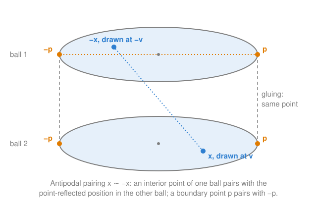

# Antipodal quotients and real projective space

## TL;DR

- Real projective space $\mathbb{RP}^n$ is the sphere $S^n$ with **every** point identified with its antipode: $x \sim -x$. Each point of $\mathbb{RP}^n$ is a pair $\{x, -x\}$.
- Every such pair has a member in the closed upper hemisphere, and only one unless both lie on the equator. So $\mathbb{RP}^n$ is also a ball $B^n$ whose opposite boundary points are identified.
- This is a different identification from the one that builds $S^3$ out of two balls. There, a boundary point is identified with **the same** point of the other ball. Here, every point is identified with its **opposite**, inside the balls too.
- In the two-ball picture of $S^3$, an interior point of ball 2 pairs with the point-reflected position in ball 1, and a boundary point pairs with the opposite boundary point.
- The projection $S^n \to \mathbb{RP}^n$ is continuous and two-to-one. A path in $S^n$ from $x$ to $-x$ becomes a closed loop in $\mathbb{RP}^n$.

## Key claims

- **C1.** $\mathbb{RP}^n = S^n / (x \sim -x)$: every point of $S^n$ is identified with its antipode $-x$, not only points on some boundary. No point is its own antipode, since $x = -x$ forces $x = 0$, which is not on the sphere. So every point of $\mathbb{RP}^n$ is a pair of exactly two points of $S^n$.
- **C2.** The projection $\pi : S^n \to \mathbb{RP}^n$, $x \mapsto \{x, -x\}$, is continuous and surjective, and every point of $\mathbb{RP}^n$ has exactly two preimages, $x$ and $-x$. So $\pi$ is not injective and not a homeomorphism.
- **C3.** Hemisphere model: $\mathbb{RP}^n \cong B^n / (y \sim -y \text{ for } y \in \partial B^n)$. Every antipodal pair has a member with first coordinate $\ge 0$, in the closed upper hemisphere, which is homeomorphic to $B^n$. The member is unique if the first coordinate is positive. If it is zero, both members lie on the equator $\partial B^n$ and are opposite there.
- **C4.** Building $S^n$ from two balls identifies each boundary point $p$ of ball 1 with the **same** point $p$ of ball 2. Building $\mathbb{RP}^n$ from $S^n$ identifies each point with its **antipode**. In the two-ball picture of $S^3$, the antipode of a point of ball 2 drawn at $v$ is the point of ball 1 drawn at $-v$, and the antipode of a boundary point $p$ is the boundary point $-p$.
- **C5.** In the hemisphere model, a path that reaches the boundary at $y$ continues from $-y$. The path in $\mathbb{RP}^n$ does not jump; only its drawing does, because $y$ and $-y$ are one point of $\mathbb{RP}^n$.
- **C6.** A path in $S^n$ from $x$ to $-x$ is not closed in $S^n$, but $\pi$ maps it to a closed loop in $\mathbb{RP}^n$, because its two endpoints become one point.
- **C7.** $\mathbb{RP}^1$ is a circle: the hemisphere model is a segment $[-1, 1]$ with its ends $-1$ and $1$ identified.

## Explanation

### Two different ways to identify points

[Gluing two balls into a sphere](gluing-balls-into-spheres.md) built $S^3$ by identifying each boundary point of ball 1 with the **same** boundary point of ball 2. Interior points were left alone.

Real projective space starts from the finished sphere and identifies points again, by a different rule ([C1](#c1)): every point $x$ becomes the same point as its antipode $-x$, the point on the opposite side of the centre. This applies to every point of the sphere. It is not a boundary rule. A boundary is only something our drawing has, not the sphere itself.

The result is written $S^n / (x \sim -x)$, read "the sphere modulo the antipodal identification", and called $\mathbb{RP}^n$. The name comes from another description: $\mathbb{RP}^n$ is the set of lines through the origin in $\mathbb{R}^{n+1}$. Each line meets the sphere in exactly one antipodal pair.

Since no point equals its own antipode, each point of $\mathbb{RP}^n$ consists of exactly two points of the sphere. The projection $\pi$ that sends $x$ to its pair is continuous, hits every pair, and hits each one twice ([C2](#c2)). So it is not a homeomorphism: it isn't even injective.

### Every point has a cousin in the other ball

Look at the antipodal identification in the two-ball picture of $S^3$ ([C4](#c4)). A point of $S^3$ is $(a, v)$ with $a$ real and $v \in \mathbb{R}^3$, drawn in ball 1 at $v$ if $a \ge 0$ and in ball 2 at $v$ if $a \le 0$. Its antipode is $(-a, -v)$.

- If the point is inside ball 2 ($a < 0$), its antipode has $-a > 0$: it is inside ball 1, drawn at $-v$. The cousin sits in the other ball, reflected through the centre.
- If the point is on the shared boundary ($a = 0$), its antipode has $-a = 0$ too: it stays on the boundary sphere, at the opposite point $-v$.

So the answer to "does each point have a cousin in each ball?" is yes, with one qualification: for a boundary point, both members of the pair are on the shared boundary. Compare with the gluing, which paired the boundary point $p$ of ball 1 with $p$ itself in ball 2 (the grey dashed lines in the figure). The antipodal identification pairs $p$ with $-p$ (the orange dotted line).

### One ball is enough: the hemisphere model

Because every interior point of ball 2 has its partner in ball 1, ball 2 adds nothing new after the identification. Throw it away and keep ball 1 ([C3](#c3)). Each pair is now represented by its member in ball 1, the one with $a \ge 0$:

- A pair with $a \ne 0$ has exactly one member in ball 1.
- A pair with $a = 0$ has both members on the boundary sphere of ball 1, at $p$ and $-p$. These must still be identified.

So $\mathbb{RP}^3$ is a single closed ball whose opposite boundary points are identified. The same argument works in every dimension, with the upper hemisphere of $S^n$ drawn as $B^n$.

### Paths in the hemisphere model

Follow a path on $S^n$ that crosses from the upper hemisphere into the lower one at an equator point $y$ ([C5](#c5)). In the hemisphere model, only upper-hemisphere representatives are drawn. Just after crossing, the path is at points with $a < 0$, which are drawn by their antipodes, near $-y$. So the drawn path reaches the boundary at $y$ and continues from the opposite boundary point $-y$.

This looks like a jump, but in $\mathbb{RP}^n$ it isn't one: $y$ and $-y$ are the same point. The jump belongs to the drawing, just as a flight across the date line "jumps" from the right edge of a world map to the left edge.

### Paths that become loops

Take a path on $S^n$ from a point $x$ to its antipode $-x$, say half a great circle ([C6](#c6)). In $S^n$ it is not closed: it ends somewhere else. Apply $\pi$: start and end become the pair $\{x, -x\}$, which is one point of $\mathbb{RP}^n$. The image is a closed loop.

## Examples

**$\mathbb{RP}^1$ is a circle** ([C7](#c7)). Take the circle $S^1$ and identify opposite points. The upper half-circle contains one member of each pair, except for the pair of endpoints $(1, 0)$ and $(-1, 0)$, which are identified with each other. Flattened, the upper half-circle is the segment $[-1, 1]$, and identifying its two ends gives a circle again. In angle terms: an angle $\varphi$ and $\varphi + \pi$ are identified, so angles only count modulo $\pi$, and the interval $[0, \pi]$ with its ends glued is a circle.

**$\mathbb{RP}^2$ as a disk.** The hemisphere model of $\mathbb{RP}^2$ is a disk with opposite rim points identified. A path that leaves through the rim at the "east" point re-enters at the "west" point. Unlike the circle, this can't be built in ordinary space without the surface passing through itself, so it is easier to work with the disk picture than to try to visualise the result.

**Counting preimages in $S^3$.** The pair $\{(1, 0, 0, 0), (-1, 0, 0, 0)\}$ consists of the two centres $O_1$ and $O_2$ of the two-ball picture. It is one point of $\mathbb{RP}^3$, drawn at the centre of the hemisphere model. The pair $\{(0, 0, 0, 1), (0, 0, 0, -1)\}$ consists of two opposite boundary points $N$ and $S$. It is one point of $\mathbb{RP}^3$, drawn twice, at the top and bottom of the boundary sphere of the hemisphere model.

## Pitfalls

- **Applying the antipodal identification only to the boundary.** It applies to every point of $S^n$. Only after throwing away ball 2 does it *look* like a boundary rule, because the interior pairs have already been accounted for ([C3](#c3)).
- **Confusing the two identifications.** Gluing identifies a boundary point with the same point of the other ball ($p \sim p$). The antipodal quotient identifies a point with its opposite ($x \sim -x$) ([C4](#c4)).
- **Calling the projection a homeomorphism.** It is continuous and surjective, but two-to-one ([C2](#c2)).
- **Taking the jump in the hemisphere model for a real jump.** It is an artefact of the drawing ([C5](#c5)).

## Exercises

1. **Distinguish.** Building $S^3$ from two balls and building $\mathbb{RP}^3$ from $S^3$ both "identify points". What is identified with what in each case?

   

Solution

   Building $S^3$: each boundary point of ball 1 with the same boundary point of ball 2; interior points not at all. Building $\mathbb{RP}^3$: every point of $S^3$ with its antipode $-x$, everywhere ([C4](#c4), [C1](#c1)).

   

2. **Explain.** Does the antipodal identification apply only to the shared boundary in the two-ball picture, or everywhere? What happens to an interior point of ball 2?

   

Solution

   Everywhere. An interior point of ball 2 drawn at $v$ is paired with the interior point of ball 1 drawn at $-v$. Only boundary points pair within the boundary, $p$ with $-p$ ([C1](#c1), [C4](#c4)).

   

3. **Explain.** Why does every point of $\mathbb{RP}^n$ have exactly two preimages in $S^n$, never one or three?

   

Solution

   A point of $\mathbb{RP}^n$ is a pair $\{x, -x\}$. It can't be a single point, since $x = -x$ would force $x = 0$, which is not on the sphere. It can't contain more, since the identification only pairs $x$ with $-x$ ([C1](#c1), [C2](#c2)).

   

4. **Reconstruct.** Starting from the two-ball picture of $S^3$, derive the description of $\mathbb{RP}^3$ as a single ball with opposite boundary points identified.

   

Solution

   Each interior point of ball 2 is identified with an interior point of ball 1, so ball 2 contributes nothing new: keep only ball 1. Pairs with $a \neq 0$ have exactly one member in ball 1. Pairs with $a = 0$ have both members, $p$ and $-p$, on the boundary sphere of ball 1, so those must still be identified ([C3](#c3), [C4](#c4)).

   

5. **Apply.** A path on $S^2$ starts at the north pole and runs along a meridian to the south pole. What does it look like in the hemisphere model of $\mathbb{RP}^2$, and is it closed there?

   

Solution

   In the hemisphere model it runs from the centre of the disk to the rim point $y$ where the meridian meets the equator. It continues from the opposite rim point $-y$, which represents the lower half of the meridian, and runs back to the centre, which represents the south pole, the antipode of the north pole. It is closed in $\mathbb{RP}^2$, because the north and south poles are one point there ([C5](#c5), [C6](#c6)).

   

## Sources

- Learning conversation on the topology of SU(2) and SO(3), 2026-11-12. The exercises are the questions Thomas asked in it.
- Allen Hatcher, [*Algebraic Topology*](https://pi.math.cornell.edu/~hatcher/AT/ATpage.html), chapter 0: real projective space as a quotient of the sphere and of the ball.
- [Real projective space](https://en.wikipedia.org/wiki/Real_projective_space), Wikipedia.
