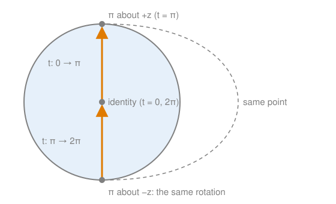

# SU(2) as the double cover of SO(3), topologically

## TL;DR

- **SO(3) is a ball.** Describe a rotation by an axis and an angle up to $\pi$. The rotations fill a closed ball of radius $\pi$, with opposite boundary points identified, since rotating by $\pi$ about $n$ and about $-n$ is the same. That is $\mathbb{RP}^3$.
- **SU(2) is the 3-sphere.** Every $U \in SU(2)$ is $aI - i(b\sigma_x + c\sigma_y + d\sigma_z)$ with $a^2 + b^2 + c^2 + d^2 = 1$. In the two-ball picture of $S^3$, $I$ is the centre of ball 1 and $-I$ the centre of ball 2.
- **Identifying $U$ with $-U$ turns $S^3$ into $\mathbb{RP}^3$**, so $SU(2)/\{\pm I\} \cong SO(3)$ as topological spaces. Each rotation has exactly two preimages, $U$ and $-U$. SU(2) is the double cover; SO(3) is the quotient.
- The 2π rotation is a path from $I$ to $-I$ in SU(2): not closed there, but closed in SO(3). The 4π rotation is a closed loop in SU(2) that contracts, and so does its image in SO(3).
- SU(2) and SO(3) are **not** homeomorphic. And this note shows a homeomorphism of spaces only, not yet a Lie group isomorphism.

## Key claims

- <a id="c1"></a>**C1.** Every rotation of $\mathbb{R}^3$ is a rotation by some angle $\theta \in [0, \pi]$ about some unit axis $n$. Drawing it as the vector $\theta n$ fills the closed ball of radius $\pi$. The vector is unique for $0 < \theta < \pi$; the identity is the centre; and $\pi n$ and $-\pi n$ are the same rotation. So $SO(3) \cong B^3 / (\text{opposite boundary points identified}) \cong \mathbb{RP}^3$.
- <a id="c2"></a>**C2.** Every matrix in $SU(2)$ can be written as $U = aI - i(b\sigma_x + c\sigma_y + d\sigma_z) = \begin{pmatrix} a - id & -c - ib \\ c - ib & a + id \end{pmatrix}$ with real $a, b, c, d$ and $a^2 + b^2 + c^2 + d^2 = 1$, in exactly one way. This identification is a homeomorphism $SU(2) \cong S^3$. In the two-ball picture of $S^3$, $I$ is the centre $O_1$ of ball 1, $-I$ the centre $O_2$ of ball 2, and the shared boundary is the set of traceless matrices ($a = 0$). $U$ and $-U$ are antipodal points.
- <a id="c3"></a>**C3.** The path $U(t) = \cos\frac{t}{2}\, I - i \sin\frac{t}{2}\, \sigma_z$ for $t \in [0, 2\pi]$ (the operator that rotates a spin-½ state by $t$ about $z$) runs $O_1 \to N \to O_2$, from $I$ to $-I$, with $N = -i\sigma_z$. It is not closed. Continued to $t = 4\pi$, it runs $O_1 \to N \to O_2 \to S \to O_1$ with $S = i\sigma_z$: a closed loop, and contractible by pushing its ball-2 part onto the shared boundary.
- <a id="c4"></a>**C4.** Define $p : SU(2) \to SO(3)$ by writing $U = \cos\frac{\theta}{2}\, I - i \sin\frac{\theta}{2}\, (n \cdot \sigma)$ with $\theta \in [0, 2\pi]$ and setting $p(U)$ = rotation by $\theta$ about $n$. Then $p(-U) = p(U)$, because $-U$ has angle $2\pi - \theta$ and axis $-n$, and rotating by $2\pi - \theta$ about $-n$ is rotating by $\theta$ about $n$. Conversely $p(U) = p(V)$ only if $V = \pm U$.
- <a id="c5"></a>**C5.** $p$ is continuous and surjective, and identifies exactly $U$ with $-U$. So it gives a homeomorphism $SU(2)/\{\pm I\} \cong SO(3)$. In pictures: $SU(2) \cong S^3$, then $S^3/(x \sim -x) \cong \mathbb{RP}^3$, and $\mathbb{RP}^3 \cong SO(3)$ by the rotation ball.
- <a id="c6"></a>**C6.** Every rotation has exactly two preimages in SU(2), $U$ and $-U$. For a rotation by less than $\pi$ they lie one in the interior of each ball; for a rotation by exactly $\pi$ both lie on the shared boundary, at opposite points. SU(2) is the double cover of SO(3); SO(3) is the quotient.
- <a id="c7"></a>**C7.** $p$ maps a path in SU(2) from $I$ to $-I$ to a closed loop in SO(3). The 2π rotation about $z$ is such a loop: in the rotation ball it runs from the centre to the boundary point $\pi \hat z$, continues from the opposite point $-\pi \hat z$, and returns to the centre.
- <a id="c8"></a>**C8.** The 4π rotation is contractible in SO(3) as well: it is the image under $p$ of the closed 4π loop in SU(2), and applying $p$ to each stage of that loop's contraction contracts the image.
- <a id="c9"></a>**C9.** The 2π loop in SO(3) is not contractible. In the rotation ball, a deformation can only create or remove boundary crossings in pairs, so its single crossing never goes away. Making this argument rigorous takes path lifting for covering maps, which is not covered here.
- <a id="c10"></a>**C10.** $SU(2) \cong S^3$ and $SO(3) \cong \mathbb{RP}^3$, but SU(2) and SO(3) are not homeomorphic: every loop in $S^3$ is contractible and the 2π loop in SO(3) is not, and a homeomorphism preserves contractibility. A diffeomorphism is a homeomorphism that is smooth both ways. A Lie group isomorphism is a diffeomorphism that also respects multiplication. Showing $SU(2)/\{\pm I\} \cong SO(3)$ as Lie groups needs $p(UV) = p(U)\,p(V)$, which this note does not show.

## Explanation

The steps follow the order in which the picture was built: SO(3) as a ball first, then the two-ball picture of SU(2), the 2π and 4π paths in it, and finally the identification that connects them.

### SO(3) as a ball

A rotation is fixed by an axis and an angle. Allow angles from $0$ to $\pi$ only: a rotation by $250°$ about $n$ is the rotation by $110°$ about $-n$. Draw the rotation as the vector $\theta n$, pointing along the axis with length equal to the angle ([C1](#c1)). The rotations then fill a closed ball of radius $\pi$:

- The centre is the identity.
- An interior point $\theta n$ with $0 < \theta < \pi$ is exactly one rotation, and no other point gives the same rotation.
- A boundary point $\pi n$ is a half-turn about $n$. A half-turn about $-n$ is the same rotation, so the opposite boundary points $\pi n$ and $-\pi n$ must be identified.

That is the hemisphere model of [real projective space](real-projective-space.md#c3): a ball with opposite boundary points identified. So $SO(3) \cong \mathbb{RP}^3$. Nearby points of the ball are nearby rotations, with the boundary as the one place where the drawing is misleading: near $\pi n$ are also the rotations drawn near $-\pi n$.

Now rotate about $z$ by an angle $t$ that grows from $0$ to $2\pi$ ([C7](#c7)). Up to $t = \pi$, the drawn point moves from the centre straight up to the boundary point $\pi \hat z$. After that, the rotation by $t$ about $\hat z$ is drawn as the rotation by $2\pi - t$ about $-\hat z$, so the drawn point continues from the opposite boundary point $-\pi \hat z$ and moves back up to the centre. As in the [hemisphere model](real-projective-space.md#c5), the jump is in the drawing only. The rotation changes continuously, and at $t = 2\pi$ it is the identity again: a closed loop.



Why can't this loop be contracted ([C9](#c9))? Try to deform it. The loop must cross the boundary somewhere, and where it leaves at $y$ it must come back in at $-y$. You can move the crossing point around on the boundary sphere, but its partner moves to the opposite side with it. They can never meet, so you can't pull the crossing back into the interior. A deformation can create new crossings, but only in pairs: push a piece of the loop out through the boundary, and it has to come back in. Removing crossings also goes in pairs. So the number of crossings stays odd, and a loop with an odd number of crossings is never a constant loop. This is the geometric idea. The rigorous version uses the fact that paths in SO(3) lift to paths in SU(2), a theorem about covering maps that is a topic of its own.

Running the rotation twice, from $0$ to $4\pi$, gives a loop with two crossings. These can cancel: move the first crossing pair around the boundary sphere until it sits on the second pair, then pull both pieces off the boundary. [C8](#c8) gives a cleaner reason, once SU(2) is in the picture.

### SU(2) as the 3-sphere

A matrix $U \in SU(2)$ is unitary ($U^\dagger U = I$) with determinant 1. Its first column is a unit vector $(\alpha, \beta)$ in $\mathbb{C}^2$, so $|\alpha|^2 + |\beta|^2 = 1$. The second column is a unit vector orthogonal to the first. All such vectors have the form $e^{i\varphi}(-\bar\beta, \bar\alpha)$, and the determinant is then $e^{i\varphi}(|\alpha|^2 + |\beta|^2) = e^{i\varphi}$. Determinant 1 forces $e^{i\varphi} = 1$. So

```math
U = \begin{pmatrix} \alpha & -\bar\beta \\ \beta & \bar\alpha \end{pmatrix}, \qquad |\alpha|^2 + |\beta|^2 = 1 .
```

Write $\alpha = a - id$ and $\beta = c - ib$. Then $|\alpha|^2 + |\beta|^2 = a^2 + b^2 + c^2 + d^2 = 1$, which is the unit sphere $S^3$ in $\mathbb{R}^4$ ([C2](#c2)). In terms of the Pauli matrices, the same matrix is $U = aI - i(b\sigma_x + c\sigma_y + d\sigma_z)$. The map from $(a, b, c, d)$ to $U$ is continuous, and reading the four numbers back off the matrix entries is continuous too, so it is a homeomorphism.

Now use the [two-ball picture of $S^3$](gluing-balls-into-spheres.md#c3): points with $a \ge 0$ are drawn in ball 1 at $(b, c, d)$, points with $a \le 0$ in ball 2.

- $I$ has $a = 1$: it is the centre $O_1$ of ball 1.
- $-I$ has $a = -1$: it is the centre $O_2$ of ball 2. These are different points.
- The shared boundary sphere is $a = 0$, the matrices with trace $2a = 0$, such as $-i\sigma_z$ and $i\sigma_z$.
- $-U$ has coordinates $(-a, -b, -c, -d)$: it is the antipode of $U$.

### The 2π and 4π paths in SU(2)

Physics rotates a spin-½ state about $z$ by the angle $t$ with $U(t) = e^{-it\sigma_z/2} = \cos\frac{t}{2}\, I - i \sin\frac{t}{2}\, \sigma_z$, so $a = \cos\frac{t}{2}$ and $d = \sin\frac{t}{2}$ ([C3](#c3)). Follow it through the two balls:

| $t$ | $U(t)$ | $a$ | Where |
|---|---|---|---|
| $0$ | $I$ | $1$ | $O_1$, centre of ball 1 |
| $\pi$ | $-i\sigma_z$ | $0$ | boundary point $(0, 0, 1)$: call it $N$ |
| $2\pi$ | $-I$ | $-1$ | $O_2$, centre of ball 2 |
| $3\pi$ | $i\sigma_z$ | $0$ | boundary point $(0, 0, -1)$: call it $S$ |
| $4\pi$ | $I$ | $1$ | $O_1$ again |

The 2π rotation is the path $O_1 \to N \to O_2$. It starts at one centre and ends at the other. Since the centres are different points, it is **not** a closed loop in SU(2). The 4π rotation continues $O_2 \to S \to O_1$ and ends where it started: a closed loop. It is exactly the loop that [gluing two balls into a sphere](gluing-balls-into-spheres.md#c8) contracts: slide the part $N \to O_2 \to S$ in ball 2 onto the shared boundary, so that the whole loop lies in ball 1, and shrink it to $O_1$.

On the ordinary sphere, the analogous path $O_1 \to N \to O_2 \to S \to O_1$ is a great circle, which you can view as an equator and slide to a pole. That two-dimensional picture is the easiest way to remember why the 4π loop contracts.

### Identifying $U$ with $-U$

The map $p$ ([C4](#c4)) sends $U$ to a rotation. Write $U$ with angle $\theta \in [0, 2\pi]$ and axis $n$: $\cos\frac{\theta}{2} = a$, and $\sin\frac{\theta}{2}\, n = (b, c, d)$. Let $p(U)$ be the rotation by $\theta$ about $n$. For $U = \pm I$ the axis is undefined, but then $\theta$ is $0$ or $2\pi$ and the rotation is the identity whatever $n$ is.

Now compare $U$ and $-U$:

```math
-U = -\cos\tfrac{\theta}{2}\, I + i \sin\tfrac{\theta}{2}\, (n \cdot \sigma)
   = \cos\tfrac{2\pi - \theta}{2}\, I - i \sin\tfrac{2\pi - \theta}{2}\, \big((-n) \cdot \sigma\big),
```

using $\cos(\pi - x) = -\cos x$ and $\sin(\pi - x) = \sin x$. So $-U$ has angle $2\pi - \theta$ and axis $-n$. Rotating by $2\pi - \theta$ about $-n$ is the same as rotating by $\theta$ about $n$. So $p(-U) = p(U)$.

No other matrix maps to the same rotation. A rotation by $\varphi \in (0, \pi]$ about $m$ can be written with $\theta \in [0, 2\pi]$ in exactly two ways: $\theta = \varphi$ about $m$, or $\theta = 2\pi - \varphi$ about $-m$. These are the two matrices $U$ and $-U$. The identity comes from $\theta = 0$ or $2\pi$, that is from $I$ and $-I$.

So $p$ identifies exactly the antipodal pairs of $S^3$, which is the identification that turns $S^3$ into $\mathbb{RP}^3$ ([C5](#c5)). The chain of identifications:


In the ball-1 view, $p$ is just the hemisphere model. Every pair $\{U, -U\}$ has a representative with $a \ge 0$, which is drawn in ball 1 at $(b, c, d) = \sin\frac{\theta}{2}\, n$ with $\theta \le \pi$. Stretching the radius $\sin\frac{\theta}{2}$ to $\theta$ turns ball 1 into the rotation ball. The stretch is continuous and increasing on $[0, \pi]$, and it matches the boundary identifications on both sides: $\pm n$ on the boundary of ball 1 becomes $\pm \pi n$ on the boundary of the rotation ball. That this gives a homeomorphism, and not just a continuous bijection, follows from the standard fact that a continuous bijection from a compact space to a Hausdorff space has a continuous inverse.

### Double cover and quotient

Does every point of SO(3) have a cousin in each ball of SU(2)? Yes, with one qualification ([C6](#c6)):

- A rotation by $\varphi < \pi$ has its two preimages at $\theta = \varphi$ ($a = \cos\frac{\varphi}{2} > 0$, inside ball 1) and at $\theta = 2\pi - \varphi$ ($a < 0$, inside ball 2), drawn at reflected positions.
- A rotation by exactly $\pi$ has both preimages on the shared boundary ($a = 0$), at opposite points $n$ and $-n$.

So each rotation is covered exactly twice: SU(2) **is the double cover**, the space that lies over SO(3) two sheets thick. SO(3) is the **quotient**, what remains after identifying the two sheets. Saying "SO(3) double covers SU(2)" gets it backwards.

Paths now explain the 2π and 4π puzzle ([C7](#c7), [C8](#c8)). The 2π rotation is a path in SU(2) from $I$ to $-I$. $p$ maps both endpoints to the identity, so the image is a closed loop in SO(3), the loop drawn in the rotation ball above. Its preimage is not closed, which matches the fact that this loop can't be contracted. The 4π rotation is closed already in SU(2) and contracts there. Applying $p$ to each stage of the contraction gives a contraction of its image, since $p$ is continuous. So the 4π rotation contracts in SO(3) too.

### Which spaces are the same, and in what sense

It is tempting to say SU(2) and SO(3) are "the same up to a factor 2". As spaces they are not the same at all ([C10](#c10)):

- $SU(2) \cong S^3$, and every loop in $S^3$ is contractible.
- $SO(3) \cong \mathbb{RP}^3$, and the 2π loop in it is not.
- A homeomorphism maps contractible loops to contractible loops and back. So no homeomorphism between SU(2) and SO(3) exists. $p$ itself is not one: it is two-to-one.

The true statement is $SU(2)/\{\pm I\} \cong SO(3)$. There are three strengths of "$\cong$" it could mean:

| Notion | Requires | Shown here? |
|---|---|---|
| Homeomorphism | continuous bijection, continuous inverse | yes |
| Diffeomorphism | smooth bijection, smooth inverse | not argued |
| Lie group isomorphism | diffeomorphism that respects multiplication: $p(UV) = p(U)\,p(V)$ | no |

The usual physics statement, "SU(2) is the double cover of SO(3) as a group", is the third. It needs the map $U \mapsto (x \mapsto$ the vector $x'$ with $x' \cdot \sigma = U (x \cdot \sigma) U^\dagger)$, and a proof that it respects multiplication and agrees with $p$. That is a separate step and a separate note.

## Examples

**The preimages of three rotations.**

| Rotation | $U$ | $-U$ | Where in the two-ball picture |
|---|---|---|---|
| identity | $I$ | $-I$ | the two centres $O_1$, $O_2$ |
| $\frac{\pi}{2}$ about $z$ | $\frac{1}{\sqrt2}(I - i\sigma_z)$ | $-\frac{1}{\sqrt2}(I - i\sigma_z)$ | inside ball 1 at $(0, 0, \frac{1}{\sqrt2})$; inside ball 2 at $(0, 0, -\frac{1}{\sqrt2})$ |
| $\pi$ about $x$ | $-i\sigma_x$ | $i\sigma_x$ | boundary points $(1, 0, 0)$ and $(-1, 0, 0)$ |

**Checking $p(-U) = p(U)$ for a quarter turn.** $U = \frac{1}{\sqrt2}(I - i\sigma_z)$ has $\cos\frac{\theta}{2} = \frac{1}{\sqrt2}$, so $\theta = \frac{\pi}{2}$ about $\hat z$. $-U$ has $\cos\frac{\theta}{2} = -\frac{1}{\sqrt2}$, so $\theta = \frac{3\pi}{2}$, and $\sin\frac{\theta}{2}\, n = (0, 0, -\frac{1}{\sqrt2})$ with $\sin\frac{3\pi}{4} = \frac{1}{\sqrt2}$, so $n = -\hat z$. A three-quarter turn about $-\hat z$ is a quarter turn about $\hat z$.

## Pitfalls

- **"SU(2) and SO(3) are homeomorphic."** They are not ([C10](#c10)). The homeomorphism is between SU(2) *modulo* $\pm I$ and SO(3).
- **Calling the quotient the double cover.** SU(2), the bigger space with two preimages per rotation, is the double cover ([C6](#c6)).
- **"The 2π path is closed in SU(2)."** It ends at $-I \neq I$ ([C3](#c3)). It only becomes closed after identifying $U$ with $-U$ ([C7](#c7)).
- **Treating the topology as a proof of the group statement.** Nothing here shows that $p$ respects multiplication ([C10](#c10)).
- **Expecting every pair of preimages to sit in different balls.** For half-turns, both preimages lie on the shared boundary ([C6](#c6)).

## Exercises

1. **Reconstruct.** Without formulas, explain why SO(3) is a ball with opposite boundary points identified.

   <details><summary>Solution</summary>

   Draw each rotation as its axis scaled by its angle, with angles from $0$ to $\pi$. That fills a ball of radius $\pi$, with the identity at the centre. Interior points are distinct rotations. On the boundary, a half-turn about $n$ equals a half-turn about $-n$, so opposite boundary points are the same rotation ([C1](#c1)).

   </details>

2. **Locate.** In the two-ball picture of SU(2), which path is the 2π rotation about $z$, and which the 4π rotation? Why is one closed and the other not?

   <details><summary>Solution</summary>

   2π: $O_1 \to N \to O_2$, from $I$ to $-I$. 4π: $O_1 \to N \to O_2 \to S \to O_1$. The 2π path ends at the centre of the other ball, a different point, so it isn't closed. The 4π path returns to $O_1$ ([C2](#c2), [C3](#c3)).

   </details>

3. **Reconstruct.** Contract the 4π loop in SU(2) using the two-ball picture, and say how the same contraction looks on an ordinary sphere.

   <details><summary>Solution</summary>

   Keep $N$ and $S$ fixed and slide the part $N \to O_2 \to S$ along straight lines in ball 2 onto the shared boundary sphere. Then the loop lies entirely in ball 1 and shrinks to $O_1$. On $S^2$, the same path is a great circle; regard it as an equator and slide it through the circles of latitude to a pole ([C3](#c3); [gluing C7, C8](gluing-balls-into-spheres.md#c7)).

   </details>

4. **Explain.** Why does every rotation have exactly two preimages in SU(2)? Where do they lie in the two-ball picture for a rotation by less than $\pi$, and for a rotation by exactly $\pi$?

   <details><summary>Solution</summary>

   $p(-U) = p(U)$ because $-U$ has angle $2\pi - \theta$ and axis $-n$, the same rotation; and a rotation by $\varphi$ about $m$ has only the two descriptions $(\varphi, m)$ and $(2\pi - \varphi, -m)$ with angles in $[0, 2\pi]$. For $\varphi < \pi$: one inside each ball, at reflected positions. For $\varphi = \pi$: both on the shared boundary, at opposite points ([C4](#c4), [C6](#c6)).

   </details>

5. **Distinguish.** Which of SU(2), SO(3) is the double cover and which is the quotient? Which of these are homeomorphic: SU(2), $S^3$, $\mathbb{RP}^3$, SO(3), $SU(2)/\{\pm I\}$?

   <details><summary>Solution</summary>

   SU(2) is the double cover; SO(3) is the quotient. Homeomorphic: SU(2) and $S^3$; and $\mathbb{RP}^3$, SO(3) and $SU(2)/\{\pm I\}$. SU(2) is not homeomorphic to SO(3), because loops behave differently in them ([C5](#c5), [C6](#c6), [C10](#c10)).

   </details>

6. **Explain.** Why is the 2π loop in SO(3) not contractible? Give the geometric argument, and say what it would take to make it rigorous.

   <details><summary>Solution</summary>

   In the rotation ball the loop crosses the boundary once, leaving at $y$ and re-entering at $-y$. The two crossing points stay opposite under any deformation and can't meet. Crossings appear and disappear only in pairs, so the count stays odd and never reaches zero. A rigorous proof uses path lifting for the covering map $p$: the 2π loop lifts to a path from $I$ to $-I$, and a contraction would lift to a deformation that keeps the endpoints apart ([C9](#c9)).

   </details>

7. **Explain.** What would still have to be shown to state $SU(2)/\{\pm I\} \cong SO(3)$ as Lie groups, beyond what this note shows?

   <details><summary>Solution</summary>

   That the map is smooth with a smooth inverse (a diffeomorphism), and that it respects multiplication: $p(UV) = p(U)\, p(V)$. The usual route defines the map by $x \cdot \sigma \mapsto U (x \cdot \sigma) U^\dagger$ and checks both properties ([C10](#c10)).

   </details>

## Sources

- Learning conversation on the topology of SU(2) and SO(3), 2026-11-12. The exercises are the questions Thomas asked in it.
- [3D rotation group](https://en.wikipedia.org/wiki/3D_rotation_group), Wikipedia: the sections on topology and the connection between SO(3) and SU(2).
- [Plate trick](https://en.wikipedia.org/wiki/Plate_trick), Wikipedia: a physical demonstration that the 2π rotation is not contractible and the 4π rotation is.
- Allen Hatcher, [*Algebraic Topology*](https://pi.math.cornell.edu/~hatcher/AT/ATpage.html), section 1.3: covering spaces and path lifting, the tools for a rigorous proof of [C9](#c9).
