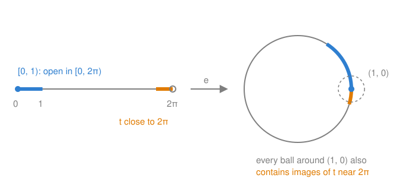

# Topological spaces and continuous maps

## TL;DR

- A **topology** on a set says which subsets are **open**. Three axioms: $\varnothing$ and the whole set are open, finite intersections of open sets are open, and arbitrary unions of open sets are open.
- A map is **continuous** if the preimage of every open set is open. For metric spaces this is exactly the $\varepsilon$-$\delta$ definition, with the distances taken out.
- A subset of a space inherits the **subspace topology**: its open sets are the traces $U \cap A$ of open sets $U$ of the big space.
- A **homeomorphism** is a continuous bijection with a continuous inverse. A continuous bijection is not enough: wrapping $[0, 2\pi)$ around the circle is one, and its inverse tears the circle open.
- **Gluing lemma:** a map that is continuous on each of two closed pieces, and agrees where they overlap, is continuous on their union.

## Key claims

- <a id="c1"></a>**C1.** A topology on a set $X$ is a collection $\mathcal{T}$ of subsets of $X$, called open, such that $\varnothing, X \in \mathcal{T}$, the intersection of finitely many open sets is open, and the union of any family of open sets is open. A topological space is a pair $(X, \mathcal{T})$. ([Definition](#def-topology))
- <a id="c2"></a>**C2.** In a metric space $(X, d)$, call $U$ open if every point $x \in U$ has an open ball $B(x, \varepsilon) = \{y : d(x, y) < \varepsilon\}$ inside $U$. This is a topology, and every open ball is open in it. Arbitrary intersections of open sets need not be open: in $\mathbb{R}$, $`\bigcap_{n \ge 1} (-\tfrac1n, \tfrac1n) = \{0\}`$. ([Proposition](#prop-metric))
- <a id="c3"></a>**C3.** A map $f : X \to Y$ between topological spaces is continuous if $f^{-1}(V)$ is open in $X$ for every open $V \subseteq Y$. Between metric spaces this is equivalent to the $\varepsilon$-$\delta$ definition. Compositions of continuous maps are continuous. ([Definition](#def-continuous), [Proposition](#prop-eps-delta))
- <a id="c4"></a>**C4.** A set is closed if its complement is open. A map is continuous if and only if the preimage of every closed set is closed. ([Proposition](#prop-closed))
- <a id="c5"></a>**C5.** For $A \subseteq X$, the subspace topology on $A$ consists of the sets $U \cap A$ with $U$ open in $X$. The inclusion $A \hookrightarrow X$ is continuous, and so is the restriction $`f|_A`$ of a continuous $f$. If $A$ is closed in $X$, a subset of $A$ that is closed in $A$ is closed in $X$. ([Definition](#def-subspace), [Proposition](#prop-subspace))
- <a id="c6"></a>**C6.** A homeomorphism is a bijection $f$ such that $f$ and $f^{-1}$ are both continuous. Equivalently, $f$ is a bijection of the points that is also a bijection of the open sets. Every property defined only through open sets is shared by homeomorphic spaces. ([Definition](#def-homeomorphism))
- <a id="c7"></a>**C7.** The map $e : [0, 2\pi) \to S^1$, $e(t) = (\cos t, \sin t)$, is a continuous bijection, but not a homeomorphism. The set $[0, 1)$ is open in $[0, 2\pi)$, but its image is not open in $S^1$: every neighbourhood of $(1, 0)$ also contains points $e(t)$ with $t$ close to $2\pi$. ([Proposition](#prop-wrap))
- <a id="c8"></a>**C8.** Gluing lemma: if $X = A \cup B$ with $A$ and $B$ closed, and $f : X \to Y$ is a map whose restrictions $`f|_A`$ and $`f|_B`$ are continuous, then $f$ is continuous. The pieces must be closed: on $[0, 2]$ with $A = [0, 1]$ and $B = (1, 2]$, the map that is $0$ on $A$ and $1$ on $B$ is continuous on each piece but not on $[0, 2]$. ([Lemma](#lemma-gluing))

## Explanation

### Why open sets

In analysis, continuity is defined with distances: $f$ is continuous at $x$ if for every $\varepsilon > 0$ there is a $\delta > 0$ such that $d(x, y) < \delta$ implies $d(f(x), f(y)) < \varepsilon$. In words: points close enough to $x$ go to points close to $f(x)$.

The exact distances don't matter for this. Stretching $\mathbb{R}$ by a factor of 2 changes every distance, but not which maps are continuous. What matters is only which points are "near" which. Topology keeps exactly that information and throws away the rest, by recording which sets are **open**. Think of an open set as a set that contains, together with each of its points, everything that is "near enough" to that point. It has no edge that you could stand on.

This is the language the SU(2) and SO(3) notes need. Gluing two disks, or identifying antipodal points, changes which points are near which, while distances become meaningless. Open sets survive such operations, distances don't.

### Topological spaces

<a id="def-topology"></a>**Definition (topology).** Let $X$ be a set. A topology on $X$ is a collection $\mathcal{T}$ of subsets of $X$, called **open sets**, such that

1. $\varnothing$ and $X$ are open,
2. the intersection of finitely many open sets is open,
3. the union of an arbitrary family of open sets is open.

A **topological space** is a pair $(X, \mathcal{T})$; usually one just writes $X$. ([C1](#c1))

*What it says.* A topology is a list of subsets, closed under the two operations in axioms 2 and 3. Nothing else is required: one set can carry many topologies.

*Why finite intersections only.* The model is the metric space, where "open" means "contains a small ball around each of its points". Intersect two such sets: around each point, take the smaller of the two balls, and it lies in both. With infinitely many sets, the balls can shrink to nothing. The intervals $(-\tfrac1n, \tfrac1n)$ are all open, but their intersection is the single point $\{0\}$, which contains no ball at all ([C2](#c2)). Unions have no such problem: a ball inside one set lies inside the union.

*Two extremes.* On any set, the **discrete topology** makes every subset open: every point is isolated, so to speak, and nothing is near anything else. The **indiscrete topology** makes only $\varnothing$ and $X$ open: every point is near every other, and no two points can be told apart by open sets. The topologies we care about lie in between.

<a id="prop-metric"></a>**Proposition (metric topology).** Let $(X, d)$ be a metric space. Call $U \subseteq X$ open if for every $x \in U$ there is an $\varepsilon > 0$ with $B(x, \varepsilon) \subseteq U$. This defines a topology on $X$, and every open ball $B(x, r)$ is open. ([C2](#c2))

*Proof idea.* For a ball: from a point $y$ inside $B(x, r)$, there is still room $r - d(x, y)$ left to the edge, and a ball of that radius around $y$ fits inside by the triangle inequality.

<details><summary>Proof</summary>

Axiom 1: $\varnothing$ has no points, so the condition holds vacuously; $X$ contains every ball. Axiom 2: let $U$ and $V$ be open and $x \in U \cap V$. There are $\varepsilon, \varepsilon' > 0$ with $B(x, \varepsilon) \subseteq U$ and $B(x, \varepsilon') \subseteq V$. Then $B(x, \min(\varepsilon, \varepsilon')) \subseteq U \cap V$. By induction this holds for finitely many sets. Axiom 3: if $x$ lies in a union of open sets, it lies in one of them, $U$, and a ball around $x$ in $U$ also lies in the union.

Balls are open: let $y \in B(x, r)$ and $\rho = r - d(x, y) > 0$. For $z \in B(y, \rho)$, the triangle inequality gives $d(x, z) \le d(x, y) + d(y, z) < d(x, y) + \rho = r$, so $B(y, \rho) \subseteq B(x, r)$.

</details>

$\mathbb{R}^n$ always carries this topology, with the Euclidean distance.

### Continuous maps

<a id="def-continuous"></a>**Definition (continuous map).** A map $f : X \to Y$ between topological spaces is **continuous** if $f^{-1}(V)$ is open in $X$ for every open set $V$ of $Y$. ([C3](#c3))

*What it says.* Take any open set downstairs in $Y$, and collect all points of $X$ that land in it. That collection must be open. In the picture of open sets as "no edges": $f$ may not create an edge, a point that lands in $V$ while points arbitrarily close to it land outside $V$.

*Why preimages and not images.* Images of open sets under continuous maps need not be open. The constant map $\mathbb{R} \to \mathbb{R}$, $x \mapsto 0$, is continuous, and it sends the open set $\mathbb{R}$ to $\{0\}$, which is not open. Preimages are what the $\varepsilon$-$\delta$ definition talks about: "all $y$ close to $x$" are the points that map into a ball around $f(x)$.

<a id="prop-eps-delta"></a>**Proposition.** Between metric spaces, $f$ is continuous in the sense above if and only if it is $\varepsilon$-$\delta$ continuous at every point. The composition $g \circ f$ of continuous maps $f : X \to Y$ and $g : Y \to Z$ is continuous. ([C3](#c3); Laures & Szymik, Satz 1.2)

*Proof idea.* A ball around $f(x)$ is an open set. Its preimage is open and contains $x$, so it contains a ball around $x$. That ball is the $\delta$.

<details><summary>Proof</summary>

($\varepsilon$-$\delta$ ⇒ open preimages.) Let $V \subseteq Y$ be open and $x \in f^{-1}(V)$. Since $V$ is open, there is an $\varepsilon > 0$ with $B(f(x), \varepsilon) \subseteq V$. By $\varepsilon$-$\delta$ continuity there is a $\delta > 0$ such that $f(B(x, \delta)) \subseteq B(f(x), \varepsilon) \subseteq V$, so $B(x, \delta) \subseteq f^{-1}(V)$. Hence $f^{-1}(V)$ is open.

(Open preimages ⇒ $\varepsilon$-$\delta$.) Let $x \in X$ and $\varepsilon > 0$. The ball $B(f(x), \varepsilon)$ is open by the [metric topology](#prop-metric), so $f^{-1}(B(f(x), \varepsilon))$ is open. It contains $x$, so it contains a ball $B(x, \delta)$. That is: $d(x, y) < \delta$ implies $d(f(x), f(y)) < \varepsilon$.

(Composition.) For $W$ open in $Z$, $(g \circ f)^{-1}(W) = f^{-1}(g^{-1}(W))$. The set $g^{-1}(W)$ is open since $g$ is continuous, and its preimage under $f$ is open since $f$ is continuous.

</details>

### Closed sets

A set $C \subseteq X$ is **closed** if its complement $X \setminus C$ is open. Closed is not the opposite of open: $\varnothing$ and $X$ are both, and $[0, 1)$ in $\mathbb{R}$ is neither. In a metric space, a closed set is one that contains all the limits of its convergent sequences. $[0, 1]$ is closed, $[0, 1)$ is not, because $1 - \tfrac1n \to 1$.

<a id="prop-closed"></a>**Proposition.** $f : X \to Y$ is continuous if and only if $f^{-1}(C)$ is closed for every closed $C \subseteq Y$. ([C4](#c4))

<details><summary>Proof</summary>

Preimages respect complements: $f^{-1}(Y \setminus C) = X \setminus f^{-1}(C)$. So $f^{-1}$ maps open sets to open sets exactly when it maps closed sets to closed sets.

</details>

### Subspaces

The circle $S^1$ and the disk $D^2$ are subsets of $\mathbb{R}^2$, and the sphere $S^2$ is a subset of $\mathbb{R}^3$. They inherit a topology from the big space.

<a id="def-subspace"></a>**Definition (subspace topology).** Let $X$ be a topological space and $A \subseteq X$. The subspace topology on $A$ consists of all sets $U \cap A$ with $U$ open in $X$. ([C5](#c5))

*What it means.* A set is open in $A$ if it is cut out of an open set of $X$. It needn't be open in $X$. In $A = [0, 2\pi)$, the set $[0, 1) = (-1, 1) \cap A$ is open, although it isn't open in $\mathbb{R}$. Seen from inside $A$, the point $0$ has no neighbours to its left, so nothing is missing there. For a metric space, the open sets of $A$ are exactly those of the metric $d$ restricted to $A$. The balls of $A$ are the balls of $X$ intersected with $A$.

<a id="prop-subspace"></a>**Proposition.** Let $A \subseteq X$ carry the subspace topology.

1. The inclusion $\iota : A \hookrightarrow X$ is continuous, and so is the restriction $`f|_A = f \circ \iota`$ of a continuous $f : X \to Y$.
2. A map $g : Z \to A$ is continuous if and only if $\iota \circ g : Z \to X$ is continuous. *(cited: Lee, Introduction to Topological Manifolds, 2nd ed., Theorem 3.8)*
3. If $A$ is closed in $X$, every subset of $A$ that is closed in $A$ is closed in $X$.

([C5](#c5))

Part 2 is intuitive: a map into a curve in the plane is continuous exactly when it is continuous as a map into the plane. It means continuity doesn't depend on whether you regard $S^1$ as a space of its own or as a subset of $\mathbb{R}^2$.

<details><summary>Proof of 1 and 3</summary>

1. For $U$ open in $X$, $\iota^{-1}(U) = U \cap A$, which is open in $A$ by definition. The restriction is a composition of continuous maps ([C3](#c3)).
3. Let $K \subseteq A$ be closed in $A$. Then $A \setminus K$ is open in $A$, so $A \setminus K = U \cap A$ for some $U$ open in $X$. Hence $K = A \cap (X \setminus U)$, an intersection of two closed sets of $X$. Its complement is $(X \setminus A) \cup U$, a union of open sets, so $K$ is closed in $X$.

</details>

### Homeomorphisms

<a id="def-homeomorphism"></a>**Definition (homeomorphism).** A map $f : X \to Y$ is a homeomorphism if it is bijective and both $f$ and $f^{-1}$ are continuous. Then $X$ and $Y$ are **homeomorphic**, written $X \cong Y$. ([C6](#c6))

*What it means.* $f^{-1}$ is continuous exactly when $(f^{-1})^{-1}(U) = f(U)$ is open for every open $U$. So a homeomorphism pairs the points of $X$ with those of $Y$, and at the same time pairs the open sets of $X$ with those of $Y$. Every statement made only in terms of points and open sets therefore transfers. "Every open cover has a finite subcover", "two points have disjoint neighbourhoods" and "this loop can be deformed to a point" are examples. Distances, angles and straightness are not defined through open sets, and they need not transfer. A square and a disk are homeomorphic.

*Why the inverse must be required separately.* For linear maps, or group homomorphisms, the inverse of a bijective structure-preserving map automatically preserves the structure. For continuous maps it does not, and the standard example is worth knowing by heart.



<a id="prop-wrap"></a>**Proposition.** $e : [0, 2\pi) \to S^1$, $e(t) = (\cos t, \sin t)$, is a continuous bijection whose inverse is not continuous. ([C7](#c7))

*Proof idea.* The interval has a beginning but no end. The circle closes up. Near the point $(1, 0) = e(0)$, the circle contains the images of $t$ just above $0$ and of $t$ just below $2\pi$. The interval keeps these two groups far apart, and $e^{-1}$ would have to tear them apart: it jumps from near $2\pi$ to $0$.

<details><summary>Proof</summary>

$e$ is continuous: its components $\cos$ and $\sin$ are continuous, so $e$ is continuous into $\mathbb{R}^2$, and hence into the subspace $S^1$ (part 2 of the [subspace proposition](#prop-subspace)). It is bijective because every point of $S^1$ is $(\cos t, \sin t)$ for exactly one $t \in [0, 2\pi)$.

The set $U = [0, 1) = (-1, 1) \cap [0, 2\pi)$ is open in $[0, 2\pi)$. Suppose $e(U)$ were open in $S^1$. Then $e(U) = W \cap S^1$ for some open $W \subseteq \mathbb{R}^2$ containing $e(0) = (1, 0)$, so $W$ contains a ball $B((1, 0), \varepsilon)$. Since $e(t) \to (1, 0)$ as $t \to 2\pi$, there is a $t \in (1, 2\pi)$ with $e(t) \in B((1, 0), \varepsilon) \cap S^1 \subseteq e(U)$. But $e$ is injective and $t \notin U$, so $e(t) \notin e(U)$. This is a contradiction, so $e(U)$ is not open. Hence $(e^{-1})^{-1}(U) = e(U)$ is not open, and $e^{-1}$ is not continuous.

</details>

The [compact-to-Hausdorff note](compact-to-hausdorff.md) shows what goes wrong here in general: the interval $[0, 2\pi)$ is not compact.

### Gluing continuous pieces

In the gluing constructions, maps and paths are defined piece by piece: one formula on disk 1, another on disk 2. The gluing lemma says when such a map is continuous.

<a id="lemma-gluing"></a>**Lemma (gluing lemma).** Let $X = A \cup B$ with $A$ and $B$ closed in $X$, and let $f : X \to Y$ be a map such that $`f|_A`$ and $`f|_B`$ are continuous (with $A$, $B$ in the subspace topology). Then $f$ is continuous. ([C8](#c8); Lee, Introduction to Topological Manifolds, 2nd ed., Lemma 3.23)

The usual way to use it is to define $f$ by two formulas, $f = g$ on $A$ and $f = h$ on $B$, which must agree on $A \cap B$ so that $f$ is well defined.

*Proof idea.* Use closed sets ([C4](#c4)). The preimage of a closed set is the union of its preimages in the two pieces. Each of these is closed in its piece, hence in $X$, and a union of two closed sets is closed.

<details><summary>Proof</summary>

Let $C \subseteq Y$ be closed. Then

```math
f^{-1}(C) = (f|_A)^{-1}(C) \cup (f|_B)^{-1}(C).
```

$`(f|_A)^{-1}(C)`$ is closed in $A$, because $`f|_A`$ is continuous ([C4](#c4)). Since $A$ is closed in $X$, it is closed in $X$ (part 3 of the [subspace proposition](#prop-subspace)). The same holds for $B$. A union of two closed sets is closed, because its complement is the intersection of two open sets. So $f^{-1}(C)$ is closed, and $f$ is continuous by [C4](#c4).

</details>

*Why closed.* The counterexample in [C8](#c8) splits $[0, 2]$ into $[0, 1]$ and $(1, 2]$. The second piece is not closed: it is missing its edge point $1$, which belongs to the other piece. The map is constant on each piece, so continuous there, but it jumps at $1$. With closed pieces, a point where the pieces meet belongs to both, so both formulas have to agree there, and no jump is possible. (The lemma also holds for any cover by open sets, and for finitely many closed sets; the version with two closed sets is the one needed here.)

## Examples

**A topology on three points.** On $X = \{a, b, c\}$, the collection $\{\varnothing, \{a\}, \{a, b\}, X\}$ is a topology. Every union and intersection of these sets is again among them. The collection $\{\varnothing, \{a\}, \{b\}, X\}$ is not, because $\{a\} \cup \{b\} = \{a, b\}$ is missing.

**The square and the disk.** The map $f : D^2 \to [-1, 1]^2$ that stretches each ray from the origin linearly, so that the boundary circle lands on the boundary square, is a homeomorphism. Corners are not a topological feature.

**A path through two pieces.** Define $\gamma : [0, 2] \to \mathbb{R}^2$ by $\gamma(t) = (t, 0)$ for $t \in [0, 1]$ and $\gamma(t) = (1, t - 1)$ for $t \in [1, 2]$. Both formulas give $(1, 0)$ at $t = 1$, and both pieces are closed. By the gluing lemma, $\gamma$ is continuous: an L-shaped path.

## Pitfalls

- **"Continuous maps send open sets to open sets."** That is a different property, being an *open map*. Continuity is about preimages ([C3](#c3)).
- **"Open in $A$" read as "open in $X$".** $[0, 1)$ is open in $[0, 2\pi)$ but not in $\mathbb{R}$ ([C5](#c5)).
- **A continuous bijection taken for a homeomorphism.** The inverse must be checked ([C7](#c7)).
- **"Closed" read as "not open".** Sets can be both or neither ([C4](#c4)).
- **Gluing along pieces that are not closed.** ([C8](#c8))

## Exercises

1. **Prove.** Show that in any topological space, the union of finitely many closed sets is closed and the intersection of any family of closed sets is closed.

   <details><summary>Solution</summary>

   Take complements. The complement of a finite union of closed sets is the finite intersection of their complements, which is open by axiom 2. The complement of an intersection of closed sets is the union of their complements, which is open by axiom 3 ([C1](#c1), [C4](#c4)).

   </details>

2. **Find the failing condition.** Is $\{\varnothing, \{a\}, \{b\}, \{a, b, c\}\}$ a topology on $\{a, b, c\}$? If not, which axiom fails, and what is the smallest set you must add?

   <details><summary>Solution</summary>

   No: the union $\{a\} \cup \{b\} = \{a, b\}$ is not in the collection, so axiom 3 fails. Adding $\{a, b\}$ gives a topology ([C1](#c1)).

   </details>

3. **Prove.** Show that a composition of homeomorphisms is a homeomorphism, and that the inverse of a homeomorphism is a homeomorphism.

   <details><summary>Solution</summary>

   If $f$ and $g$ are homeomorphisms, $g \circ f$ is a bijection, it is continuous as a composition of continuous maps, and its inverse $f^{-1} \circ g^{-1}$ is continuous for the same reason. The inverse $f^{-1}$ is a bijection whose inverse $f$ is continuous ([C3](#c3), [C6](#c6)).

   </details>

4. **Explain.** In the proof that $e : [0, 2\pi) \to S^1$ is not a homeomorphism, why does the argument use the open set $[0, 1)$ and not, say, $(1, 2)$?

   <details><summary>Solution</summary>

   $e$ is a homeomorphism away from the point $(1, 0)$: on $(0, 2\pi)$ its inverse is a continuous angle function. The only place where $e^{-1}$ tears is at $(1, 0) = e(0)$. So the open set must contain $0$. $[0, 1)$ is open in $[0, 2\pi)$, but its image is a half-open arc that lacks the points just "before" $(1, 0)$ ([C7](#c7)).

   </details>

5. **Apply.** Define $f : [-1, 1] \to \mathbb{R}$ by $f(x) = -x$ for $x \le 0$ and $f(x) = x^2$ for $x \ge 0$. Use the gluing lemma to show that $f$ is continuous. Which condition of the lemma would fail if you split $[-1, 1]$ into $[-1, 0)$ and $[0, 1]$, and does it matter here?

   <details><summary>Solution</summary>

   $A = [-1, 0]$ and $B = [0, 1]$ are closed. The formulas agree at $0$, where both give $0$. Each formula is continuous on its piece. So $f$ is continuous ([C8](#c8)). With $[-1, 0)$ the first piece is not closed, so the lemma doesn't apply. The function is still continuous, but the lemma no longer shows it: the lemma gives a sufficient condition, not a necessary one.

   </details>

## Sources

- Gerd Laures and Markus Szymik, *Grundkurs Topologie*, 2nd ed., Springer 2015: section 1.2 (topological spaces), Satz 1.2 (continuity between metric spaces), section 2.1 (subspaces). From Thomas's `eBooks` folder.
- John M. Lee, *Introduction to Topological Manifolds*, 2nd ed., Springer 2011: Example 2.3 (metric topology), Theorem 3.8 (characteristic property of the subspace topology), Lemma 3.23 (gluing lemma). From Thomas's `eBooks` folder.
- Written as a foundation for [#40](https://github.com/thomaswening/doubting-thomas/pull/40), after the review conversation of 2026-11-12.
