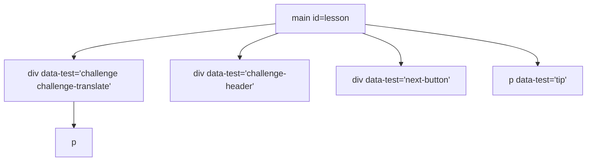

# The DOM and CSS selectors

## TL;DR

- A browser turns a page's **HTML** text into the **DOM** (Document Object Model): a tree of element objects, much like WPF turns XAML into a tree of elements.
- Each element has a **tag name**, **attributes** (name and string value) and **children**. Text sits in text nodes inside elements.
- A **CSS selector** is a small pattern language for finding elements: by tag, by attribute, by position in the tree.
- `querySelector` returns the **first** match, `querySelectorAll` **all** matches, as a snapshot.
- Attribute selectors compare strings: `[data-test='x']` means equals, `[data-test^='x']` means starts with.
- `textContent` is all the text inside an element, **including** text that is hidden on screen.

## Key claims

- <a id="c1"></a>**C1.** A browser parses a page's HTML into the DOM, a tree of nodes. Element nodes have a tag name, attributes and child nodes. Text is held in text nodes. Scripts read and change the page through this tree, not through the HTML text.
- <a id="c2"></a>**C2.** An attribute's value is always a string. Attributes whose names start with `data-` are reserved for the page's own use. The browser draws nothing differently because of them.
- <a id="c3"></a>**C3.** `root.querySelector(s)` returns the first element below `root` that matches selector `s`, in document order, or `null` if none matches. Document order visits a parent before its children and children in the order they appear in the HTML.
- <a id="c4"></a>**C4.** `root.querySelectorAll(s)` returns every matching element below `root` as a static list. Elements the page adds later do not appear in a list that was already returned.
- <a id="c5"></a>**C5.** `[a='x']` matches an element whose attribute `a` equals `x` exactly. `[a^='x']` matches when the value starts with `x`, `[a*='x']` when it contains `x`, and `[a~='x']` when `x` is one of its space-separated words. `[a]` matches when the attribute is present at all.
- <a id="c6"></a>**C6.** In a selector, a space means "a descendant at any depth" (`main p`), `>` means "a direct child" (`main > p`). Parts written together without a space apply to the same element (`div[data-test='x']`).
- <a id="c7"></a>**C7.** `el.textContent` is the text of all text nodes inside `el`, joined in document order. It ignores CSS: text of hidden elements is included, and the whitespace from the HTML source is kept.
- <a id="c8"></a>**C8.** `el.matches(s)` tests `el` itself against `s` and returns `true` or `false`. `el.closest(s)` returns the nearest element, starting with `el` itself and going up through its ancestors, that matches `s`, or `null`.

## Explanation

### HTML is text, the DOM is objects

A web page arrives as **HTML**: text with **tags** in angle brackets. `<p>Hello</p>` is a paragraph element with the text `Hello`. Tags nest, like XAML elements. An opening tag can carry **attributes**: `<div id="lesson" data-test="challenge">` has two.

The browser's **parser** reads this text once and builds the **DOM**: one object per element, with its parent and children ([C1](#c1)). This is what WPF does with XAML. The XAML file becomes a tree of `FrameworkElement` objects, the *logical tree*. After that, code works with the objects, not with the file. JavaScript in the page does the same: it finds element objects in the tree, reads their attributes and changes them. The browser redraws what changed.

The analogy has one important difference. A WPF element has typed properties (`Width` is a `double`). A DOM attribute is just a name with a **string** value ([C2](#c2)), like an entry in a `Dictionary<string, string>`. `div` and `span` are general containers that mean nothing by themselves, like WPF's `Grid` and `Border`.

`data-` attributes, such as `data-test`, exist so that a page can attach its own labels to elements ([C2](#c2)). Sites often use them as stable handles for their own automated tests, like setting `AutomationProperties.AutomationId` on a WPF control. Because they mean something to the site's tests and nothing to the browser, they tend to stay put when the site's looks change. That makes them good handles for other people's code too.

### Selectors: a query language for the tree

The second web language, **CSS** (Cascading Style Sheets), styles pages: colours, sizes, whether something is shown. A CSS rule has the form `selector { property: value; }`. The **selector** says which elements the rule applies to. Selectors turned out to be so useful for finding elements that scripts use the same syntax, through `querySelector` and `querySelectorAll` ([C3](#c3), [C4](#c4)). Think of a selector as a LINQ `Where` predicate over all elements of the tree, written as a short string.

The building blocks used most:

| Selector | Matches | Like in C# |
|---|---|---|
| `div` | every `<div>` element | `e.TagName == "div"` |
| `#lesson` | the element with `id="lesson"` | `e.Id == "lesson"` |
| `[data-test]` | elements that have a `data-test` attribute | `e.Attributes.ContainsKey("data-test")` |
| `[data-test='x']` | value equals `x` | `v == "x"` |
| `[data-test^='x']` | value starts with `x` | `v.StartsWith("x")` |
| `[data-test*='x']` | value contains `x` | `v.Contains("x")` |
| `[data-test~='x']` | `x` is one of the space-separated words | `v.Split(' ').Contains("x")` |

The quotes around the value are optional when the value is a single plain word. Combinators join parts ([C6](#c6)): `#lesson [data-test]` is "an element with `data-test` anywhere inside `#lesson`". A comma means "or": `h1, h2` matches both kinds.

`querySelector` returns one element or `null` ([C3](#c3)): the first in **document order**, which is the order of the opening tags in the HTML. `querySelectorAll` returns a list ([C4](#c4)). That list is a snapshot, like calling `.ToList()` on a LINQ query: elements added to the page afterwards are not in it. Both can be called on `document` to search the whole page, or on one element to search only inside it.

To ask about one element you already hold, use `matches` and `closest` ([C8](#c8)). `closest` walks up the tree, like WPF's helper loops over `VisualTreeHelper.GetParent` until a parent of the wanted type turns up.

### Reading text

`textContent` collects every piece of text inside an element ([C7](#c7)). It works on the tree alone, without asking how the page looks, so it also returns the text of hidden elements. It returns the line breaks and indentation of the HTML source too. Code that compares text therefore trims it, or uses a "contains" test.

## Examples

A made-up page:

```html
<main id="lesson">
  <div data-test="challenge challenge-translate">
    <p>Translate this sentence.</p>
  </div>
  <div data-test="challenge-header">Header</div>
  <div data-test="next-button">Continue</div>
  <p data-test="tip" style="display: none">A hidden tip</p>
</main>
```

The browser builds this tree from it (text nodes left out):



What some selectors return on it. In JavaScript, `const` declares a variable that is not reassigned, like a C# `var` that you never assign again. `.length` is a list's `Count`.

```javascript
document.querySelectorAll("[data-test^='challenge']").length; // 2: both "challenge..." divs
document.querySelectorAll("[data-test='challenge']").length;  // 0: no value equals "challenge" exactly
document.querySelectorAll("[data-test~='challenge']").length; // 1: only the first div has the word "challenge"
document.querySelector("[data-test^='challenge']").getAttribute("data-test");
                                                              // "challenge challenge-translate": the first in document order
document.querySelector("[data-test='next-button']").textContent; // "Continue"
document.querySelector("#lesson > p");                        // the hidden tip: the only <p> that is a direct child
document.querySelector("[data-test='tip']").textContent;      // "A hidden tip", although it is not shown
document.querySelector("[data-test='missing']");              // null
document.querySelector("p").closest("[data-test]").getAttribute("data-test");
                                                              // "challenge challenge-translate"
```

## Pitfalls

- **"Starts with" is wider than it looks.** `[data-test^='challenge']` also matches `challenge-header` and any later `challenge-whatever` ([C5](#c5)). If only some values are meant, list them, or match whole words with `~=`.
- **Expecting `querySelectorAll` to stay current.** It is a snapshot ([C4](#c4)). Code that must react to elements added later needs a [MutationObserver](event-loop-and-mutation-observer.md).
- **Treating `textContent` as "what the user sees".** It includes hidden text and the source's whitespace ([C7](#c7)). Whether an element is shown is a [different question](element-visibility.md).
- **A typo in a selector throws.** An invalid selector such as `[data-test='x'` (missing `]`) raises a `SyntaxError` instead of returning nothing.
- **Forgetting the space.** `div [data-test]` (with a space) is "an element with `data-test` inside a `div`". `div[data-test]` is "a `div` that has `data-test`" ([C6](#c6)).

## Exercises

1. **Predict.** On the example page, what does `document.querySelectorAll("main > [data-test*='button']").length` return?

   <details><summary>Solution</summary>

   `1`. `*=` means "contains" ([C5](#c5)), so only `next-button` matches. It is a direct child of `main` ([C6](#c6)).

   </details>

2. **Explain.** A script runs `const all = document.querySelectorAll("[data-test]")`. Afterwards the page adds a new element with a `data-test` attribute. Is it in `all`? Why?

   <details><summary>Solution</summary>

   No. `querySelectorAll` returns a static list of the matches at the moment of the call ([C4](#c4)). Run the query again to see the new element.

   </details>

## Sources

- Claude session on [Skip the Fluff](https://github.com/thomaswening/skip-the-fluff), 2026-11-12: primer before reviewing the fix engine, which finds elements by `data-test` attributes.
- MDN: [Introduction to the DOM](https://developer.mozilla.org/en-US/docs/Web/API/Document_Object_Model/Introduction), [`querySelector`](https://developer.mozilla.org/en-US/docs/Web/API/Document/querySelector), [`querySelectorAll`](https://developer.mozilla.org/en-US/docs/Web/API/Document/querySelectorAll), [attribute selectors](https://developer.mozilla.org/en-US/docs/Web/CSS/Attribute_selectors), [`textContent`](https://developer.mozilla.org/en-US/docs/Web/API/Node/textContent), [`closest`](https://developer.mozilla.org/en-US/docs/Web/API/Element/closest).
- Specifications: [DOM Standard, "Scope-match a selectors string"](https://dom.spec.whatwg.org/#scope-match-a-selectors-string), [Selectors Level 4, attribute selectors](https://www.w3.org/TR/selectors-4/#attribute-selectors).
