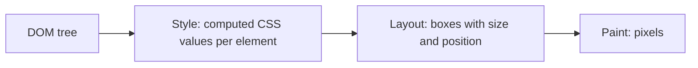

# When is an element visible?

## TL;DR

- The browser turns the [DOM](dom-and-selectors.md) into pixels in steps: **style** (which CSS values apply to each element), **layout** (boxes with sizes and positions), **paint**.
- `getComputedStyle(el)` answers the style question. `getClientRects()`, `getBoundingClientRect()` and `checkVisibility()` answer the layout question.
- `display: none` removes the element's box **and every descendant's box**. No child can undo it. It is WPF's `Visibility.Collapsed`.
- `visibility: hidden` keeps the box (the space stays empty). It is **inherited**, but a child can set `visibility: visible` and show again.
- An element can also have a box of **zero size**, or be transparent (`opacity: 0`). "Visible" therefore needs a definition, and each tool picks its own.
- A DOM without a layout engine, such as **jsdom** in Node, has no boxes. Every size is 0. It cannot tell you whether something is on screen.

## Key claims

- <a id="c1"></a>**C1.** `getComputedStyle(el)` returns the value of every CSS property for `el` after all style rules, the `style` attribute and inheritance are applied. Its values are strings, such as `"none"` or `"hidden"`.
- <a id="c2"></a>**C2.** An element with `display: none` generates no layout box. Neither do any of its descendants, whatever their own `display` value.
- <a id="c3"></a>**C3.** `getComputedStyle` of a descendant of a `display: none` element still reports the descendant's own `display` value, for example `"block"`. A check of the element's own computed `display` therefore misses a hidden ancestor.
- <a id="c4"></a>**C4.** `visibility: hidden` makes an element invisible but keeps its box, so it still takes up space. The property is inherited: descendants are hidden too, unless one sets `visibility: visible`, which shows it again.
- <a id="c5"></a>**C5.** `el.getClientRects()` returns the element's layout boxes. It is empty for an element without a box. `el.getBoundingClientRect()` returns one rectangle around them, with width and height 0 when there is no box.
- <a id="c6"></a>**C6.** `el.checkVisibility()` returns `false` when the element has no box, which covers `display: none` on the element or on any ancestor. By default it returns `true` for `visibility: hidden`, for `opacity: 0` and for a box of zero size. The options `{ visibilityProperty: true }` and `{ opacityProperty: true }` add the first two checks.
- <a id="c7"></a>**C7.** Layout needs a rendering engine. jsdom, a DOM implementation for Node used in JavaScript unit tests, does no layout: `getBoundingClientRect()` returns zeros and `getClientRects()` is empty for every element. jsdom does compute some styles, such as `display`, but it cannot say whether an element is on screen.

## Explanation

### From tree to pixels

The [DOM](dom-and-selectors.md) only says which elements exist. Before anything appears, the browser works in three steps, much as WPF does:



1. **Style.** CSS rules say things like `.tip { display: none; }`. Several rules can apply to one element. An element's `style` attribute adds more (`style="display: none"`). Some properties are **inherited**: if the parent sets them and the child doesn't, the child takes the parent's value. `color` and `visibility` are inherited. `display` is not. The result for each element is its **computed style** ([C1](#c1)). It is like WPF's dependency-property value resolution: local value, style, inherited value, default.
2. **Layout.** The browser gives each element a **box**: a rectangle with a size and a position. This is WPF's Measure and Arrange.
3. **Paint.** The boxes are drawn.

"Is this element visible?" is a question about the result of steps 2 and 3, not about the DOM.

### Four ways to be invisible

| CSS | Box? | Takes space? | Children | WPF counterpart |
|---|---|---|---|---|
| `display: none` | no ([C2](#c2)) | no | all hidden, no way back | `Visibility.Collapsed` |
| `visibility: hidden` | yes | yes | hidden, but a child can set `visible` ([C4](#c4)) | `Visibility.Hidden`, except that in WPF no child can come back |
| `width: 0; height: 0; overflow: hidden` | yes, of size 0 | no | clipped away | `Width="0"` with `ClipToBounds="True"` |
| `opacity: 0` | yes | yes | transparent | `Opacity="0"` |

A site can hide something in any of these ways. A check that wants "is it on screen?" has to decide which of them it cares about.

### Asking the browser

**Computed style** answers "what does CSS say about this element?" ([C1](#c1)). But `display` is not inherited. A child of a `display: none` parent still reports its own `display`, such as `"block"`, although it has no box ([C3](#c3)). To use computed style, a check would have to walk up through every ancestor.

**Layout boxes** answer the question directly ([C5](#c5)). `getClientRects()` lists the element's boxes. An element without a box, for whatever reason, has none. `getBoundingClientRect()` gives one rectangle, in pixels, relative to the visible part of the page.

**`checkVisibility()`** packages the common case ([C6](#c6)). It returns `false` when the element has no box, which includes any hidden ancestor. Options add the `visibility` and `opacity` checks. A box of size 0 still counts as visible. Chromium has had it since version 105, so Android's WebView, which is Chromium, supports it.

Test tools have their own definition. Playwright treats an element as visible when its bounding box is not empty and its computed `visibility` is not `hidden`. That makes a zero-size element hidden and an `opacity: 0` element visible.

### Why jsdom can't answer

JavaScript unit tests often run in **Node**, a JavaScript runtime without a browser (as `dotnet` runs C# without a window). For pages they use **jsdom**, which builds a DOM from HTML and implements selectors and much of the DOM API. It has no layout engine ([C7](#c7)). Every box size is 0.

The WPF counterpart: build a visual tree in code and never show it. Measure and Arrange never run, so `ActualWidth` is 0 for every element. You can ask what `Visibility` is set to, but not whether anything would be on screen. In jsdom, `getComputedStyle` even works for `display`, so the `display: none` element itself is detected. Everything that needs boxes is not. A visibility check therefore has to be tested in a real browser engine.

## Examples

A made-up page:

```html
<div id="gone" style="display: none">
  <span id="inner" style="display: block">a</span>
</div>
<div id="ghost" style="visibility: hidden">
  <span id="ghostChild">b</span>
  <span id="back" style="visibility: visible">c</span>
</div>
<div id="tiny" style="width: 0; height: 0; overflow: hidden">d</div>
<div id="clear" style="opacity: 0">e</div>
```

What the browser reports, measured in headless Chrome:

| Element | computed `display` | computed `visibility` | `getClientRects().length` | `checkVisibility()` | `checkVisibility({ visibilityProperty: true })` |
|---|---|---|---|---|---|
| `#gone` | `none` | `visible` | 0 | `false` | `false` |
| `#inner` | `block` ([C3](#c3)) | `visible` | 0 | `false` | `false` |
| `#ghost` | `block` | `hidden` | 1 | `true` | `false` |
| `#ghostChild` | `inline` | `hidden` (inherited) | 1 | `true` | `false` |
| `#back` | `inline` | `visible` | 1 | `true` | `true` |
| `#tiny` | `block` | `visible` | 1 (0 × 0 pixels) | `true` | `true` |
| `#clear` | `block` | `visible` | 1 | `true` (`false` with `{ opacityProperty: true }`) | `true` |

The same question in jsdom, run in Node. `require` loads a package, like a `using` plus a NuGet reference:

```javascript
const { JSDOM } = require("jsdom");
const dom = new JSDOM(`<div id="box" style="width: 100px; height: 50px">b</div>`);
const box = dom.window.document.getElementById("box");
box.getBoundingClientRect().width; // 0, not 100: no layout ran
box.getClientRects().length;       // 0
```

## Pitfalls

- **Checking only the element's own `display`.** It misses a hidden ancestor ([C3](#c3)). Use the layout boxes or `checkVisibility()`.
- **Treating `visibility: hidden` like WPF's `Hidden`.** In CSS, a child can set `visibility: visible` and appear inside a hidden parent ([C4](#c4)).
- **Expecting `checkVisibility()` to catch everything.** By default it ignores `visibility: hidden` and `opacity: 0`, and it calls a zero-size box visible ([C6](#c6)).
- **Testing a visibility check in jsdom.** Without layout, every element has no boxes or zero size, so the test proves nothing about a real browser ([C7](#c7)).
- **Confusing "in the DOM" with "on screen".** `querySelector` finds hidden elements too. Finding an element says nothing about whether the user sees it.

## Exercises

1. **Predict.** `<section style="display: none"><p style="visibility: visible">Hi</p></section>`. Is the paragraph visible? What does `p.checkVisibility()` return?

   <details><summary>Solution</summary>

   Not visible, and `false`. `display: none` on the section removes the boxes of all its descendants ([C2](#c2)). `visibility: visible` only overrides an inherited `visibility: hidden` ([C4](#c4)). It cannot create a box. `checkVisibility()` returns `false` for an element without a box ([C6](#c6)).

   </details>

2. **Explain.** A unit test runs a function `isVisible(el)` in jsdom on a page with one visible button. The function returns `false`. The same function returns `true` in Chrome. Which part of the function is likely at fault, and why does the test not show a bug in the function?

   <details><summary>Solution</summary>

   The function probably reads layout: box sizes or `getClientRects()`. jsdom does no layout, so every box is empty or of size 0 ([C7](#c7)), and the function correctly reports "no box". The test environment is wrong, not the function. Such a function needs a real browser engine to be tested.

   </details>

## Sources

- Claude session on [Skip the Fluff](https://github.com/thomaswening/skip-the-fluff), 2026-11-12: primer before reviewing the fix engine, whose exercise guard checks that no exercise element is visible. All values in the example table were measured in headless Chrome through Playwright.
- MDN: [`getComputedStyle`](https://developer.mozilla.org/en-US/docs/Web/API/Window/getComputedStyle), [`display`](https://developer.mozilla.org/en-US/docs/Web/CSS/display), [`visibility`](https://developer.mozilla.org/en-US/docs/Web/CSS/visibility), [`getClientRects`](https://developer.mozilla.org/en-US/docs/Web/API/Element/getClientRects), [`getBoundingClientRect`](https://developer.mozilla.org/en-US/docs/Web/API/Element/getBoundingClientRect), [`checkVisibility`](https://developer.mozilla.org/en-US/docs/Web/API/Element/checkVisibility).
- [jsdom README, "Unimplemented parts of the web platform"](https://github.com/jsdom/jsdom#unimplemented-parts-of-the-web-platform): layout is one of the two features it names as outside its scope.
- [Playwright: actionability, "Visible"](https://playwright.dev/docs/actionability#visible).
- Microsoft Learn: [`UIElement.Visibility`](https://learn.microsoft.com/en-us/dotnet/api/system.windows.uielement.visibility), [Layout (Measure and Arrange)](https://learn.microsoft.com/en-us/dotnet/desktop/wpf/advanced/layout).
