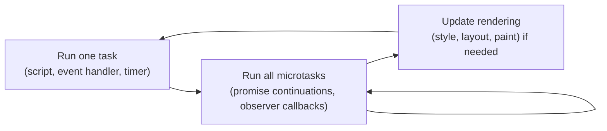

# The event loop and MutationObserver

## TL;DR

- A page's JavaScript runs on **one thread**, the main thread, one piece of work at a time. It is WPF's dispatcher thread.
- The **event loop** runs one **task** (a script, an event handler, a timer), then all **microtasks** that are waiting, then lets the browser redraw.
- A **MutationObserver** watches part of the [DOM](dom-and-selectors.md) for changes. It does not call back during each change: it collects **records** and delivers them in **one batch, as a microtask**, after the current script is done.
- Options choose what to watch: `childList` (children added or removed), `attributes`, and `subtree` (the whole tree below the target, not only its direct children).
- A callback that changes what it observes triggers itself again. Without a guard, that never stops and the page freezes.
- A script injected **at document start** runs before the page's own scripts, when the document is still **empty**: in Chromium, even `document.documentElement` is `null`.

## Key claims

- <a id="c1"></a>**C1.** A page's scripts, event handlers and callbacks all run on one thread, the main thread, which also does style, layout and painting. Each piece of work runs to completion before the next starts, so a long-running script freezes the page.
- <a id="c2"></a>**C2.** The event loop repeats three steps: take one task from a task queue and run it, then run microtasks until the microtask queue is empty, then let the browser update the rendering if it needs to. Tasks include running a script, an event handler and a `setTimeout` callback.
- <a id="c3"></a>**C3.** Promise continuations (the code after an `await`) and MutationObserver callbacks are microtasks. A microtask queued by a running microtask still runs before the next task, so an endless chain of microtasks freezes the page like an endless loop.
- <a id="c4"></a>**C4.** A MutationObserver's callback is not called during the change. The browser queues a record for each change and calls the callback once, as a microtask, with all records collected since the last call. Three elements appended in one script give one call with three records.
- <a id="c5"></a>**C5.** `observer.observe(target, options)`: `childList: true` reports children added to or removed from the target, `attributes: true` reports attribute changes on it, and `subtree: true` extends both to all descendants of the target. At least one of `childList`, `attributes` and `characterData` must be `true`, otherwise `observe` throws a `TypeError`.
- <a id="c6"></a>**C6.** If an observer's callback changes something the observer watches, that change queues a new record and the callback runs again. A callback that makes a change on every call therefore never stops. The usual guard is to change only what is not already in the wanted state.
- <a id="c7"></a>**C7.** `setAttribute` queues a mutation record even when it sets the value the attribute already has. A guard against [C6](#c6) must therefore compare before it writes, not rely on "same value, no change".
- <a id="c8"></a>**C8.** A script injected at document start runs before any of the page's own scripts. In Chromium, at that moment the document has no elements yet: `document.documentElement`, `document.head` and `document.body` are `null`. Such a script observes `document` itself with `childList` and `subtree` to see every element as the parser adds it.

## Explanation

### One thread, like the WPF dispatcher

In WPF, everything that touches the UI runs on the dispatcher thread. A click handler that runs for five seconds freezes the window for five seconds. The browser works the same way ([C1](#c1)). The page's JavaScript, every event handler, and the browser's own style and layout work share one thread. JavaScript has no `Dispatcher.Invoke` from other threads, because a page's code has no other threads that touch the DOM.

The **event loop** decides what runs next ([C2](#c2)):



A **task** is a big unit of work, like a work item that `Dispatcher.BeginInvoke` queues. `setTimeout(f, 0)` queues `f` as a task. A **microtask** is a small follow-up that must run "right after the current work, before anything else" ([C3](#c3)). The code after an `await` is a microtask, like a continuation in C#. The difference from C#: no thread pool is involved. Everything stays on the one thread.

### MutationObserver: being told about changes

A page changes its DOM all the time: a click shows a new screen, a script adds a dialog. Code that must react, for example to hide a newly added element, can't poll with `querySelectorAll` (a [snapshot](dom-and-selectors.md#c4)). It registers a **MutationObserver** instead.

The closest C# counterpart is `ObservableCollection<T>.CollectionChanged`, with two differences:

| | `CollectionChanged` | MutationObserver |
|---|---|---|
| When | synchronously, inside `Add`, before `Add` returns | later, as a microtask after the current script ([C4](#c4)) |
| How many calls | one event per change | one call per batch, with a list of records |
| What it watches | one collection | a node and, with `subtree`, everything below it ([C5](#c5)) |

Batching matters. A page that builds a screen of 200 elements in one script causes one callback with many records, not 200 callbacks. Each record says what happened: its `type` is `"childList"` (with `addedNodes` and `removedNodes`) or `"attributes"` (with `attributeName`).

The options ([C5](#c5)):

- `childList: true`: children added or removed. Without `subtree`, only the target's **direct** children count.
- `attributes: true`: attributes changed. `attributeFilter: ["style", "class"]` narrows it to some names.
- `subtree: true`: the same for every descendant, at any depth. Observing `document.body` with `childList` and `subtree` sees every element added anywhere in the visible page.

`observer.disconnect()` stops all watching. `observer.takeRecords()` returns the records not yet delivered and removes them from the queue.

### The observer that triggers itself

Hiding an element usually means changing its attributes: setting `style="display: none"` changes the `style` attribute. If the same observer watches `attributes` on that element, the change it just made is a new record, so the callback runs again ([C6](#c6)). If that call writes again, the cycle repeats. All of it happens in microtasks, which run before the browser can redraw or handle a click ([C3](#c3)). The page freezes.

Two guards are common:

- **Change only what needs changing.** Check whether the element is already hidden before writing. The callback still runs once more for its own change. That second call finds nothing to do, so the cycle ends. The check must read the current state, because `setAttribute` with an unchanged value still produces a record ([C7](#c7)).
- **Don't watch what you write.** Watch `childList` only, or filter attributes so that the observer's own writes are not reported. Or `disconnect()` before writing and `observe()` again afterwards.

### Scripts injected at document start

The browser parses HTML from top to bottom and builds the DOM as it goes. A `<script>` tag runs when the parser reaches it. An app can also give the browser a script to run **at document start**: Android's `WebViewCompat.addDocumentStartJavaScript` does this, and so does Playwright's `page.addInitScript`. Such a script runs before any script of the page ([C8](#c8)). That is the only way to be sure it sees every change the page makes.

The price is that the document is still empty at that moment. In Chromium, `document.documentElement` (the `<html>` element) is `null`, and so are `head` and `body`. Code that calls `document.body.querySelector(...)` there fails with a `TypeError`. A MutationObserver on `document` itself, with `childList` and `subtree`, works. It reports the `<html>` element, then `<head>`, `<body>` and everything else as the parser adds them. The alternative is to wait for the `DOMContentLoaded` event, which fires when the parser has finished.

## Examples

Some JavaScript first. `(records) => { ... }` is a lambda, as in C#. `for (const r of list)` is `foreach`. `push` is `List.Add`. `Promise.resolve().then(f)` queues `f` as a microtask.

**Batching and order** ([C2](#c2), [C4](#c4)). Measured in headless Chrome:

```javascript
const log = [];
const observer = new MutationObserver((records) => log.push("callback with " + records.length + " records"));
observer.observe(document.body, { childList: true, subtree: true });

for (let i = 0; i < 3; i++) document.body.appendChild(document.createElement("div"));
log.push("after appends");
Promise.resolve().then(() => log.push("promise"));
setTimeout(() => log.push("timeout"), 0);
log.push("end of script");
```

Afterwards `log` holds, in this order:

```text
after appends
end of script
callback with 3 records
promise
timeout
```

The script runs to completion first. Then the microtasks run: the observer's, queued at the first append, before the promise's. The timer is a task and comes last.

**A callback that triggers itself** ([C6](#c6), [C7](#c7)):

```javascript
const target = document.createElement("div");
document.body.appendChild(target);
let calls = 0;
const observer = new MutationObserver(() => {
  calls++;
  if (calls < 1000) target.setAttribute("data-hidden", "true"); // writes on every call
});
observer.observe(target, { attributes: true });
target.setAttribute("data-x", "1");
// calls reaches 1000: each write is a new record, although the value never changes.
```

Without the `calls < 1000` brake, the page would hang. With the guard `if (target.getAttribute("data-hidden") !== "true")` in place of the brake, the callback runs twice: once for `data-x`, once for its own write. The second call finds the attribute set and writes nothing. (`!==` is JavaScript's strict "not equal", the one to use by default.)

**Watching from document start** ([C8](#c8)). A script injected at document start, then a page `<!doctype html><title>t</title><p>hi</p>`:

```javascript
// Runs before the page: document.documentElement === null here.
const seen = [];
new MutationObserver((records) => {
  for (const r of records)
    for (const node of r.addedNodes)
      if (node.nodeType === Node.ELEMENT_NODE) seen.push(node.tagName);
}).observe(document, { childList: true, subtree: true });
// After the page has loaded, seen is ["HTML", "HEAD", "TITLE", "BODY", "P"].
```

## Pitfalls

- **Expecting the callback inside the change.** Code right after `appendChild` runs before the observer hears about it ([C4](#c4)). That is the opposite of `CollectionChanged`.
- **Forgetting `subtree`.** Without it, `childList` reports only the target's direct children ([C5](#c5)). An element added three levels down goes unnoticed.
- **Observing your own writes.** A callback that hides elements by changing attributes, on an observer that watches attributes, runs again for its own change ([C6](#c6)). Guard by comparing first ([C7](#c7)).
- **Touching `document.body` at document start.** It is `null` there in Chromium ([C8](#c8)). Observe `document`, or wait for `DOMContentLoaded`.
- **Long work in a callback.** The callback runs on the main thread ([C1](#c1)). Scanning the whole page on every batch can make the page stutter. Look at the records' `addedNodes` where possible.

## Exercises

1. **Predict.** A script appends two elements to an observed node, then logs `"done"`. The callback logs the number of records. What is logged, in which order?

   <details><summary>Solution</summary>

   `done`, then `2`. The records are delivered in one call, as a microtask, after the script has run to completion ([C2](#c2), [C4](#c4)).

   </details>

2. **Explain.** An observer watches `document.body` with `{ childList: true, subtree: true, attributes: true }`. Its callback sets `el.style.display = "none"` on every matching element, every time. Why might the page freeze, and what is the smallest fix?

   <details><summary>Solution</summary>

   Setting the style changes the `style` attribute, which the observer watches. That queues a new record and calls the callback again ([C6](#c6)). Each call writes again, all in microtasks, so the browser never gets to redraw ([C3](#c3)). The smallest fix: write only when the element is not hidden yet. Or drop `attributes` from the options if the observer does not need it.

   </details>

3. **Explain.** Why does a script injected at document start observe `document` rather than `document.body`?

   <details><summary>Solution</summary>

   At document start, `document.body` does not exist yet. In Chromium even `document.documentElement` is `null` ([C8](#c8)). `document` exists from the start. With `childList` and `subtree`, an observer on it sees every element the parser adds ([C5](#c5)).

   </details>

## Sources

- Claude session on [Skip the Fluff](https://github.com/thomaswening/skip-the-fluff), 2026-11-12: primer before reviewing the fix engine, which is injected at document start and watches the page with a MutationObserver. The examples' outputs and [C7](#c7) and [C8](#c8) were measured in headless Chrome 157 through Playwright 1.48.
- MDN: [`MutationObserver`](https://developer.mozilla.org/en-US/docs/Web/API/MutationObserver), [`observe()`](https://developer.mozilla.org/en-US/docs/Web/API/MutationObserver/observe), [`MutationRecord`](https://developer.mozilla.org/en-US/docs/Web/API/MutationRecord), [Using microtasks](https://developer.mozilla.org/en-US/docs/Web/API/HTML_DOM_API/Microtask_guide).
- Specifications: [HTML Standard, event loops](https://html.spec.whatwg.org/multipage/webappapis.html#event-loops), [DOM Standard, mutation observers](https://dom.spec.whatwg.org/#mutation-observers).
- Android: [`WebViewCompat.addDocumentStartJavaScript`](https://developer.android.com/reference/androidx/webkit/WebViewCompat#addDocumentStartJavaScript(android.webkit.WebView,java.lang.String,java.util.Set%3Cjava.lang.String%3E)). Playwright: [`page.addInitScript`](https://playwright.dev/docs/api/class-page#page-add-init-script).
- Microsoft Learn: [Threading model (WPF dispatcher)](https://learn.microsoft.com/en-us/dotnet/desktop/wpf/advanced/threading-model), [`ObservableCollection<T>.CollectionChanged`](https://learn.microsoft.com/en-us/dotnet/api/system.collections.objectmodel.observablecollection-1.collectionchanged).
