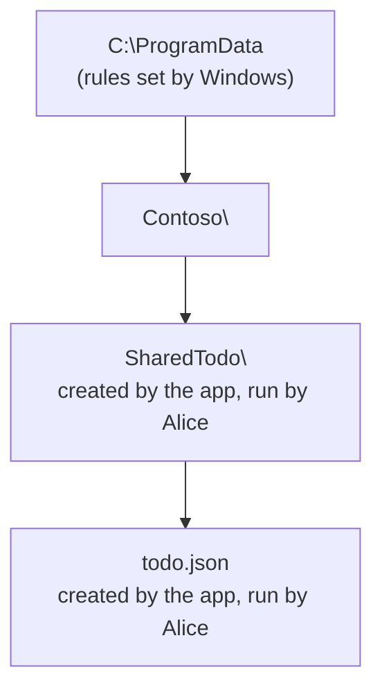
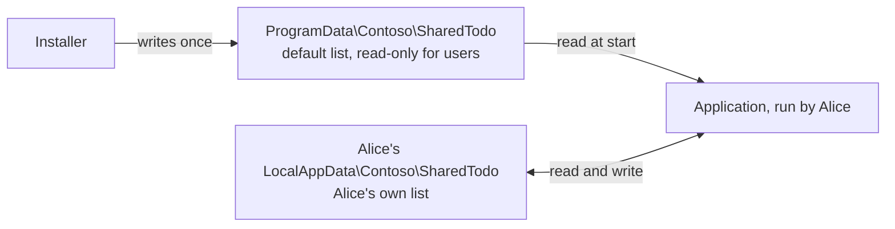

# Shared and per-user application data folders

## TL;DR

- Windows has three standard places for an application's data. **`%ProgramData%`** (`C:\ProgramData`) is one folder for the whole PC. **`%LocalAppData%`** (`…\AppData\Local`) and **`%AppData%`** (`…\AppData\Roaming`) exist once per user. In .NET, `Environment.GetFolderPath` finds all three.

- Every file and folder carries a list of **permission rules**: who may do what. A rule on a folder can be passed down to the subfolders and files created inside it.

- `ProgramData`'s rules say: every user may read everything and create new files, and whoever creates a file gets full control over it. Nobody else gets the right to change it.

- **The trap:** on a PC shared by Alice and Bob, if Alice's run of the application creates the shared file, Bob can read it but not save it.

- The fix: the application's **installer** creates the application's folder and adds one rule: *the group Users may modify everything in it*. Or a different design: shared defaults that nobody changes, and each user's changes in their own folder.

## Key claims

- <a id="c1"></a>**C1.** `%ProgramData%` (default `C:\ProgramData`) holds application data for all users of the PC. `%LocalAppData%` (default `%USERPROFILE%\AppData\Local`) holds one user's data that stays on this PC. `%AppData%` (default `%USERPROFILE%\AppData\Roaming`) holds one user's data that travels to other PCs when the network uses roaming user profiles.

- <a id="c2"></a>**C2.** In .NET, `Environment.GetFolderPath` returns them for `SpecialFolder.CommonApplicationData`, `SpecialFolder.LocalApplicationData` and `SpecialFolder.ApplicationData`. If the folder does not exist, it returns an empty string, unless it is called with `SpecialFolderOption.Create` or `SpecialFolderOption.DoNotVerify`.

- <a id="c3"></a>**C3.** A user's `AppData` folders allow access only to that user, to the operating system (SYSTEM) and to the Administrators group. Another standard user cannot read them.

- <a id="c4"></a>**C4.** The default rules of `C:\ProgramData`: SYSTEM and Administrators have full control over everything below. Users may read everything below. Users may create new files and folders in every folder below, but this rule is not passed on to files. Whoever creates a file or folder gets full control over it (the `CREATOR OWNER` rule).

- <a id="c5"></a>**C5.** So a file that a standard user creates under `ProgramData` gives full control to that user and only read access to all other users. Other standard users cannot change, delete or replace it.

- <a id="c6"></a>**C6.** To let every user change shared files, an installer, which runs with administrator rights, creates the application's folder under `ProgramData` and adds a rule: Users may modify, applied to this folder, its subfolders and its files. Every file created in the folder afterwards gets that rule, whoever creates it.

- <a id="c7"></a>**C7.** Windows identifies every account and group by a **security identifier** (SID), a fixed ID such as `S-1-5-32-545` for the built-in group Users. The group's *name* is only a label and is translated: `Users` is `Benutzer` on German Windows. Code names the group by its SID (`WellKnownSidType.BuiltinUsersSid` in .NET), which is the same on every Windows.

- <a id="c8"></a>**C8.** A folder that every user can modify must not hold anything that a program running with administrator rights trusts, such as executables, scripts or a service's configuration. Any user could change it and so gain that program's rights.

- <a id="c9"></a>**C9.** The alternative design keeps shared defaults read-only in `ProgramData`, written by the installer, and stores each user's changes in that user's `LocalAppData` or `AppData`. It needs no changed permissions. But one user's change is not seen by the others.

## Explanation

### Three folders

Where an application keeps its data depends on two questions: does it belong to one user or to the whole PC, and should it follow the user to other PCs? ([C1](#c1))

| | `%ProgramData%` | `%LocalAppData%` | `%AppData%` (Roaming) |
|---|---|---|---|
| Default path | `C:\ProgramData` | `C:\Users\<name>\AppData\Local` | `C:\Users\<name>\AppData\Roaming` |
| Belongs to | the PC | one user | one user |
| Follows the user to other PCs | no | no | yes, with roaming profiles |
| .NET `SpecialFolder` | `CommonApplicationData` | `LocalApplicationData` | `ApplicationData` |
| Typical content | data all users share | caches, logs, large data | small personal settings |
| Who can read | every user | that user ([C3](#c3)) | that user ([C3](#c3)) |
| Who can change a file | its creator, by default ([C5](#c5)) | that user | that user |

A **roaming user profile** is a feature of company networks: at logoff, Windows copies the user's `AppData\Roaming` to a server, and at the next logon, on any PC, it copies it back. `AppData\Local` is never copied, so large files belong there. On a PC without roaming profiles, the two behave the same.

By convention, an application uses a subfolder of its own in each, named `<Company>\<Product>`.

### Finding the folders in .NET

Paths differ between PCs (another drive, another user name), so an application asks Windows instead of building the path itself ([C2](#c2)):

```csharp
string shared = Environment.GetFolderPath(Environment.SpecialFolder.CommonApplicationData);
string local  = Environment.GetFolderPath(Environment.SpecialFolder.LocalApplicationData);
string roam   = Environment.GetFolderPath(Environment.SpecialFolder.ApplicationData);
```

```text
C:\ProgramData
C:\Users\alice\AppData\Local
C:\Users\alice\AppData\Roaming
```

### Who is who: accounts, groups and SIDs

Permissions are given to accounts and groups. These are the ones that matter here:

| Name | What it is |
|---|---|
| Alice, Bob | **user accounts**: one per person who logs on |
| **Users** | a **group** that every account that logs on is a member of: Alice, Bob, and administrators too |
| **Administrators** | a group of accounts with administrator rights. Its members use those rights only in programs started "as administrator", such as an installer |
| **SYSTEM** | the account Windows itself and its services run as |
| **CREATOR OWNER** | not a real account but a placeholder: "whoever creates this file or folder" |

Windows does not identify accounts and groups by name. Each has a **security identifier** (SID): a fixed ID, written like `S-1-5-32-545` ([C7](#c7)). Compare a database row with a `Guid` primary key and a `DisplayName` column: rules refer to the key, and the name is only shown to people. Built-in groups such as Users have the same SID on every Windows, while their names are translated: the German Windows shows `Benutzer`. Code that refers to the group by name breaks on a German PC. Code that uses the SID works everywhere.

### Permission rules and where they apply

Every file and folder has a list of **permission rules** (Windows calls the list an *access control list*, ACL). In C# terms, each rule is roughly a record:

```csharp
record Rule(string Who, string Rights, string AppliesTo);
```

- **Who**: an account or group.
- **Rights**, the ones this note needs: *Read*; *Modify* (read, change, delete); *Full control* (Modify, plus changing the rules themselves); and *Create files and folders*, which lets someone add new items to a folder without changing existing ones.
- **AppliesTo**: a rule on a folder can also be passed down to what is inside it. Windows shows this as "Applies to" on the *Security* tab of a folder's properties (*Advanced*). Three flags combine into these choices:

| Flags | Short for | "Applies to" in Windows |
|---|---|---|
| OI + CI | object inherit, container inherit | this folder, subfolders and files |
| CI | container inherit | this folder and subfolders |
| OI + CI + IO | … plus inherit only | subfolders and files only (not this folder) |

*Object* means file and *container* means folder. **OI** passes the rule to files, **CI** to subfolders, and **IO** says the rule does not apply to the folder it sits on, only to what is created below it.

A file or folder gets its rules **when it is created**, copied from the folder it is created in. The rules on the folders above decide what a new file can be done with.

### The example: a shared to-do list

A to-do application on a family PC keeps one list that everybody shares: `C:\ProgramData\Contoso\SharedTodo\todo.json`. Alice and Bob are two standard users. Nobody set up anything special.



**Step 1: Windows' rules on `C:\ProgramData`** ([C4](#c4)):

| Who | Rights | Applies to |
|---|---|---|
| SYSTEM | Full control | this folder, subfolders and files |
| Administrators | Full control | this folder, subfolders and files |
| CREATOR OWNER | Full control | subfolders and files only |
| Users | Read | this folder, subfolders and files |
| Users | Create files and folders | this folder and subfolders |

**Step 2: Alice starts the application first.** It creates the folders `Contoso\SharedTodo` and the file `todo.json`. Each gets the rules passed down from above. The `CREATOR OWNER` placeholder turns into Alice, because she created them.

| Who | `SharedTodo\` (folder) | `todo.json` (file) | Why |
|---|---|---|---|
| SYSTEM, Administrators | Full control | Full control | passed to everything |
| Alice | Full control | Full control | `CREATOR OWNER` became Alice |
| Users | Read | Read | passed to everything |
| Users | Create files and folders | — | passed to folders only |

**Step 3: Bob starts the application.** He is a member of Users, and nothing else on the list names him ([C5](#c5)):

| Bob tries to | Allowed? | Because of |
|---|---|---|
| read `todo.json` | yes | Users: Read |
| save `todo.json` | **no**: `UnauthorizedAccessException` | no rule lets Users change the file |
| delete it and write a new one | **no** | deleting needs a right on the file or on its folder, and Users have neither |
| create `bob.json` next to it | yes | Users: Create files and folders, on the folder |

If Bob had started the application first, it would be the other way round. Who can save depends on who happened to run the application first. On a developer's PC, where one account does everything, the problem never shows.

The defaults are a reasonable middle: every user can put files in a shared place and read everyone else's, but nobody can change what another user relies on. A file that everyone may *change* needs an explicit decision by whoever installs the application.

### The fix: one more rule, set by the installer

An **installer** is the setup program that puts the application on the PC. It runs once, with administrator rights. That is exactly what is needed to change rules on a folder in `ProgramData`.

The installer creates `C:\ProgramData\Contoso\SharedTodo` and adds one rule to it ([C6](#c6)):

| Who | Rights | Applies to |
|---|---|---|
| Users | Modify | this folder, subfolders and files |

From then on, every file created in the folder is passed this rule, whoever creates it. When Alice's run creates `todo.json`, the file allows Users to modify it, and Bob can save.

In C#, for example in a small setup tool that the installer runs, the rule is:

```csharp
using System.Security.AccessControl;
using System.Security.Principal;

string folder = Path.Combine(
    Environment.GetFolderPath(Environment.SpecialFolder.CommonApplicationData),
    "Contoso", "SharedTodo");
DirectoryInfo dir = Directory.CreateDirectory(folder);

DirectorySecurity rules = dir.GetAccessControl();
var users = new SecurityIdentifier(WellKnownSidType.BuiltinUsersSid, null);  // S-1-5-32-545
rules.AddAccessRule(new FileSystemAccessRule(
    users,                                                                  // who
    FileSystemRights.Modify,                                                // rights
    InheritanceFlags.ContainerInherit | InheritanceFlags.ObjectInherit,     // CI + OI
    PropagationFlags.None,                                                  // no IO
    AccessControlType.Allow));
dir.SetAccessControl(rules);
```

Reading it:

- `FileSystemAccessRule` is the record from above: who, rights, and where it applies.
- `ContainerInherit | ObjectInherit` with `PropagationFlags.None` is "this folder, subfolders and files".
- `SecurityIdentifier(WellKnownSidType.BuiltinUsersSid, null)` is the Users group by its SID, so the code works on a German Windows too ([C7](#c7)).
- `GetAccessControl` and `SetAccessControl` are extension methods on `DirectoryInfo` (class `FileSystemAclExtensions`). They exist only on Windows.

Why the installer and not the application? Alice's run could add the rule to the folder it created, because she has full control over it. But that runs only if her run comes first, and the folder may already exist from an older version, owned by someone else. The installer is the one program that runs with administrator rights, once, before any user.

Add the rule only to the application's own folder, never to `ProgramData` itself. And keep nothing in that folder that a program running with administrator rights trusts ([C8](#c8)).

### The other design: shared defaults plus each user's own changes

If a user's change need not reach the others, the permission question disappears ([C9](#c9)):



The application reads the shared defaults, then the user's own file, and lets the user's entries win. Saving writes only to the user's own folder, where the default rules suffice. The cost: an item Alice adds is not seen by Bob. If everyone must see everyone's changes, this design does not meet that, and the installer's rule is the simpler answer.

## Pitfalls

- **Testing with one account.** On a developer's PC, the same user creates and changes every file, and [C5](#c5) never shows. Test shared files with two standard accounts. To see a file's rules, open its properties, *Security* tab.

- **Testing as administrator.** A program started "as administrator" passes every check through the Administrators rule, and hides the problem.

- **Naming the group instead of using its SID.** A rule for `"Users"` by name fails on a German Windows, where the group is called `Benutzer` ([C7](#c7)).

- **Forgetting to pass the rule down.** A rule for Users with *Modify* that applies to "this folder only" lets Users change the folder, not the files created in it later ([C6](#c6)).

- **Two users at once.** With fast user switching, Alice and Bob can both run the application and save the same shared file. The last save wins. Write through a temporary file and `File.Replace`, and reload before merging changes.

- **Hard-coded paths.** `C:\ProgramData` and `C:\Users\<name>\AppData` are defaults, not guarantees ([C2](#c2)).

## Exercises

1. **Predict.** On a PC with default rules, Bob's run of an application creates `C:\ProgramData\Fabrikam\notes.txt`. Then Alice, also a standard user, tries to (a) read it, (b) add a line to it, (c) create `C:\ProgramData\Fabrikam\alice.txt`. Which succeed, and what can Bob do with `alice.txt`?

   <details><summary>Solution</summary>

   (a) succeeds: Users may read everything ([C4](#c4)). (b) fails: no rule lets Users change a file someone else created ([C5](#c5)). (c) succeeds: the folder `Fabrikam` was passed the rule "Users: create files and folders" ([C4](#c4)). Bob can only read `alice.txt`, because now Alice is its creator.

   </details>

2. **Explain.** A setup tool adds a rule for the group `"Users"` by name. It works on the developer's PC and fails at a customer in Germany. Why, and what is the fix?

   <details><summary>Solution</summary>

   The group's name is translated, to `Benutzer` on German Windows, so no group called `Users` exists there. Rules refer to the group's SID, `S-1-5-32-545`, which is the same everywhere. Name it in code by `WellKnownSidType.BuiltinUsersSid` ([C7](#c7)).

   </details>

3. **Choose.** Everyone on a PC should see the same shared to-do list, and anyone may add an item. Which folder, and what must the installer do? What changes if each user only needs their own list, starting from a common one?

   <details><summary>Solution</summary>

   A subfolder of `ProgramData`, to which the installer adds "Users: Modify, this folder, subfolders and files" ([C1](#c1), [C6](#c6)). For own lists from a common start: the common list read-only in `ProgramData`, each user's list in their own `LocalAppData` or `AppData`, with the default rules ([C9](#c9)).

   </details>

## Sources

- [KNOWNFOLDERID](https://learn.microsoft.com/en-us/windows/win32/shell/knownfolderid), Win32 documentation, Microsoft Learn: default paths of `FOLDERID_ProgramData`, `FOLDERID_LocalAppData` and `FOLDERID_RoamingAppData`.
- [Environment.SpecialFolder](https://learn.microsoft.com/en-us/dotnet/api/system.environment.specialfolder), [Environment.GetFolderPath](https://learn.microsoft.com/en-us/dotnet/api/system.environment.getfolderpath) and [Environment.SpecialFolderOption](https://learn.microsoft.com/en-us/dotnet/api/system.environment.specialfolderoption), .NET API reference, Microsoft Learn.
- [Deploy roaming user profiles](https://learn.microsoft.com/en-us/windows-server/storage/folder-redirection/deploy-roaming-user-profiles), Windows Server documentation, Microsoft Learn.
- [icacls](https://learn.microsoft.com/en-us/windows-server/administration/windows-commands/icacls), Windows commands reference, Microsoft Learn: the inheritance flags OI, CI and IO.
- [Well-known SIDs](https://learn.microsoft.com/en-us/windows/win32/secauthz/well-known-sids), Win32 documentation, Microsoft Learn: `S-1-5-32-545` (Users) and `S-1-3-0` (Creator Owner).
- [FileSystemAclExtensions](https://learn.microsoft.com/en-us/dotnet/api/system.io.filesystemaclextensions) and [FileSystemAccessRule](https://learn.microsoft.com/en-us/dotnet/api/system.security.accesscontrol.filesystemaccessrule), .NET API reference, Microsoft Learn.
- Raymond Chen, [How do I create a directory where people can create subdirectories but cannot mess with those created by other users?](https://devblogs.microsoft.com/oldnewthing/20160524-00/?p=93515), The Old New Thing, 24 May 2016: the `CREATOR OWNER` pattern that `ProgramData` uses.
- [Cannot load file from c:\ProgramData folder](https://learn.microsoft.com/en-us/answers/questions/1841814/cannot-load-file-from-c-programdata-folder), Microsoft Q&A: the same trap, traced to the passed-down `CREATOR OWNER` and `Users` rules.
- Aaron Margosis, [FAQ: Where do I save files, and how exactly do I do that?](https://learn.microsoft.com/en-us/archive/blogs/aaron_margosis/faq-where-do-i-save-files-and-how-exactly-do-i-do-that), Microsoft blog archive: per-user against shared content, and `ProgramData` as the successor of "All Users".
- Claude session at work, 2026-11-24. The default rules of `ProgramData` and what a new file gets were read on Windows 11 with a test folder, and the C# rule above was run there.
