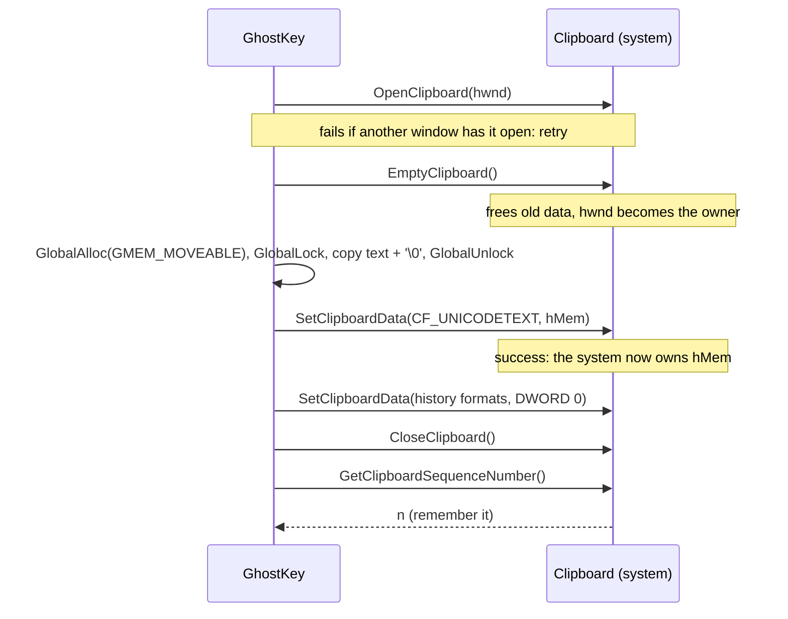
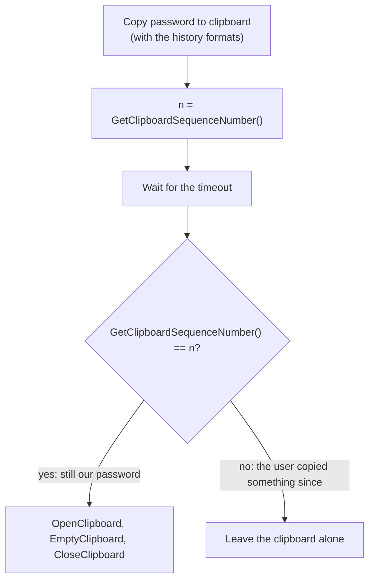

# The Win32 clipboard

## TL;DR

- The Windows clipboard is a shared, system-owned table of **formats**: one item can be on it as plain text, rich text and HTML at once. Each format is a number and a block of memory.

- To copy, a program **opens** the clipboard with a window handle, **empties** it (which makes that window the owner), puts each format on it with **`SetClipboardData`**, and **closes** it. Text goes in as `CF_UNICODETEXT`: zero-terminated UTF-16 in a block from `GlobalAlloc(GMEM_MOVEABLE)`.

- After a successful `SetClipboardData`, the memory belongs to the system. The program must not free it or write to it again.

- **`GetClipboardSequenceNumber`** changes with every change to the clipboard. A password tool remembers the number after copying, and later clears the clipboard only if the number is unchanged, so it never wipes something the user copied since.

- Three **registered formats** keep an item out of Win+V history and cloud sync: `ExcludeClipboardContentFromMonitorProcessing`, `CanIncludeInClipboardHistory` = 0 and `CanUploadToCloudClipboard` = 0. WPF's `Clipboard.SetText` sets none of them.

## Key claims

- <a id="c1"></a>**C1.** The clipboard holds one item in any number of **formats** at once. A format is identified by a number: predefined ones such as `CF_UNICODETEXT` (13), or registered ones that `RegisterClipboardFormat` returns for a name, in the range `0xC000` to `0xFFFF`. Every program that registers the same name gets the same number.

- <a id="c2"></a>**C2.** Writing to the clipboard takes four steps: `OpenClipboard(hwnd)`, `EmptyClipboard()`, one `SetClipboardData(format, hMem)` per format, `CloseClipboard()`. `EmptyClipboard` frees the previous contents and makes the window that opened the clipboard its owner.

- <a id="c3"></a>**C3.** If the clipboard was opened with a null window handle, `EmptyClipboard` sets the owner to null, and `SetClipboardData` then fails. A program without a visible window opens it with a hidden or message-only window.

- <a id="c4"></a>**C4.** `OpenClipboard` fails while another window has the clipboard open. Only one program can have it open at a time, so the open must be short and is usually retried a few times.

- <a id="c5"></a>**C5.** The data handed to `SetClipboardData` must be a memory block from `GlobalAlloc` with `GMEM_MOVEABLE`. If the call succeeds, the system owns the block: the program must not write to it or free it. If the call fails, the program still owns it and must free it.

- <a id="c6"></a>**C6.** `CF_UNICODETEXT` holds zero-terminated UTF-16 text. The system converts it on request into `CF_TEXT` and `CF_OEMTEXT` for programs that ask for 8-bit text.

- <a id="c7"></a>**C7.** `GetClipboardSequenceNumber` returns a number that the system increases whenever the clipboard's contents change or it is emptied. There is one such number per window station, which in practice means per logon session.

- <a id="c8"></a>**C8.** Placing data in the registered format `ExcludeClipboardContentFromMonitorProcessing` keeps the whole item out of clipboard history and cloud sync. `CanIncludeInClipboardHistory` with the `DWORD` 0 keeps it out of history only. `CanUploadToCloudClipboard` with the `DWORD` 0 keeps it from syncing to other devices only.

## Explanation

The snippets in this section are pieces of one console program (`net10.0-windows`, `AllowUnsafeBlocks` on), run on Windows 11 with .NET 10. The full program, with its `Native` declarations, is under [Examples](#examples). The program saved the clipboard's text first and put it back at the end.

### What the clipboard is

In WPF you write `Clipboard.SetText("…")` and think of the clipboard as holding a string. Underneath, it is a table owned by Windows. Each row is a **format** and a block of memory ([C1](#c1)). When you copy a cell in Excel, Excel puts the same cell on the clipboard as text, as RTF, as HTML and as its own format. A program that pastes picks the richest format it understands.

Predefined formats have fixed numbers: `CF_TEXT` (1) is 8-bit text, `CF_UNICODETEXT` (13) is UTF-16 text. A program can also invent a format by name with `RegisterClipboardFormat("My Format")`. Windows hands out a number from `0xC000` up, and every other program that registers the same name gets the same number. That is how unrelated programs agree on a format, and how the history formats below work.

```csharp
Console.WriteLine($"ExcludeClipboardContentFromMonitorProcessing id >= 0xC000: {Native.RegisterClipboardFormatW("ExcludeClipboardContentFromMonitorProcessing") >= 0xC000}");
Console.WriteLine($"same id twice: {Native.RegisterClipboardFormatW("CanIncludeInClipboardHistory") == Native.RegisterClipboardFormatW("CanIncludeInClipboardHistory")}");
```

```text
ExcludeClipboardContentFromMonitorProcessing id >= 0xC000: True
same id twice: True
```

### Writing: open, empty, set, close



The clipboard is a shared resource with a lock. `OpenClipboard` takes the lock, `CloseClipboard` releases it ([C2](#c2)). While you hold it, no other program can open the clipboard, so you hold it only for a few calls ([C4](#c4)). Clipboard managers and remote desktop clients open it often, so a failed `OpenClipboard` is normal: wait a few milliseconds and retry.

`EmptyClipboard` does two things. It frees whatever was on the clipboard, and it records the window that opened the clipboard as the new **owner**. The owner matters to Windows: if you open the clipboard with a null window handle, there is no owner, and `SetClipboardData` refuses to work ([C3](#c3)). A tray tool has no visible window, so it creates a hidden one. In plain Win32 that is a *message-only window* (parent `HWND_MESSAGE`). In WPF, a hidden `Window` whose handle comes from `new WindowInteropHelper(window).EnsureHandle()` does the same job.

The four steps, with the retry, and the sequence number read after closing:

```csharp
public static uint CopySecret(nint owner, ReadOnlySpan<char> secret)
{
    Open(owner);
    try
    {
        if (!Native.EmptyClipboard()) throw new Win32Exception();
        SetUnicode(secret);
        SetDword("ExcludeClipboardContentFromMonitorProcessing", 0);
        SetDword("CanIncludeInClipboardHistory", 0);
        SetDword("CanUploadToCloudClipboard", 0);
    }
    finally { Native.CloseClipboard(); }
    return Native.GetClipboardSequenceNumber();   // after closing
}

static void Open(nint owner)
{
    for (int i = 0; i < 10; i++)
    {
        if (Native.OpenClipboard(owner)) return;
        Thread.Sleep(20);               // another program has it open
    }
    throw new Win32Exception();
}
```

The program creates a message-only window as the owner, copies a password with it and reads the clipboard back:

```csharp
nint hwnd = Native.CreateWindowExW(0, "STATIC", "clip", 0, 0, 0, 0, 0, Native.HWND_MESSAGE, 0, 0, 0);

char[] password = "hunter2".ToCharArray();
uint before = Native.GetClipboardSequenceNumber();
uint mine = Clip.CopySecret(hwnd, password);
CryptographicOperations.ZeroMemory(MemoryMarshal.AsBytes(password.AsSpan()));
Console.WriteLine($"sequence: {before} -> {mine} (changed: {mine != before})");
Console.WriteLine($"reads back: {Clip.ReadText(hwnd) == "hunter2"}");
```

```text
sequence: 50 -> 58 (changed: True)
reads back: True
```

### The memory: GlobalAlloc and handing it over

`SetClipboardData` doesn't take a pointer. It takes an `HGLOBAL`, a handle to a block from `GlobalAlloc` with the flag `GMEM_MOVEABLE` ([C5](#c5)). "Movable" means Windows may move the block; you get a pointer to it only between `GlobalLock` and `GlobalUnlock`. The steps for text are:

1. `GlobalAlloc(GMEM_MOVEABLE, (length + 1) * 2)`: room for the UTF-16 characters and the terminating zero ([C6](#c6)).
2. `GlobalLock` to get a pointer, copy the characters, write the zero, `GlobalUnlock`.
3. `SetClipboardData(CF_UNICODETEXT, h)`.

From step 3 on, the block belongs to Windows. This is an **ownership transfer**, like passing a `Stream` to a constructor that takes ownership and disposes it: after the call, disposing it yourself would be a bug. So the handle must not sit in a `SafeHandle` that frees it later. If the call fails, ownership never moved, and freeing the block is your job again.

```csharp
static unsafe void SetUnicode(ReadOnlySpan<char> text)
{
    nuint bytes = (nuint)((text.Length + 1) * sizeof(char));
    nint h = Native.GlobalAlloc(GMEM_MOVEABLE, bytes);
    if (h == 0) throw new Win32Exception();
    char* p = (char*)Native.GlobalLock(h);
    var dest = new Span<char>(p, text.Length + 1);
    text.CopyTo(dest);
    dest[text.Length] = '\0';
    Native.GlobalUnlock(h);
    if (Native.SetClipboardData(CF_UNICODETEXT, h) == 0)
    {
        int err = Marshal.GetLastPInvokeError();
        p = (char*)Native.GlobalLock(h);
        new Span<byte>(p, (int)bytes).Clear();
        Native.GlobalUnlock(h);
        Native.GlobalFree(h);           // still ours: the call failed
        throw new Win32Exception(err);
    }
    // Success: the system owns h now. Never free or lock it again.
}
```

Once the item is on the clipboard, every program in your session can read it. Text you put there is a plain copy outside your process, and only emptying the clipboard removes it.

### Clearing after a timeout, without wiping the user's copy

A password tool clears the clipboard after, say, 30 seconds. But it must not clear it if the user has copied something else in the meantime: that would destroy the user's data.

The **sequence number** solves this ([C7](#c7)). Windows increases it at every change. Right after `CloseClipboard`, the tool reads it and keeps it. When the timer fires, it reads it again:



Read the number *after* closing the clipboard. Each `EmptyClipboard` and `SetClipboardData` changes it, so a number read earlier would never match. In the run above it went from 50 to 58: the empty and each of the four `SetClipboardData` calls count as changes. Only "changed or not" is meaningful, never the size of the step.

The number is a check, not a notification: to learn about changes as they happen, a program registers with `AddClipboardFormatListener` and handles `WM_CLIPBOARDUPDATE`. For a single expiry check, the number is enough.

```csharp
public static bool ClearIfUnchanged(nint owner, uint sequence)
{
    if (Native.GetClipboardSequenceNumber() != sequence) return false;
    Open(owner);
    try { return Native.EmptyClipboard(); }
    finally { Native.CloseClipboard(); }
}
```

The program clears its own copy, then copies a second secret and lets "the user" copy something over it before the timer:

```csharp
Console.WriteLine($"clear if unchanged: {Clip.ClearIfUnchanged(hwnd, mine)}");
Console.WriteLine($"empty now: {Clip.ReadText(hwnd) is null}");

uint mine2 = Clip.CopySecret(hwnd, "x".ToCharArray());
Clip.SetText(hwnd, "user copied this");
Console.WriteLine($"clear after user copied: {Clip.ClearIfUnchanged(hwnd, mine2)}");
```

```text
clear if unchanged: True
empty now: True
clear after user copied: False
```

### Keeping a password out of Win+V history and cloud sync

Windows 10 and 11 keep a **clipboard history** (Win+V) and can **sync** the clipboard to your other devices. Both are clipboard monitors: they see every item put on the clipboard. A password would land in the history and stay there long after you cleared the clipboard.

Windows defines three registered formats that tell these monitors to ignore an item ([C8](#c8)). Each is put on the clipboard in the same open–set–close session as the text, as an extra format. `CopySecret` above does this with its three `SetDword` calls:

| Format name | Data | Effect |
|---|---|---|
| `ExcludeClipboardContentFromMonitorProcessing` | any (a `DWORD` 0 is usual) | not in history, not synced |
| `CanIncludeInClipboardHistory` | `DWORD` 0 | not in history (sync unaffected) |
| `CanUploadToCloudClipboard` | `DWORD` 0 | not synced (history unaffected) |

```csharp
static unsafe void SetDword(string format, uint value)
{
    uint id = Native.RegisterClipboardFormatW(format);
    nint h = Native.GlobalAlloc(GMEM_MOVEABLE, sizeof(uint));
    *(uint*)Native.GlobalLock(h) = value;
    Native.GlobalUnlock(h);
    if (Native.SetClipboardData(id, h) == 0) { Native.GlobalFree(h); throw new Win32Exception(); }
}
```

Setting all three is the safe choice: the first already covers both, and the other two cover a monitor that only knows one of them. They are a request, not a lock. Windows' own history and sync honour them; a third-party clipboard manager may not. And the item is still readable by any program in your session while it is on the clipboard, which is why the timeout matters as much.

WPF's `Clipboard.SetText` and Windows Forms' `Clipboard.SetText` put only the text on the clipboard, so their copies do land in the history. That is one reason a password tool calls the Win32 functions itself.

The history formats can only be checked by hand: with clipboard history turned on, copy with `CopySecret`, press Win+V, and the password should be missing; copy with `Clipboard.SetText`, and it appears. This check was not run for this note.

## Examples

The snippets above sit right after the sections they illustrate. Together they form this program; it is collapsed because it only adds the declarations and the code that saves and restores the clipboard.

<details><summary>The full program</summary>

```csharp
using System.ComponentModel;
using System.Runtime.InteropServices;
using System.Security.Cryptography;

// --- save current text so the test can restore it
string? saved = Clip.ReadText(0);

nint hwnd = Native.CreateWindowExW(0, "STATIC", "clip", 0, 0, 0, 0, 0, Native.HWND_MESSAGE, 0, 0, 0);

char[] password = "hunter2".ToCharArray();
uint before = Native.GetClipboardSequenceNumber();
uint mine = Clip.CopySecret(hwnd, password);
CryptographicOperations.ZeroMemory(MemoryMarshal.AsBytes(password.AsSpan()));
Console.WriteLine($"sequence: {before} -> {mine} (changed: {mine != before})");
Console.WriteLine($"reads back: {Clip.ReadText(hwnd) == "hunter2"}");
Console.WriteLine($"ExcludeClipboardContentFromMonitorProcessing id >= 0xC000: {Native.RegisterClipboardFormatW("ExcludeClipboardContentFromMonitorProcessing") >= 0xC000}");
Console.WriteLine($"same id twice: {Native.RegisterClipboardFormatW("CanIncludeInClipboardHistory") == Native.RegisterClipboardFormatW("CanIncludeInClipboardHistory")}");

// expiry: clear only if nobody changed the clipboard since
Console.WriteLine($"clear if unchanged: {Clip.ClearIfUnchanged(hwnd, mine)}");
Console.WriteLine($"empty now: {Clip.ReadText(hwnd) is null}");

// someone else copies -> do not clear
uint mine2 = Clip.CopySecret(hwnd, "x".ToCharArray());
Clip.SetText(hwnd, "user copied this");
Console.WriteLine($"clear after user copied: {Clip.ClearIfUnchanged(hwnd, mine2)}");

// restore
if (saved is not null) Clip.SetText(hwnd, saved); else Clip.ClearIfUnchanged(hwnd, Native.GetClipboardSequenceNumber());
Native.DestroyWindow(hwnd);

static class Clip
{
    const uint CF_UNICODETEXT = 13, GMEM_MOVEABLE = 0x0002;

    public static uint CopySecret(nint owner, ReadOnlySpan<char> secret)
    {
        Open(owner);
        try
        {
            if (!Native.EmptyClipboard()) throw new Win32Exception();
            SetUnicode(secret);
            SetDword("ExcludeClipboardContentFromMonitorProcessing", 0);
            SetDword("CanIncludeInClipboardHistory", 0);
            SetDword("CanUploadToCloudClipboard", 0);
        }
        finally { Native.CloseClipboard(); }
        return Native.GetClipboardSequenceNumber();
    }

    public static void SetText(nint owner, string text)
    {
        Open(owner);
        try { Native.EmptyClipboard(); SetUnicode(text); }
        finally { Native.CloseClipboard(); }
    }

    public static bool ClearIfUnchanged(nint owner, uint sequence)
    {
        if (Native.GetClipboardSequenceNumber() != sequence) return false;
        Open(owner);
        try { return Native.EmptyClipboard(); }
        finally { Native.CloseClipboard(); }
    }

    static unsafe void SetUnicode(ReadOnlySpan<char> text)
    {
        nuint bytes = (nuint)((text.Length + 1) * sizeof(char));
        nint h = Native.GlobalAlloc(GMEM_MOVEABLE, bytes);
        if (h == 0) throw new Win32Exception();
        char* p = (char*)Native.GlobalLock(h);
        var dest = new Span<char>(p, text.Length + 1);
        text.CopyTo(dest);
        dest[text.Length] = '\0';
        Native.GlobalUnlock(h);
        if (Native.SetClipboardData(CF_UNICODETEXT, h) == 0)
        {
            int err = Marshal.GetLastPInvokeError();
            p = (char*)Native.GlobalLock(h);
            new Span<byte>(p, (int)bytes).Clear();
            Native.GlobalUnlock(h);
            Native.GlobalFree(h);          // still ours: the call failed
            throw new Win32Exception(err);
        }
        // success: the system owns h now, never free or lock it again
    }

    static unsafe void SetDword(string format, uint value)
    {
        uint id = Native.RegisterClipboardFormatW(format);
        nint h = Native.GlobalAlloc(GMEM_MOVEABLE, sizeof(uint));
        *(uint*)Native.GlobalLock(h) = value;
        Native.GlobalUnlock(h);
        if (Native.SetClipboardData(id, h) == 0) { Native.GlobalFree(h); throw new Win32Exception(); }
    }

    static void Open(nint owner)
    {
        for (int i = 0; i < 10; i++)
        {
            if (Native.OpenClipboard(owner)) return;
            Thread.Sleep(20);   // another program has it open
        }
        throw new Win32Exception();
    }

    public static unsafe string? ReadText(nint owner)
    {
        Open(owner);
        try
        {
            nint h = Native.GetClipboardData(CF_UNICODETEXT);
            if (h == 0) return null;
            char* p = (char*)Native.GlobalLock(h);
            try { return new string(p); } finally { Native.GlobalUnlock(h); }
        }
        finally { Native.CloseClipboard(); }
    }
}

static partial class Native
{
    public static readonly nint HWND_MESSAGE = -3;
    [LibraryImport("user32.dll", SetLastError = true)] [return: MarshalAs(UnmanagedType.Bool)] public static partial bool OpenClipboard(nint owner);
    [LibraryImport("user32.dll", SetLastError = true)] [return: MarshalAs(UnmanagedType.Bool)] public static partial bool CloseClipboard();
    [LibraryImport("user32.dll", SetLastError = true)] [return: MarshalAs(UnmanagedType.Bool)] public static partial bool EmptyClipboard();
    [LibraryImport("user32.dll", SetLastError = true)] public static partial nint SetClipboardData(uint format, nint mem);
    [LibraryImport("user32.dll", SetLastError = true)] public static partial nint GetClipboardData(uint format);
    [LibraryImport("user32.dll")] public static partial uint GetClipboardSequenceNumber();
    [LibraryImport("user32.dll", SetLastError = true, StringMarshalling = StringMarshalling.Utf16)] public static partial uint RegisterClipboardFormatW(string name);
    [LibraryImport("kernel32.dll", SetLastError = true)] public static partial nint GlobalAlloc(uint flags, nuint bytes);
    [LibraryImport("kernel32.dll")] public static partial nint GlobalLock(nint mem);
    [LibraryImport("kernel32.dll")] [return: MarshalAs(UnmanagedType.Bool)] public static partial bool GlobalUnlock(nint mem);
    [LibraryImport("kernel32.dll")] public static partial nint GlobalFree(nint mem);
    [LibraryImport("user32.dll", SetLastError = true, StringMarshalling = StringMarshalling.Utf16)]
    public static partial nint CreateWindowExW(uint ex, string cls, string name, uint style, int x, int y, int w, int h, nint parent, nint menu, nint inst, nint param);
    [LibraryImport("user32.dll")] [return: MarshalAs(UnmanagedType.Bool)] public static partial bool DestroyWindow(nint hwnd);
}
```

</details>

## Good habits

- Open the clipboard with a window handle, even a hidden one ([C3](#c3); Microsoft Learn, `OpenClipboard`).

- Keep the clipboard open only for the calls that need it, and retry a failed open briefly ([C4](#c4); Microsoft Learn, *Using the Clipboard*).

- Free the `GlobalAlloc` block yourself only when `SetClipboardData` failed ([C5](#c5); Microsoft Learn, `SetClipboardData`).

- Put secrets on the clipboard with the three history and cloud formats, and clear them after a timeout only if the sequence number is unchanged ([C7](#c7), [C8](#c8); Microsoft Learn, *Clipboard Formats*).

## Pitfalls

- **`OpenClipboard(IntPtr.Zero)` in a tray app.** It succeeds, `EmptyClipboard` succeeds, and then `SetClipboardData` fails ([C3](#c3)).

- **Freeing the block after a successful `SetClipboardData`**, for example by wrapping it in a `SafeHandle` that frees it on dispose. The clipboard then holds freed memory ([C5](#c5)).

- **Forgetting the terminating zero.** Pasting programs read until the zero and may pick up garbage after the text ([C6](#c6)).

- **Using `Marshal.AllocHGlobal` for the clipboard.** That memory comes from `LocalAlloc` and is fixed, not a movable global block ([C5](#c5)).

- **Clearing on a timer without the sequence check.** It deletes whatever the user copied in the meantime ([C7](#c7)).

- **Reading the sequence number before `CloseClipboard`.** Later changes in the same session raise it, so the expiry check never matches ([C7](#c7)).

- **Believing the history formats hide the password.** They keep it out of Win+V and sync. Any program in the session can still read the clipboard while the password is on it ([C8](#c8)).

## Exercises

1. **Predict.** GhostKey copies a password at sequence number 120 (read after closing). Twenty seconds later the user copies a URL. At thirty seconds the expiry timer fires. What does GhostKey do, and why?

   <details><summary>Solution</summary>

   Nothing. The user's copy raised the sequence number, so it no longer equals 120, and GhostKey leaves the URL on the clipboard ([C7](#c7)). The password is already gone, since the user's copy replaced it.

   </details>

2. **Explain.** Why must the `HGLOBAL` passed to `SetClipboardData` not live in a `SafeHandle` that frees it on dispose?

   <details><summary>Solution</summary>

   After a successful call the system owns the block ([C5](#c5)). A `SafeHandle` would free it a second time, and the clipboard would point at freed memory. If the call fails, the program still owns the block, so that is the only case to free it.

   </details>

3. **Interpret.** A colleague's tool puts the password on the clipboard with `CanIncludeInClipboardHistory` = 0 only. Where can the password still end up?

   <details><summary>Solution</summary>

   On the user's other devices, through cloud clipboard sync: that format affects history only ([C8](#c8)). And with any program in the session that reads the clipboard while the password is on it.

   </details>

## Sources

- Microsoft Learn, [Using the Clipboard](https://learn.microsoft.com/en-us/windows/win32/dataxchg/using-the-clipboard): the copy sequence, the sequence number as a check rather than a notification.
- Microsoft Learn, [Clipboard Formats](https://learn.microsoft.com/en-us/windows/win32/dataxchg/clipboard-formats): standard, registered and synthesised formats, and the section *Cloud Clipboard and Clipboard History Formats*.
- Microsoft Learn, [`OpenClipboard`](https://learn.microsoft.com/en-us/windows/win32/api/winuser/nf-winuser-openclipboard), [`EmptyClipboard`](https://learn.microsoft.com/en-us/windows/win32/api/winuser/nf-winuser-emptyclipboard), [`SetClipboardData`](https://learn.microsoft.com/en-us/windows/win32/api/winuser/nf-winuser-setclipboarddata), [`GetClipboardSequenceNumber`](https://learn.microsoft.com/en-us/windows/win32/api/winuser/nf-winuser-getclipboardsequencenumber), [`RegisterClipboardFormatW`](https://learn.microsoft.com/en-us/windows/win32/api/winuser/nf-winuser-registerclipboardformatw).
- Microsoft Learn, [Message-only windows](https://learn.microsoft.com/en-us/windows/win32/winmsg/window-features#message-only-windows).
- Claude session on GhostKey, 2026-11-18: the snippet was run there with .NET 10.
