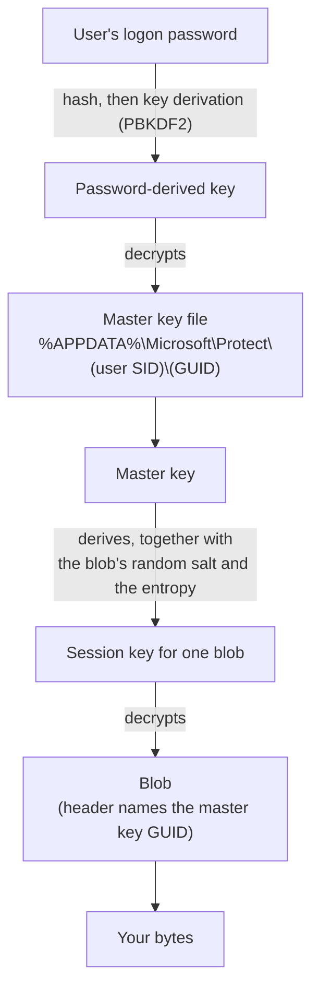

# DPAPI and ProtectedData

## TL;DR

- **DPAPI** (the Windows Data Protection API) encrypts a byte array with a key that Windows manages for you. In .NET you call `ProtectedData.Protect(bytes, entropy, scope)` and get back an opaque **blob**. `ProtectedData.Unprotect` turns the blob back into the bytes.

- You never see or store a key. With `DataProtectionScope.CurrentUser`, the key belongs to your Windows account and is itself protected by your logon password. With `LocalMachine`, it belongs to the computer, and every user and process on it can decrypt.

- **Optional entropy** is an extra byte array that must be passed again to decrypt. It keeps other programs from decrypting your blob by accident. It is not a password: anything stored next to the blob, an attacker reads too.

- DPAPI protects a stolen disk or backup, and data of one Windows user against another. It does **not** protect against malware running as you: such a program calls `Unprotect` exactly as your app does.

- Think of it as a `using`-free, keyless `Aes`: Windows holds the key ring, the blob says which key it needs.

## Key claims

- <a id="c1"></a>**C1.** `ProtectedData.Protect(userData, optionalEntropy, scope)` encrypts a `byte[]` and returns a blob. `ProtectedData.Unprotect(blob, optionalEntropy, scope)` decrypts it. The caller never handles a key. `ProtectedData` works only on Windows; elsewhere it throws `PlatformNotSupportedException`.

- <a id="c2"></a>**C2.** With `DataProtectionScope.CurrentUser`, only the same Windows user can decrypt the blob. With `DataProtectionScope.LocalMachine`, any user and any process on the same computer can decrypt it.

- <a id="c3"></a>**C3.** The user's data is encrypted under a **master key**, which is stored encrypted in the user's profile, in `%APPDATA%\Microsoft\Protect\<user SID>\`. The master key is encrypted with a key derived from the user's logon password. The blob records the GUID of the master key it was made with, so `Unprotect` knows which one to load.

- <a id="c4"></a>**C4.** A new master key is made about every three months. Old master keys are never deleted, so old blobs stay readable. When the user changes the password, Windows re-encrypts all master keys under the new password.

- <a id="c5"></a>**C5.** If an administrator *resets* a local account's password (instead of the user changing it), the master keys can no longer be decrypted, and data protected with `CurrentUser` is lost. In a domain, a backup key held by the domain controllers recovers the master keys.

- <a id="c6"></a>**C6.** Optional entropy must be passed unchanged to `Unprotect`, or decryption fails with a `CryptographicException`. It separates one application's blobs from another's. It adds no strength against an attacker who can read the entropy, for example from the application's binary.

- <a id="c7"></a>**C7.** DPAPI protects against reading the blob without the user's logon: a stolen disk, a copied backup, another Windows user on the same machine. It does not protect against code running as the same user, which can call `Unprotect` itself, nor against an administrator of the running machine.

- <a id="c8"></a>**C8.** With a roaming profile, the master keys roam with `%APPDATA%`, so a user can decrypt `CurrentUser` blobs on another computer of the same network. Without a roaming profile, a blob decrypts only on the computer where it was made.

## Explanation

### The problem: where do you keep the key?

A password store has to keep passwords on disk. Encrypting them with `Aes` is easy. The hard part is the key. Hard-code it in the binary, and anyone with the binary has it. Store it in a file next to the data, and anyone who copies the folder has both. Ask the user for a master password at every start, and the tool is no longer convenient.

DPAPI answers this with a key the user already has: their Windows logon. You hand bytes to Windows and get back a blob. Windows picks the key, encrypts, and later decrypts, as long as the same user is logged on ([C1](#c1)). There is no key in your code or on your disk.

### The API

```csharp
byte[] blob = ProtectedData.Protect(secret, entropy, DataProtectionScope.CurrentUser);
byte[] back = ProtectedData.Unprotect(blob, entropy, DataProtectionScope.CurrentUser);
```

`ProtectedData` is in the assembly `System.Security.Cryptography.ProtectedData`. A WPF or Windows Forms project (`net10.0-windows` with `UseWPF`) already references it through the Windows Desktop framework. A plain console project needs the NuGet package of the same name. On Linux or macOS the calls throw `PlatformNotSupportedException` ([C1](#c1)), because DPAPI is a Windows service.

Under the hood, `Protect` calls the Win32 function `CryptProtectData` in `crypt32.dll`, and `Unprotect` calls `CryptUnprotectData`.

### The two scopes

The **scope** says who may decrypt ([C2](#c2)):

| Scope | Key belongs to | Who can `Unprotect` |
|---|---|---|
| `CurrentUser` | the Windows user account | the same user, on this computer (or on any computer, with a roaming profile, [C8](#c8)) |
| `LocalMachine` | the computer | every user and every process on this computer |

`LocalMachine` sounds safer than it is. It ties the blob to the machine, so a copied file is useless elsewhere. But on the machine itself it protects nothing from other users. Microsoft's own DPAPI paper advises against it for user data on workstations. It suits a service that has no interactive user. For a password tool, `CurrentUser` is the right choice.

### The key hierarchy

Windows does not encrypt your data with the password directly. There are layers ([C3](#c3)):



1. Your **logon password** is hashed and run through a key derivation function. The result is a key that is never stored.
2. That key decrypts a **master key**, a random secret stored encrypted in a file in your profile. The file name is a GUID.
3. Each `Protect` call derives a fresh **session key** from the master key, a random salt and the optional entropy, and encrypts the data with it. The salt makes two blobs of the same data different.
4. The **blob** stores the salt and the GUID of the master key. So `Unprotect` knows which master-key file to open.

Why the middle layer? Because passwords change. If the data were encrypted with a key from the password, a password change would mean re-encrypting every blob on the disk, which Windows can't find. With a master key in between, a password change re-encrypts only the few master-key files ([C4](#c4)).

### Master keys rotate, and are kept

About every three months, DPAPI makes a new master key and uses it for new blobs ([C4](#c4)). It never deletes the old ones, because blobs made with them may still exist anywhere on the disk. On a typical machine the `Protect` folder holds several GUID-named files and a file called `Preferred`, which names the current one.

A password change by the user is harmless: Windows knows the old password at that moment, decrypts every master key and encrypts it again under the new one.

A password **reset** by an administrator is different ([C5](#c5)). Windows doesn't know the old password then, so it can't decrypt the master keys. On a standalone machine the user's DPAPI data is lost: saved browser passwords, Wi-Fi keys stored per user, and a password tool's store alike. Windows warns about exactly this when an administrator sets another user's password. In a domain, the domain controllers keep a backup key that can decrypt each user's master keys, so a reset there loses nothing.

### What entropy is for

Every program running as you can call `Unprotect` on any `CurrentUser` blob it finds. Entropy is a second input that must match ([C6](#c6)). If GhostKey protects with the entropy `"GhostKey v1"`, a program that finds the blob but doesn't know that string can't decrypt it.

That is a guard against *accidents and lazy attackers*, not a secret. The string is in GhostKey's binary. A determined attacker who runs as you reads it out and calls `Unprotect` with it. Entropy only becomes a real secret if it comes from outside, for example a PIN the user types.

### What DPAPI protects, and what not

This is the part to get right before relying on it ([C7](#c7)):

| Attacker | Protected? | Why |
|---|---|---|
| Steals the laptop's disk, or a backup | yes | needs the user's password to decrypt the master key |
| Another user on the same PC | yes, with `CurrentUser` | can't decrypt your master key |
| Malware running as you | **no** | calls `Unprotect` like your app does |
| An administrator of the running machine | **no** | can run code as you, or read keys from memory |

A weak logon password weakens the first row: with the disk in hand, an attacker can guess passwords offline against the master-key file.

The third row is the honest limit of every password tool that runs without a separate master password. DPAPI moves the question "who can read my passwords?" to "who can run code as me?". For a tool on your own machine, that is usually the right trade.

### Roaming profiles

The master keys live in `%APPDATA%`, the roaming part of the profile. In a network with roaming profiles they follow the user, so a blob made on one PC decrypts on another ([C8](#c8)). Without roaming, a blob copied to a new PC is unreadable, even for the same user. Plan for that when you migrate: export the secrets in clear text on the old machine (carefully) and protect them again on the new one.

## Examples

### Protect, unprotect, and wrong entropy

```csharp
using System.Security.Cryptography;
using System.Text;

byte[] secret = Encoding.UTF8.GetBytes("hunter2");
byte[] entropy = Encoding.UTF8.GetBytes("GhostKey v1");

byte[] blob = ProtectedData.Protect(secret, entropy, DataProtectionScope.CurrentUser);
Console.WriteLine($"secret: {secret.Length} bytes, blob: {blob.Length} bytes");

byte[] back = ProtectedData.Unprotect(blob, entropy, DataProtectionScope.CurrentUser);
Console.WriteLine(Encoding.UTF8.GetString(back));

byte[] blob2 = ProtectedData.Protect(secret, entropy, DataProtectionScope.CurrentUser);
Console.WriteLine($"same blob twice: {blob.AsSpan().SequenceEqual(blob2)}");

try
{
    ProtectedData.Unprotect(blob, Encoding.UTF8.GetBytes("wrong"), DataProtectionScope.CurrentUser);
}
catch (CryptographicException e)
{
    Console.WriteLine($"wrong entropy: {e.GetType().Name}");
}

// Overwrite the plain bytes once they are no longer needed.
CryptographicOperations.ZeroMemory(secret);
CryptographicOperations.ZeroMemory(back);
```

Expected output (on Windows 11, .NET 10):

```text
secret: 7 bytes, blob: 230 bytes
hunter2
same blob twice: False
wrong entropy: CryptographicException
```

- The blob is much larger than the data: it carries a header, the salt, the master-key GUID and an integrity check (a MAC).
- Two blobs of the same data differ, because each gets a fresh salt ([C3](#c3)).
- Wrong entropy fails loudly instead of returning garbage ([C6](#c6)).

The snippet starts from a `string` to stay short. A real password tool avoids holding a password in a `string` at all, because a `string` can't be overwritten.

### The blob names its master key

The blob's header holds, at byte offset 24, the GUID of the master key it was made with ([C3](#c3)):

```csharp
Console.WriteLine(new Guid(blob.AsSpan(24, 16)));
```

On the machine where this note was checked, that printed `9e24ca40-19fe-4673-9450-e8daca27f33a`, and a file of exactly that name sat in `%APPDATA%\Microsoft\Protect\<SID>\` next to three older master keys and the `Preferred` file. The header layout is not a documented contract: read it to understand DPAPI, never to build on it.

## Good habits

- Use `DataProtectionScope.CurrentUser` for a user's secrets; `LocalMachine` lets every account on the PC decrypt them ([C2](#c2); Microsoft, *Windows Data Protection*).

- Pass a fixed, application-specific entropy, so other programs can't decrypt your blobs by accident, and don't count it as a secret ([C6](#c6); Microsoft, *Windows Data Protection*).

- Zero plain-text byte arrays with `CryptographicOperations.ZeroMemory` as soon as they are no longer needed ([C7](#c7); .NET documentation of `CryptographicOperations.ZeroMemory`).

## Pitfalls

- **Thinking DPAPI stops malware.** It doesn't. Any program running as you can decrypt your `CurrentUser` blobs ([C7](#c7)). It protects data at rest, not against your own account.

- **Thinking `LocalMachine` is stronger.** It is weaker: it binds the blob to the machine, but opens it to every user on it ([C2](#c2)).

- **Treating entropy as a password.** A string compiled into the app is readable by anyone who has the app ([C6](#c6)).

- **Copying the store to a new PC.** Without a roaming profile, the blobs don't decrypt there, even for the same user name ([C8](#c8)). Migrate by decrypting on the old machine and protecting again on the new one.

- **Resetting a forgotten password as administrator.** It makes the user's DPAPI data unrecoverable on a standalone machine ([C5](#c5)). A password reset disk or the user's own change keeps it.

- **Confusing it with ASP.NET Core Data Protection.** `IDataProtector` in ASP.NET Core is a different API with its own key ring in files or a database. It is not DPAPI, though it can use DPAPI to protect its keys on Windows.

- **Naming your own project `dpapi`.** While checking this note, a test project called `dpapi` failed with "The specified procedure could not be found". Its own `dpapi.dll` sat in the application folder, and Windows loaded it in place of the system's `dpapi.dll`, which `crypt32.dll` loads to do the work. Renaming the project fixed it.

## Exercises

1. **Explain.** Why does DPAPI encrypt your data under a master key instead of a key derived straight from your password?

   <details><summary>Solution</summary>

   Because the password changes. With a key straight from the password, every blob anywhere on the disk would have to be re-encrypted at each password change, and Windows can't find them all. With a master key in between, a password change re-encrypts only the master-key files, and the blobs stay valid ([C3](#c3), [C4](#c4)).

   </details>

2. **Predict.** GhostKey protects its store with `CurrentUser` and the entropy `"GhostKey v1"`. Which of these can read the passwords: (a) a thief with the laptop's SSD, (b) your colleague logged on to the same PC under their own account, (c) a malicious browser extension's native helper running as you, (d) you, after an IT administrator reset your forgotten local password?

   <details><summary>Solution</summary>

   (a) No: they need your logon password to decrypt the master key ([C7](#c7)), unless they can guess a weak one. (b) No: `CurrentUser` keys belong to your account ([C2](#c2)). (c) Yes: it runs as you, can read the entropy from GhostKey's binary and call `Unprotect` ([C6](#c6), [C7](#c7)). (d) No: an administrator reset leaves the master keys encrypted under the old password, so the store is lost on a standalone machine ([C5](#c5)).

   </details>

3. **Explain.** Your new PC has the same user name, and you copied GhostKey's store file over. Why does `Unprotect` throw, and what should the migration do instead?

   <details><summary>Solution</summary>

   The blob names a master key by GUID ([C3](#c3)). That master key lives in the old PC's profile, and without a roaming profile it was never copied ([C8](#c8)). The migration decrypts on the old PC, carries the secrets over safely, and protects them again on the new one.

   </details>

## Sources

- Microsoft Learn, [`ProtectedData` class](https://learn.microsoft.com/en-us/dotnet/api/system.security.cryptography.protecteddata): the API, Windows-only, the note on loaded profiles.
- Microsoft Learn, [How to: Use Data Protection](https://learn.microsoft.com/en-us/dotnet/standard/security/how-to-use-data-protection): the scopes, with a sample.
- Microsoft Learn, [`CryptProtectData` function](https://learn.microsoft.com/en-us/windows/win32/api/dpapi/nf-dpapi-cryptprotectdata): the Win32 function underneath, `CRYPTPROTECT_LOCAL_MACHINE`, roaming profiles.
- Microsoft (NAI Labs), [*Windows Data Protection*](https://learn.microsoft.com/en-us/previous-versions/ms995355(v=msdn.10)), 2001: the key hierarchy, master-key rotation and expiry, password changes, the domain backup key, the advice against the machine scope on workstations. It describes the Windows XP algorithms; current Windows uses stronger ones, but the structure is the same.
- Microsoft Learn, [`CryptographicOperations.ZeroMemory`](https://learn.microsoft.com/en-us/dotnet/api/system.security.cryptography.cryptographicoperations.zeromemory).
- Claude session on GhostKey, 2026-11-18: the snippets were run there on Windows 11 with .NET 10.
