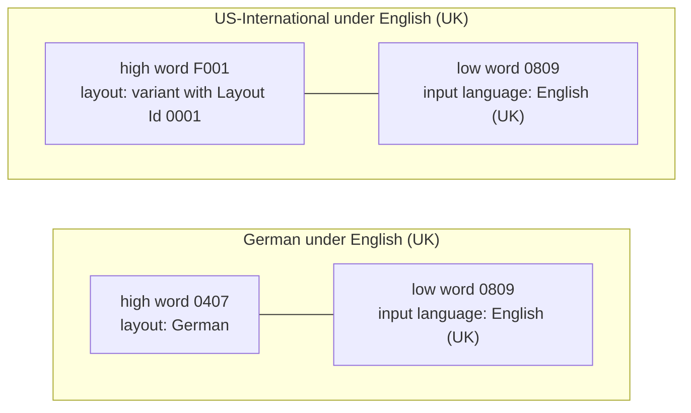
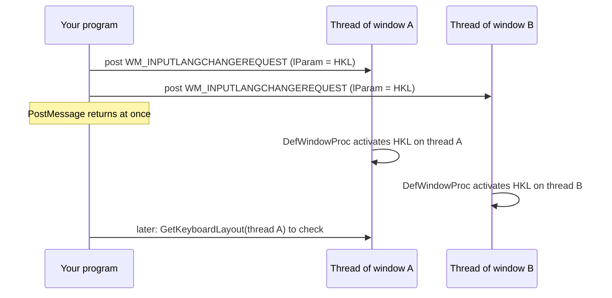

# Windows keyboard layouts, KLIDs and HKLs

## TL;DR

- Windows names a keyboard layout in two ways. A **KLID** (keyboard layout ID) is an eight-digit hex string that names the layout itself: `00000407` is German, `00020409` is US-International. An **HKL** is a runtime handle for one layout *paired with one input language*: US-International under English (UK) is a different HKL from US-International under English (US).

- The user's list of layouts lives under `HKCU\Keyboard Layout\Preload`, with `Substitutes` mapping a placeholder to the real KLID. Settings also offers an **override for the default input method**, which decides the layout a new sign-in starts with.

- The active layout belongs to a **thread**, not to the machine. `GetKeyboardLayout` reads it for one thread. To switch every window, post `WM_INPUTLANGCHANGEREQUEST` to `HWND_BROADCAST`: each window's thread switches itself, the way Win+Space does it.

- `LoadKeyboardLayout` loads a layout into the system even if the user never installed it. To switch to a layout without adding one, find it among the installed ones: `GetKeyboardLayoutList` or `InputLanguage.InstalledInputLanguages`, then compare KLIDs with `GetKeyboardLayoutName`.

## Key claims

- <a id="c1"></a>**C1.** A KLID is an eight-hex-digit string that identifies a keyboard layout independently of any input language: `00000407` is German, `00000409` is US, `00020409` is US-International. Its low four digits are the language the layout was made for; the high four digits number variants of it.

- <a id="c2"></a>**C2.** An HKL (input locale identifier) is a handle whose low word is the input language and whose high word identifies the physical layout. The same layout under two input languages has two different HKLs: German under English (UK) is `0x04070809`, German under German is `0x04070407`.

- <a id="c3"></a>**C3.** For a layout variant such as US-International, the HKL's high word is not the KLID's low word but `0xF000` plus the variant's `Layout Id` from `HKLM\SYSTEM\CurrentControlSet\Control\Keyboard Layouts\<KLID>`. US-International (`Layout Id` `0001`) under English (UK) is the HKL `0xF0010809`.

- <a id="c4"></a>**C4.** `HKCU\Keyboard Layout\Preload` lists the user's layouts in order as values `1`, `2`, …. Where a value isn't the KLID itself, `HKCU\Keyboard Layout\Substitutes` maps it to the KLID that is actually loaded.

- <a id="c5"></a>**C5.** The keyboard layout is state of a thread. `GetKeyboardLayout(threadId)` returns the HKL active on that thread; with 0 it returns the calling thread's. The thread behind a window comes from `GetWindowThreadProcessId(hwnd, out pid)`.

- <a id="c6"></a>**C6.** `GetKeyboardLayoutName` takes no HKL: it returns the KLID of the calling thread's active layout. To learn the KLID of another installed HKL, a program activates that HKL on its own thread (`ActivateKeyboardLayout`) and then calls `GetKeyboardLayoutName`.

- <a id="c7"></a>**C7.** Posting `WM_INPUTLANGCHANGEREQUEST` with the HKL in `lParam` asks a window to switch. A window accepts by passing the message on to `DefWindowProc`, which activates the layout on that window's thread. Posting it to `HWND_BROADCAST` asks every top-level window.

- <a id="c8"></a>**C8.** `LoadKeyboardLayout(klid, flags)` loads the named layout into the system whether or not the user has installed it. Since Windows 8, `KLF_ACTIVATE` activates it for the whole system. A program that only wants to switch between the user's own layouts should look the layout up among the installed ones instead.

## Explanation

In the snippets, `Native.` names stand for P/Invoke declarations of the Win32 functions, written as in the [P/Invoke note](pinvoke-and-unmanaged-memory.md). The outputs were printed on Windows 11 with .NET 10, on a machine whose user has two layouts under English (UK): US-International and German.

### A layout and an input language

A **keyboard layout** maps keys to characters. The [SendInput note](sendinput.md#from-key-to-character) shows where it sits: the driver reports which key moved. The layout then decides that this key types `y` on a US layout and `z` on a German one. An **input language** is the language Windows thinks you are typing in. Spell checkers and some apps read it. Windows pairs the two: in Settings, you add a layout *under* a language.

Two identifiers follow from that. Their difference is the whole point of this note:

| | KLID | HKL |
|---|---|---|
| Names | the layout alone | the pair layout + input language |
| Looks like | `"00020409"`, a string | `0xF0010809`, a handle (`nint` in C#) |
| Lives in | the registry, `LoadKeyboardLayout`, `GetKeyboardLayoutName` | `GetKeyboardLayout`, `ActivateKeyboardLayout`, `WM_INPUTLANGCHANGEREQUEST` |
| .NET counterpart | `InputLanguage.LayoutId` (WinForms) | `InputLanguage.Handle` |

The KLID's low four digits are the **language ID** the layout was designed for ([C1](#c1)): `0409` is English (US), `0407` German, `0809` English (UK). That's why US-International ends in `0409`: it is a variant of the US layout, number `0002`.

An HKL has the same shape but means something else ([C2](#c2)). Its low word is the input language the user put the layout under. Its high word identifies the layout. Both are visible in the hex digits:



A plain layout such as German puts its language ID into the high word. A variant can't: US and US-International would collide on `0409`. So Windows writes `F000` plus the variant's `Layout Id` from the registry instead ([C3](#c3)). The value is in `HKLM\SYSTEM\CurrentControlSet\Control\Keyboard Layouts\00020409`. It is `0001`.

The practical consequence: **you can't compute the HKL from the KLID**, nor the other way round. The input language is missing from the KLID. The variant number is missing from the HKL.

### Where the user's layouts are stored

Settings writes the user's layouts into the registry, under `HKCU\Keyboard Layout` ([C4](#c4)). Here is what that key held on the machine above:

```text
Preload       1 = d0010809
Preload       2 = 00000809
Substitutes   d0010809 = 00020409
Substitutes   00000809 = 00000407
```

`Preload` is the ordered list. Its values look like KLIDs, but they are keyed by input language: `00000809` means "the layout for English (UK)". That fails as soon as a language has a layout other than its own. So `Substitutes` maps each entry to the KLID really meant: English (UK) gets German (`00000407`). The placeholder `d0010809` gets US-International (`00020409`). Microsoft documents neither key as an API. Treat them as something to read when debugging, not to write: Settings and PowerShell's `Set-WinUserLanguageList` are the supported ways to change the list.

A separate setting decides which layout a new sign-in starts with: **Settings › Time & language › Typing › Advanced keyboard settings › Override for default input method**. PowerShell reads it with `Get-WinDefaultInputMethodOverride`. It uses a third notation, an *input method tip*: language ID, colon, KLID.

```text
InputMethodTip : 0809:00020409
Description    : English (United Kingdom) - United States-International
```

### The layout is per thread

Win32 keeps the active layout as state of each **thread** that has windows ([C5](#c5)). `GetKeyboardLayout(0)` asks for the caller's own thread. To ask about another app, find the thread that owns its window. `GetWindowThreadProcessId` returns that thread's ID and, as an `out` parameter, the process ID:

```csharp
nint window = Native.GetForegroundWindow();
uint thread = Native.GetWindowThreadProcessId(window, out uint processId);
nint layout = Native.GetKeyboardLayout(thread);
Console.WriteLine($"foreground thread {thread}: 0x{layout:X8}");
```

```text
foreground thread 15588: 0xFFFFFFFFF0010809
```

Reading it:

- The window in front is on US-International under English (UK), `F0010809`.
- The leading `FFFFFFFF` is not part of the layout. An HKL is a pointer-sized handle. Win32 sign-extends its 32-bit value on 64-bit Windows: `0xF0010809` has its top bit set. Compare HKLs as `nint`, never as hex strings you built yourself.

The user doesn't see layouts as per-thread state, because since Windows 8 a switch with Win+Space applies to every app by default. Underneath, the shell achieves that by asking each window to switch. A program that wants the same effect does it the same way ([C7](#c7)): post `WM_INPUTLANGCHANGEREQUEST` to `HWND_BROADCAST`, the pseudo-window handle `0xFFFF` that Win32 delivers to every top-level window.

```csharp
const nint HWND_BROADCAST = 0xFFFF;
const uint WM_INPUTLANGCHANGEREQUEST = 0x0050;

Native.PostMessage(HWND_BROADCAST, WM_INPUTLANGCHANGEREQUEST, wParam: 0, lParam: layout);
```

`PostMessage` puts the message into each window's queue and returns at once. Each window's thread handles it when it next pumps messages. If the window passes it on to `DefWindowProc` (the default handler, which ordinary WPF and WinForms windows reach), that thread switches. A window may also refuse by returning without calling `DefWindowProc`. So the broadcast is a request, not an order. Check its effect afterwards by reading the layout again.



### Finding an installed layout by its KLID

Suppose you know the layout you want by its KLID, `00020409`, and need its HKL to post. The obvious call, `LoadKeyboardLayout("00020409", KLF_ACTIVATE)`, returns an HKL, but it also *loads* the layout ([C8](#c8)). If the user has never installed US-International, it is now in the system, and in practice it turns up in their Win+Space list. A tool that should only switch among the user's own layouts must not do that.

The safe way is to look through the installed HKLs. `GetKeyboardLayoutList` returns them; WinForms wraps it as `InputLanguage.InstalledInputLanguages`. But an HKL doesn't say its KLID ([C3](#c3)). And `GetKeyboardLayoutName` only answers for the calling thread's *active* layout ([C6](#c6)). So the program activates each candidate on its own thread and asks:

```csharp
static nint? FindInstalledLayout(string wantedKlid)
{
    nint original = Native.GetKeyboardLayout(0);
    try
    {
        int count = Native.GetKeyboardLayoutList(0, null);   // first call: how many
        var layouts = new nint[count];
        Native.GetKeyboardLayoutList(count, layouts);         // second call: fill the array

        foreach (nint layout in layouts)
        {
            Native.ActivateKeyboardLayout(layout, 0);         // this thread only
            if (CurrentKlid() == wantedKlid)
                return layout;
        }
        return null;
    }
    finally
    {
        Native.ActivateKeyboardLayout(original, 0);
    }
}

static unsafe string CurrentKlid()
{
    char* buffer = stackalloc char[9];                       // KL_NAMELENGTH: 8 digits + '\0'
    return Native.GetKeyboardLayoutName(buffer) ? new string(buffer) : "";
}
```

Run on the machine above, with each HKL and the KLID found for it printed in the loop:

```text
HKL 0xFFFFFFFFF0010809  KLID 00020409
HKL 0x04070809  KLID 00000407
```

Reading it:

- `GetKeyboardLayoutList` is called twice, the usual Win32 pattern for a list of unknown length: with 0 it returns the count, then it fills an array of that size.
- `ActivateKeyboardLayout` changes only the calling thread's layout, so the probing is invisible to other apps. The `finally` block puts the thread back.
- `stackalloc` puts the nine-character buffer on the stack, like a C local array; the [unsafe code note](../dotnet/unsafe-code-and-pointers.md) covers it.

## Good habits

- Compare layouts by KLID when you mean a layout, and by HKL when you mean a layout under a language ([C1](#c1), [C2](#c2); Microsoft Learn, Languages, Locales, and Keyboard Layouts).

- Look a layout up among the installed ones instead of calling `LoadKeyboardLayout`, unless installing it is the point ([C8](#c8); Microsoft Learn, `LoadKeyboardLayoutW`).

- After broadcasting `WM_INPUTLANGCHANGEREQUEST`, check the result with `GetKeyboardLayout` on the thread you care about ([C5](#c5), [C7](#c7); Microsoft Learn, `WM_INPUTLANGCHANGEREQUEST`).

## Pitfalls

- **Treating a KLID and an HKL as two spellings of one number.** `00020409` and `0xF0010809` are the same layout; nothing in either value tells you the other ([C3](#c3)).

- **Expecting `GetKeyboardLayoutName` to describe another window's layout.** It reports the calling thread's layout only ([C6](#c6)).

- **Reading `GetKeyboardLayout(0)` to learn what the user types with.** A background tool's own thread is not the window in front. Ask the foreground window's thread ([C5](#c5)).

- **Calling `LoadKeyboardLayout` "just to get the handle".** It loads the layout. The user then finds a layout in their list they never added ([C8](#c8)).

- **Expecting the broadcast to reach every window.** A window that refuses the request, a hung app that doesn't pump messages, and an elevated app (UIPI drops messages from a lower integrity level, as in the [SendInput note](sendinput.md#uipi-you-cant-push-input-upwards)) all keep their layout ([C7](#c7)).

- **Formatting an HKL with `:X8` and comparing strings.** On 64-bit, the sign extension makes it `FFFFFFFFF0010809` ([C5](#c5)).

## Exercises

1. **Interpret.** `GetKeyboardLayout` returns `0x04070407` for one window and `0x04070809` for another. Do the two windows type the same characters?

   <details><summary>Solution</summary>

   Yes. Both high words are `0407`, the German layout. The input languages differ: German and English (UK). A spell checker in the second window would assume English ([C2](#c2)).

   </details>

2. **Explain.** Why can't a program get the KLID of every installed layout from `GetKeyboardLayoutList` alone, and how does it get them?

   <details><summary>Solution</summary>

   The list holds HKLs. An HKL of a variant layout only carries `F000` plus a `Layout Id`, not the KLID ([C3](#c3)). `GetKeyboardLayoutName` returns the KLID of the calling thread's active layout only, so the program activates each HKL on its own thread and asks ([C6](#c6)).

   </details>

3. **Predict.** A tool posts `WM_INPUTLANGCHANGEREQUEST` with the US-International HKL to `HWND_BROADCAST`. An admin PowerShell window is open. What layout does it have afterwards?

   <details><summary>Solution</summary>

   Unchanged: UIPI drops the posted message to the elevated window. The other windows that pass the message to `DefWindowProc` switch ([C7](#c7)).

   </details>

## Sources

- Microsoft Learn, [Keyboard Input overview: Languages, Locales, and Keyboard Layouts](https://learn.microsoft.com/en-us/windows/win32/inputdev/about-keyboard-input#languages-locales-and-keyboard-layouts): input locale identifiers and layouts.
- Microsoft Learn, [`GetKeyboardLayout`](https://learn.microsoft.com/en-us/windows/win32/api/winuser/nf-winuser-getkeyboardlayout): the low and high words of an HKL, thread 0.
- Microsoft Learn, [`GetKeyboardLayoutList`](https://learn.microsoft.com/en-us/windows/win32/api/winuser/nf-winuser-getkeyboardlayoutlist), [`GetKeyboardLayoutNameW`](https://learn.microsoft.com/en-us/windows/win32/api/winuser/nf-winuser-getkeyboardlayoutnamew) and [`ActivateKeyboardLayout`](https://learn.microsoft.com/en-us/windows/win32/api/winuser/nf-winuser-activatekeyboardlayout).
- Microsoft Learn, [`LoadKeyboardLayoutW`](https://learn.microsoft.com/en-us/windows/win32/api/winuser/nf-winuser-loadkeyboardlayoutw): loading into the system, `KLF_ACTIVATE` since Windows 8, `Substitutes`.
- Microsoft Learn, [`WM_INPUTLANGCHANGEREQUEST`](https://learn.microsoft.com/en-us/windows/win32/winmsg/wm-inputlangchangerequest): accepting through `DefWindowProc`, rejecting by returning.
- Microsoft Learn, [Default input profiles (input locales) in Windows](https://learn.microsoft.com/en-us/windows-hardware/manufacture/desktop/default-input-locales-for-windows-language-packs): the list of KLIDs and input method tips.
- Microsoft Learn, [`Get-WinDefaultInputMethodOverride`](https://learn.microsoft.com/en-us/powershell/module/international/get-windefaultinputmethodoverride) and [`InputLanguage`](https://learn.microsoft.com/en-us/dotnet/api/system.windows.forms.inputlanguage).
- Claude session on KeyboardLayoutFix, 2026-11-24: the registry values, HKLs and KLIDs were read there with .NET 10 on Windows 11.
