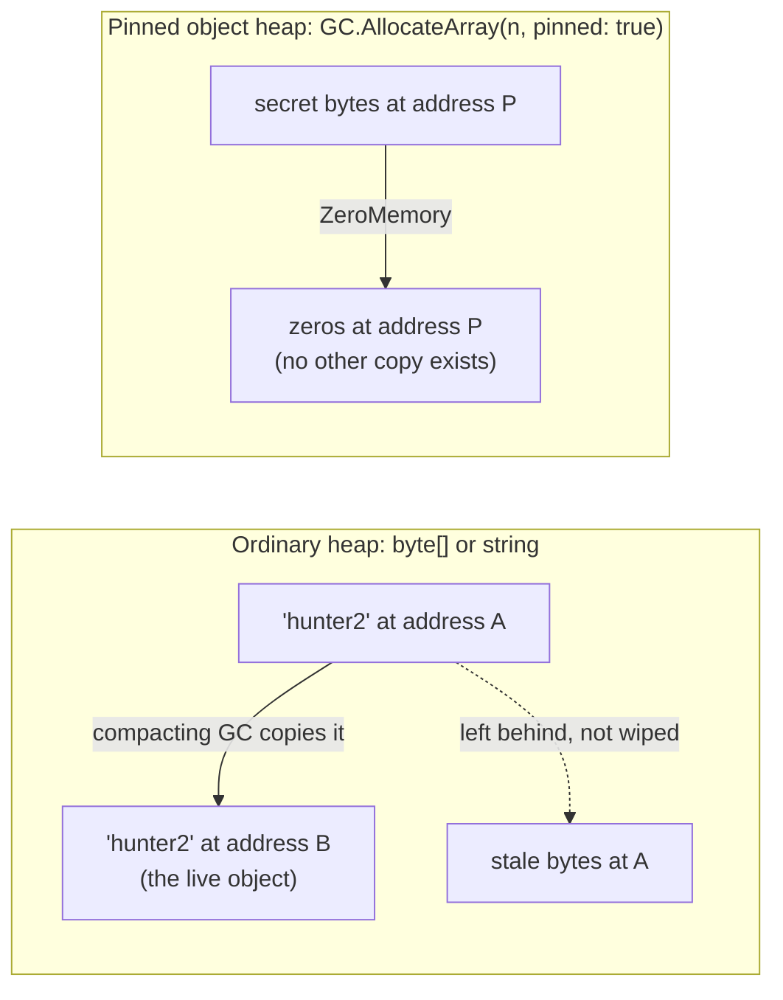

# P/Invoke and unmanaged memory

## TL;DR

- **P/Invoke** (platform invoke) lets C# call a function exported by a native DLL, such as `kernel32.dll`. You declare the function's signature in C#. The runtime finds the DLL, converts the arguments and makes the call.

- There are two ways to declare it. **`[DllImport]`** converts arguments at run time. **`[LibraryImport]`** (.NET 7+) has a source generator write that conversion code at compile time, so you can read it, it works with Native AOT, and it refuses types whose conversion would be a guess.

- Native pointers and handles arrive as **`nint`**, an integer the size of a pointer that carries no type and no ownership. Native memory is outside the garbage collector. You free it yourself, best through a **`SafeHandle`** subclass: the native counterpart of `IDisposable` plus a finaliser, which P/Invoke can return in place of the raw `nint`.

- The GC **moves** objects when it compacts the heap. A native function holding a pointer into a managed array needs that array **pinned**: for one statement with `fixed`, or for its whole life with `GC.AllocateArray<byte>(n, pinned: true)`.

- A `string` is a poor home for a secret. It can't be overwritten, the GC may leave old copies behind, and every operation on it makes new copies. Keep secrets in a pinned `byte[]` or `char[]` and wipe it with `CryptographicOperations.ZeroMemory`. `SecureString` is no way out: Microsoft advises against it for new code.

## Key claims

- <a id="c1"></a>**C1.** A P/Invoke declaration is a `static extern` (with `[DllImport]`) or `static partial` (with `[LibraryImport]`) method whose attribute names the DLL. The runtime loads the DLL on the first call and looks up the function by name.

- <a id="c2"></a>**C2.** **Marshalling** converts arguments and return values between managed and native representations. **Blittable** types, such as `int`, `uint`, `nint` and structs made only of them, have the same layout on both sides and are passed without conversion. Others, such as `string`, `bool` and `char`, need a conversion that must be specified.

- <a id="c3"></a>**C3.** With `[DllImport]`, the runtime builds the marshalling code when the method is first called. With `[LibraryImport]`, a source generator writes it at compile time into the `partial` method's body. `[LibraryImport]` requires the project to allow unsafe code, and it rejects a parameter whose marshalling is not stated, such as a `bool` without `[MarshalAs]` or a `char[]` without a `StringMarshalling`.

- <a id="c4"></a>**C4.** A Win32 function that fails usually returns `FALSE` or `NULL` and sets a thread-local error code. With `SetLastError = true` in the attribute, the marshaller saves that code right after the call, and `Marshal.GetLastPInvokeError()` returns it.

- <a id="c5"></a>**C5.** A `SafeHandle` subclass wraps a native handle and frees it in its `ReleaseHandle` override. That runs once: from `Dispose`, or from the finaliser if `Dispose` was never called. A P/Invoke method may return a `SafeHandle` subclass directly, so the handle is never a bare `IntPtr` that could leak.

- <a id="c6"></a>**C6.** The garbage collector may move a managed object to compact the heap. A pointer to a managed object is valid only while the object is **pinned**. `fixed` pins for the duration of a block. `GC.AllocateArray<T>(length, pinned: true)` allocates an array on the pinned object heap, where it never moves.

- <a id="c7"></a>**C7.** `CryptographicOperations.ZeroMemory(span)` overwrites memory with zeros in a way the compiler and JIT may not optimise away. A plain loop that writes zeros into a buffer that is never read again may be removed.

- <a id="c8"></a>**C8.** A .NET `string` can't safely hold a secret: it is immutable, so it can't be wiped; string literals are interned and live as long as the process; the GC may copy it while compacting; and every operation on it (`Substring`, concatenation, formatting, a `TextBox`) makes new copies outside your control.

- <a id="c9"></a>**C9.** Microsoft recommends against `SecureString` for new code (platform-compat diagnostic DE0001). It is encrypted only on Windows, and most APIs that consume it turn it into a `string` or plain memory anyway.

- <a id="c10"></a>**C10.** A secret buffer can be wrapped in an `IDisposable` type whose `Dispose` calls `ZeroMemory`. Used with `using`, the buffer is zeroed when the block is left, also when an exception leaves it. Copies made from the buffer's contents are not zeroed.

- <a id="c11"></a>**C11.** `nint` is C#'s native-sized integer, the same type as `IntPtr`: 4 bytes in a 32-bit process, 8 bytes in a 64-bit one. Win32 pointers and handles (`HANDLE`, `HGLOBAL`, `HWND`) arrive in C# as `nint`. An `nint` is only a number: it carries no type and no ownership.

- <a id="c12"></a>**C12.** For a P/Invoke method whose return type is a `SafeHandle` subclass, the marshaller calls the native function as if it returned an `nint`, creates the subclass through its parameterless constructor, and stores the value in it. For a `SafeHandle` parameter, it passes the stored `nint` and keeps the handle from being released until the call returns.

## Explanation

Each snippet below is a complete `Program.cs` for a console project with `<TargetFramework>net10.0-windows</TargetFramework>` and `<AllowUnsafeBlocks>true</AllowUnsafeBlocks>`. All were run with .NET 10 on Windows 11, and the output shown is what they printed.

### Calling a native function

A Windows DLL such as `kernel32.dll` exports functions by name, the way a .NET assembly exposes public methods. C# can call them if you tell it the signature ([C1](#c1)). On the first call, the runtime loads the DLL (`kernel32.dll` is already loaded in every process), looks up the function by name and calls it.

The C signature of the function below is `DWORD GetCurrentProcessId(void)`. A `DWORD` is a 32-bit unsigned integer, so the C# side returns `uint`:

```csharp
using System.Runtime.InteropServices;

Console.WriteLine(Native.GetCurrentProcessId() == Environment.ProcessId);

internal static partial class Native
{
    [LibraryImport("kernel32.dll")]
    public static partial uint GetCurrentProcessId();
}
```

```text
True
```

The DLL is found by the Windows DLL search order. For system DLLs that are not on the protected "known DLLs" list, the application's own folder comes first. A DLL of the same name next to your `.exe` wins.

### nint: an integer the size of a pointer

Native code passes pointers and **handles** around. A handle is a number that stands for something the operating system keeps for you: a window (`HWND`), a memory block (`HGLOBAL`), an open file (`HANDLE`). You never see inside it. You hand it back to the functions that know what it means, like a key to a locker.

Pointers and handles have the size of a memory address: 4 bytes in a 32-bit process, 8 in a 64-bit one. C# has a type with exactly that size: **`nint`**, the native-sized integer ([C11](#c11)). It is the same type as `IntPtr`, under a shorter name; `nuint` is `UIntPtr`. Where C uses a pointer or a handle, the C# declaration uses `nint`.

```csharp
using System.Runtime.InteropServices;

Console.WriteLine($"64-bit process: {Environment.Is64BitProcess}, size of nint: {IntPtr.Size} bytes");
Console.WriteLine($"nint is IntPtr: {typeof(nint) == typeof(IntPtr)}");

nint module = Native.GetModuleHandleW("kernel32.dll");   // a handle: just a number
Console.WriteLine($"kernel32 handle is non-zero: {module != 0}");

internal static partial class Native
{
    [LibraryImport("kernel32.dll", StringMarshalling = StringMarshalling.Utf16)]
    public static partial nint GetModuleHandleW(string moduleName);
}
```

```text
64-bit process: True, size of nint: 8 bytes
nint is IntPtr: True
kernel32 handle is non-zero: True
```

An `nint` is only a number. It doesn't know whether it is a window, a memory block or a file, and nothing frees what it stands for. That is the gap `SafeHandle` closes, further down.

### Marshalling: when the two sides disagree

Managed and native code agree on what an `int` is: four bytes, same order. A type whose bytes in memory mean exactly the same on both sides is called **blittable** ([C2](#c2)). The word comes from *blit*, an old graphics term for copying a block of memory unchanged. For a blittable argument the marshaller has nothing to do: it passes the value as it is, or, for an array of them, pins the array and passes a pointer to it. Native code then works directly on your managed memory.

| Blittable | Not blittable |
|---|---|
| `byte`, `sbyte`, `short`, `ushort`, `int`, `uint`, `long`, `ulong` | `bool`: 1, 2 or 4 bytes on the native side? |
| `float`, `double` | `char`: UTF-16 or an 8-bit code page? |
| `nint`, `nuint` (`IntPtr`, `UIntPtr`), pointers | `string`: an object with a length field, not a zero-terminated buffer |
| a struct whose fields are all blittable, with sequential layout | a class, a delegate, an array of a non-blittable type |
| a one-dimensional array of a blittable type, such as `byte[]` | a struct with one non-blittable field |

A struct such as `struct DATA_BLOB { int cbData; nint pbData; }` is blittable. Add one `bool` field, and the whole struct isn't.

The C# constraint `where T : unmanaged` is a close relative but not the same thing. It only asks "no references inside", so `bool` and `char` satisfy it. Blittable asks the stricter question "same meaning on the native side", and for `bool` and `char` the answer depends on the native API.

The other types need conversion:

| C# type | Native counterpart | The problem |
|---|---|---|
| `bool` | Win32 `BOOL` (4 bytes) or C `bool` (1 byte) | which one? |
| `char` | `WCHAR` (UTF-16, 2 bytes) or `char` (1 byte, ANSI) | which encoding? |
| `string` | `const WCHAR*`, zero-terminated | needs a native copy with a terminator |
| `char[]` an API fills | `WCHAR*` buffer | copy back after the call? |

Marshalling is the code that converts these. You state the conversion with `[MarshalAs]` or `StringMarshalling`.

### DllImport against LibraryImport

The two attributes describe the same call. They differ in *when* the marshalling code is made ([C3](#c3)):

```csharp
// Run-time marshalling: the runtime makes an IL stub on the first call.
[DllImport("advapi32.dll", SetLastError = true, CharSet = CharSet.Unicode)]
static extern bool GetUserNameW(char[] buffer, ref uint size);

// Compile-time marshalling: a source generator writes the body of this partial method.
[LibraryImport("advapi32.dll", SetLastError = true, StringMarshalling = StringMarshalling.Utf16)]
[return: MarshalAs(UnmanagedType.Bool)]
static partial bool GetUserNameW([Out] char[] buffer, ref uint size);
```

`[DllImport]` has defaults: a `bool` becomes a 4-byte `BOOL`, and `char` follows `CharSet`, which defaults to ANSI. Defaults are guesses. A wrong guess means a corrupted value at run time, not a build error.

`[LibraryImport]` makes no guesses. A `bool` without `[MarshalAs]` is a build error, and so is a `char[]` without `StringMarshalling` (`SYSLIB1051`). The generated code is ordinary C# you can open in the IDE under *Analyzers*. It needs `<AllowUnsafeBlocks>true</AllowUnsafeBlocks>` in the project, because the generated body uses pointers. Prefer it in new code: the .NET analyzers even offer to convert `[DllImport]` declarations.

The analogy in .NET terms: `[DllImport]` is like reflection-based serialisation, `[LibraryImport]` like `System.Text.Json`'s source generator.

### Errors: the last-error code

Win32 functions report failure through their return value, usually `FALSE` or `NULL`, and leave the reason in a thread-local **last-error code**. The runtime itself calls Win32 functions too, which could overwrite that code before your next line runs. So `SetLastError = true` asks the marshaller to save the code right after the call. You read the saved value with `Marshal.GetLastPInvokeError()` ([C4](#c4)). `new Win32Exception(code)` turns it into a message.

`GetUserNameW` fills a buffer you pass in. The second call gives it a buffer that is too small:

```csharp
using System.Runtime.InteropServices;

char[] name = new char[256];
uint size = (uint)name.Length;
bool ok = Native.GetUserNameW(name, ref size);   // size now includes the terminating zero
Console.WriteLine($"{ok}, {new string(name, 0, (int)size - 1) == Environment.UserName}");

uint tooSmall = 1;
ok = Native.GetUserNameW(new char[1], ref tooSmall);
Console.WriteLine($"{ok}, error {Marshal.GetLastPInvokeError()}");

internal static partial class Native
{
    [LibraryImport("advapi32.dll", SetLastError = true, StringMarshalling = StringMarshalling.Utf16)]
    [return: MarshalAs(UnmanagedType.Bool)]
    public static partial bool GetUserNameW([Out] char[] buffer, ref uint size);
}
```

```text
True, True
False, error 122
```

Error 122 is `ERROR_INSUFFICIENT_BUFFER`.

### Native memory and SafeHandle

Memory that native code allocates is invisible to the GC. Nothing frees it unless you do. The same goes for every handle: a window, a file, a block from `GlobalAlloc`. If `GlobalAlloc` gives you an `nint`, you must call `GlobalFree` on it exactly once, also when an exception gets in the way. That is the same problem `IDisposable` solves for managed resources.

In C++, a destructor would free it ([RAII](../cpp/raii-and-ownership.md)). In .NET, the tool is `SafeHandle` ([C5](#c5)). It is an abstract class that holds an `nint` in a protected field called `handle` and implements `IDisposable` and a finaliser for you. You write one small subclass per *kind* of handle, and the only thing it adds is how to free that kind:

```csharp
internal sealed class SafeGlobalHandle : SafeHandleZeroOrMinusOneIsInvalid
{
    public SafeGlobalHandle() : base(ownsHandle: true) { }
    protected override bool ReleaseHandle() => Native.GlobalFree(handle) == 0;
}
```

`SafeHandleZeroOrMinusOneIsInvalid` is a ready-made base that treats 0 and -1 as "no handle", which is how most Win32 functions signal failure.

Then the P/Invoke declaration says `SafeGlobalHandle` where the C function returns an `HGLOBAL`:

```csharp
[LibraryImport("kernel32.dll", SetLastError = true)]
public static partial SafeGlobalHandle GlobalAlloc(uint flags, nuint bytes);
```

#### How the generator knows what to do

The native `GlobalAlloc` returns a pointer-sized number. It has no idea what C# types are. A DLL export carries a name and nothing else: no parameter types, no return type. Your C# declaration is the only description of the call, and it is a promise: "this function returns something pointer-sized."

When the return type is a `SafeHandle` subclass, the source generator reads that as "the native function returns an `nint`; wrap it in this class" ([C12](#c12)). The code it writes for the declaration above looks like this, shortened:

```csharp
public static partial SafeGlobalHandle GlobalAlloc(uint flags, nuint bytes)
{
    // Created before the call, through the parameterless constructor,
    // so nothing can fail between the native call and the wrapping.
    var marshaller = new SafeHandleMarshaller<SafeGlobalHandle>.ManagedToUnmanagedOut();
    Marshal.SetLastSystemError(0);
    nint native = __PInvoke(flags, bytes);              // the real call: returns an nint
    int lastError = Marshal.GetLastSystemError();
    marshaller.FromUnmanaged(native);                   // store the nint in the new SafeGlobalHandle
    SafeGlobalHandle result = marshaller.ToManaged();
    Marshal.SetLastPInvokeError(lastError);
    return result;

    [DllImport("kernel32.dll", EntryPoint = "GlobalAlloc", ExactSpelling = true)]
    static extern nint __PInvoke(uint flags, nuint bytes);
}
```

The inner `__PInvoke` declares the native function as returning `nint`. Your `SafeGlobalHandle` exists only on the C# side. This is why the subclass needs a public parameterless constructor: the generated code creates it.

For a `SafeHandle` *parameter*, as in `GlobalSize(SafeGlobalHandle mem)`, the generated code goes the other way. It takes the `nint` out of the handle, passes it, and holds a reference count on the handle until the call returns. A `Dispose` on another thread meanwhile only marks the handle closed, and `ReleaseHandle` runs after the call. Native code never works on a freed handle.

In short: one subclass per kind of handle, and the imported function returns it as a wrapper around the raw value. What it gains over an `nint` in a class of your own:

- The wrapping happens *inside* the generated code, so no exception between the native call and your assignment can leak the handle.
- `ReleaseHandle` runs exactly once, from `Dispose` or from the finaliser.
- A handle in use by a native call is never released under it.

The [note on opaque handles](../c/opaque-handles.md#c6) shows the same idea from the C side.

```csharp
using System.Runtime.InteropServices;
using Microsoft.Win32.SafeHandles;

using (SafeGlobalHandle h = Native.GlobalAlloc(Native.GMEM_MOVEABLE, 16))
{
    Console.WriteLine($"invalid: {h.IsInvalid}, size: {Native.GlobalSize(h)}");
}   // Dispose calls ReleaseHandle, which calls GlobalFree

internal sealed class SafeGlobalHandle : SafeHandleZeroOrMinusOneIsInvalid
{
    public SafeGlobalHandle() : base(ownsHandle: true) { }

    protected override bool ReleaseHandle()
    {
        Console.WriteLine("ReleaseHandle: GlobalFree");
        return Native.GlobalFree(handle) == 0;
    }
}

internal static partial class Native
{
    public const uint GMEM_MOVEABLE = 0x0002;

    [LibraryImport("kernel32.dll", SetLastError = true)]
    public static partial SafeGlobalHandle GlobalAlloc(uint flags, nuint bytes);

    [LibraryImport("kernel32.dll")]
    public static partial nuint GlobalSize(SafeGlobalHandle mem);

    [LibraryImport("kernel32.dll")]
    public static partial nint GlobalFree(nint mem);
}
```

```text
invalid: False, size: 16
ReleaseHandle: GlobalFree
```

`GlobalFree` itself still takes a plain `nint`: it is called from inside `ReleaseHandle`, where the raw value is all there is.

Two allocation functions appear in Win32 code, and they are not interchangeable:

| Function | What it gives | Use for |
|---|---|---|
| `Marshal.AllocHGlobal` / `FreeHGlobal` | a fixed block from `LocalAlloc` | scratch memory for a native call |
| `GlobalAlloc(GMEM_MOVEABLE, …)` / `GlobalFree` | a movable block, reached through `GlobalLock` | APIs that ask for an `HGLOBAL`, such as the clipboard |

### Pinning: the GC moves things

The GC compacts the heap: it copies live objects together to close the gaps, and updates every managed reference. It can't update a pointer that native code holds. So a pointer to a managed object is valid only while the object is **pinned**, meaning the GC promises not to move it ([C6](#c6)).

- **`fixed`** pins for one block. The P/Invoke marshaller does the same for a `byte[]` argument during the call.
- **`GC.AllocateArray<T>(n, pinned: true)`** (.NET 5+) allocates on the **pinned object heap**, a separate heap the GC never compacts. The array stays at one address for its whole life.

```csharp
byte[] movable = new byte[4];
unsafe
{
    fixed (byte* q = movable)   // the GC won't move the array inside this block
    {
        *q = 42;
    }
}   // from here on the array may move again, and q must not be used
Console.WriteLine(movable[0]);
```

```text
42
```

Pinning matters for secrets even when no native code is involved. When the GC moves an array, the bytes at the old address are not wiped. They stay in memory until something else overwrites them. A pinned array has exactly one copy, so one `ZeroMemory` really erases it.



### Wiping: ZeroMemory

Writing zeros in a loop into a buffer that is never read again is a "dead store". An optimising compiler may delete it, because no observable behaviour changes. `CryptographicOperations.ZeroMemory` is guaranteed not to be removed ([C7](#c7)). It takes a `Span<byte>`, so it works on arrays and on native memory alike. For a `char[]`, pass `MemoryMarshal.AsBytes(chars.AsSpan())`.

The snippet keeps a secret in a pinned array, copies it into native memory, and wipes both:

```csharp
using System.Runtime.InteropServices;
using System.Security.Cryptography;

byte[] secret = GC.AllocateArray<byte>(8, pinned: true);
"s3cr3t!?"u8.CopyTo(secret);

nint p = Marshal.AllocHGlobal(secret.Length);   // native memory, invisible to the GC
Marshal.Copy(secret, 0, p, secret.Length);
unsafe
{
    var native = new Span<byte>((void*)p, secret.Length);
    CryptographicOperations.ZeroMemory(native);
    Console.WriteLine($"native zeroed: {native.IndexOfAnyExcept((byte)0) < 0}");
}
Marshal.FreeHGlobal(p);

CryptographicOperations.ZeroMemory(secret);
Console.WriteLine($"managed zeroed: {secret.AsSpan().IndexOfAnyExcept((byte)0) < 0}");
```

```text
native zeroed: True
managed zeroed: True
```

### Wiping by Dispose

Calling `ZeroMemory` by hand has the problem every manual cleanup has: an exception or an early `return` skips it. .NET's answer for cleanup is `IDisposable` with `using`, and it fits here too ([C10](#c10)). A small `SecretBuffer` class owns a pinned array, hands it out only as a `Span<byte>`, and zeroes it in `Dispose`. Held in a `using`, the buffer is zeroed when the block is left, whether normally or by an exception. `DangerousArray` exists only so the demo can look at the array after disposal:

```csharp
using System.Security.Cryptography;
using System.Text;

byte[] seen;
using (var secret = new SecretBuffer(7))
{
    Encoding.UTF8.GetBytes("hunter2", secret.Span);
    seen = secret.DangerousArray;
    Console.WriteLine(Encoding.UTF8.GetString(secret.Span));
}
Console.WriteLine($"after using: all zero = {seen.AsSpan().IndexOfAnyExcept((byte)0) < 0}");

try
{
    using var s2 = new SecretBuffer(4);
    seen = s2.DangerousArray;
    s2.Span.Fill(0xAA);
    throw new InvalidOperationException("boom");
}
catch (InvalidOperationException)
{
    Console.WriteLine($"after exception: all zero = {seen.AsSpan().IndexOfAnyExcept((byte)0) < 0}");
}

var s3 = new SecretBuffer(4);
s3.Dispose();
try { _ = s3.Span; } catch (ObjectDisposedException) { Console.WriteLine("use after Dispose: ObjectDisposedException"); }

/// <summary>A pinned byte buffer for a secret that is zeroed on Dispose.</summary>
public sealed class SecretBuffer : IDisposable
{
    private byte[]? _bytes;

    public SecretBuffer(int length) => _bytes = GC.AllocateArray<byte>(length, pinned: true);

    public Span<byte> Span => _bytes ?? throw new ObjectDisposedException(nameof(SecretBuffer));

    internal byte[] DangerousArray => _bytes!;   // for the demo only

    public void Dispose()
    {
        if (_bytes is null) return;
        CryptographicOperations.ZeroMemory(_bytes);
        _bytes = null;
    }
}
```

```text
hunter2
after using: all zero = True
after exception: all zero = True
use after Dispose: ObjectDisposedException
```

Two limits remain. `using` only zeroes the buffer itself: a `string` or another array made from its contents is a copy outside the wrapper. The demo breaks that rule on purpose: `"hunter2"` is a string literal, and `Encoding.UTF8.GetString` makes another string. Real code fills the buffer from a source that isn't a `string`, such as `Unprotect`'s result copied in and zeroed, or characters read one at a time from a password box. And if the caller forgets `using`, nothing zeroes it. A finaliser could, but only at some later garbage collection, so the analyzer warning CA2000 (dispose objects before losing scope) is the better safety net.

### Why not a string?

Everything above is why a password tool keeps secrets out of `string` ([C8](#c8)):

- **Immutable.** There is no supported way to overwrite a string's characters. You can only drop the reference and wait.
- **Interned.** A string literal is shared and lives until the process ends.
- **Moved.** A string lives on the ordinary heap, so compaction can leave copies behind, as in the diagram.
- **Copied.** `Substring`, `+`, `$"…"`, `ToString`, a WPF `TextBox`, a log call: each makes a new string you can't wipe.

```csharp
string a = "hunter2";
string b = string.Concat("hunter", "2".AsSpan());
Console.WriteLine($"equal text: {a == b}, same object: {ReferenceEquals(a, b)}");
Console.WriteLine($"the literal is interned: {ReferenceEquals(a, string.IsInterned(b))}");
```

```text
equal text: True, same object: False
the literal is interned: True
```

`b` has the same text as `a` but is a separate object: a second copy of the "password" now exists. `string.IsInterned(b)` returns the literal's instance, which lives until the process ends.

In memory, a string on 64-bit .NET is an object header (8 bytes), a method-table pointer (8 bytes), a 4-byte length, then the characters in UTF-16 and a terminating zero character. The password sits there as plain UTF-16 for anyone who can read the process memory or a crash dump.

`SecureString` was meant to fix this. Microsoft now advises against it ([C9](#c9)): on Linux and macOS it isn't encrypted at all, and to *use* the secret (send it, show it, hash it) you almost always convert it to a `string` or plain memory first. The guidance is to avoid holding credentials in the process where possible, and otherwise to keep the window short: plain bytes in a buffer you control, wiped right after use.

## Examples

The examples sit in the explanation above, each right after the section it illustrates:

- [Calling a native function](#calling-a-native-function): `GetCurrentProcessId`.
- [nint](#nint-an-integer-the-size-of-a-pointer): its size, and a module handle.
- [Errors](#errors-the-last-error-code): `GetUserNameW` with a buffer, and error 122.
- [SafeHandle](#native-memory-and-safehandle): `SafeGlobalHandle` around `GlobalAlloc`, and the code the generator writes.
- [Pinning](#pinning-the-gc-moves-things): `fixed`.
- [ZeroMemory](#wiping-zeromemory): wiping managed and native memory.
- [Wiping by Dispose](#wiping-by-dispose): `SecretBuffer`.
- [Why not a string?](#why-not-a-string): two copies of the same text, and interning.

## Good habits

- Write new declarations with `[LibraryImport]`, not `[DllImport]` ([C3](#c3); Microsoft Learn, *P/Invoke source generation*).

- State every non-blittable conversion: `[MarshalAs(UnmanagedType.Bool)]` for `BOOL`, `StringMarshalling.Utf16` and the `W` variant of a function for text ([C2](#c2); Microsoft Learn, *Native interoperability best practices*).

- Set `SetLastError = true` on functions that report errors through the last-error code, and read it with `Marshal.GetLastPInvokeError()` straight after the call ([C4](#c4); same source).

- Return handles as `SafeHandle` subclasses, never as bare `nint` ([C5](#c5); same source).

- Keep secrets in a pinned `byte[]` or `char[]`, and wipe them with `CryptographicOperations.ZeroMemory` as soon as they are used ([C6](#c6), [C7](#c7), [C8](#c8); .NET documentation of `SecureString` and `ZeroMemory`).

- Put that buffer in a disposable wrapper that zeroes it, and hold the wrapper in a `using` ([C10](#c10); .NET design guidelines, *Dispose pattern*, and analyzer rule CA2000).

## Pitfalls

- **Declaring a `BOOL` as `bool` with a 1-byte conversion**, or the other way round. Win32 `BOOL` is 4 bytes. The wrong size reads garbage or corrupts the stack ([C2](#c2)).

- **Calling the `A` function instead of `W`.** `GetUserNameA` returns ANSI text in the current code page. Use the `W` (wide, UTF-16) variant with `StringMarshalling.Utf16`.

- **Reading `Marshal.GetLastWin32Error()` without `SetLastError = true`.** The value is then whatever the last marshalled call left, not the error of your call ([C4](#c4)).

- **Keeping a pointer after `fixed` ends.** The GC may move the array right after the block, and the pointer then points at someone else's object ([C6](#c6)).

- **"Wiping" a string with unsafe code.** Writing into a string through a pointer breaks .NET's assumptions (interning, hash codes) and doesn't reach the copies already made ([C8](#c8)).

- **Converting a `SecureString` to a `string` to use it.** That undoes the whole point ([C9](#c9)).

- **Passing `Marshal.AllocHGlobal` memory where an API expects a `GlobalAlloc(GMEM_MOVEABLE)` handle.** The clipboard, for one, requires a movable global block.

## Exercises

1. **Interpret.** Why does this declaration fail to build, and what are the two possible fixes?

   ```csharp
   [LibraryImport("user32.dll")]
   public static partial bool OpenClipboard(nint owner);
   ```

   <details><summary>Solution</summary>

   `bool` is not blittable, and `[LibraryImport]` refuses to guess its size ([C2](#c2), [C3](#c3)). Win32 returns a 4-byte `BOOL`, so add `[return: MarshalAs(UnmanagedType.Bool)]`. Alternatively, declare the return type as `int` and compare with 0 yourself.

   </details>

2. **Explain.** A colleague keeps the master password in a `byte[]` from `new byte[32]` and calls `ZeroMemory` on it after use. Why can a copy of the password still be in memory, and what one change fixes that?

   <details><summary>Solution</summary>

   An ordinary array may be moved by a compacting GC, which leaves the old bytes unwiped at the old address ([C6](#c6)). Allocate it with `GC.AllocateArray<byte>(32, pinned: true)`, so there is only ever one copy to wipe.

   </details>

3. **Predict.** A `SafeGlobalHandle` is returned from `GlobalAlloc` and never disposed. Does the memory leak?

   <details><summary>Solution</summary>

   No, not permanently: the finaliser calls `ReleaseHandle`, which calls `GlobalFree` ([C5](#c5)). But it is freed only when the GC gets round to it, so dispose it with `using` anyway.

   </details>

4. **Explain.** List three ways a password typed into GhostKey could end up in memory you can't wipe if the code holds it in a `string`.

   <details><summary>Solution</summary>

   Any three of: the string itself can't be overwritten; the GC may have copied it during compaction; a `Substring`, concatenation or format call made another string; a WPF `TextBox.Text` holds its own copy; a literal (in a test) is interned for the process's lifetime ([C8](#c8)).

   </details>

5. **Explain.** The C function is `HGLOBAL GlobalAlloc(UINT, SIZE_T)`. The C# declaration returns `SafeGlobalHandle`. Nothing in `kernel32.dll` mentions that class. Who creates the `SafeGlobalHandle`, when, and what does the native function actually return?

   <details><summary>Solution</summary>

   The native function returns a pointer-sized number, an `nint` ([C11](#c11)). The code the source generator writes declares an inner `extern` method that returns `nint`, creates the `SafeGlobalHandle` through its parameterless constructor before the call, and stores the returned value in it after the call ([C12](#c12)). The DLL only knows the function's name; the C# declaration is the only place that says what the value means.

   </details>

## Sources

- Microsoft Learn, [Platform Invoke (P/Invoke)](https://learn.microsoft.com/en-us/dotnet/standard/native-interop/pinvoke).
- Microsoft Learn, [P/Invoke source generation](https://learn.microsoft.com/en-us/dotnet/standard/native-interop/pinvoke-source-generation): `[LibraryImport]`, its requirements and the differences from `[DllImport]`.
- Microsoft Learn, [Native interoperability best practices](https://learn.microsoft.com/en-us/dotnet/standard/native-interop/best-practices): `BOOL`, `W` functions, `SetLastError`, `SafeHandle`.
- Microsoft Learn, [Type marshalling](https://learn.microsoft.com/en-us/dotnet/standard/native-interop/type-marshalling) and [Blittable and non-blittable types](https://learn.microsoft.com/en-us/dotnet/framework/interop/blittable-and-non-blittable-types).
- Microsoft Learn, [`SafeHandle` class](https://learn.microsoft.com/en-us/dotnet/api/system.runtime.interopservices.safehandle).
- Microsoft Learn, [`GC.AllocateArray`](https://learn.microsoft.com/en-us/dotnet/api/system.gc.allocatearray) and [`CryptographicOperations.ZeroMemory`](https://learn.microsoft.com/en-us/dotnet/api/system.security.cryptography.cryptographicoperations.zeromemory).
- Microsoft Learn, [`SecureString` class](https://learn.microsoft.com/en-us/dotnet/api/system.security.securestring), section *Remarks*, and [DE0001: SecureString shouldn't be used](https://github.com/dotnet/platform-compat/blob/master/docs/DE0001.md).
- Microsoft Learn, [Dynamic-link library search order](https://learn.microsoft.com/en-us/windows/win32/dlls/dynamic-link-library-search-order).
- Microsoft Learn, [Native-sized integers](https://learn.microsoft.com/en-us/dotnet/csharp/language-reference/builtin-types/integral-numeric-types#native-sized-integers): `nint` and `nuint`, and that they are `IntPtr` and `UIntPtr`.
- Claude session on GhostKey, 2026-11-18: every snippet was run there with .NET 10. The shortened generated code for `GlobalAlloc` comes from building with `EmitCompilerGeneratedFiles=true` and reading `LibraryImports.g.cs`.
