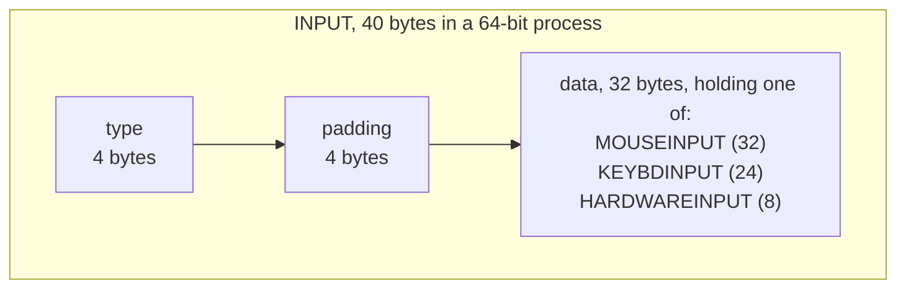
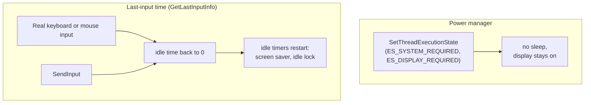

# SendInput and synthetic keyboard input

## TL;DR

- **`SendInput`** puts synthetic keyboard and mouse events into Windows' input stream, as if they came from a device. Each event is an **`INPUT`** struct; for a key it holds a **`KEYBDINPUT`**: which key, and whether it goes down or up.

- A key is named either by its **virtual-key code** (`VK_SCROLL`, `'A'`), which the active keyboard layout then turns into a character, or with **`KEYEVENTF_UNICODE`** by the UTF-16 character itself, which types that character whatever the layout.

- **UIPI** (User Interface Privilege Isolation) blocks input into windows of a higher integrity level, such as an app run as administrator. The call fails silently: neither the return value nor the error code says so.

- Windows tracks two different kinds of idleness. **`SetThreadExecutionState`** tells the power manager not to sleep or turn off the display. It does **not** reset the session's **last-input time**, which idle timers such as screen savers and idle-lock policies watch. Only input does, and synthetic input from `SendInput` counts.

## Key claims

- <a id="c1"></a>**C1.** `SendInput(count, inputs, size)` inserts the events in the array, in order, into the input stream and returns how many it inserted. `size` must be the size of one `INPUT` struct (40 bytes in a 64-bit process); any other value makes it insert nothing and fail with `ERROR_INVALID_PARAMETER` (87).

- <a id="c2"></a>**C2.** `INPUT` holds one mouse, keyboard or hardware event, and is as large as the largest of them, `MOUSEINPUT`. A C# copy of `INPUT` that leaves `MOUSEINPUT` out is 32 bytes instead of 40, and `SendInput` rejects it.

- <a id="c3"></a>**C3.** A key press is two events: one with `dwFlags = 0` (key down) and one with `KEYEVENTF_KEYUP` (key up). A virtual-key code names a physical key, and the active keyboard layout decides which character, if any, it produces.

- <a id="c4"></a>**C4.** With `KEYEVENTF_UNICODE`, `wVk` is 0 and `wScan` holds a UTF-16 code unit. The target receives it as `VK_PACKET` and gets exactly that character, independent of the keyboard layout. A character outside the Basic Multilingual Plane takes two such events, one per surrogate.

- <a id="c5"></a>**C5.** `SendInput` is subject to UIPI: a process may inject input only into windows of an equal or lower integrity level. When UIPI blocks the input, neither the return value nor `GetLastError` indicates it. Input also doesn't reach the secure desktop (the lock screen, UAC prompts).

- <a id="c6"></a>**C6.** Input injected with `SendInput` resets the session's last-input time, which `GetLastInputInfo` reports and which input-idle timers use.

- <a id="c7"></a>**C7.** `SetThreadExecutionState(ES_CONTINUOUS | ES_SYSTEM_REQUIRED | ES_DISPLAY_REQUIRED)` keeps the system from sleeping and the display from turning off until it is called again with `ES_CONTINUOUS` alone or the thread exits. It doesn't reset the last-input time and doesn't stop the screen saver.

## Explanation

The snippets in this section are pieces of one console program (`net10.0-windows`, `AllowUnsafeBlocks` on), run on Windows 11 with .NET 10 while nobody touched keyboard or mouse. Its `Native` declarations of `SendInput`, `GetLastInputInfo`, `SetThreadExecutionState` and the constants follow the patterns of the [P/Invoke note](pinvoke-and-unmanaged-memory.md) and are left out. The program pressed Scroll Lock twice, which leaves the lock state as it was.

### From key to character

When you press a key, the keyboard driver reports a **scan code**: which physical key moved. Windows maps it to a **virtual-key code**, a layout-neutral name such as `VK_SCROLL` (0x91) or `'A'` (0x41). Windows then puts a key-down message in the queue of the window that has the focus. The window's message loop turns the virtual key into a character using the active **keyboard layout** (`WM_KEYDOWN`, then `WM_CHAR`). That last step is why the same key types `y` on a US layout and `z` on a German one.

`SendInput` enters this pipeline right after the driver ([C1](#c1)). The events go into the same input stream as real keystrokes and are delivered to whatever window has the focus. Your program doesn't choose a target window. It is like typing on the keyboard, not like calling a method on a control.

### The INPUT struct

`SendInput` takes an array of `INPUT` structs, one per event. An `INPUT` holds *one* event: a mouse event (`MOUSEINPUT`), a key event (`KEYBDINPUT`) or a raw hardware event (`HARDWAREINPUT`). Its `type` field says which. In C, the three event structs share the same bytes in a **union**, so `INPUT` is as large as the largest of them ([C2](#c2)). The [note on unions and struct layout](../c/unions-and-struct-layout.md) explains unions, `StructLayout` and `FieldOffset`, and this very struct.



The C# declarations copy the C ones field by field. The field names are the Win32 names; the [note on Win32 type names](win32-types-and-hungarian-notation.md) explains prefixes such as `w` and `dw`. The union has no name in C. Here it is called `data`:

```csharp
struct INPUT { public uint type; public InputUnion data; }

[StructLayout(LayoutKind.Explicit)]
struct InputUnion
{
    [FieldOffset(0)] public MOUSEINPUT mi;      // mouse input
    [FieldOffset(0)] public KEYBDINPUT ki;      // keyboard input
    [FieldOffset(0)] public HARDWAREINPUT hi;   // hardware input
}

struct MOUSEINPUT { public int dx, dy; public uint mouseData, dwFlags, time; public nuint dwExtraInfo; }
struct KEYBDINPUT { public ushort wVk, wScan; public uint dwFlags, time; public nuint dwExtraInfo; }
struct HARDWAREINPUT { public uint uMsg; public ushort wParamL, wParamH; }
```

For this note only `KEYBDINPUT` matters. Its fields:

| Field | Win32 type | C# type | Meaning |
|---|---|---|---|
| `wVk` | `WORD` | `ushort` | the virtual-key code, such as `VK_SCROLL` |
| `wScan` | `WORD` | `ushort` | a hardware scan code, or a UTF-16 character with `KEYEVENTF_UNICODE` |
| `dwFlags` | `DWORD` | `uint` | flags: `KEYEVENTF_KEYUP` for key up, `KEYEVENTF_UNICODE` for a character |
| `time` | `DWORD` | `uint` | a timestamp; 0 lets Windows fill it in |
| `dwExtraInfo` | `ULONG_PTR` | `nuint` | a value the sender may attach; usually 0 |

The program first prints the sizes:

```csharp
Console.WriteLine($"sizeof INPUT: {Marshal.SizeOf<INPUT>()}, KEYBDINPUT: {Marshal.SizeOf<KEYBDINPUT>()}");
```

```text
sizeof INPUT: 40, KEYBDINPUT: 24
```

`SendInput` checks its `size` argument against the real `sizeof(INPUT)` ([C1](#c1)). A C# union that declares only `KEYBDINPUT` makes `INPUT` 32 bytes: the call inserts nothing and fails with error 87. It is the classic `SendInput` bug, and it looks exactly like "nothing happens". Passing a size 8 bytes short shows it:

```csharp
uint bad = Native.SendInput((uint)inputs.Length, inputs, Marshal.SizeOf<INPUT>() - 8);
Console.WriteLine($"wrong cbSize: {bad}, error {Marshal.GetLastPInvokeError()}");
```

```text
wrong cbSize: 0, error 87
```

### Key down, key up

One key press is two events ([C3](#c3)): key down, with `dwFlags = 0`, and key up, with `KEYEVENTF_KEYUP`. Forget the up event and Windows believes the key is held. For a modifier such as Shift or Ctrl, that changes every key the user presses afterwards.

Put all events of one action in one array and one call. `SendInput` inserts them as a block, so the user's own keystrokes can't land in the middle.

The helper `Key` builds one event: `type` set to `INPUT_KEYBOARD`, and in the union's `ki` member the virtual key and, for key up, the flag. All other fields stay 0. The program then presses Scroll Lock twice, four events in one call:

```csharp
static INPUT Key(ushort vk, bool up) => new()
{
    type = Native.INPUT_KEYBOARD,
    data = new InputUnion { ki = new KEYBDINPUT { wVk = vk, dwFlags = up ? Native.KEYEVENTF_KEYUP : 0 } },
};

INPUT[] inputs =
[
    Key(Native.VK_SCROLL, up: false), Key(Native.VK_SCROLL, up: true),
    Key(Native.VK_SCROLL, up: false), Key(Native.VK_SCROLL, up: true),
];
uint sent = Native.SendInput((uint)inputs.Length, inputs, Marshal.SizeOf<INPUT>());
```

`sent` was 4: all four events were inserted. Scroll Lock serves well for experiments: it types no character, and pressing it twice puts its light back as it was.

### Virtual keys against Unicode

With a virtual-key code, the target app sees a real key: shortcuts work, and the active layout decides the character ([C3](#c3)). That's what you want for keys that aren't characters, such as Scroll Lock, Tab or Enter.

To *type text*, a virtual-key code is fragile. Typing `@` means pressing Shift+2 on a US layout but AltGr+Q on a German one. `KEYEVENTF_UNICODE` sidesteps the layout: put the character in `wScan`, leave `wVk` at 0, and the target receives a `VK_PACKET` carrying exactly that character ([C4](#c4)). A character beyond U+FFFF, such as many emoji, is two UTF-16 code units in .NET as well, and takes two events.

The method below returns the two events that type one character. Each is an `INPUT` with `type = INPUT_KEYBOARD`, whose `ki` member carries the character in `wScan` and the flag `KEYEVENTF_UNICODE`. The second event adds `KEYEVENTF_KEYUP`. `new()` without a type name is C#'s target-typed `new`: the compiler takes the type from the field it is assigned to, `InputUnion` for `data` and `KEYBDINPUT` for `ki`.

```csharp
static INPUT[] TypeChar(char c) =>
[
    new() { type = Native.INPUT_KEYBOARD, data = new() { ki = new() { wScan = c, dwFlags = Native.KEYEVENTF_UNICODE } } },
    new() { type = Native.INPUT_KEYBOARD, data = new() { ki = new() { wScan = c, dwFlags = Native.KEYEVENTF_UNICODE | Native.KEYEVENTF_KEYUP } } },
];
```

Passing `TypeChar('@')` to `SendInput` types `@` into the focused window on any keyboard layout. The method was compiled for this note, not run: it would type into whatever window has the focus.

### UIPI: you can't push input upwards

Windows gives every process an **integrity level**. A normal app runs at *medium*. An app started with "Run as administrator" runs at *high*. UIPI forbids a lower process from sending input or window messages to a higher one ([C5](#c5)), so malware at medium level can't click "Yes" in an elevated tool.

For `SendInput` this means: if the focused window belongs to an elevated app, your events are dropped. The function's documentation says plainly that neither the return value nor `GetLastError` reveals this. If a feature must work in elevated windows, the tool itself must run elevated, with everything that comes with that.

The **secure desktop** is a separate desktop for the lock screen and UAC prompts. Input sent from your normal desktop never reaches it.

### Two kinds of "idle"

Windows tracks idleness in two separate places, and they are often confused:



**The power manager** decides when the machine sleeps and the screen turns off. `SetThreadExecutionState` is the official way to keep both awake ([C7](#c7)). It is what a video player or a presentation tool calls. With `ES_CONTINUOUS` the request stays until you call it again with `ES_CONTINUOUS` alone, or until the thread ends. It touches nothing else.

**The last-input time** is when the session last saw keyboard or mouse input. `GetLastInputInfo` reports it. Screen savers and idle-lock policies (such as the *machine inactivity limit* security policy) look at how long ago that was. `SetThreadExecutionState` doesn't touch it. Input does, and `SendInput` counts as input ([C6](#c6)).

The program measured both. `IdleMs` asks `GetLastInputInfo` for the tick count of the last input and subtracts it from the current tick count: the result is how many milliseconds ago the last input was. The program waits four seconds without input, reads the idle time, calls `SetThreadExecutionState`, reads it again, then sends the Scroll Lock events from above and reads it a third time:

```csharp
static uint IdleMs()
{
    var info = new LASTINPUTINFO { cbSize = (uint)Marshal.SizeOf<LASTINPUTINFO>() };
    Native.GetLastInputInfo(ref info);
    return (uint)Environment.TickCount - info.dwTime;
}

Thread.Sleep(4000);
Console.WriteLine($"idle before: {IdleMs()} ms");

Native.SetThreadExecutionState(Native.ES_CONTINUOUS | Native.ES_SYSTEM_REQUIRED | Native.ES_DISPLAY_REQUIRED);
Console.WriteLine($"idle after SetThreadExecutionState: {IdleMs()} ms");
Native.SetThreadExecutionState(Native.ES_CONTINUOUS);   // end the request

// ... the SendInput call from "Key down, key up" ...
Thread.Sleep(50);
Console.WriteLine($"sent: {sent}, idle after SendInput: {IdleMs()} ms");
```

```text
idle before: 6766 ms
idle after SetThreadExecutionState: 6766 ms
sent: 4, idle after SendInput: 47 ms
```

`SetThreadExecutionState` left the idle time where it was. `SendInput` reset it to almost zero. The times vary from run to run; the difference doesn't.

So the two are not interchangeable. `SetThreadExecutionState` keeps the machine awake but leaves idle timers running: the screen saver still starts, and an idle-lock policy still locks. Input resets them. An idle-lock policy exists for security, so on a managed machine, whether a program may reset it is the organisation's decision.

### Injected input is visible

Synthetic input is not perfectly disguised. A low-level keyboard hook sees an `LLKHF_INJECTED` flag on every injected event. `dwExtraInfo` can carry a value the sender chooses, which hooks can read. Games and some security tools use the flag to ignore or block injected input.

## Good habits

- Declare the full `INPUT` union, `MOUSEINPUT` included, and pass `Marshal.SizeOf<INPUT>()` as the size ([C1](#c1), [C2](#c2); Microsoft Learn, `SendInput`).

- Send every key-down with its key-up, in the same `SendInput` call ([C3](#c3); Microsoft Learn, `SendInput`).

- Use `KEYEVENTF_UNICODE` to type text, virtual-key codes for keys that aren't characters ([C4](#c4); Microsoft Learn, `KEYBDINPUT`).

- To keep the machine from sleeping during a task, use `SetThreadExecutionState`, not synthetic input ([C7](#c7); Microsoft Learn, `SetThreadExecutionState`).

## Pitfalls

- **Leaving `MOUSEINPUT` out of the union.** `SendInput` returns 0 and nothing happens ([C2](#c2)).

- **Taking a return value of `count` as proof the input arrived.** UIPI drops input to elevated windows without telling you ([C5](#c5)).

- **Forgetting a key-up.** A stuck Shift or Ctrl changes everything the user types next ([C3](#c3)).

- **Typing text with virtual-key codes.** It depends on the keyboard layout; `@`, `z` and `y` come out wrong on another layout ([C4](#c4)).

- **Expecting `SetThreadExecutionState` to stop the screen saver or an idle lock.** It keeps the PC awake, but the last-input time keeps ageing ([C6](#c6), [C7](#c7)).

- **Pressing a lock key such as Scroll Lock or Num Lock once.** The lock state flips and stays flipped. Press it twice to restore it.

## Exercises

1. **Predict.** A C# declaration of `INPUT` has a union with only `KEYBDINPUT`. In a 64-bit process, what does `Marshal.SizeOf<INPUT>()` return, and what does `SendInput` do with it?

   <details><summary>Solution</summary>

   32 bytes: 4 for `type`, 4 of padding, 24 for `KEYBDINPUT`. `SendInput` expects 40, inserts nothing and fails with error 87 ([C1](#c1), [C2](#c2)).

   </details>

2. **Explain.** A presentation tool calls `SetThreadExecutionState(ES_CONTINUOUS | ES_DISPLAY_REQUIRED)` during a talk, but the screen saver still starts after ten minutes without a key press. Why, and what does the screen saver look at?

   <details><summary>Solution</summary>

   `SetThreadExecutionState` talks to the power manager only: no sleep, display on ([C7](#c7)). The screen saver looks at the last-input time, which only input resets ([C6](#c6)).

   </details>

3. **Predict.** An elevated PowerShell window has the focus when a program calls `SendInput` with four key events. `SendInput` returns 4. Did the keystrokes arrive?

   <details><summary>Solution</summary>

   No: UIPI drops them, and the return value doesn't show it ([C5](#c5)).

   </details>

## Sources

- Microsoft Learn, [`SendInput` function](https://learn.microsoft.com/en-us/windows/win32/api/winuser/nf-winuser-sendinput): the return value, UIPI and its silent failure.
- Microsoft Learn, [`INPUT` structure](https://learn.microsoft.com/en-us/windows/win32/api/winuser/ns-winuser-input) and [`KEYBDINPUT` structure](https://learn.microsoft.com/en-us/windows/win32/api/winuser/ns-winuser-keybdinput): the union, `KEYEVENTF_UNICODE` and `VK_PACKET`.
- Microsoft Learn, [Virtual-Key Codes](https://learn.microsoft.com/en-us/windows/win32/inputdev/virtual-key-codes) and [Keyboard Input overview](https://learn.microsoft.com/en-us/windows/win32/inputdev/about-keyboard-input): scan codes, virtual keys and layouts.
- Microsoft Learn, [`GetLastInputInfo`](https://learn.microsoft.com/en-us/windows/win32/api/winuser/nf-winuser-getlastinputinfo) and [`SetThreadExecutionState`](https://learn.microsoft.com/en-us/windows/win32/api/winbase/nf-winbase-setthreadexecutionstate).
- Microsoft Learn, [Mandatory Integrity Control](https://learn.microsoft.com/en-us/windows/win32/secauthz/mandatory-integrity-control): integrity levels behind UIPI.
- Microsoft Learn, [`KBDLLHOOKSTRUCT`](https://learn.microsoft.com/en-us/windows/win32/api/winuser/ns-winuser-kbdllhookstruct): the `LLKHF_INJECTED` flag.
- Claude session, 2026-11-18: the program was run there with .NET 10.
